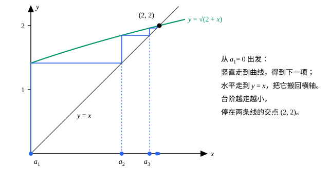

## 这一节要回答的问题

数列$\sqrt2,\ \sqrt{2+\sqrt2},\ \sqrt{2+\sqrt{2+\sqrt2}},\ \dots$一项比一项大，又好像总小于$2$。它:term[收敛]{id="math.analysis.convergent-sequence"}（convergent sequence）吗？收敛的话，:term[极限]{id="math.analysis.sequence-limit"}（limit of a sequence，lim）是多少？

它的通项不好写，没法先猜出极限、再用定义去验证。我们需要一条不知道极限是多少也能判断收敛的定理。

## 讲解

### 单调数列

::anchor{id="def-monotone"}
如果对每个$n$都有$a_n\le a_{n+1}$，就说$\{a_n\}$单调递增（increasing）；如果对每个$n$都有$a_n\ge a_{n+1}$，就说它单调递减（decreasing）。两者统称:term[单调数列]{id="math.analysis.monotone-sequence"}（monotone sequence）。不等号都是严格的时候，叫作严格递增（strictly increasing）、严格递减（strictly decreasing）。

数列有:term[上界]{id="math.analysis.upper-bound"}（upper bound），指它的项组成的集合$\{a_n:n\in\N^+\}$有上界，也就是有$M$使每一项都满足$a_n\le M$；有下界（lower bound）的意思类似。既有上界又有下界，就是:term[有界数列]{id="math.analysis.bounded-sequence"}（bounded sequence）：若$m\le a_n\le M$，则$|a_n|\le\max\{|m|,|M|\}$。

为什么单调值得单独拿出来：单调数列只能往一个方向走，不会来回跳。一个往上走的数列，要么越走越高、没有上界，要么被一个上界挡住、越挤越密。前一种情况它显然不:term[收敛]{id="math.analysis.convergent-sequence"}；后一种情况，直觉上它应该停在「被挡住的地方」。

### 单调有界原理

::anchor{id="thm-monotone-convergence"}
**定理**　单调递增且有:term[上界]{id="math.analysis.upper-bound"}的数列:term[收敛]{id="math.analysis.convergent-sequence"}，:term[极限]{id="math.analysis.sequence-limit"}是它的项的:term[上确界]{id="math.analysis.supremum"}（supremum，sup）；单调递减且有下界的数列收敛，极限是它的项的:term[下确界]{id="math.analysis.infimum"}（infimum，inf）。这叫作:term[单调有界原理]{id="math.analysis.monotone-convergence-theorem"}（monotone convergence theorem）。

**证明**：设$\{a_n\}$单调递增、有上界。项的集合$A=\{a_n:n\in\N^+\}$非空、有上界，由:term[确界原理]{id="math.analysis.supremum-principle"}（least-upper-bound property），$s=\sup A$存在。任给$\varepsilon>0$，$s-\varepsilon$不是$A$的上界，所以有某一项$a_N>s-\varepsilon$。当$n>N$时，由单调$a_n\ge a_N$，又$s$是上界，于是

$$
s-\varepsilon<a_N\le a_n\le s ,
$$

即$|a_n-s|<\varepsilon$，所以$a_n\to s$。单调递减、有下界时，$\{-a_n\}$单调递增、有上界，收敛于$\sup\{-a_n\}=-\inf A$，所以$a_n\to\inf A$。

为什么想到上确界：极限应该是数列「被挡住的地方」，也就是最紧的那个上界。上确界的定义只说「在$s-\varepsilon$和$s$之间总有某一项」，单调性再把「某一项」变成「从这一项起的每一项」，这正是收敛要的。

这条定理离不开:term[实数的完备性]{id="math.analysis.real-completeness"}（completeness of the real numbers）。$\sqrt2$的不足近似值$1,\ 1.4,\ 1.41,\ 1.414,\ \dots$单调递增、以$2$为上界，在$\R$里收敛于$\sqrt2$；可在只有有理数的世界里，它找不到极限：若它收敛于有理数$q$，在$\R$里也收敛于$q$，由极限的唯一性$q=\sqrt2$，矛盾。

两个条件也缺一不可：$\{n\}$单调而无界，$\{(-1)^n\}$:term[有界]{id="math.analysis.bounded-sequence"}而不单调，都是:term[发散数列]{id="math.analysis.divergent-sequence"}（divergent sequence）。单调可以放宽成从某一项起单调：这时只要相应地有上界（或下界），数列照样收敛，因为前面有限项不影响收敛；只是极限是从那一项起各项的上确界（或下确界），不一定是全部项的。例如$a_1=100$，$n\ge2$时$a_n=1-\frac1n$，它从第 2 项起单调递增、有上界，极限是$1$，可全部项的上确界是$100$。

### 递推数列的极限

::anchor{id="def-recursive-sequence"}
给定第一项$a_1$和函数$f$，由$a_{n+1}=f(a_n)$一项一项定义的数列叫作递推数列（recursive sequence）。这样的数列，通项常常不好写（例 1 就是），也就不好先求通项、再求:term[极限]{id="math.analysis.sequence-limit"}，要直接从递推式下手。

求递推数列的极限，一般分四步：

1. 用数学归纳法（mathematical induction）证明它单调、:term[有界]{id="math.analysis.bounded-sequence"}：每一项由前一项定义，有关所有项的结论自然要靠归纳。
2. 由:term[单调有界原理]{id="math.analysis.monotone-convergence-theorem"}，极限$L$存在。
3. 在递推式两边取极限。$\{a_{n+1}\}$就是$\{a_n\}$去掉第一项，所以也趋于$L$；再用:term[极限的四则运算法则]{id="math.analysis.algebraic-limit-theorem"}（algebraic limit theorem），得到$L$满足的方程。
4. 解方程，再用数列的界和:term[保不等式性]{id="math.analysis.order-limit-theorem"}（order limit theorem）挑出正确的根。

第 2 步不能省。$a_1=1$、$a_{n+1}=2a_n$时，如果直接设极限为$L$，得$L=2L$，$L=0$；可$a_n=2^{n-1}$越来越大，根本不:term[收敛]{id="math.analysis.convergent-sequence"}。方程只能告诉你「如果收敛，极限只能是哪几个数」。

## 几何图像

这是递推$a_{n+1}=\sqrt{2+a_n}$的蛛网图（cobweb plot），从$a_1=0$出发，第二项就是例 1 的$\sqrt2$。从横轴上的$a_n$竖直走到曲线，高度就是$a_{n+1}$；再水平走到直线$y=x$，把这个高度搬回横轴。曲线在交点左边一直高于直线，所以每一步都往右走，又越不过交点：数列单调递增、有:term[上界]{id="math.analysis.upper-bound"}，停在交点$x=2$，也就是方程$L=\sqrt{2+L}$的根。

:::anim{component="function-plot"}
range: { x: [0, 41], y: [1.9, 4.1] }
functions:
  - expr: "e"
    label: |
      $y=e$
sequences:
  - expr: "(1 + 1/n)^n"
    n: [1, 40]
    label: |
      $\left(1+\frac{1}{n}\right)^n$
  - expr: "(1 + 1/n)^(n + 1)"
    n: [1, 40]
    label: |
      $\left(1+\frac{1}{n}\right)^{n+1}$
:::

微积分里的$e=\lim_{n\to\infty}\bigl(1+\frac1n\bigr)^n$，也要靠:term[单调有界原理]{id="math.analysis.monotone-convergence-theorem"}才知道这个:term[极限]{id="math.analysis.sequence-limit"}存在。图里下面一串点逐项增大、上面一串点逐项减小，从两边夹向$e\approx2.718$；第 5 题会证明下面那一串单调递增、有上界。

## 例题

### 例 1　$a_1=\sqrt2$，$a_{n+1}=\sqrt{2+a_n}$

证明$\{a_n\}$:term[收敛]{id="math.analysis.convergent-sequence"}，并求它的:term[极限]{id="math.analysis.sequence-limit"}。

**为什么想到这么做**：通项不好写，只能用:term[单调有界原理]{id="math.analysis.monotone-convergence-theorem"}。前几项$1.414,\ 1.848,\ 1.962,\dots$在增大，看起来不超过$2$；$2$也正是方程$L=\sqrt{2+L}$的正根。所以先猜「递增、:term[上界]{id="math.analysis.upper-bound"}是$2$」，再用归纳法证明。

**推导**：先用归纳法证明$0<a_n<2$。$a_1=\sqrt2$满足；若$0<a_n<2$，则$0<a_{n+1}=\sqrt{2+a_n}<\sqrt{4}=2$。

再证单调递增：

$$
a_{n+1}^2-a_n^2=2+a_n-a_n^2=(2-a_n)(1+a_n)>0 ,
$$

而$a_{n+1}$、$a_n$都是正数，所以$a_{n+1}>a_n$。由单调有界原理，$a_n\to L$。

对$a_{n+1}^2=2+a_n$两边取极限：左边由积的法则趋于$L^2$，右边趋于$2+L$，所以$L^2=L+2$，$L=2$或$L=-1$。每一项都满足$a_n\ge\sqrt2$，由:term[保不等式性]{id="math.analysis.order-limit-theorem"}得$L\ge\sqrt2$，所以$L=2$。

### 例 2　巴比伦算法：$a_1=2$，$a_{n+1}=\frac12\Bigl(a_n+\frac{2}{a_n}\Bigr)$

证明$\{a_n\}$:term[收敛]{id="math.analysis.convergent-sequence"}，并且:term[极限]{id="math.analysis.sequence-limit"}$L$满足$L>0$、$L^2=2$。

**为什么想到这么做**：$a_n$和$\frac{2}{a_n}$的乘积是$2$，一个在$\sqrt2$上方，另一个就在下方，取平均就离$\sqrt2$更近。巴比伦算法（Babylonian method）的每一项都是有理数（$2,\ \frac32,\ \frac{17}{12},\ \frac{577}{408},\dots$），在$\Q$里它找不到极限；在$\R$里，:term[单调有界原理]{id="math.analysis.monotone-convergence-theorem"}保证它有极限，而且不用事先知道$\sqrt2$存在：下面的证明只比较$a_n^2$和$2$。

**推导**：由归纳法，每一项都是正数。再看$a_n^2$和$2$的关系：

$$
a_{n+1}^2-2=\frac14\Bigl(a_n+\frac{2}{a_n}\Bigr)^2-2=\frac14\Bigl(a_n-\frac{2}{a_n}\Bigr)^2\ge0 ,
$$

又$a_1^2=4\ge2$，所以每一项都满足$a_n^2\ge2$。于是

$$
a_{n+1}-a_n=\frac{2-a_n^2}{2a_n}\le0 ,
$$

数列单调递减，又以$0$为下界，由单调有界原理，$a_n\to L$，并且$L\ge0$。由$a_n^2\ge2$和:term[保不等式性]{id="math.analysis.order-limit-theorem"}，$L^2\ge2$，所以$L>0$。把递推式写成$2a_na_{n+1}=a_n^2+2$，两边取极限得$2L^2=L^2+2$，即$L^2=2$。

这就从另一条路证明了「存在正实数$L$使$L^2=2$」，和[实数的完备性](lesson:math.analysis.completeness)那一节的第 6 题相互印证。这个数列收敛得极快：$\frac{577}{408}$和$\sqrt2$只差约$2\times10^{-6}$。

## 常见误区

- 「设:term[极限]{id="math.analysis.sequence-limit"}为$L$，代进递推式解出来就是答案。」先要证明极限存在。$a_{n+1}=2a_n$解出$L=0$，数列却:term[发散]{id="math.analysis.divergent-sequence"}。
- 「:term[单调数列]{id="math.analysis.monotone-sequence"}一定:term[收敛]{id="math.analysis.convergent-sequence"}。」还要:term[有界]{id="math.analysis.bounded-sequence"}：$\{n\}$单调递增，却是:term[发散数列]{id="math.analysis.divergent-sequence"}。
- 「有:term[上界]{id="math.analysis.upper-bound"}的递增数列，极限就是那个上界$M$。」极限是最小的上界，也就是:term[上确界]{id="math.analysis.supremum"}，不是随便哪个上界。例 1 里$3$也是上界，极限却是$2$。
- 「解出的方程有两个根，随便挑一个。」要用数列的界或单调的方向排除不可能的根：例 1 的每一项都不小于$\sqrt2$，所以$L=-1$不可能。
