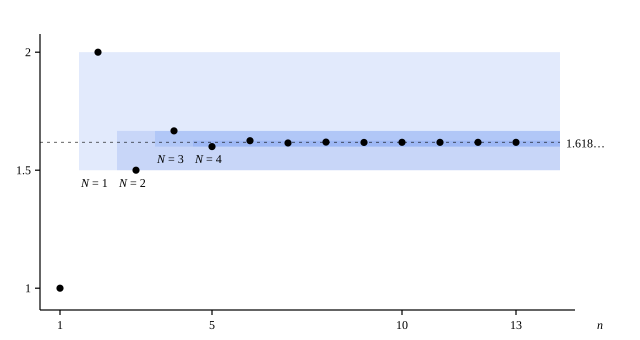

## 这一节要回答的问题

数列$a_1=1$，$a_{n+1}=1+\frac{1}{a_n}$的前几项是$1,\ 2,\ \frac32,\ \frac53,\ \frac85,\ \frac{13}{8},\dots$，忽大忽小，不是:term[单调数列]{id="math.analysis.monotone-sequence"}（monotone sequence），:term[单调有界原理]{id="math.analysis.monotone-convergence-theorem"}（monotone convergence theorem）没法直接用。要用定义证明它:term[收敛]{id="math.analysis.convergent-sequence"}（convergent sequence），又得先猜出:term[极限]{id="math.analysis.sequence-limit"}（limit of a sequence，lim）是多少。

有没有一种判断收敛的办法，只看数列自己的项，既不要求单调，也不用事先知道极限？

## 讲解

### 项和项挤在一起

先看:term[收敛数列]{id="math.analysis.convergent-sequence"}有什么不用说出:term[极限]{id="math.analysis.sequence-limit"}的特征。若$a_n\to L$，任给$\varepsilon>0$，从某一项起所有的项都落在$L$的$\frac\varepsilon2$:term[邻域]{id="math.analysis.neighborhood"}（neighborhood）里，于是这些项两两之间的距离都小于$\varepsilon$：

$$
|a_m-a_n|\le|a_m-L|+|L-a_n|<\frac\varepsilon2+\frac\varepsilon2=\varepsilon .
$$

这个结论里已经看不到$L$了，它只说靠后的项彼此挤得很近。反过来问：项和项挤得越来越近，数列是不是一定收敛？

### 柯西列

::anchor{id="def-cauchy-sequence"}
如果任给$\varepsilon>0$，都存在正整数$N$，使得当$m,n>N$时都有$|a_m-a_n|<\varepsilon$，就说$\{a_n\}$是:term[柯西列]{id="math.analysis.cauchy-sequence"}（Cauchy sequence）。

用量词写出来是

$$
\forall\varepsilon>0,\ \exists N\in\N^+,\ \forall m,n>N,\quad |a_m-a_n|<\varepsilon .
$$

为什么这样定义：它和:term[极限]{id="math.analysis.sequence-limit"}的定义只差一处，把「项到$L$的距离」换成了「项到项的距离」。定义里没有$L$，所以不知道极限是多少也能检验。前面刚证过：:term[收敛数列]{id="math.analysis.convergent-sequence"}都是柯西列。

要求的是「任意两项」，不只是「相邻两项」。$a_n=\sqrt n$的相邻两项之差$\sqrt{n+1}-\sqrt n=\frac{1}{\sqrt{n+1}+\sqrt n}$趋于$0$，可$a_{4n}-a_n=\sqrt n$越来越大，所以它不是柯西列，也不收敛：步子越迈越小，走的总路程却没有限度。另一个边界情况是$\{(-1)^n\}$，相邻两项总相差$2$，也不是柯西列。

把定义里的量词逐个否定，就得到「$\{a_n\}$不是柯西列」：有$\varepsilon_0>0$，对每个正整数$N$，都有$m,n>N$使$|a_m-a_n|\ge\varepsilon_0$。也就是说，无论从多靠后的地方看起，后面总有两项相距至少$\varepsilon_0$。

### 柯西列有界

**定理 1**　:term[柯西列]{id="math.analysis.cauchy-sequence"}一定:term[有界]{id="math.analysis.bounded-sequence"}（bounded sequence）。

**证明**：取$\varepsilon=1$，有正整数$N$，使$m,n>N$时$|a_m-a_n|<1$。固定$m=N+1$，则$n>N$时$|a_n|\le|a_n-a_{N+1}|+|a_{N+1}|<1+|a_{N+1}|$。令$M=\max\bigl\{|a_1|,\dots,|a_N|,\ 1+|a_{N+1}|\bigr\}$，则每一项都满足$|a_n|\le M$。

这和「:term[收敛数列]{id="math.analysis.convergent-sequence"}有界」的证明是同一个思路：后面无穷多项用一项管住，前面有限项单独处理。差别是这里没有:term[极限]{id="math.analysis.sequence-limit"}，就拿第$N+1$项当锚。

### 柯西收敛准则

::anchor{id="thm-cauchy-criterion"}
**定理 2**　数列:term[收敛]{id="math.analysis.convergent-sequence"}，当且仅当它是:term[柯西列]{id="math.analysis.cauchy-sequence"}。这叫作:term[柯西收敛准则]{id="math.analysis.cauchy-criterion"}（Cauchy criterion）。

**证明**：收敛数列是柯西列，前面已经证过，下面证反过来的方向。设$\{a_n\}$是柯西列，由定理 1，它:term[有界]{id="math.analysis.bounded-sequence"}；由:term[致密性定理]{id="math.analysis.bolzano-weierstrass"}（Bolzano-Weierstrass theorem），它有收敛的:term[子列]{id="math.analysis.subsequence"}（subsequence）$a_{n_k}\to L$。剩下的事是证明整个数列都趋于$L$。

任给$\varepsilon>0$。由柯西列的定义，有$N$使$m,n>N$时$|a_m-a_n|<\frac\varepsilon2$；由$a_{n_k}\to L$，有$K$使$k>K$时$|a_{n_k}-L|<\frac\varepsilon2$。取一个$k>\max\{K,N\}$，则$n_k\ge k>N$。于是对每个$n>N$，

$$
|a_n-L|\le|a_n-a_{n_k}|+|a_{n_k}-L|<\frac\varepsilon2+\frac\varepsilon2=\varepsilon ,
$$

所以$a_n\to L$。

为什么要绕道子列：柯西列的条件只说项和项越来越近，没有指出它们往哪里挤。:term[致密性定理]{id="math.analysis.bolzano-weierstrass"}先找出一个候选的$L$，柯西列的条件再把其余的项全拉到$L$身边。这个证明顺带说明了一件以后常用的事：柯西列只要有一个子列收敛，整个数列就收敛到同一个:term[极限]{id="math.analysis.sequence-limit"}。

这条准则离不开:term[实数的完备性]{id="math.analysis.real-completeness"}（completeness of the real numbers），因为致密性定理离不开它。$\sqrt2$的不足近似值$1,\ 1.4,\ 1.41,\ 1.414,\dots$是柯西列：从第$n$项起，所有的项都在区间$\bigl[a_n,\ a_n+10^{-(n-1)}\bigr)$里。可在$\Q$里它没有极限（见[单调有界数列](lesson:math.analysis.bounded-monotone)），所以「柯西列都收敛」在$\Q$里不成立，在$\R$里成立。它是完备性的又一种说法：把它和:term[阿基米德性质]{id="math.analysis.archimedean-property"}（Archimedean property）一起当作出发点，反过来也能推出:term[单调有界原理]{id="math.analysis.monotone-convergence-theorem"}（第 6 题）。

## 几何图像

图里是这一节开头的数列$a_{n+1}=1+\frac1{a_n}$。每条淡色横带从第$N$项和第$N+1$项之间开始往右延伸，宽度正好装下第$N$项以后的所有项。$N$越大，带子越窄，而且一条套在另一条里面：:term[柯西列]{id="math.analysis.cauchy-sequence"}说的就是这个宽度趋于$0$。带子画在哪里由项自己决定，用不着事先知道虚线所在的:term[极限]{id="math.analysis.sequence-limit"}。

:::anim{component="function-plot"}
range: { x: [0, 61], y: [-0.2, 1.7] }
functions:
  - expr: "1 + (-1)^(N + 1) / (N + 1)"
    label: |
      $y=a_{N+1}$
  - expr: "1 + (-1)^(N + 2) / (N + 2)"
    label: |
      $y=a_{N+2}$
sequences:
  - expr: "1 + (-1)^n / n"
    n: [1, 60]
    label: |
      $a_n=1+\frac{(-1)^n}{n}$
points:
  - { x: "N + 1", y: "1 + (-1)^(N + 1) / (N + 1)" }
  - { x: "N + 2", y: "1 + (-1)^(N + 2) / (N + 2)" }
sliders:
  - name: N
    min: 1
    max: 20
    step: 1
    default: 3
    label: |
      $N$
:::

这个数列在[数列的极限](lesson:math.analysis.sequences-limits)里出现过，那里画的是以极限$1$为中心的横带。这里换一种看法：两条横线分别过单独标出的第$N+1$项和第$N+2$项，从第$N+1$项起，所有的项都夹在这两条线之间，任意两项的距离不超过两线的间距$\frac{1}{N+1}+\frac{1}{N+2}$。两条线的位置只由项决定；拖动滑块把$N$调大，间距趋于$0$。

## 例题

### 例 1　不知道极限也能证明收敛

证明数列$a_1=1$，$a_{n+1}=1+\frac{1}{a_n}$:term[收敛]{id="math.analysis.convergent-sequence"}，并求它的:term[极限]{id="math.analysis.sequence-limit"}。

**为什么想到这么做**：这个数列不单调，事先也不知道极限，正好用:term[柯西收敛准则]{id="math.analysis.cauchy-criterion"}。要估计任意两项的距离，先估计相邻两项：由递推式，$a_{n+1}-a_n$可以用$a_n-a_{n-1}$表示出来。如果每一步至少缩小一半，相邻两项之差就像$\frac{1}{2^n}$一样变小，任意两项的距离就能用等比数列的和管住。

**推导**：由归纳法，每一项都满足$a_n\ge1$：$a_1=1$；若$a_n\ge1$，则$a_{n+1}=1+\frac1{a_n}>1$。于是$n\ge2$时$a_na_{n-1}=a_{n-1}+1\ge2$，并且

$$
|a_{n+1}-a_n|=\left|\frac{1}{a_n}-\frac{1}{a_{n-1}}\right|=\frac{|a_n-a_{n-1}|}{a_na_{n-1}}\le\frac12\,|a_n-a_{n-1}| .
$$

从$|a_2-a_1|=1$出发反复用这个不等式，得$|a_{k+1}-a_k|\le\frac{1}{2^{k-1}}$。于是对$m>n$，

$$
|a_m-a_n|\le\sum_{k=n}^{m-1}|a_{k+1}-a_k|\le\sum_{k=n}^{m-1}\frac{1}{2^{k-1}}<\frac{1}{2^{n-2}} .
$$

由[数列的极限](lesson:math.analysis.sequences-limits)的例 2，$\frac{1}{2^{n-2}}=\frac{4}{2^n}\to0$。任给$\varepsilon>0$，取$N$使$\frac{1}{2^{N-2}}<\varepsilon$，则$m>n>N$时$|a_m-a_n|<\frac{1}{2^{n-2}}<\frac{1}{2^{N-2}}<\varepsilon$。所以$\{a_n\}$是:term[柯西列]{id="math.analysis.cauchy-sequence"}，由柯西收敛准则，它收敛，记极限为$L$。

由:term[保不等式性]{id="math.analysis.order-limit-theorem"}（order limit theorem），$L\ge1$。在递推式两边取极限，由:term[极限的四则运算法则]{id="math.analysis.algebraic-limit-theorem"}（algebraic limit theorem）得$L=1+\frac1L$，即$L^2-L-1=0$。它的两个根里只有$\frac{1+\sqrt5}{2}$不小于$1$，所以$\lim_{n\to\infty}a_n=\frac{1+\sqrt5}{2}\approx1.618$。

### 例 2　相邻两项越来越近，却不收敛

设$H_n=1+\frac12+\frac13+\cdots+\frac1n$。证明$\{H_n\}$:term[发散]{id="math.analysis.divergent-sequence"}（divergent sequence）。

**为什么想到这么做**：相邻两项之差$\frac{1}{n+1}$趋于$0$，$H_n$又长得极慢（$H_{1000000}$还不到$15$），光看数值很难判断。用:term[柯西收敛准则]{id="math.analysis.cauchy-criterion"}的否定形式，只要找到无论多靠后都相距不小的两项。从$H_n$到$H_{2n}$加了$n$项，每项至少$\frac{1}{2n}$，合起来至少$\frac12$。

**推导**：对每个正整数$n$，

$$
H_{2n}-H_n=\frac{1}{n+1}+\frac{1}{n+2}+\cdots+\frac{1}{2n}\ge n\cdot\frac{1}{2n}=\frac12 .
$$

取$\varepsilon_0=\frac12$。对每个正整数$N$，取$n=N+1$、$m=2N+2$，则$m,n>N$而$|H_m-H_n|\ge\frac12$，所以$\{H_n\}$不是:term[柯西列]{id="math.analysis.cauchy-sequence"}。由柯西收敛准则，它发散。

## 常见误区

- 「相邻两项之差趋于$0$，数列就是:term[柯西列]{id="math.analysis.cauchy-sequence"}。」不对：$\sqrt n$和例 2 的$H_n$都是反例。柯西列要求从某一项起任意两项都近，不管它们隔得多远。
- 「柯西列定义里的$N$可以随$m$、$n$变。」不对，$N$只依赖$\varepsilon$：先给定$\varepsilon$，找出$N$，然后对所有$m,n>N$都要成立。
- 「柯西列在任何数系里都:term[收敛]{id="math.analysis.convergent-sequence"}。」在$\Q$里不对：$\sqrt2$的不足近似值是柯西列，在$\Q$里却没有:term[极限]{id="math.analysis.sequence-limit"}。:term[柯西收敛准则]{id="math.analysis.cauchy-criterion"}靠的是:term[实数的完备性]{id="math.analysis.real-completeness"}。
- 「要用柯西收敛准则，得先知道极限。」恰恰相反，它的好处正是不用知道极限；知道了极限，直接用定义往往更简单。
