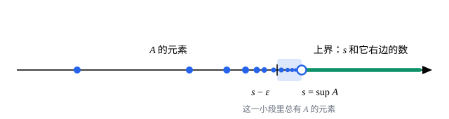

## 这一节要回答的问题

有理数在数轴上密密麻麻：任意两个有理数之间，还夹着无穷多个有理数。可是$\sqrt{2}$不是有理数，它在数轴上的位置却实实在在。只用有理数的数轴，到底哪里有「洞」？实数又凭什么说自己「没有洞」，这句话能拿来证明什么？

## 讲解

### 有理数轴上的洞

先看一个只用有理数就能写出的集合：$S=\{x\in\Q : x^2<2\}$。$S$里的数都小于$2$，所以$2$、$1.5$、$1.42$都「压得住」它，这样的数叫作$S$的:term[上界]{id="math.analysis.upper-bound"}（upper bound）。上界可以一个比一个小，那么有没有最小的有理上界？

答案是没有。对正有理数$b$，令$c=\dfrac{2b+2}{b+2}$，它还是有理数，并且

$$
\begin{aligned}
c-b &= \frac{2-b^2}{b+2},\\
c^2-2 &= \frac{2\,(b^2-2)}{(b+2)^2}.
\end{aligned}
$$

若$b^2>2$，则$c<b$且$c^2>2$：$c$是一个更小的上界。若$b^2<2$，则$c>b$且$c^2<2$：$S$里有比$b$更大的数，$b$不是上界。有理数又不可能满足$b^2=2$，所以$S$的每个有理上界都能再往下压。「最小的有理上界」本该是$\sqrt{2}$，可它不在$\Q$里，这就是有理数轴上的一个洞。

### 上界与上确界

::anchor{id="def-upper-bound"}
设$A\subseteq\R$。如果实数$M$满足：对所有$a\in A$都有$a\le M$，就说$M$是$A$的:term[上界]{id="math.analysis.upper-bound"}，也说$A$有上界。类似地，对所有$a\in A$都有$a\ge m$的数$m$，叫作$A$的下界（lower bound）。

::anchor{id="def-supremum"}
如果$s$是$A$的上界，并且比$s$小的数都不是$A$的上界，就说$s$是$A$的:term[上确界]{id="math.analysis.supremum"}（supremum，sup），记作$s=\sup A$。也就是说，$s$是所有上界里最小的那一个。

为什么这样定义：上界有无穷多个，真正说明「$A$往右延伸到哪里」的，只有最紧的那一个，也就是上确界。上确界的第二个条件常改写成便于证明的形式：任给$\varepsilon>0$，都有$a\in A$使$a>s-\varepsilon$。它说的是$s$左边无论多近的地方都有$A$的元素，$s$不能再往左挪。

::anchor{id="def-maximum"}
属于$A$本身的上界，叫作$A$的:term[最大元]{id="math.analysis.maximum"}（maximum，max），记作$\max A$。有最大元时，它一定就是上确界；反过来却不成立。比如$[0,1)$的上确界是$1$，可$1\notin[0,1)$，所以$[0,1)$有上确界、没有最大元。另外，空集没有上确界：每个实数都是空集的上界，上界里没有最小的。

::anchor{id="def-infimum"}
把不等号反过来，所有下界里最大的那一个叫作$A$的:term[下确界]{id="math.analysis.infimum"}（infimum，inf），记作$\inf A$。记$-A=\{-a : a\in A\}$，则$m$是$A$的下界当且仅当$-m$是$-A$的上界，所以$\inf A=-\sup(-A)$。下确界的结论都可以这样从上确界那边搬过来。

### 确界原理

有了:term[上确界]{id="math.analysis.supremum"}，就能把「没有洞」说精确。

::anchor{id="def-supremum-principle"}
:term[确界原理]{id="math.analysis.supremum-principle"}（least-upper-bound property）：$\R$的每个有:term[上界]{id="math.analysis.upper-bound"}的非空子集，都在$\R$中有上确界。这条性质叫作:term[实数的完备性]{id="math.analysis.real-completeness"}（completeness of the real numbers）。

为什么把它当作实数的基本性质：前面的$S$说明，$\Q$恰恰缺这一条，$S$非空、有上界，在$\Q$里却没有上确界。确界原理要求这种事在$\R$里不再发生，等于把所有的洞都补上：$S$在$\R$里的上确界就是$\sqrt{2}$。两个条件缺一不可：空集没有上确界；$\N^+$非空但没有上界，也没有上确界（见例 1）。

证明思路：确界原理在$\Q$里不成立，所以它不可能只从有理数的四则运算和大小关系推出来。一种做法是把它当作实数的公理；另一种是先用有理数「造出」实数，例如把每个实数看成它左边所有有理数组成的集合（:term[戴德金分割]{id="math.analysis.dedekind-cut"}，Dedekind cut），再证明一族这样的集合的上确界就是它们的并集。这一节采用第一种看法，构造方法见[用戴德金分割构造实数](lesson:math.analysis.real-construction)。

## 几何图像

图里实心的点是$A$的元素，它们越来越挤向$s=\sup A$，而$s$本身可以不属于$A$（画成空心圆）。$s$和它右边的数都是:term[上界]{id="math.analysis.upper-bound"}；在$s$左边任取一点$s-\varepsilon$，它和$s$之间总有$A$的元素，所以$s-\varepsilon$不是上界。

:::anim{component="function-plot"}
range: { x: [0, 41], y: [0, 1.1] }
functions:
  - expr: "1 - eps"
    label: |
      $y=1-\varepsilon$
sequences:
  - expr: "1 - 1/n"
    n: [1, 40]
    label: |
      $a_n=1-\frac{1}{n}$
sliders:
  - name: eps
    min: 0.05
    max: 0.5
    step: 0.01
    default: 0.2
    label: |
      $\varepsilon$
:::

拖动滑块改变$\varepsilon$，看$1-\frac{1}{n}$从第几项起超过$1-\varepsilon$：无论$\varepsilon$多小，总有这样的项，这正是例 2 要证的。

## 例题

### 例 1　阿基米德性质

::anchor{id="def-archimedean"}
证明:term[阿基米德性质]{id="math.analysis.archimedean-property"}（Archimedean property）：对任意实数$x$，都存在正整数$n$使$n>x$。换句话说，正整数集$\N^+$没有:term[上界]{id="math.analysis.upper-bound"}。

**为什么想到这么做**：要证「没有上界」，直接造出$n$不容易，反证更顺手。假设$\N^+$有上界，:term[确界原理]{id="math.analysis.supremum-principle"}就送给我们一个:term[上确界]{id="math.analysis.supremum"}$s$。再用上确界的第二个条件：$s-1$不是上界，于是能找到一个比$s-1$大的正整数，它加上$1$就越过了$s$。

**推导**：假设结论不成立，即有实数$x$，使所有正整数$n$都满足$n\le x$。这时$\N^+$非空、有上界，由确界原理，它有上确界$s$。因为$s-1<s$，$s-1$不是$\N^+$的上界，所以有正整数$m>s-1$。于是$m+1>s$，而$m+1$也是正整数，这和$s$是上界矛盾。

[数列的极限](lesson:math.analysis.sequences-limits)里找$N$时一直在用这条性质，到这里它才有了证明。

### 例 2　$\sup\{1-\frac{1}{n} : n\in\N^+\}=1$

设$A=\{1-\frac{1}{n} : n\in\N^+\}$，证明$\sup A=1$。

**为什么想到这么做**：证明一个数是:term[上确界]{id="math.analysis.supremum"}，就是逐条验证定义：先说明它是:term[上界]{id="math.analysis.upper-bound"}，再说明比它小的数都不是上界。第二条用「$\varepsilon$形式」最方便，要找的那一项可以由例 1 给出。

**推导**：对每个$n\in\N^+$都有$1-\frac{1}{n}<1$，所以$1$是$A$的上界。任给$\varepsilon>0$，由例 1 取正整数$n>\frac{1}{\varepsilon}$，就有

$$
1-\frac{1}{n} > 1-\varepsilon ,
$$

所以$1-\varepsilon$不是上界，于是$\sup A=1$。注意$1\notin A$，所以$A$没有:term[最大元]{id="math.analysis.maximum"}；$1$也是数列$1-\frac{1}{n}$的:term[极限]{id="math.analysis.sequence-limit"}（limit of a sequence，lim），:term[单调数列]{id="math.analysis.monotone-sequence"}（monotone sequence）的极限和确界的关系见[单调有界数列](lesson:math.analysis.bounded-monotone)。

## 常见误区

- 「:term[上确界]{id="math.analysis.supremum"}就是:term[最大元]{id="math.analysis.maximum"}。」不对：上确界可以不属于集合，例如$\sup\,[0,1)=1$；只有上确界属于集合时，它才是最大元。
- 「只要$A$里有元素任意接近$s$，$s$就是上确界。」还差一条：$s$先得是:term[上界]{id="math.analysis.upper-bound"}。例如$[0,2]$里有元素任意接近$1$，但$1$不是上界，$\sup\,[0,2]=2$。
- 「有上界的集合都有上确界。」这要看数系：在$\Q$里不成立（例子是前面的$S$），在$\R$里才成立，而且集合必须非空。
