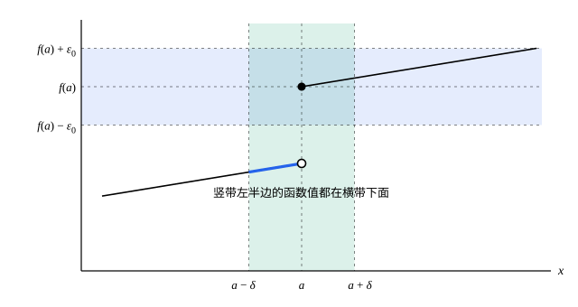

## 这一节要回答的问题

微积分里说$f$在$a$处:term[连续]{id="math.analysis.continuous-function"}（continuous），指的是$\lim_{x\to a}f(x)=f(a)$，图像在那里不断开。可「不断开」能当定义吗？$x\sin\frac1x$（补充定义它在$0$处的值为$0$）在$0$附近上下摆动无穷多次，图像根本画不完，它在$0$处连续吗？

怎样用$\varepsilon$-$\delta$把连续说清楚，又怎样用数列来检验？

## 讲解

### 连续的定义

先把微积分里的说法翻译过来。$\lim_{x\to a}f(x)=f(a)$，按[函数极限的严格定义](lesson:math.analysis.function-limits)，就是：任给$\varepsilon>0$，有$\delta>0$，使$0<|x-a|<\delta$时$|f(x)-f(a)|<\varepsilon$。$x=a$时$|f(a)-f(a)|=0<\varepsilon$自动成立，所以条件$0<|x-a|$可以去掉。

::anchor{id="def-continuous"}
设$a$属于函数$f$的定义域$D$。如果任给$\varepsilon>0$，都存在$\delta>0$，使得对所有满足$|x-a|<\delta$的$x\in D$都有$|f(x)-f(a)|<\varepsilon$，就说$f$在$a$处:term[连续]{id="math.analysis.continuous-function"}。若$f$在区间$I$的每一点都连续（只考虑$I$里的$x$），就说$f$在$I$上连续，也说$f$是$I$上的:term[连续函数]{id="math.analysis.continuous-function"}（continuous function）。

为什么这样定义：和:term[函数的极限]{id="math.analysis.function-limit"}（limit of a function）相比，$L$换成了$f(a)$，所以它同时要求三件事：$f$在$a$处有定义，$x\to a$时:term[极限]{id="math.analysis.function-limit"}存在，极限等于$f(a)$。只考虑定义域里的$x$，是为了照顾区间的端点：$\sqrt x$定义在$[0,+\infty)$上，在$0$处只能看右边的$x$，这时连续就是单侧的。

反例：$\operatorname{sgn}x$在$0$处不连续。取$\varepsilon=\frac12$，无论$\delta$多小，$x=\frac\delta2$都满足$|x-0|<\delta$，而$|\operatorname{sgn}x-\operatorname{sgn}0|=1$。不连续的点，就是微积分里说的间断点（point of discontinuity）。

### 用定义证明连续

证明$f(x)=x^2$在每一点$a$处:term[连续]{id="math.analysis.continuous-function"}。$|x^2-a^2|=|x-a|\,|x+a|$，和证明$x^2\to4$时一样，先把$x$限制在$a$附近：若$|x-a|<1$，则$|x+a|\le|x-a|+2|a|<1+2|a|$。任给$\varepsilon>0$，取$\delta=\min\bigl\{1,\frac{\varepsilon}{1+2|a|}\bigr\}$，则$|x-a|<\delta$时$|x^2-a^2|<(1+2|a|)\,\delta\le\varepsilon$。

注意这里的$\delta$和$a$有关：$|a|$越大，曲线越陡，$\delta$就得取得越小。对一次函数$f(x)=kx+b$（$k\ne0$），$|f(x)-f(a)|=|k|\,|x-a|$，取$\delta=\frac{\varepsilon}{|k|}$，一个$\delta$对所有的$a$都管用。$\delta$能不能不依赖$a$，是[一致连续](lesson:math.analysis.uniform-continuity)那一节的话题。

### 用数列刻画连续

::anchor{id="thm-sequential-continuity"}
**定理 1**　$f$在$a$处:term[连续]{id="math.analysis.continuous-function"}，当且仅当：对定义域里每个趋于$a$的数列$\{x_n\}$，都有$f(x_n)\to f(a)$。

**证明**：设$f$在$a$处连续，$x_n\to a$。任给$\varepsilon>0$，有$\delta$使$|x-a|<\delta$时$|f(x)-f(a)|<\varepsilon$；又有$N$使$n>N$时$|x_n-a|<\delta$，于是$|f(x_n)-f(a)|<\varepsilon$。反过来，若$f$在$a$处不连续，则有$\varepsilon_0>0$，对每个$\delta=\frac1n$都有定义域里的$x_n$满足$|x_n-a|<\frac1n$，而$|f(x_n)-f(a)|\ge\varepsilon_0$；这个$\{x_n\}$趋于$a$，$f(x_n)$却不趋于$f(a)$。

这和:term[海涅定理]{id="math.analysis.heine-theorem"}（Heine's theorem）几乎一样，只是$x_n$可以等于$a$，函数的:term[极限]{id="math.analysis.function-limit"}换成了$f(a)$。它可以写成

$$
f\Bigl(\lim_{n\to\infty}x_n\Bigr)=\lim_{n\to\infty}f(x_n) ,
$$

也就是说，连续函数和:term[极限]{id="math.analysis.sequence-limit"}（limit of a sequence，lim）可以交换次序。[收敛数列的基本性质](lesson:math.analysis.limit-properties)的例 1 证过「$a_n\to L$时$\sqrt{a_n}\to\sqrt L$」，现在看来，它说的正是$\sqrt x$连续（例 1）。

定理 1 也是证明不连续的利器：找一个趋于$a$的数列，让$f(x_n)$不趋于$f(a)$。比如$x_n=\frac1n\to0$，而$\operatorname{sgn}x_n=1\to1\ne\operatorname{sgn}0$。

### 连续函数的运算

**定理 2**　设$f$、$g$在$a$处:term[连续]{id="math.analysis.continuous-function"}，则$f\pm g$、$fg$在$a$处连续；若还有$g(a)\ne0$，则$\frac fg$在$a$处连续。若$g$在$a$处连续，$f$在$g(a)$处连续，则复合函数$f(g(x))$在$a$处连续。

**证明**：都用定理 1。设$x_n\to a$（在相应函数的定义域里），则$f(x_n)\to f(a)$，$g(x_n)\to g(a)$，由:term[极限的四则运算法则]{id="math.analysis.algebraic-limit-theorem"}（algebraic limit theorem），$f(x_n)\pm g(x_n)\to f(a)\pm g(a)$，积、商同理。复合函数：$g(x_n)\to g(a)$，再由$f$在$g(a)$处连续，$f(g(x_n))\to f(g(a))$。

由定理 2，从常数和$x$出发，多项式处处连续，有理函数（rational function）在分母不为零的点都连续。$\sin x$、$e^x$这些函数的连续性，要等[用幂级数定义指数函数与对数](lesson:math.analysis.exp-log-construction)等几节给出它们的严格定义以后才能证明；在那之前，用到它们时承认微积分里的结论。

## 几何图像

这是「不:term[连续]{id="math.analysis.continuous-function"}」的图：$f(a)$画成实心点，左边的曲线在$a$处断开、停在空心圆。取$\varepsilon_0$为跳跃高度的一半。竖带是$a$的$\delta$:term[邻域]{id="math.analysis.neighborhood"}（neighborhood），无论它多窄，左半边的函数值都落在横带下面，所以找不到合格的$\delta$。

:::anim{component="function-plot"}
range: { x: [-0.5, 0.5], y: [-0.5, 0.5] }
functions:
  - expr: "x * sin(1 / x)"
    label: |
      $y=x\sin\frac1x$
  - expr: "abs(x)"
    label: |
      $y=|x|$
  - expr: "-abs(x)"
    label: |
      $y=-|x|$
  - expr: "eps"
    label: |
      $y=\varepsilon$
  - expr: "-eps"
    label: |
      $y=-\varepsilon$
points:
  - { x: "-eps", y: "eps" }
  - { x: "eps", y: "eps" }
sliders:
  - name: eps
    min: 0.02
    max: 0.4
    step: 0.01
    default: 0.2
    label: |
      $\varepsilon$
:::

这是$x\sin\frac1x$（补充$f(0)=0$）在$0$处的情形。曲线夹在$y=\pm|x|$之间，所以$|f(x)-f(0)|\le|x|$：取$\delta=\varepsilon$，两个标出的点之间（$|x|<\varepsilon$）的曲线全落在两条横线之间。拖动滑块把$\varepsilon$调小，$\delta$跟着变小，却总存在，所以它在$0$处:term[连续]{id="math.analysis.continuous-function"}，尽管图像在那里摆动无穷多次。

## 例题

### 例 1　$\sqrt x$在$[0,+\infty)$上连续

**为什么想到这么做**：要把$|\sqrt x-\sqrt a|$和$|x-a|$联系起来，自然想到分子有理化：$\sqrt x-\sqrt a=\frac{x-a}{\sqrt x+\sqrt a}$。分母不小于$\sqrt a$，$a>0$时就有了放大的办法。$a=0$时分母可能很小，要单独处理，好在那时只看$x\ge0$一侧。

**推导**：设$a>0$。对$x\ge0$，

$$
\bigl|\sqrt x-\sqrt a\bigr|=\frac{|x-a|}{\sqrt x+\sqrt a}\le\frac{|x-a|}{\sqrt a} .
$$

任给$\varepsilon>0$，取$\delta=\sqrt a\,\varepsilon$，则$|x-a|<\delta$（$x\ge0$）时$|\sqrt x-\sqrt a|<\varepsilon$。

设$a=0$。任给$\varepsilon>0$，取$\delta=\varepsilon^2$，则$0\le x<\delta$时$|\sqrt x-0|=\sqrt x<\varepsilon$。所以$\sqrt x$在$[0,+\infty)$的每一点都:term[连续]{id="math.analysis.continuous-function"}。

### 例 2　连续函数的局部保号性

设$f$在$a$处:term[连续]{id="math.analysis.continuous-function"}，$f(a)>0$。证明：有$\delta>0$，使定义域里满足$|x-a|<\delta$的$x$都有$f(x)>\frac{f(a)}{2}>0$。

**为什么想到这么做**：这和数列的:term[保号性]{id="math.analysis.sign-preservation"}（sign-preserving property）是同一个想法。$f(a)$到$0$的距离是$f(a)$，在连续的定义里取$\varepsilon=\frac{f(a)}{2}$，$f(a)$的$\varepsilon$:term[邻域]{id="math.analysis.neighborhood"}（neighborhood）就整个在$0$的右边。

**推导**：取$\varepsilon=\frac{f(a)}{2}>0$，由连续，有$\delta>0$使$|x-a|<\delta$时$|f(x)-f(a)|<\frac{f(a)}{2}$，于是$f(x)>f(a)-\frac{f(a)}{2}=\frac{f(a)}{2}>0$。$f(a)<0$时同理，从某个$\delta$邻域起$f(x)<\frac{f(a)}2<0$。

这个结论叫作局部保号性（local sign preservation）。由它，$g(a)\ne0$时$g$在$a$附近都不为零，定理 2 里的$\frac fg$在$a$附近都有定义；以后证明:term[介值定理]{id="math.analysis.intermediate-value-theorem"}（intermediate value theorem）时，它也会派上用场（[介值定理](lesson:math.analysis.intermediate-value)那一节的第 5 题）。

## 常见误区

- 「:term[连续]{id="math.analysis.continuous-function"}就是图像能一笔画出来。」不对：$x\sin\frac1x$在$0$处连续，图像却在那里摆动无穷多次。「一笔画」描述的是区间上的连续函数的一种整体性质，和在一点连续不是一回事（第 7 题）。
- 「$\lim_{x\to a}f(x)$存在，$f$就在$a$处连续。」还要等于$f(a)$：$g(x)=x+1$（$x\ne1$）、$g(1)=5$在$1$处有:term[极限]{id="math.analysis.function-limit"}，却不连续。
- 「沿某个趋于$a$的数列有$f(x_n)\to f(a)$，$f$就在$a$处连续。」不对，要对每个这样的数列都成立：$\operatorname{sgn}x$沿常数数列$x_n=0$当然有$\operatorname{sgn}x_n\to\operatorname{sgn}0$，沿$x_n=\frac1n$却趋于$1$，它在$0$处不连续。
- 「证明$x^2$连续时，能找到一个对所有点都管用的$\delta$。」不能：$\delta$必须随$|a|$变小，这正是[一致连续](lesson:math.analysis.uniform-continuity)要讨论的。
