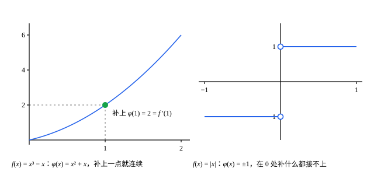

## 这一节要回答的问题

微积分里，复合函数的导数是$\bigl(f(g(x))\bigr)'=f'(g(x))\,g'(x)$。常见的推导把差商（difference quotient）拆成两个差商相乘：

$$
\frac{f(g(x))-f(g(a))}{x-a}=\frac{f(g(x))-f(g(a))}{g(x)-g(a)}\cdot\frac{g(x)-g(a)}{x-a} .
$$

可是$g(x)-g(a)$可能等于$0$，甚至在$a$附近无穷多次等于$0$，这时右边第一个分式没有意义。能不能换一种方式描述「:term[可导]{id="math.analysis.differentiable-function"}（differentiable）」，让证明绕开除以零？

## 讲解

### 导数的定义

::anchor{id="def-differentiable"}
设$f$在$a$的某个:term[邻域]{id="math.analysis.neighborhood"}（neighborhood）里有定义。如果:term[极限]{id="math.analysis.function-limit"}（limit of a function）$\lim_{h\to0}\frac{f(a+h)-f(a)}{h}$存在，就说$f$在$a$处:term[可导]{id="math.analysis.differentiable-function"}，这个极限叫作$f$在$a$处的导数，记作$f'(a)$。在区间的每一点都可导的函数，叫作这个区间上的可导函数（differentiable function）；区间的端点处只看一侧。

为什么这样定义：差商$\frac{f(a+h)-f(a)}{h}$是过$(a,f(a))$和$(a+h,f(a+h))$的割线的斜率，$h\to0$时割线转向切线。有了[函数极限的严格定义](lesson:math.analysis.function-limits)，「差商趋于$f'(a)$」就有了确切的意思：任给$\varepsilon>0$，有$\delta>0$，使$0<|h|<\delta$时$\Bigl|\frac{f(a+h)-f(a)}{h}-f'(a)\Bigr|<\varepsilon$。$h=0$被排除在外，差商在那里本来就没有定义。

::anchor{id="def-one-sided-derivative"}
极限$\lim_{h\to0^+}\frac{f(a+h)-f(a)}{h}$叫作$f$在$a$处的右导数（right derivative）；把$h\to0^+$换成$h\to0^-$，就是左导数（left derivative）。两者合称单侧导数（one-sided derivative）。

为什么要单侧导数：区间的端点只有一侧有定义域里的点，那里只能看一侧。$f$在$a$处可导，当且仅当左、右导数都存在并且相等，这是:term[单侧极限]{id="math.analysis.one-sided-limit"}（one-sided limit）那条结论的直接推论。$|x|$在$0$处的右导数是$1$、左导数是$-1$，所以它在$0$处不可导，尽管它在那里:term[连续]{id="math.analysis.continuous-function"}（continuous）。

**定理 1**　$f$在$a$处可导，则$f$在$a$处连续。

**证明**：$h\ne0$时$f(a+h)-f(a)=\frac{f(a+h)-f(a)}{h}\cdot h$。$h\to0$时右边第一个因子趋于$f'(a)$，第二个趋于$0$，由:term[极限的四则运算法则]{id="math.analysis.algebraic-limit-theorem"}（algebraic limit theorem），左边趋于$0$，即$\lim_{h\to0}f(a+h)=f(a)$。反过来不成立，$|x|$就是例子。

### 线性近似

把差商的:term[极限]{id="math.analysis.function-limit"}换一种写法。令$r(h)=f(a+h)-f(a)-f'(a)h$，它是用一次函数$f(a)+f'(a)h$代替$f(a+h)$时的误差。:term[可导]{id="math.analysis.differentiable-function"}的定义说的正是$\frac{r(h)}{h}\to0$：误差不只是趋于$0$，而且比$h$趋于$0$得还快。

::anchor{id="thm-linear-approximation"}
**定理 2**　$f$在$a$处可导，当且仅当有常数$A$和定义在$0$附近的函数$r(h)$，使$f(a+h)=f(a)+Ah+r(h)$，并且$\lim_{h\to0}\frac{r(h)}{h}=0$。这时$A=f'(a)$。$f(a)+Ah$叫作$f$在$a$处的:term[线性近似]{id="math.analysis.linear-approximation"}（linear approximation）。

**证明**：若$f$在$a$处可导，取$A=f'(a)$，$r(h)=f(a+h)-f(a)-f'(a)h$，则$h\ne0$时$\frac{r(h)}{h}=\frac{f(a+h)-f(a)}{h}-f'(a)\to0$。反过来，若有这样的$A$和$r(h)$，则$\frac{f(a+h)-f(a)}{h}=A+\frac{r(h)}{h}\to A$，所以$f$在$a$处可导，$f'(a)=A$。

为什么要这样写：它把「可导」说成「在$a$附近能用一次函数近似，误差比$h$高阶」，几何上就是「放大了看，曲线越来越像切线」。这个说法里没有除法，所以能推广到差商没有意义的地方，比如自变量是平面上的点（第 7 题）。微积分里的微分（differential）$\dd y=f'(x)\dd x$说的也是这件事，见[微分与线性近似](lesson:math.calculus.differentials)。

线性近似还有一种不带$r(h)$的写法，下面证明:term[链式法则]{id="math.analysis.chain-rule"}（chain rule）时要用。

**定理 3**　$f$在$a$处可导，当且仅当有一个在$a$处:term[连续]{id="math.analysis.continuous-function"}的函数$\varphi$，使$a$附近的$x$都满足$f(x)-f(a)=\varphi(x)(x-a)$。这时$\varphi(a)=f'(a)$。

**证明**：若$f$在$a$处可导，令$x\ne a$时$\varphi(x)=\frac{f(x)-f(a)}{x-a}$，$\varphi(a)=f'(a)$。等式对$x\ne a$成立，$x=a$时两边都是$0$；而$\lim_{x\to a}\varphi(x)=f'(a)=\varphi(a)$，这正是$\varphi$在$a$处连续。反过来，若有这样的$\varphi$，则$x\ne a$时$\frac{f(x)-f(a)}{x-a}=\varphi(x)$，由$\varphi$在$a$处连续，$x\to a$时它趋于$\varphi(a)$，所以$f'(a)=\varphi(a)$。

$\varphi(x)$是从$(a,f(a))$到$(x,f(x))$的割线的斜率。定理 3 说：可导，就是这个斜率函数能在$a$处补上一个值，补完以后连续，补上的值就是$f'(a)$。$|x|$在$0$处的斜率函数在$x>0$时是$1$、$x<0$时是$-1$，在$0$处补什么值都不连续。

### 链式法则

::anchor{id="thm-chain-rule"}
**定理 4**　设$g$在$a$处:term[可导]{id="math.analysis.differentiable-function"}，$f$在$b=g(a)$处可导，则复合函数$f\circ g$在$a$处可导，并且$(f\circ g)'(a)=f'(g(a))\,g'(a)$。这叫作:term[链式法则]{id="math.analysis.chain-rule"}。

**证明**：由定理 3，有在$a$处:term[连续]{id="math.analysis.continuous-function"}的$\psi$和在$b$处连续的$\varphi$，使$g(x)-g(a)=\psi(x)(x-a)$，$f(y)-f(b)=\varphi(y)(y-b)$，并且$\psi(a)=g'(a)$，$\varphi(b)=f'(b)$。$g$在$a$处可导，由定理 1 也连续，所以$x$离$a$足够近时$g(x)$落在$b$附近，$f(g(x))$有定义。把$y=g(x)$代进第二个等式，再用第一个：

$$
f(g(x))-f(g(a))=\varphi(g(x))\bigl(g(x)-g(a)\bigr)=\varphi(g(x))\,\psi(x)\,(x-a) .
$$

$\varphi$在$g(a)$处连续、$g$在$a$处连续，由[连续函数的严格定义](lesson:math.analysis.continuity)的定理 2，$\varphi\circ g$在$a$处连续，再乘上在$a$处连续的$\psi$，乘积仍在$a$处连续。由定理 3，$f\circ g$在$a$处可导，导数是$\varphi(g(a))\,\psi(a)=f'(g(a))\,g'(a)$。

为什么想到这么做：开头那个推导的毛病出在除以$g(x)-g(a)$。定理 3 把除法换成了乘法：$g(x)=g(a)$时，等式$f(g(x))-f(g(a))=\varphi(g(x))\cdot0$照样成立，用不着单独处理。这种情况确实会出现，例 2 里的$g(x)=x^2\sin\frac1x$在$0$附近有无穷多个点满足$g(x)=g(0)$。

## 几何图像

:::anim{component="function-plot"}
range: { x: [0.3, 1.7], y: [-2.6, 3.4] }
functions:
  - expr: "x^3 - x"
    label: |
      $y=x^3-x$
  - expr: "2 * (x - 1)"
    label: |
      切线$y=2(x-1)$
  - expr: "(2 + eps) * (x - 1)"
    label: |
      $y=(2+\varepsilon)(x-1)$
  - expr: "(2 - eps) * (x - 1)"
    label: |
      $y=(2-\varepsilon)(x-1)$
points:
  - { x: "1", y: "0" }
  - { x: "1 + (sqrt(9 + 4 * eps) - 3) / 2", y: "(1 + (sqrt(9 + 4 * eps) - 3) / 2)^3 - (1 + (sqrt(9 + 4 * eps) - 3) / 2)" }
  - { x: "1 - (sqrt(9 + 4 * eps) - 3) / 2", y: "(1 - (sqrt(9 + 4 * eps) - 3) / 2)^3 - (1 - (sqrt(9 + 4 * eps) - 3) / 2)" }
sliders:
  - name: eps
    min: 0.1
    max: 1.5
    step: 0.05
    default: 0.8
    label: |
      $\varepsilon$
:::

$f(x)=x^3-x$，$f'(1)=2$，切线是$y=2(x-1)$。另外两条过$(1,0)$的直线斜率是$2\pm\varepsilon$，夹出左右两个角形区域。两侧标出的点的横坐标是$1\pm\delta$，$\delta=\frac{\sqrt{9+4\varepsilon}-3}{2}$，它们之间的那段曲线全在这两个区域里，右边那个点正好落在上面那条直线上。拖动滑块把$\varepsilon$调小，区域越收越窄，$\delta$也跟着变小，却总存在：这就是$|r(h)|\le\varepsilon|h|$，也就是定理 2 里的$\frac{r(h)}{h}\to0$。

这是定理 3 的图。左边，$f(x)=x^3-x$在$a=1$处的割线斜率$\varphi(x)=\frac{x^3-x}{x-1}=x^2+x$，$x=1$处原本是个洞，补上$\varphi(1)=2=f'(1)$就连成一条完整的曲线。右边，$|x|$在$0$处的割线斜率在$x>0$时是$1$、$x<0$时是$-1$，中间断成两截，补什么值都接不上，所以$|x|$在$0$处不:term[可导]{id="math.analysis.differentiable-function"}。

## 例题

### 例 1　$\sqrt x$在哪里可导

设$a>0$。证明$\sqrt x$在$a$处:term[可导]{id="math.analysis.differentiable-function"}，导数是$\frac{1}{2\sqrt a}$；再说明它在定义域的端点$0$处不可导。

**为什么想到这么做**：差商$\frac{\sqrt{a+h}-\sqrt a}{h}$的分子、分母都趋于$0$，直接看不出:term[极限]{id="math.analysis.function-limit"}。和[连续函数的严格定义](lesson:math.analysis.continuity)的例 1 一样，先分子有理化，分子变成$h$，正好和分母约掉。

**推导**：$h\ne0$且$a+h\ge0$时，

$$
\frac{\sqrt{a+h}-\sqrt a}{h}=\frac{(a+h)-a}{h\bigl(\sqrt{a+h}+\sqrt a\bigr)}=\frac{1}{\sqrt{a+h}+\sqrt a} .
$$

$\sqrt x$在$a$处:term[连续]{id="math.analysis.continuous-function"}（[连续函数的严格定义](lesson:math.analysis.continuity)的例 1），所以$h\to0$时分母趋于$2\sqrt a>0$，由:term[极限的四则运算法则]{id="math.analysis.algebraic-limit-theorem"}，差商趋于$\frac{1}{2\sqrt a}$。在$0$处只能看右边：$\frac{\sqrt h-0}{h}=\frac{1}{\sqrt h}$，$h\to0^+$时它要多大有多大，右导数不存在，所以$\sqrt x$在$0$处不可导。图像在原点处的切线是竖直的，斜率不是一个实数。

### 例 2　$g(x)=x^2\sin\frac1x$与链式法则

设$g(x)=x^2\sin\frac1x$（$x\ne0$），$g(0)=0$；$f$在$0$处:term[可导]{id="math.analysis.differentiable-function"}。证明$f\circ g$在$0$处可导，并求$(f\circ g)'(0)$。

**为什么想到这么做**：先看$g$在$0$处可不可导，再用:term[链式法则]{id="math.analysis.chain-rule"}。开头那个拆差商的办法在这里行不通：$x_k=\frac{1}{k\pi}$时$g(x_k)=0=g(0)$，这些点要多靠近$0$有多靠近，在那里没法除以$g(x)-g(0)$。

**推导**：$h\ne0$时$\Bigl|\frac{g(h)-g(0)}{h}\Bigr|=\Bigl|h\sin\frac1h\Bigr|\le|h|$，由:term[夹逼定理]{id="math.analysis.squeeze-theorem"}（squeeze theorem），$g'(0)=0$。$f$在$g(0)=0$处可导，由链式法则，$f\circ g$在$0$处可导，$(f\circ g)'(0)=f'(0)\cdot0=0$。

也可以直接验证。由定理 3，$f(y)-f(0)=\varphi(y)\,y$，$\varphi$在$0$处:term[连续]{id="math.analysis.continuous-function"}，于是$\Bigl|\frac{f(g(h))-f(0)}{h}\Bigr|=\bigl|\varphi(g(h))\bigr|\cdot\Bigl|\frac{g(h)}{h}\Bigr|\le\bigl|\varphi(g(h))\bigr|\,|h|$。$h\to0$时$\varphi(g(h))\to\varphi(0)$，右边趋于$0$；在$g(h)=0$的那些点，左边本来就是$0$，不需要单独处理。

## 常见误区

- 「:term[连续]{id="math.analysis.continuous-function"}就:term[可导]{id="math.analysis.differentiable-function"}。」不对：$|x|$在$0$处连续，左、右导数却不相等。可导比连续多要求了一条：割线斜率在$a$处能连续地补上一个值（定理 3）。
- 「对称差商（symmetric difference quotient）$\frac{f(a+h)-f(a-h)}{2h}$有:term[极限]{id="math.analysis.function-limit"}，$f$就在$a$处可导。」不对：$|x|$在$0$处的对称差商恒为$0$，它却不可导。反过来，可导时对称差商一定趋于$f'(a)$，算法和第 4 题一样。
- 「在一点可导，在它附近也可导。」不对：$f(x)=x^2$（$x$是有理数）、$f(x)=0$（$x$是无理数）在$0$处可导，因为$\bigl|\frac{f(h)}{h}\bigr|\le|h|\to0$。在别的点它连连续都谈不上：沿有理数列和无理数列逼近$a\ne0$，函数值分别趋于$a^2$和$0$。
- 「:term[链式法则]{id="math.analysis.chain-rule"}只要把差商拆成两个差商相乘就证完了。」不对：$g(x)-g(a)$可能在$a$附近无穷多次等于$0$（例 2），要用定理 3 绕开除以零。
