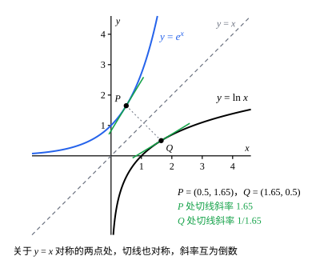

## 这一节要回答的问题

微积分里用过$e^x$的许多性质：它的导数是它自己，$e^{x+y}=e^xe^y$，$\ln x$是它的反函数（inverse function）。可$e^{\sqrt2}$是什么意思？乘方和开方只能给出$e$的有理数次幂，指数是无理数时连定义都还没有，这些性质也就无从证明。

这一节倒过来走：先用一个:term[幂级数]{id="math.analysis.power-series"}（power series）定义:term[指数函数]{id="math.analysis.exponential-function"}（exponential function，exp），再从这个:term[级数]{id="math.analysis.series"}（series）出发，证明它有$e^x$该有的性质，最后把:term[自然对数]{id="math.analysis.natural-logarithm"}（natural logarithm，ln）定义成它的反函数。

## 讲解

### 指数函数的定义

微积分里，$e^x$的泰勒级数（Taylor series）是$\sum_{n=0}^\infty\frac{x^n}{n!}$。这个:term[级数]{id="math.analysis.series"}不靠$e^x$也找得出来：设:term[幂级数]{id="math.analysis.power-series"}$f(x)=\sum_{n=0}^\infty a_nx^n$满足$f'=f$、$f(0)=1$，逐项求导得$f'(x)=\sum_{n=0}^\infty(n+1)a_{n+1}x^n$。和函数（sum function）相同的两个幂级数，系数也相同（系数都是$\frac{f^{(n)}(0)}{n!}$，见[幂级数的收敛理论](lesson:math.analysis.power-series-theory#thm-termwise)），所以$(n+1)a_{n+1}=a_n$；又$a_0=f(0)=1$，于是$a_n=\frac{1}{n!}$。

::anchor{id="def-exp"}
对每个实数$x$，令$\exp x=\sum_{n=0}^\infty\frac{x^n}{n!}$（约定$0!=1$，$x^0=1$），这样定义的函数叫作:term[指数函数]{id="math.analysis.exponential-function"}。它对每个$x$都:term[收敛]{id="math.analysis.convergent-series"}（convergent series）：$x\ne0$时，相邻两项之比的绝对值$\frac{|x|}{n+1}$趋于$0$，由比值判别法（ratio test），$\sum\frac{|x|^n}{n!}$收敛。所以这个幂级数的:term[收敛半径]{id="math.analysis.radius-of-convergence"}（radius of convergence）是$+\infty$，在每一点都:term[绝对收敛]{id="math.analysis.absolute-convergence"}（absolute convergence）。

为什么这样定义：上面的推导说明，满足$f'=f$、$f(0)=1$的幂级数只可能是这一个，定理 1 会证明它确实满足这两条。有了级数，函数在每一点的值都有了着落，不必先知道$e$的无理数次幂是什么。边界情况：每个:term[部分和]{id="math.analysis.partial-sum"}（partial sum）$S_N(x)=\sum_{n=0}^N\frac{x^n}{n!}$都是多项式，$S_N'=S_{N-1}\ne S_N$，截断到哪一项都不满足$f'=f$。

部分和也不在整个$\R$上:term[一致收敛]{id="math.analysis.uniform-convergence"}（uniform convergence）于$\exp$：$x>0$时$\exp x-S_N(x)\ge\frac{x^{N+1}}{(N+1)!}$，$x\to+\infty$时这个下界（lower bound）趋于$+\infty$。由[幂级数的收敛理论](lesson:math.analysis.power-series-theory#thm-power-series-uniform)的定理 2，它在每个闭区间上一致收敛，也就是在$\R$上:term[内闭一致收敛]{id="math.analysis.locally-uniform-convergence"}（uniform convergence on compact subsets），几何图像的动画里看得到。

::anchor{id="thm-exp-derivative"}
**定理 1**　$\exp$在$\R$上:term[可导]{id="math.analysis.differentiable-function"}（differentiable），$\exp'(x)=\exp x$，并且$\exp 0=1$。

**证明**：收敛半径是$+\infty$，由[幂级数的收敛理论](lesson:math.analysis.power-series-theory#thm-termwise)的定理 3，可以逐项求导：

$$\exp'(x)=\sum_{n=1}^\infty\frac{nx^{n-1}}{n!}=\sum_{n=1}^\infty\frac{x^{n-1}}{(n-1)!}=\exp x.$$

$x=0$时级数只有第一项是$1$，其余各项都是$0$，所以$\exp 0=1$。

### 加法公式

::anchor{id="thm-exp-addition"}
**定理 2**　对任意实数$x$、$y$，$\exp(x+y)=\exp x\cdot\exp y$。

**证明**：两个:term[级数]{id="math.analysis.series"}$\sum\frac{x^n}{n!}$、$\sum\frac{y^n}{n!}$都:term[绝对收敛]{id="math.analysis.absolute-convergence"}，由[级数的重排](lesson:math.analysis.rearrangement#thm-cauchy-product)的定理 3，它们的:term[柯西乘积]{id="math.analysis.cauchy-product"}（Cauchy product）:term[收敛]{id="math.analysis.convergent-series"}于$\exp x\cdot\exp y$。柯西乘积的第$n$项是

$$c_n=\sum_{k=0}^n\frac{x^k}{k!}\cdot\frac{y^{n-k}}{(n-k)!}=\frac{1}{n!}\sum_{k=0}^n\binom{n}{k}x^ky^{n-k}=\frac{(x+y)^n}{n!},$$

最后一步用了二项式定理（binomial theorem）。所以$\exp x\cdot\exp y=\sum_{n=0}^\infty\frac{(x+y)^n}{n!}=\exp(x+y)$。

为什么想到这么做：两个:term[幂级数]{id="math.analysis.power-series"}相乘，把次数相同的项归到一起，正是柯西乘积。$\frac{1}{k!\,(n-k)!}$乘上$n!$恰好是二项式系数（binomial coefficient）$\binom{n}{k}$，系数取$\frac{1}{n!}$，正好让这一步成立。

由定理 1、定理 2，马上得到$\exp$的几条性质：

- $\exp x\cdot\exp(-x)=\exp 0=1$，所以$\exp x\ne0$，并且$\exp(-x)=\frac{1}{\exp x}$。
- $\exp x=\bigl(\exp\frac x2\bigr)^2\ge0$，又不等于$0$，所以$\exp x>0$。
- $\exp'=\exp>0$，由:term[拉格朗日中值定理]{id="math.analysis.mean-value-theorem"}（mean value theorem），$\exp$严格递增（strictly increasing），见[中值定理的证明](lesson:math.analysis.mean-value-proofs)例 1 后面的说明。
- $x>0$时级数的各项都是正数，$\exp x>1+x$，所以$x\to+\infty$时$\exp x\to+\infty$；$x\to-\infty$时$\exp x=\frac{1}{\exp(-x)}\to0$。

::anchor{id="thm-exp-unique"}
**定理 3**　设$f$在$\R$上:term[可导]{id="math.analysis.differentiable-function"}，$f'=f$，$f(0)=1$，则$f=\exp$。

**证明**：令$g(x)=f(x)\exp(-x)$。由:term[链式法则]{id="math.analysis.chain-rule"}（chain rule），$\bigl(\exp(-x)\bigr)'=-\exp(-x)$，于是$g'(x)=f(x)\exp(-x)-f(x)\exp(-x)=0$。由[中值定理的证明](lesson:math.analysis.mean-value-proofs)的例 1，$g$恒等于$g(0)=1$，所以$f(x)=\frac{1}{\exp(-x)}=\exp x$。

为什么想到这么做：要证两个函数相等，就看它们的比。$\exp$处处不为$0$，比$\frac{f}{\exp}=f(x)\exp(-x)$有定义，它的导数是$0$，比就是常数。定理 3 说明满足$f'=f$、$f(0)=1$的可导函数只有$\exp$一个，这个定义没有选错。

### $e$与$e^x$

::anchor{id="def-e"}
数$\exp 1=\sum_{n=0}^\infty\frac{1}{n!}=2.71828\cdots$记作$e$；对所有实数$x$，把$\exp x$也记作$e^x$。这样记不会和乘方冲突：下面验证，$x$是有理数时，$\exp x$正好等于$e$的$x$次幂。

整数：由定理 2 和数学归纳法（mathematical induction），正整数$m$满足$\exp m=(\exp 1)^m=e^m$；又$\exp(-m)=\frac{1}{\exp m}=e^{-m}$。有理数$x=\frac pq$（$p$是整数，$q$是正整数）：由定理 2，$\bigl(\exp\frac pq\bigr)^q=\exp p=e^p$，而$\exp\frac pq>0$，所以它就是$e^p$的正的$q$次方根$e^{p/q}$。

为什么这样定义：新记号在有理数处和乘方、开方的结果一致；在无理数处，比如$x=\sqrt2$，取有理数列$r_k\to\sqrt2$（如不足近似值$1,\ 1.4,\ 1.41,\dots$），由$\exp$的:term[连续]{id="math.analysis.continuous-function"}（continuous）性（:term[可导]{id="math.analysis.differentiable-function"}函数一定连续），$e^{\sqrt2}=\lim_{k\to\infty}e^{r_k}$。也就是说，$e^{\sqrt2}$是有理数次幂的:term[极限]{id="math.analysis.sequence-limit"}（limit of a sequence，lim），新定义只是把乘方连续地延拓到了无理数上。边界情况：$e^x$不再是「$e$自乘$x$次」，$x=\sqrt2$时无所谓自乘，它的值由:term[级数]{id="math.analysis.series"}给出。

微积分里把$e$定义成$\lim_{n\to\infty}\bigl(1+\frac1n\bigr)^n$，它和$\exp 1$是同一个数，证明见第 6 题；$e$不是有理数，证明见第 5 题。

### 对数

$\exp$在$\R$上:term[连续]{id="math.analysis.continuous-function"}、严格递增，$x\to-\infty$时趋于$0$，$x\to+\infty$时趋于$+\infty$。它的图像从左到右往上爬，每个正的高度都恰好经过一次：

::anchor{id="thm-exp-onto"}
**定理 4**　对每个$y>0$，恰好有一个实数$x$使$\exp x=y$。

**证明**：$\exp$严格递增，不同的$x$给出不同的值，所以至多有一个。由$x>0$时$\exp x>1+x$，得$\exp y>1+y>y$，并且$\exp\bigl(-\frac1y\bigr)=\frac{1}{\exp\frac1y}<\frac{1}{1+\frac1y}<y$。$\exp$在闭区间$\bigl[-\frac1y,\ y\bigr]$上连续，由:term[介值定理]{id="math.analysis.intermediate-value-theorem"}（intermediate value theorem），其中有$x$使$\exp x=y$。

::anchor{id="def-ln"}
对$y>0$，使$\exp x=y$的那个唯一的$x$叫作$y$的:term[自然对数]{id="math.analysis.natural-logarithm"}，记作$\ln y$。也就是说，$\ln$是$\exp$的反函数：$\ln(\exp x)=x$对所有实数$x$成立，$\exp(\ln y)=y$对所有$y>0$成立。

为什么这样定义：对数本来就是为「已知$e^x$，求$x$」而设的，定理 4 保证这个$x$存在而且唯一；于是$\ln$的一切性质，都可以从$\exp$的性质推出来。边界情况：$\exp$只取正值，所以$\ln y$只在$y>0$时有定义，$\ln 0$、$\ln(-1)$都没有意义；$\ln 1=0$，$\ln e=1$。

::anchor{id="thm-ln"}
**定理 5**　(1) $a,b>0$时，$\ln(ab)=\ln a+\ln b$；(2) $\ln$在$(0,+\infty)$上严格递增、连续；(3) $\ln$在$(0,+\infty)$上:term[可导]{id="math.analysis.differentiable-function"}，$\ln'(y)=\frac1y$。

**证明**：(1) 由定理 2，$\exp(\ln a+\ln b)=\exp(\ln a)\exp(\ln b)=ab$，所以$\ln a+\ln b$就是$ab$的自然对数。

(2) 设$0<a<b$。若$\ln a\ge\ln b$，则$a=\exp(\ln a)\ge\exp(\ln b)=b$，矛盾，所以$\ln$严格递增。再证在$y_0>0$处连续，记$x_0=\ln y_0$：任给$\varepsilon>0$，取$\delta=\min\{y_0-\exp(x_0-\varepsilon),\ \exp(x_0+\varepsilon)-y_0\}>0$，则$|y-y_0|<\delta$时$\exp(x_0-\varepsilon)<y<\exp(x_0+\varepsilon)$，两边取$\ln$，得$|\ln y-x_0|<\varepsilon$。

(3) 任取$y_0>0$和$y\ne y_0$（$y>0$），记$x_0=\ln y_0$、$x=\ln y$，则$x\ne x_0$。由:term[拉格朗日中值定理]{id="math.analysis.mean-value-theorem"}，有介于$x$与$x_0$之间的$\xi$，使$y-y_0=\exp x-\exp x_0=\exp\xi\cdot(x-x_0)$，于是$\frac{\ln y-\ln y_0}{y-y_0}=\frac{1}{\exp\xi}$。由 (2)，$y\to y_0$时$|\xi-x_0|\le|\ln y-\ln y_0|\to0$；$\exp$连续，所以这个差商趋于$\frac{1}{\exp x_0}=\frac{1}{y_0}$。

为什么想到这么做：$\ln$的差商就是$\exp$的差商倒过来。中值定理把后者换成一点处的导数$\exp\xi$，而$\xi$夹在$x$和$x_0$之间，跟着它们一起趋于$x_0$。

### 一般的幂

开头的$e^{\sqrt2}$现在有了定义，$2^{\sqrt2}$呢？由$2=e^{\ln 2}$，自然的写法是$2^{\sqrt2}=e^{\sqrt2\ln 2}$。

::anchor{id="def-general-power"}
设$a>0$。对实数$x$，定义$a^x=e^{x\ln a}$。

为什么这样定义：$x$是整数$m$时，由定理 2，$e^{m\ln a}=\bigl(e^{\ln a}\bigr)^m=a^m$；$x=\frac pq$时，$e^{\frac pq\ln a}$是正数，它的$q$次方是$a^p$，所以它就是$a^{p/q}$。新定义在有理数处和原来的乘方、开方一致，在无理数处由$\exp$的:term[连续]{id="math.analysis.continuous-function"}性接上。边界情况：底数$a$必须是正数，因为$\ln a$只在$a>0$时有定义；$(-8)^{\frac13}=-2$这样的值另有来历，不由这个公式给出。

由定理 1、定理 2、定理 5 和:term[链式法则]{id="math.analysis.chain-rule"}，$a^{x+y}=a^xa^y$，$(a^x)'=a^x\ln a$；$x>0$时$x^\alpha=e^{\alpha\ln x}$，$(x^\alpha)'=e^{\alpha\ln x}\cdot\frac{\alpha}{x}=\alpha x^{\alpha-1}$。微积分里的这些求导公式，到这里都有了证明。

## 几何图像

:::anim{component="function-plot"}
range: { x: [-8, 3], y: [-3, 21] }
functions:
  - expr: "exp(x)"
    label: |
      $y=e^x$
  - expr: "sum(k, 0, N, prod(j, 1, k, x / j))"
    label: |
      部分和$y=S_N(x)$
sliders:
  - name: N
    min: 0
    max: 16
    step: 1
    default: 4
    label: |
      最高次数$N$
:::

拖动$N$，看:term[部分和]{id="math.analysis.partial-sum"}$S_N(x)=\sum_{n=0}^N\frac{x^n}{n!}$怎样贴近$e^x$。在任何一个闭区间上，$N$足够大时两条曲线就分不开，这是:term[内闭一致收敛]{id="math.analysis.locally-uniform-convergence"}；可两条曲线分开的地方随$N$增大往左移，总有分开的地方，所以在整个$\R$上不:term[一致收敛]{id="math.analysis.uniform-convergence"}。负半轴上各项正负交替：$N$是正偶数时，部分和在左端往上翘，$N$是奇数时往下掉，拖动$N$时那一端上下翻转。

:term[自然对数]{id="math.analysis.natural-logarithm"}的图像是:term[指数函数]{id="math.analysis.exponential-function"}的图像关于直线$y=x$的镜像：点$P(a,e^a)$对应点$Q(e^a,a)$，图里$a=0.5$。镜像把切线也翻了过去，斜率变成倒数，所以$\ln$在$e^a$处的导数是$\frac{1}{e^a}$，这正是定理 5 的 (3)。

## 例题

### 例 1　指数函数比任何多项式长得快

证明：对每个正整数$m$，$\lim_{x\to+\infty}\frac{x^m}{e^x}=0$。

**为什么想到这么做**：$x>0$时，$e^x$的:term[级数]{id="math.analysis.series"}各项都是正数，扔掉其余各项、只留一项，就得到一个下界。要压过$x^m$，留比它高一次的那一项$\frac{x^{m+1}}{(m+1)!}$就够了。

**推导**：$x>0$时级数的各项都是正数，所以$e^x>\frac{x^{m+1}}{(m+1)!}$，于是$0<\frac{x^m}{e^x}<\frac{(m+1)!}{x}$。$x\to+\infty$时右边趋于$0$，由:term[夹逼定理]{id="math.analysis.squeeze-theorem"}（squeeze theorem），$\frac{x^m}{e^x}\to0$。

令$x=\ln t$，就得到$t\to+\infty$时$\frac{(\ln t)^m}{t}\to0$：:term[对数]{id="math.analysis.natural-logarithm"}比任何正的幂都长得慢。

### 例 2　对数的积分表示

证明：$y>0$时，$\ln y=\int_1^y\frac{\dd t}{t}$。

**为什么想到这么做**：两边都是$y$的函数，在$y=1$处都等于$0$。只要导数也处处相等，两边的差就是导数为$0$的函数，只能是常数$0$。

**推导**：$\frac1t$在$(0,+\infty)$上:term[连续]{id="math.analysis.continuous-function"}，由:term[微积分基本定理]{id="math.analysis.fundamental-theorem-of-calculus"}（fundamental theorem of calculus），$F(y)=\int_1^y\frac{\dd t}{t}$在$(0,+\infty)$上:term[可导]{id="math.analysis.differentiable-function"}，$F'(y)=\frac1y$。由定理 5，$\bigl(\ln y-F(y)\bigr)'=\frac1y-\frac1y=0$。由[中值定理的证明](lesson:math.analysis.mean-value-proofs)的例 1，$\ln y-F(y)$在区间$(0,+\infty)$上是常数，而它在$y=1$处等于$\ln 1-F(1)=0$。

有的书反过来，先用这个积分定义$\ln$，再把$\exp$定义成它的反函数；两条路得到的是同一对函数。

## 常见误区

- 「$e^x$就是$e$自乘$x$次。」只在$x$是正整数时如此；$x=\sqrt2$时无所谓自乘，$e^x$由:term[级数]{id="math.analysis.series"}定义，只在有理数处和乘方、开方的结果一致。
- 「:term[部分和]{id="math.analysis.partial-sum"}在整个$\R$上:term[一致收敛]{id="math.analysis.uniform-convergence"}于$e^x$。」不对：只在每个闭区间上一致收敛，两条曲线总在某处分开（几何图像的动画）。
- 「两个:term[收敛级数]{id="math.analysis.convergent-series"}的:term[柯西乘积]{id="math.analysis.cauchy-product"}，和总是两个和之积。」不一定：柯西乘积可能:term[发散]{id="math.analysis.divergent-series"}（divergent series），见[级数的重排](lesson:math.analysis.rearrangement)第 6 题。定理 2 能用柯西乘积，是因为$\exp$的级数处处:term[绝对收敛]{id="math.analysis.absolute-convergence"}。
- 「$a^x=e^{x\ln a}$对负数$a$也成立。」$\ln a$只在$a>0$时有定义；$(-8)^{\frac13}=-2$不是由这个公式算出来的。
