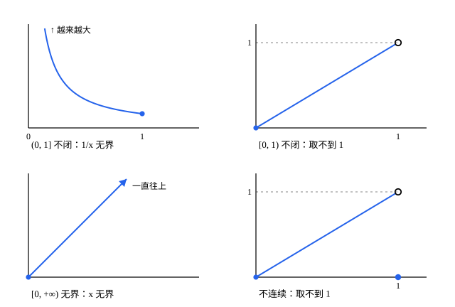

## 这一节要回答的问题

$\frac1x$在$(0,1]$上:term[连续]{id="math.analysis.continuous-function"}（continuous），却越来越大，没有最大值；$x$在$[0,1)$上连续，函数值往$1$挤，却取不到$1$。可在闭区间$[a,b]$上，微积分里求最值时从来不担心最值存不存在。

闭区间凭什么这么特殊？证明里，「区间是闭的」和「区间两端是有限的数」各用在哪里，:term[实数的完备性]{id="math.analysis.real-completeness"}（completeness of the real numbers）又藏在哪一步？

## 讲解

### 有界函数

::anchor{id="def-bounded-function"}
设$f$定义在集合$D$上。如果存在$M>0$，使所有$x\in D$都满足$|f(x)|\le M$，就说$f$是$D$上的:term[有界函数]{id="math.analysis.bounded-function"}（bounded function），也说$f$在$D$上有界。

为什么这样定义：它和:term[有界数列]{id="math.analysis.bounded-sequence"}（bounded sequence）一样，要求全部函数值都落在$[-M,M]$里，一个也不能漏。$\frac1x$在$(0,1]$上无界：任给$M>0$，取$x=\frac{1}{M+1}$，就有$\frac1x>M$。同一个函数在$[\frac12,1]$上就有界，所以有界不有界，和定义在哪个集合上有关。

### 有界性定理

::anchor{id="thm-boundedness"}
**定理 1**　闭区间$[a,b]$上的:term[连续函数]{id="math.analysis.continuous-function"}一定:term[有界]{id="math.analysis.bounded-function"}。这叫作:term[有界性定理]{id="math.analysis.boundedness-theorem"}（boundedness theorem）。

**证明**：用反证法。假设$f$在$[a,b]$上无界，则对每个正整数$n$，$n$都不是界，有$x_n\in[a,b]$使$|f(x_n)|>n$。数列$\{x_n\}$:term[有界]{id="math.analysis.bounded-sequence"}，由:term[致密性定理]{id="math.analysis.bolzano-weierstrass"}（Bolzano-Weierstrass theorem），它有:term[收敛]{id="math.analysis.convergent-sequence"}（convergent sequence）的:term[子列]{id="math.analysis.subsequence"}（subsequence）$x_{n_k}\to\xi$。

由$a\le x_{n_k}\le b$和:term[保不等式性]{id="math.analysis.order-limit-theorem"}（order limit theorem），$a\le\xi\le b$，所以$f$在$\xi$处连续。由[连续函数的严格定义](lesson:math.analysis.continuity)的定理 1，$f(x_{n_k})\to f(\xi)$，收敛数列有界。可$|f(x_{n_k})|>n_k\ge k$，$\{f(x_{n_k})\}$无界，矛盾。

三个条件各用在一处。区间有界，$\{x_n\}$才有收敛的子列：$f(x)=x$在$[0,+\infty)$上无界，那里的$x_n$可以跑向无穷。区间是闭的，:term[极限]{id="math.analysis.sequence-limit"}（limit of a sequence，lim）$\xi$才留在定义域里：在$(0,1]$上，$\frac1x$的$x_n$可以挤向$0$，而$0$不在定义域里。$f$在$\xi$处连续，$f(x_{n_k})$才跟着$x_{n_k}$收敛。

### 最值定理

::anchor{id="def-max-value"}
设$f$定义在$D$上。若有$x_0\in D$，使所有$x\in D$都满足$f(x)\le f(x_0)$，就说$f$在$x_0$处取到最大值$f(x_0)$；把不等号反过来，就是在$x_0$处取到最小值。用集合的话说，最大值就是函数值的集合$f(D)=\{f(x):x\in D\}$的:term[最大元]{id="math.analysis.maximum"}（maximum，max）。

函数值的集合有:term[上界]{id="math.analysis.upper-bound"}（upper bound）时，由:term[确界原理]{id="math.analysis.supremum-principle"}（least-upper-bound property），它有:term[上确界]{id="math.analysis.supremum"}（supremum，sup）$\sup_{x\in D}f(x)$。问题在于取不取得到：$x$在$[0,1)$上的上确界是$1$，却没有最大值。

::anchor{id="thm-extreme-value"}
**定理 2**　设$f$在$[a,b]$上:term[连续]{id="math.analysis.continuous-function"}，则有$x_1,x_2\in[a,b]$，使所有$x\in[a,b]$都满足$f(x_1)\le f(x)\le f(x_2)$。也就是说，$f$在$[a,b]$上取到最大值和最小值。这叫作:term[最值定理]{id="math.analysis.extreme-value-theorem"}（extreme value theorem）。

**证明**：由:term[有界性定理]{id="math.analysis.boundedness-theorem"}，函数值的集合有上界，由确界原理，$M=\sup_{x\in[a,b]}f(x)$存在。对每个正整数$n$，$M-\frac1n$不是上界，所以有$x_n\in[a,b]$使$M-\frac1n<f(x_n)\le M$。$\{x_n\}$:term[有界]{id="math.analysis.bounded-sequence"}，由:term[致密性定理]{id="math.analysis.bolzano-weierstrass"}，有:term[子列]{id="math.analysis.subsequence"}$x_{n_k}\to\xi$，和定理 1 一样，$\xi\in[a,b]$。

一方面，$M-\frac1{n_k}<f(x_{n_k})\le M$，由:term[夹逼定理]{id="math.analysis.squeeze-theorem"}（squeeze theorem），$f(x_{n_k})\to M$。另一方面，$f$在$\xi$处连续，$f(x_{n_k})\to f(\xi)$。由:term[极限]{id="math.analysis.sequence-limit"}的唯一性，$f(\xi)=M$，取$x_2=\xi$即可。对$-f$用同样的论证，$-f$的最大值点就是$f$的最小值点$x_1$。

为什么要先取上确界：最大值要是存在，只能是上确界，所以先用确界原理把这个「候选」找出来，再证明它真被取到。证明里先用致密性定理找到一串函数值逼近$M$的点，再用连续把「逼近」变成「等于」。

两个证明里，:term[实数的完备性]{id="math.analysis.real-completeness"}藏在致密性定理和确界原理里：确界原理就是完备性，致密性定理也是由它推出来的。只用有理数就不行：在$\Q\cap[1,2]$上，$\frac{1}{x^2-2}$在每一点都连续，却无界；$-(x^2-2)^2$的上确界是$0$，却取不到。两处卡在同一个地方：证明里取出的$x_n$都挤向$\sqrt2$，可$\sqrt2$不在$\Q$里。

两个定理合起来，再加上[介值定理](lesson:math.analysis.intermediate-value)（intermediate value theorem）：$[a,b]$上的连续函数，值的集合正好是闭区间$[m,M]$，$m$、$M$是最小值和最大值。

## 几何图像

四个小图各缺定理的一个条件。左上，$(0,1]$不闭，$\frac1x$在$0$附近越来越大，无界；右上，$[0,1)$不闭，$x$往$1$挤，却取不到$1$；左下，$[0,+\infty)$无界，$x$一直往上走；右下，区间是$[0,1]$，可函数在$1$处不:term[连续]{id="math.analysis.continuous-function"}（$f(1)=0$），:term[上确界]{id="math.analysis.supremum"}$1$也取不到。

:::anim{component="function-plot"}
range: { x: [-2.2, 2.2], y: [-2.5, 2.5] }
functions:
  - expr: "x^3 - 3 * x + 0 * sqrt(a^2 - x^2)"
    label: |
      $y=x^3-3x$，$-a\le x\le a$
points:
  - { x: "-min(a, 1)", y: "(-min(a, 1))^3 + 3 * min(a, 1)" }
  - { x: "min(a, 1)", y: "min(a, 1)^3 - 3 * min(a, 1)" }
sliders:
  - name: a
    min: 0.5
    max: 2
    step: 0.05
    default: 0.7
    label: |
      区间$[-a,a]$的$a$
:::

曲线只画在闭区间$[-a,a]$上，两个标出的点是最大值点和最小值点。拖动滑块：$a<1$时最大值、最小值在两个端点取到；$a>1$时改在区间里面的$x=-1$、$x=1$取到（$a=2$时，右端点也取到最大值$2$）。:term[最值定理]{id="math.analysis.extreme-value-theorem"}只保证取得到，不管在哪里取到。

## 例题

### 例 1　处处为正的连续函数有正的下界

设$f$在$[a,b]$上:term[连续]{id="math.analysis.continuous-function"}，并且每个函数值都大于$0$。证明$f$有正的下界（lower bound）：有$c>0$，使所有$x\in[a,b]$都满足$f(x)\ge c$；由此$\frac1f$在$[a,b]$上:term[有界]{id="math.analysis.bounded-function"}。

**为什么想到这么做**：每个$f(x)$都大于$0$，可它们可能一个比一个小，越来越接近$0$，比如$x$在$(0,1]$上。要排除这种情况，最直接的是让$f$取到最小值：最小值本身是某个函数值，它大于$0$，就是要找的$c$。

**推导**：由:term[最值定理]{id="math.analysis.extreme-value-theorem"}，有$x_1\in[a,b]$使$f(x)\ge f(x_1)$对所有$x\in[a,b]$成立。令$c=f(x_1)$，它是一个函数值，所以$c>0$。于是$0<\frac{1}{f(x)}\le\frac1c$，$\frac1f$有界。在$(0,1]$上，$f(x)=x$处处为正，:term[下确界]{id="math.analysis.infimum"}（infimum，inf）却是$0$，结论不成立：区间闭不闭，这里同样要紧。

### 例 2　在整条实数轴上取到最小值

设$p(x)=x^4-3x^2+x$。证明$p$在$\R$上取到最小值。

**为什么想到这么做**：$\R$不是闭区间，:term[最值定理]{id="math.analysis.extreme-value-theorem"}不能直接用。可$|x|$很大时$x^4$压倒一切，$p(x)$很大，最小值只可能出现在某个闭区间$[-R,R]$里。先在$[-R,R]$上用最值定理，再说明外面的值都更大。

**推导**：$|x|\ge3$时，$x^4\ge9x^2$，所以$p(x)\ge9x^2-3x^2+x=6x^2+x\ge6x^2-|x|>0=p(0)$。$p$在$[-3,3]$上:term[连续]{id="math.analysis.continuous-function"}，由最值定理，有$x_0\in[-3,3]$使$p(x)\ge p(x_0)$对所有$x\in[-3,3]$成立；特别地，$p(x_0)\le p(0)=0$。对$|x|>3$，$p(x)>0\ge p(x_0)$，所以$p(x_0)$就是$p$在整个$\R$上的最小值。

## 常见误区

- 「:term[连续函数]{id="math.analysis.continuous-function"}都:term[有界]{id="math.analysis.bounded-function"}。」不对，要在闭区间上：$\frac1x$在$(0,1]$上连续，却无界。
- 「有界的连续函数一定取到最大值。」不对：$x$在$[0,1)$上有界、连续，:term[上确界]{id="math.analysis.supremum"}$1$却取不到。:term[最值定理]{id="math.analysis.extreme-value-theorem"}要区间是闭的。
- 「取到最大值的函数一定是闭区间上的连续函数。」不对，定理只给充分条件：$-x^2$在开区间$(-1,1)$上就在$0$处取到最大值。
- 「最大值在导数为零的地方取到。」不一定：最值定理不管$f$可不可导，最大值也可能在端点取到，动画里$a<1$时就是这样。
