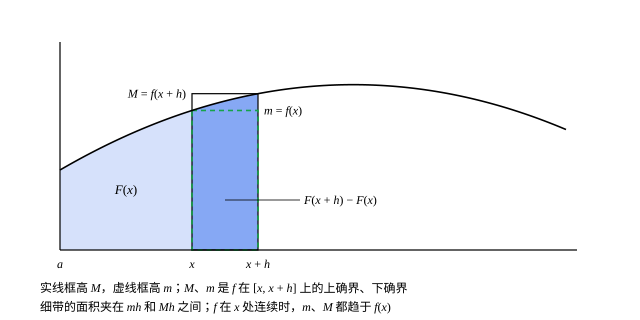

## 这一节要回答的问题

微积分里有两句话：:term[变上限积分]{id="math.analysis.variable-upper-limit-integral"}（integral with variable upper limit）$\int_a^xf(t)\dd t$的导数是$f(x)$；若$F'=f$，则$\int_a^bf(x)\dd x=F(b)-F(a)$。它们把求导和积分连在一起，算积分从此不用再求和取极限。

这两句话各要什么条件？$f$:term[可积]{id="math.analysis.riemann-integral"}（Riemann integrable）但不一定:term[连续]{id="math.analysis.continuous-function"}（continuous）时，第一句还对吗？$F$处处:term[可导]{id="math.analysis.differentiable-function"}（differentiable）时，$F'$一定可积吗？

## 讲解

### 两条准备：估值与区间可加性

**引理 1**　设$f$在$[a,b]$上:term[可积]{id="math.analysis.riemann-integral"}，并且$m\le f(x)\le M$对所有$x$成立，则$m(b-a)\le\int_a^bf\le M(b-a)$。

**证明**：取最粗的:term[分割]{id="math.analysis.partition"}（partition）$P=\{a,b\}$。$f$的:term[下确界]{id="math.analysis.infimum"}（infimum，inf）不小于$m$，:term[上确界]{id="math.analysis.supremum"}（supremum，sup）不大于$M$，所以$m(b-a)\le L(f,P)\le\int_a^bf\le U(f,P)\le M(b-a)$。

::anchor{id="thm-additivity"}
**引理 2**　设$a<c<b$，$f$在$[a,b]$上:term[可积]{id="math.analysis.riemann-integral"}，则$f$在$[a,c]$和$[c,b]$上都可积，并且$\int_a^bf=\int_a^cf+\int_c^bf$。这叫作积分的区间可加性（additivity）。

**证明**：任给$\varepsilon>0$，由:term[可积准则]{id="math.analysis.integrability-criterion"}（Riemann's criterion），有$[a,b]$的分割$P$使$U(f,P)-L(f,P)<\varepsilon$。添上分点$c$得到它的:term[加细]{id="math.analysis.refinement"}（refinement）$P^*$，差仍小于$\varepsilon$。$P^*$在$[a,c]$、$[c,b]$上的部分记作$P_1$、$P_2$，则$U(f,P^*)-L(f,P^*)=\bigl[U(f,P_1)-L(f,P_1)\bigr]+\bigl[U(f,P_2)-L(f,P_2)\bigr]$，两个方括号都不小于$0$，所以各自小于$\varepsilon$，$f$在两段上都可积。

再看积分的值：$\int_a^bf$夹在$L(f,P^*)=L(f,P_1)+L(f,P_2)$和$U(f,P^*)=U(f,P_1)+U(f,P_2)$之间，$\int_a^cf+\int_c^bf$也夹在这两个数之间，所以两者相差小于$\varepsilon$。$\varepsilon$是任意的，所以两者相等。

::anchor{id="def-reversed-limits"}
约定$\int_a^af=0$；$a>b$时，$\int_a^bf=-\int_b^af$。

为什么这样约定：有了它，不管$a$、$b$、$c$的大小顺序如何，$\int_a^bf=\int_a^cf+\int_c^bf$都成立。比如$a<b<c$时，由引理 2，$\int_a^cf=\int_a^bf+\int_b^cf$，移项就是$\int_a^bf=\int_a^cf-\int_b^cf=\int_a^cf+\int_c^bf$。

### 变上限积分

::anchor{id="def-variable-upper-limit"}
设$f$在$[a,b]$上:term[可积]{id="math.analysis.riemann-integral"}。由引理 2，$f$在每个$[a,x]$上可积，令$F(x)=\int_a^xf(t)\dd t$（$a\le x\le b$），叫作$f$的:term[变上限积分]{id="math.analysis.variable-upper-limit-integral"}（integral with variable upper limit）。

为什么要研究它：$F(x)$是$f$从$a$到$x$累积起来的「面积」，它把一个只知道可积的函数，变成了一个可以讨论:term[连续]{id="math.analysis.continuous-function"}、:term[可导]{id="math.analysis.differentiable-function"}的新函数。变上限积分不一定:term[可导]{id="math.analysis.differentiable-function"}：$f$是$\operatorname{sgn}x$时，$F$在$0$处有一个拐角（例 1）。

**定理 1**　设$f$在$[a,b]$上:term[可积]{id="math.analysis.riemann-integral"}，$|f|\le K$，则对$[a,b]$里的$x$、$y$都有$|F(y)-F(x)|\le K|y-x|$。特别地，$F$在$[a,b]$上:term[连续]{id="math.analysis.continuous-function"}。

**证明**：设$x<y$。由引理 2，$F(y)-F(x)=\int_x^yf$；由引理 1（$m=-K$，$M=K$），$-K(y-x)\le\int_x^yf\le K(y-x)$。

::anchor{id="thm-ftc"}
**定理 2**　设$f$在$[a,b]$上:term[可积]{id="math.analysis.riemann-integral"}，在$x_0\in[a,b]$处:term[连续]{id="math.analysis.continuous-function"}，则$F$在$x_0$处:term[可导]{id="math.analysis.differentiable-function"}（端点处是单侧导数，one-sided derivative），并且$F'(x_0)=f(x_0)$。这叫作:term[微积分基本定理]{id="math.analysis.fundamental-theorem-of-calculus"}（fundamental theorem of calculus）。

**证明**：任给$\varepsilon>0$，由$f$在$x_0$处连续，有$\delta>0$，使$|t-x_0|<\delta$时$f(x_0)-\varepsilon<f(t)<f(x_0)+\varepsilon$。设$0<h<\delta$，由引理 2，$F(x_0+h)-F(x_0)=\int_{x_0}^{x_0+h}f$；在$[x_0,x_0+h]$上用引理 1，得$\bigl(f(x_0)-\varepsilon\bigr)h\le F(x_0+h)-F(x_0)\le\bigl(f(x_0)+\varepsilon\bigr)h$，即

$$
\Bigl|\frac{F(x_0+h)-F(x_0)}{h}-f(x_0)\Bigr|\le\varepsilon .
$$

$-\delta<h<0$时，$F(x_0)-F(x_0+h)=\int_{x_0+h}^{x_0}f$，同样得到这个不等式。$\varepsilon$是任意的，所以差商（difference quotient）趋于$f(x_0)$。

为什么想到这么做：$F(x_0+h)-F(x_0)$是$x_0$到$x_0+h$之间的一条细带的面积，宽$h$，高在$f$的:term[上确界]{id="math.analysis.supremum"}和:term[下确界]{id="math.analysis.infimum"}之间。$f$在$x_0$处连续，带子上的函数值都贴近$f(x_0)$，面积除以宽度，就贴近$f(x_0)$。连续只用在$x_0$这一点：$f$在别处怎么跳都不影响结论。

$f$在$[a,b]$上连续时，$F$处处可导，$F'=f$：闭区间上的:term[连续函数]{id="math.analysis.continuous-function"}（continuous function）都有原函数。

### 牛顿-莱布尼茨公式

::anchor{id="thm-newton-leibniz"}
**定理 3**　设$F$在$[a,b]$上:term[可导]{id="math.analysis.differentiable-function"}（端点处是单侧导数），并且$f=F'$在$[a,b]$上:term[可积]{id="math.analysis.riemann-integral"}，则$\int_a^bf(x)\dd x=F(b)-F(a)$。这叫作:term[牛顿-莱布尼茨公式]{id="math.analysis.newton-leibniz-formula"}（Newton-Leibniz formula）。

**证明**：任取$[a,b]$的:term[分割]{id="math.analysis.partition"}$P$。在每一段$[x_{i-1},x_i]$上，$F$可导，也就:term[连续]{id="math.analysis.continuous-function"}，由:term[拉格朗日中值定理]{id="math.analysis.mean-value-theorem"}（mean value theorem），有$\xi_i\in(x_{i-1},x_i)$使$F(x_i)-F(x_{i-1})=f(\xi_i)\Delta x_i$。把各段加起来，

$$
F(b)-F(a)=\sum_{i=1}^n\bigl[F(x_i)-F(x_{i-1})\bigr]=\sum_{i=1}^nf(\xi_i)\Delta x_i .
$$

右边每一项都夹在$m_i\Delta x_i$和$M_i\Delta x_i$之间，所以$L(f,P)\le F(b)-F(a)\le U(f,P)$。这对每个分割都成立，所以$F(b)-F(a)$不小于下积分（lower integral）、不大于上积分（upper integral）；$f$可积，两者都等于$\int_a^bf$，于是$\int_a^bf=F(b)-F(a)$。

为什么想到这么做：中值定理在每一段上挑出一个点$\xi_i$，让$F(b)-F(a)$恰好等于一个黎曼和（Riemann sum）。任何分割都能这样做，而可积函数的黎曼和只能逼近一个数，那就是积分。证明里没用到$f$连续，只用到两条：$F$在每一点都可导，$F'$可积。

两条都不能少。$F'$不可积时，公式左边就没有意义（第 7 题）。$F$哪怕只在一点不可导也不行：$F(x)=\lfloor x\rfloor$（不超过$x$的最大整数）在$[0,1.5]$上除$x=1$外导数都是$0$（端点处是单侧导数），$x=1$处不论补什么值，积分都是$0$，可$F(1.5)-F(0)=1$。右端点不取$2$，是因为$\lfloor x\rfloor$在$2$处也跳了一下，那里的左导数（left derivative）不存在。

## 几何图像

这是定理 2 的证明。深色细带的面积是$F(x+h)-F(x)$，它夹在两个宽$h$的矩形之间：虚线框以带子上$f$的:term[下确界]{id="math.analysis.infimum"}$m$为高，实线框以:term[上确界]{id="math.analysis.supremum"}$M$为高，面积分别是$mh$和$Mh$。图里$f$在带子上递增，所以$m=f(x)$，$M=f(x+h)$。$h$越小，带子越窄，$f$在$x$处:term[连续]{id="math.analysis.continuous-function"}时，$m$、$M$都趋于$f(x)$，所以$\frac{F(x+h)-F(x)}{h}\to f(x)$。

:::anim{component="function-plot"}
range: { x: [0, 3], y: [-0.5, 3.2] }
functions:
  - expr: "min(floor(x), 2)"
    label: |
      $y=f(t)=\lfloor t\rfloor$
  - expr: "floor(x) * (floor(x) - 1) / 2 + floor(x) * (x - floor(x))"
    label: |
      $y=F(x)=\int_0^x\lfloor t\rfloor\dd t$
  - expr: "floor(p) * (floor(p) - 1) / 2 + floor(p) * (p - floor(p)) + min(floor(p), 2) * (x - p)"
    label: |
      过$(p,F(p))$、斜率$f(p)$的直线
points:
  - { x: "p", y: "floor(p) * (floor(p) - 1) / 2 + floor(p) * (p - floor(p))" }
  - { x: "p", y: "min(floor(p), 2)" }
sliders:
  - name: p
    min: 0.2
    max: 2.8
    step: 0.05
    default: 1.5
    label: |
      点$p$
:::

$f(t)=\lfloor t\rfloor$是台阶，在$1$、$2$处跳跃；$F(x)=\int_0^xf$是一条折线：$[0,1]$上是$0$，$[1,2]$上是$x-1$，$[2,3]$上是$2x-3$。把$p$拖到非整数点，过$(p,F(p))$、斜率为$f(p)$的直线正好和折线的那一段重合，$F'(p)=f(p)$，这是定理 2。拖到$p=1$或$p=2$，折线在那里拐了个弯：左边的斜率是$f$的左极限，右边的斜率是右极限，$F$不:term[可导]{id="math.analysis.differentiable-function"}，但仍然:term[连续]{id="math.analysis.continuous-function"}（定理 1）。

## 例题

### 例 1　$\operatorname{sgn}x$的变上限积分

求$F(x)=\int_{-1}^x\operatorname{sgn}t\,\dd t$（$-1\le x\le1$），并说明它在哪些点:term[可导]{id="math.analysis.differentiable-function"}。

**为什么想到这么做**：$\operatorname{sgn}t$在$[-1,0)$上是$-1$、在$(0,1]$上是$1$，分段是常数。常数的积分由引理 1（$m=M$）直接得到；只在一个点处与常数不同，由[黎曼积分与达布和](lesson:math.analysis.riemann-integral)的例 2，积分不变。

**推导**：$-1\le x\le0$时，$\operatorname{sgn}t$在$[-1,x]$上除$t=0$外都等于$-1$，所以$F(x)=-(x+1)$。$0<x\le1$时，由引理 2，$F(x)=\int_{-1}^0\operatorname{sgn}t\,\dd t+\int_0^x\operatorname{sgn}t\,\dd t=-1+x$。合起来，$F(x)=|x|-1$。

$F$处处:term[连续]{id="math.analysis.continuous-function"}，这和定理 1 一致。$x\ne0$时$\operatorname{sgn}$在$x$处连续，由定理 2，$F'(x)=\operatorname{sgn}x$；在$0$处，$F$的右导数（right derivative）是$1$、左导数（left derivative）是$-1$，不可导。$f$在$x_0$处不连续时，定理 2 的结论可能不成立，这正是一个例子。

### 例 2　导函数不连续时的牛顿-莱布尼茨公式

设$F(x)=x^2\sin\frac1x$（$x\ne0$），$F(0)=0$。求$\int_0^{1/\pi}F'(x)\dd x$。

**为什么想到这么做**：$F'$在$0$处不:term[连续]{id="math.analysis.continuous-function"}（[可导性与链式法则的证明](lesson:math.analysis.differentiability)第 8 题），不能先说「$F'$连续，所以$F$是它的:term[变上限积分]{id="math.analysis.variable-upper-limit-integral"}加常数」。可:term[牛顿-莱布尼茨公式]{id="math.analysis.newton-leibniz-formula"}只要求$F$处处:term[可导]{id="math.analysis.differentiable-function"}、$F'$:term[可积]{id="math.analysis.riemann-integral"}，用不着连续。

**推导**：$x\ne0$时，由乘积和复合函数的求导法则，$F'(x)=2x\sin\frac1x-\cos\frac1x$；在$0$处，$F'(0)=0$（[可导性与链式法则的证明](lesson:math.analysis.differentiability)例 2）。所以$F$在$\bigl[0,\frac1\pi\bigr]$上处处可导。$|F'(x)|\le2x+1\le\frac2\pi+1$，$F'$:term[有界]{id="math.analysis.bounded-function"}（bounded function），只在$0$处不连续，由[哪些函数可积](lesson:math.analysis.integrable-functions)第 5 题，$F'$可积。

由牛顿-莱布尼茨公式，$\int_0^{1/\pi}F'(x)\dd x=F\bigl(\frac1\pi\bigr)-F(0)=\frac{1}{\pi^2}\sin\pi-0=0$。这个积分要是直接对$2x\sin\frac1x-\cos\frac1x$求，并不容易。

## 常见误区

- 「$f$:term[可积]{id="math.analysis.riemann-integral"}，它的:term[变上限积分]{id="math.analysis.variable-upper-limit-integral"}就处处:term[可导]{id="math.analysis.differentiable-function"}。」不对：例 1 的$F(x)=|x|-1$在$0$处不可导。可积只保证$F$:term[连续]{id="math.analysis.continuous-function"}（定理 1）。
- 「$F'(x_0)$存在，就等于$f(x_0)$。」不对：$f(0)=1$、其余点$f=0$时，$F$恒为$0$，$F'(0)=0\ne f(0)$（第 8 题）。定理 2 要的是$f$在$x_0$处连续。
- 「:term[牛顿-莱布尼茨公式]{id="math.analysis.newton-leibniz-formula"}要求$f$连续。」不对：定理 3 只要求$F$处处可导、$F'$可积，例 2 的$F'$在$0$处不连续，公式照样成立。
- 「$F$只在有限个点不可导，公式也成立。」不对：$\lfloor x\rfloor$在$[0,1.5]$上只在$1$处不可导，导数在别处都是$0$，可$\lfloor1.5\rfloor-\lfloor0\rfloor=1$。
