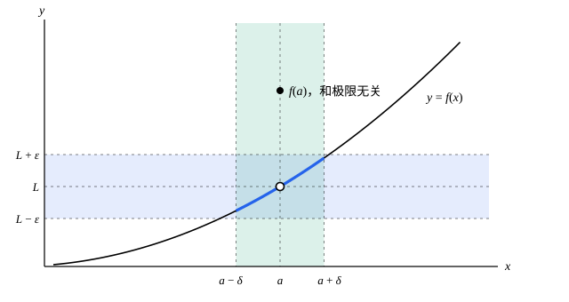

## 这一节要回答的问题

微积分里，「$x\to a$时$f(x)\to L$」是从图像和数值表看出来的：$\frac{x^2-1}{x-1}$在$x=1$处没有定义，$x\to1$时却趋于$2$。数列的:term[极限]{id="math.analysis.sequence-limit"}（limit of a sequence，lim）已经有了$\varepsilon$-$N$的说法，:term[函数的极限]{id="math.analysis.function-limit"}（limit of a function）能不能也写成一句能拿来证明的话？数列极限的那些定理，又能不能直接搬过来？

## 讲解

### 从 ε-N 到 ε-δ

看$f(x)=2x+1$，$x\to1$时它趋于$3$。$|f(x)-3|=2|x-1|$：要它小于$0.01$，只要$|x-1|<0.005$；要它小于任给的$\varepsilon$，只要$|x-1|<\frac\varepsilon2$。数列里说的是「$n$足够大」，这里换成「$x$离$a$足够近」，用一个正数$\delta$衡量多近。

和数列不同的是，这里不让$x$等于$a$。$f$在$a$处可能没有定义，比如$\frac{x^2-1}{x-1}$在$x=1$处；即使有定义，那个值也和$x$趋于$a$时的走向无关。所以只看$a$附近、去掉$a$本身的那些点。

::anchor{id="def-punctured-neighborhood"}
设$\delta>0$。集合$\{x:0<|x-a|<\delta\}$，也就是$a$的$\delta$:term[邻域]{id="math.analysis.neighborhood"}（neighborhood）去掉$a$本身，叫作$a$的$\delta$:term[去心邻域]{id="math.analysis.punctured-neighborhood"}（punctured neighborhood）。

### 函数极限的定义

::anchor{id="def-function-limit"}
设函数$f$在$a$的某个:term[去心邻域]{id="math.analysis.punctured-neighborhood"}里有定义，$L$是实数。如果任给$\varepsilon>0$，都存在$\delta>0$，使得当$0<|x-a|<\delta$时都有$|f(x)-L|<\varepsilon$，就说$x\to a$时$f(x)$的:term[极限]{id="math.analysis.function-limit"}是$L$，记作$\lim_{x\to a}f(x)=L$，或$f(x)\to L\ (x\to a)$。

用量词写出来是

$$
\forall\varepsilon>0,\ \exists\delta>0,\ \forall x\ \bigl(0<|x-a|<\delta\bigr),\quad |f(x)-L|<\varepsilon .
$$

为什么这样定义：$\varepsilon$是对「$f(x)$离$L$多近」的要求，$\delta$是对这个要求的回应，$\delta$可以随$\varepsilon$变，只要存在就行。条件$0<|x-a|$把$x=a$排除在外，所以极限只和$a$附近的函数值有关，和$f(a)$是多少、甚至有没有定义都无关。比如$g(x)=x+1$（$x\ne1$），$g(1)=5$，则$\lim_{x\to1}g(x)=2\ne g(1)$。

边界情况：$\operatorname{sgn}x$（$x>0$时为$1$，$x<0$时为$-1$，$x=0$时为$0$）在$x\to0$时没有极限。任取$L$，$|1-L|$和$|-1-L|$中至少有一个不小于$1$，而$0$的每个去心邻域里，两种函数值都有，所以取$\varepsilon=1$时找不到$\delta$。

把量词逐个否定，就得到「$x\to a$时$f(x)$不趋于$L$」：有$\varepsilon_0>0$，对每个$\delta>0$，都有$x$满足$0<|x-a|<\delta$，而$|f(x)-L|\ge\varepsilon_0$。

### 用定义证明函数的极限

和数列一样分三步：任给$\varepsilon>0$；找出$\delta$；验证$0<|x-a|<\delta$时$|f(x)-L|<\varepsilon$。证明$\lim_{x\to2}x^2=4$：$|x^2-4|=|x-2|\,|x+2|$，因子$|x+2|$随$x$变，先把$x$限制在$2$附近。若$|x-2|<1$，则$1<x<3$，$|x+2|<5$，于是$|x^2-4|<5|x-2|$。

任给$\varepsilon>0$，取$\delta=\min\bigl\{1,\frac\varepsilon5\bigr\}$。当$0<|x-2|<\delta$时，$|x-2|<1$，所以$|x^2-4|<5|x-2|<5\delta\le\varepsilon$。这里的$\delta$要同时满足两个要求：不超过$1$，好让$|x+2|<5$；不超过$\frac\varepsilon5$，好让最后的结果小于$\varepsilon$。取两者中较小的一个，两个要求就都满足了。

### 海涅定理

::anchor{id="thm-heine"}
**定理**　设$f$在$a$的:term[去心邻域]{id="math.analysis.punctured-neighborhood"}$\{x:0<|x-a|<\rho\}$里有定义。$\lim_{x\to a}f(x)=L$，当且仅当：对这个去心邻域里每个趋于$a$的数列$\{x_n\}$，都有$f(x_n)\to L$。这叫作:term[海涅定理]{id="math.analysis.heine-theorem"}（Heine's theorem）。

**证明**：先设$\lim_{x\to a}f(x)=L$，$x_n\to a$，并且$0<|x_n-a|<\rho$。任给$\varepsilon>0$，有$\delta>0$使$0<|x-a|<\delta$时$|f(x)-L|<\varepsilon$。由$x_n\to a$，有$N$使$n>N$时$|x_n-a|<\delta$，又$x_n\ne a$，所以$|f(x_n)-L|<\varepsilon$。这说明$f(x_n)\to L$。

反过来用反证法。假设$f(x)$不趋于$L$，按否定形式，有$\varepsilon_0>0$，对每个$\delta$都有使$|f(x)-L|\ge\varepsilon_0$的$x$满足$0<|x-a|<\delta$。依次取$\delta=\min\bigl\{\rho,\frac1n\bigr\}$，得到$x_n$满足$0<|x_n-a|<\frac1n$和$|f(x_n)-L|\ge\varepsilon_0$。于是$x_n\to a$、$x_n\ne a$，$f(x_n)$却不:term[收敛]{id="math.analysis.convergent-sequence"}（convergent sequence）于$L$，和条件矛盾。

为什么它有用：它把函数的:term[极限]{id="math.analysis.function-limit"}化成了数列的:term[极限]{id="math.analysis.sequence-limit"}。数列极限的定理因此能整个搬过来：唯一性、:term[极限的四则运算法则]{id="math.analysis.algebraic-limit-theorem"}（algebraic limit theorem）、:term[夹逼定理]{id="math.analysis.squeeze-theorem"}（squeeze theorem）对函数极限都成立。比如$f(x)\to A$、$g(x)\to B$时，对每个这样的$\{x_n\}$都有$f(x_n)+g(x_n)\to A+B$，由海涅定理，$f(x)+g(x)\to A+B$。

它也是证明极限不存在的利器：找两个趋于$a$、各项不等于$a$的数列，让$f$沿它们趋于不同的数；或者找一个数列，让$f(x_n)$:term[发散]{id="math.analysis.divergent-sequence"}（divergent sequence）。例 2 就是这样做的。

### 单侧极限与 x → +∞

::anchor{id="def-one-sided-limit"}
只让$x$从右边趋于$a$：把条件$0<|x-a|<\delta$换成$a<x<a+\delta$，得到右极限（right-hand limit），记作$\lim_{x\to a^+}f(x)$；换成$a-\delta<x<a$，得到左极限（left-hand limit），记作$\lim_{x\to a^-}f(x)$。两者统称:term[单侧极限]{id="math.analysis.one-sided-limit"}（one-sided limit）。

为什么要分开看两侧：有的函数只在$a$的一侧有定义，比如$\sqrt x$在$0$处；有的函数在两侧走向不同，比如$\operatorname{sgn}x$在$0$处。$\lim_{x\to a}f(x)=L$，当且仅当左、右极限都存在并且等于$L$：给定$\varepsilon$，左右两边各有一个$\delta$，取较小的那个即可。$\operatorname{sgn}x$在$0$处的右极限是$1$、左极限是$-1$，所以它在$0$处没有:term[极限]{id="math.analysis.function-limit"}。:term[海涅定理]{id="math.analysis.heine-theorem"}对单侧极限同样成立，只要把数列换成从那一侧趋于$a$的数列。

::anchor{id="def-limit-at-infinity"}
如果任给$\varepsilon>0$，都存在实数$X$，使得当$x>X$时都有$|f(x)-L|<\varepsilon$，就记作$\lim_{x\to+\infty}f(x)=L$。它和数列的:term[极限]{id="math.analysis.sequence-limit"}几乎一样，只是正整数$n$换成了实数$x$；$x\to-\infty$类似。

反例：$\sin x$在$x\to+\infty$时没有极限。任取$L$，$|1-L|$和$|-1-L|$中至少有一个不小于$1$（两者之和不小于$2$）；而无论$X$多大，后面都有$\sin x=1$和$\sin x=-1$的点。所以取$\varepsilon=1$时，找不到这样的$X$。

## 几何图像

横带是$L$的$\varepsilon$:term[邻域]{id="math.analysis.neighborhood"}，竖带是$a$的$\delta$邻域。竖带里那段加粗的曲线全在横带里，这就是「$0<|x-a|<\delta$时$|f(x)-L|<\varepsilon$」。$(a,L)$画成空心圆：$f(a)$在别处（实心点）也不影响:term[极限]{id="math.analysis.function-limit"}是$L$；把$\varepsilon$缩小，就得把$\delta$也缩小。

:::anim{component="function-plot"}
range: { x: [-0.02, 0.35], y: [-1.3, 1.3] }
functions:
  - expr: "sin(1 / x)"
    label: |
      $y=\sin\frac1x$
points:
  - { x: "1 / (k * pi)", y: "0" }
  - { x: "1 / (2 * k * pi + pi / 2)", y: "1" }
sliders:
  - name: k
    min: 1
    max: 20
    step: 1
    default: 1
    label: |
      $k$
:::

两个点的横坐标是$\frac{1}{k\pi}$和$\frac{1}{2k\pi+\pi/2}$，也就是例 2 的$x_k$、$y_k$。拖动滑块把$k$调大，两个点一起向$0$靠近，前一个的高度却总是$0$，后一个总是$1$。这就是例 2 用:term[海涅定理]{id="math.analysis.heine-theorem"}说明$\sin\frac1x$在$x\to0$时没有极限的办法。

## 例题

### 例 1　$\lim_{x\to3}\frac1x=\frac13$

**为什么想到这么做**：$\bigl|\frac1x-\frac13\bigr|=\frac{|x-3|}{3|x|}$，分子能任意小，可分母里的$|x|$在$x$靠近$0$时会很小，把整个式子放大。所以先把$x$限制在$3$附近，让$|x|$有一个正的下界（lower bound），再像证明$x^2\to4$那样取$\delta$。

**推导**：若$|x-3|<1$，则$2<x<4$，于是

$$
\left|\frac1x-\frac13\right|=\frac{|x-3|}{3x}<\frac{|x-3|}{6} .
$$

任给$\varepsilon>0$，取$\delta=\min\{1,6\varepsilon\}$。当$0<|x-3|<\delta$时，$\bigl|\frac1x-\frac13\bigr|<\frac{\delta}{6}\le\varepsilon$，所以$\lim_{x\to3}\frac1x=\frac13$。

### 例 2　$\lim_{x\to0}\sin\frac1x$不存在

**为什么想到这么做**：$x\to0$时$\frac1x$跑向无穷，$\sin\frac1x$在$-1$和$1$之间摆动无穷多次，看上去不趋于任何数。要证明「不存在」，用:term[海涅定理]{id="math.analysis.heine-theorem"}最直接：挑两串趋于$0$的点，一串上函数值总是$0$，另一串上总是$1$。

**推导**：取$x_n=\frac{1}{n\pi}$，$y_n=\frac{1}{2n\pi+\pi/2}$，它们都趋于$0$，各项都不等于$0$。而$\sin\frac{1}{x_n}=\sin n\pi=0\to0$，$\sin\frac{1}{y_n}=\sin\bigl(2n\pi+\frac\pi2\bigr)=1\to1$。如果$\lim_{x\to0}\sin\frac1x=L$存在，由海涅定理，两个数列都:term[收敛]{id="math.analysis.convergent-sequence"}于$L$，得$L=0$且$L=1$，矛盾。所以:term[极限]{id="math.analysis.function-limit"}不存在。

对比$x\sin\frac1x$：$\bigl|x\sin\frac1x-0\bigr|\le|x|$，任给$\varepsilon>0$取$\delta=\varepsilon$即可，所以$\lim_{x\to0}x\sin\frac1x=0$。同样是无穷多次摆动，摆幅被因子$x$压住，就有了:term[极限]{id="math.analysis.function-limit"}。

## 常见误区

- 「$\lim_{x\to a}f(x)$就是$f(a)$。」不对：:term[极限]{id="math.analysis.function-limit"}不管$f(a)$，前面的$g$就是例子。两者相等，正是[连续函数的严格定义](lesson:math.analysis.continuity)要讲的:term[连续]{id="math.analysis.continuous-function"}（continuous）。
- 「$\delta$要取满足条件的最大的那个。」不必：定义只要求$\delta$存在，比够用的$\delta$更小的数也都够用。
- 「沿某一个趋于$a$的数列有$f(x_n)\to L$，就有$f(x)\to L$。」不对：$\sin\frac1x$沿$x_n=\frac{1}{n\pi}$趋于$0$，可它没有极限。:term[海涅定理]{id="math.analysis.heine-theorem"}要求对每个这样的数列都成立。
- 「$x\to a$时$f(x)$有极限，说明$f$在$a$处有定义。」不对：$\frac{x^2-1}{x-1}$在$x=1$处没有定义，极限却是$2$。
