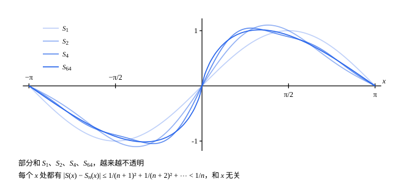

## 这一节要回答的问题

$\sum_{n=1}^\infty\frac{\sin nx}{n^2}$对每个$x$都:term[绝对收敛]{id="math.analysis.absolute-convergence"}（absolute convergence），因为$\bigl|\frac{\sin nx}{n^2}\bigr|\le\frac{1}{n^2}$。这样每个$x$对应一个和，得到一个函数。

要把它当函数研究，比如问它是不是:term[连续函数]{id="math.analysis.continuous-function"}（continuous function），就要知道:term[部分和]{id="math.analysis.partial-sum"}（partial sum）是不是:term[一致收敛]{id="math.analysis.uniform-convergence"}（uniform convergence）。可和写不出式子来，怎么判断？

## 讲解

### 函数项级数

等比级数（geometric series）$1+x+x^2+\cdots$对$(-1,1)$里的每个$x$都是:term[收敛级数]{id="math.analysis.convergent-series"}（convergent series），和是$\frac{1}{1-x}$。把$x$当变量，这是一串函数$1,x,x^2,\dots$相加，前$n+1$项的和$1+x+\cdots+x^n$是一列函数。

::anchor{id="def-function-series"}
设$u_1,u_2,\dots$都定义在集合$D$上，$S_n(x)=u_1(x)+u_2(x)+\cdots+u_n(x)$。$\sum u_n(x)$叫作$D$上的:term[函数项级数]{id="math.analysis.function-series"}（series of functions），$S_n$叫作它的:term[部分和]{id="math.analysis.partial-sum"}。若$\{S_n\}$在$D$上:term[逐点收敛]{id="math.analysis.pointwise-convergence"}（pointwise convergence）于$S$，就说:term[级数]{id="math.analysis.series"}（series）在$D$上逐点收敛，$S$叫作和函数（sum function）；若$\{S_n\}$在$D$上:term[一致收敛]{id="math.analysis.uniform-convergence"}于$S$，就说级数在$D$上一致收敛。下标也可以从$0$开始，比如$\sum_{n=0}^\infty x^n$。

为什么这样定义：固定$x$，它就是一个数项级数（series of numbers），和是$S(x)$；把部分和看成一列函数，上一节的逐点收敛、一致收敛就能直接搬过来。边界情况：$\sum_{n=0}^\infty x^n$在$(-1,1)$上逐点收敛于$\frac{1}{1-x}$，可误差$\frac{1}{1-x}-(1+x+\cdots+x^n)=\frac{x^{n+1}}{1-x}$在$x\to1$时没有:term[上界]{id="math.analysis.upper-bound"}（upper bound），所以在$(-1,1)$上不一致收敛（例 2）。

### 一致收敛的柯西准则

按定义判断:term[一致收敛]{id="math.analysis.uniform-convergence"}，要先知道和函数。和函数常常写不出来，又要用:term[柯西收敛准则]{id="math.analysis.cauchy-criterion"}（Cauchy criterion）的想法：不看:term[极限]{id="math.analysis.sequence-limit"}（limit of a sequence，lim），只看项与项之间。

::anchor{id="thm-uniform-cauchy"}
**定理 1**　函数列$\{f_n\}$在$D$上:term[一致收敛]{id="math.analysis.uniform-convergence"}（于某个函数），当且仅当任给$\varepsilon>0$，都存在正整数$N$，使得当$m,n>N$时，对所有$x\in D$都有$|f_m(x)-f_n(x)|<\varepsilon$。这叫作:term[一致收敛的柯西准则]{id="math.analysis.uniform-cauchy-criterion"}（Cauchy criterion for uniform convergence）。

**证明**：设$\{f_n\}$一致收敛于$f$。任给$\varepsilon>0$，有$N$，使$n>N$时所有$x$都满足$|f_n(x)-f(x)|<\frac\varepsilon2$，于是$m,n>N$时$|f_m(x)-f_n(x)|\le|f_m(x)-f(x)|+|f(x)-f_n(x)|<\varepsilon$。

反过来，设条件成立。对每个$x$，$\{f_n(x)\}$是:term[柯西列]{id="math.analysis.cauchy-sequence"}（Cauchy sequence），由柯西收敛准则，它是:term[收敛数列]{id="math.analysis.convergent-sequence"}（convergent sequence），把极限记作$f(x)$。任给$\varepsilon>0$，取条件里的$N$；固定$n>N$和$x$，在$|f_m(x)-f_n(x)|<\varepsilon$里令$m\to\infty$，由:term[保不等式性]{id="math.analysis.order-limit-theorem"}（order limit theorem），$|f(x)-f_n(x)|\le\varepsilon$。这对所有$x$都成立，所以$\|f_n-f\|_\infty\le\varepsilon$，$\{f_n\}$一致收敛于$f$。

为什么想到这么做：先逐点用柯西收敛准则造出极限函数，再把「对所有$x$」一路带到极限里；$N$只依赖$\varepsilon$，一致性就保住了。

用到:term[部分和]{id="math.analysis.partial-sum"}上，$f_n=S_n$，$S_n(x)-S_m(x)=u_{m+1}(x)+\cdots+u_n(x)$，就得到下面的推论。

**推论**　:term[函数项级数]{id="math.analysis.function-series"}$\sum u_n(x)$在$D$上一致收敛，当且仅当任给$\varepsilon>0$，都有$N$，使$n>m>N$时，对所有$x\in D$都有$|u_{m+1}(x)+\cdots+u_n(x)|<\varepsilon$。特别地（取$n=m+1$），一致收敛的:term[级数]{id="math.analysis.series"}满足$\|u_n\|_\infty\to0$。

$\sum x^n$在$(-1,1)$上，$\|x^n\|_\infty=\sup_{-1<x<1}|x|^n=1$，不趋于$0$，所以不一致收敛，和上面的边界情况一致。

### 魏尔斯特拉斯判别法

$\sum\frac{\sin nx}{n^2}$的每一项，不管$x$是多少，绝对值都不超过$\frac{1}{n^2}$。所以它的一段和，绝对值被$\sum\frac{1}{n^2}$的同一段和压住，而后者和$x$无关。

::anchor{id="thm-weierstrass-m-test"}
**定理 2**　若有数列$\{M_n\}$，使所有$x\in D$都满足$|u_n(x)|\le M_n$，并且$\sum M_n$:term[收敛]{id="math.analysis.convergent-series"}（convergent series），则$\sum u_n(x)$在$D$上:term[一致收敛]{id="math.analysis.uniform-convergence"}，并且对每个$x$都:term[绝对收敛]{id="math.analysis.absolute-convergence"}。这叫作:term[魏尔斯特拉斯判别法]{id="math.analysis.weierstrass-m-test"}（Weierstrass M-test）。

**证明**：任给$\varepsilon>0$，由:term[级数的柯西准则]{id="math.analysis.series-cauchy-criterion"}（Cauchy criterion for series），有$N$，使$n>m>N$时$M_{m+1}+\cdots+M_n<\varepsilon$。于是对所有$x\in D$，$|u_{m+1}(x)+\cdots+u_n(x)|\le|u_{m+1}(x)|+\cdots+|u_n(x)|\le M_{m+1}+\cdots+M_n<\varepsilon$。由定理 1 的推论，:term[级数]{id="math.analysis.series"}在$D$上一致收敛；中间那个不等式也说明$\sum|u_n(x)|$满足柯西准则，所以对每个$x$绝对收敛。

为什么它好用：要找的只是一串和$x$无关的:term[上界]{id="math.analysis.upper-bound"}，最好的选择是$M_n=\|u_n\|_\infty$，所以判别法也可以说成「$\sum\|u_n\|_\infty$收敛，则一致收敛」。反过来不成立：一致收敛的级数，不一定找得到这样的$M_n$（第 5 题）。

## 几何图像

:::anim{component="function-plot"}
range: { x: [-1, 0.9], y: [-0.3, 10.5] }
functions:
  - expr: "1 / (1 - x)"
    label: |
      和函数$y=\frac{1}{1-x}$
  - expr: "(1 - x^(k + 1)) / (1 - x)"
    label: |
      部分和$y=1+x+\cdots+x^k$
points:
  - { x: "r", y: "1 / (1 - r)" }
  - { x: "r", y: "(1 - r^(k + 1)) / (1 - r)" }
sliders:
  - name: k
    min: 1
    max: 25
    step: 1
    default: 5
    label: |
      部分和的最高次数$k$
  - name: r
    min: 0.3
    max: 0.85
    step: 0.05
    default: 0.6
    label: |
      $r$
:::

两条曲线是$\sum_{n=0}^\infty x^n$的:term[部分和]{id="math.analysis.partial-sum"}$1+x+\cdots+x^k=\frac{1-x^{k+1}}{1-x}$和它的和函数$\frac{1}{1-x}$。在$[-r,r]$上，两者之差的绝对值$\frac{|x|^{k+1}}{1-x}$在$x=r$处最大，是$\frac{r^{k+1}}{1-r}$，图上标出了这两个点。把$k$调大，它们就靠在一起，这是$[-r,r]$上的:term[一致收敛]{id="math.analysis.uniform-convergence"}。可$x$越靠近$1$，两条曲线分得越开：在$(-1,1)$上，不管$k$多大，差的:term[上确界]{id="math.analysis.supremum"}（supremum，sup）都是$+\infty$。

这是例 1 的$\sum\frac{\sin kx}{k^2}$，四条曲线是它的部分和，$n=64$时已经和和函数看不出差别。:term[魏尔斯特拉斯判别法]{id="math.analysis.weierstrass-m-test"}给出的误差:term[上界]{id="math.analysis.upper-bound"}$\frac{1}{(n+1)^2}+\frac{1}{(n+2)^2}+\cdots<\frac1n$和$x$无关，整条曲线一起被压向和函数。

## 例题

### 例 1　$\sum\frac{\sin nx}{n^2}$在$\R$上一致收敛

证明$\sum_{n=1}^\infty\frac{\sin nx}{n^2}$在$\R$上:term[一致收敛]{id="math.analysis.uniform-convergence"}，并估计用前$n$项代替和函数时的误差。

**为什么想到这么做**：每一项的绝对值都不超过$\frac{1}{n^2}$，和$x$无关，正好用:term[魏尔斯特拉斯判别法]{id="math.analysis.weierstrass-m-test"}。误差就是余下各项之和，同样用$\frac{1}{k^2}$放大。

**推导**：对所有$x\in\R$，$\bigl|\frac{\sin nx}{n^2}\bigr|\le\frac{1}{n^2}$，而$\sum\frac{1}{n^2}$:term[收敛]{id="math.analysis.convergent-series"}（见[级数的柯西准则与绝对收敛](lesson:math.analysis.series-cauchy)例 1），由魏尔斯特拉斯判别法，:term[级数]{id="math.analysis.series"}在$\R$上一致收敛。记和函数为$S$，:term[部分和]{id="math.analysis.partial-sum"}为$S_n$，那里还证明了$m>n$时$\frac{1}{(n+1)^2}+\cdots+\frac{1}{m^2}<\frac1n$，所以$|S_m(x)-S_n(x)|<\frac1n$。令$m\to\infty$，得$|S(x)-S_n(x)|\le\frac1n$，对所有$x$都成立。

### 例 2　$\sum x^n$在哪里一致收敛

证明$\sum_{n=0}^\infty x^n$在每个$[-r,r]$（$0<r<1$）上:term[一致收敛]{id="math.analysis.uniform-convergence"}，在$(-1,1)$上不一致收敛。

**为什么想到这么做**：在$[-r,r]$上$|x^n|\le r^n$，等比级数$\sum r^n$:term[收敛]{id="math.analysis.convergent-series"}，用:term[魏尔斯特拉斯判别法]{id="math.analysis.weierstrass-m-test"}。在$(-1,1)$上，要否定一致收敛，看一致收敛的必要条件$\|u_n\|_\infty\to0$。

**推导**：在$[-r,r]$上，$|x^n|\le r^n$，$\sum r^n$:term[收敛]{id="math.analysis.convergent-series"}，由魏尔斯特拉斯判别法，一致收敛。在$(-1,1)$上，$\|x^n\|_\infty=\sup_{-1<x<1}|x|^n=1$，不趋于$0$，由定理 1 的推论，不一致收敛。

两件事并不矛盾：一致收敛要一个$N$管住整个集合，在$[-r,r]$上管得住，可$r$越接近$1$，需要的$N$越大，没有一个$N$能管住整个$(-1,1)$。

## 常见误区

- 「每一点都:term[绝对收敛]{id="math.analysis.absolute-convergence"}，就:term[一致收敛]{id="math.analysis.uniform-convergence"}。」不对：$\sum x^n$在$(-1,1)$上每一点都绝对收敛，却不一致收敛（例 2）。
- 「:term[魏尔斯特拉斯判别法]{id="math.analysis.weierstrass-m-test"}用不上，就不一致收敛。」不对：判别法只是充分条件，第 5 题的:term[级数]{id="math.analysis.series"}一致收敛，却找不到:term[收敛]{id="math.analysis.convergent-series"}的$\sum M_n$。
- 「$M_n$可以随$x$变。」不对：$M_n$必须对所有$x$都管用。对每个$x$分别找一个收敛的:term[上界]{id="math.analysis.upper-bound"}，只能说明每一点都绝对收敛。
- 「一致收敛的:term[函数项级数]{id="math.analysis.function-series"}，各项的绝对值组成的级数也一致收敛。」不对：常数函数$u_n(x)=\frac{(-1)^n}{n}$组成的级数一致收敛，$\sum|u_n|$却:term[发散]{id="math.analysis.divergent-series"}（divergent series），见第 7 题。
