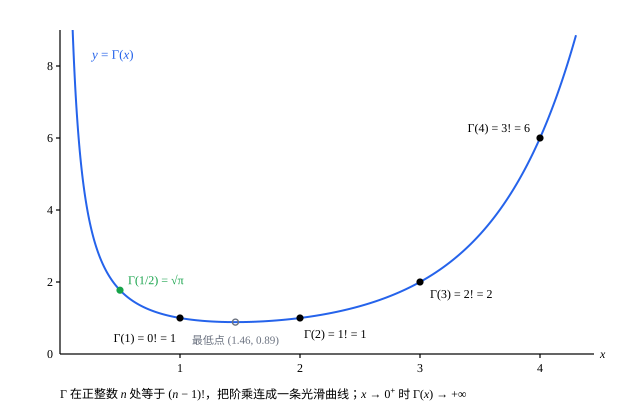

## 这一节要回答的问题

$n!$只对自然数有定义。微积分里，分部积分（integration by parts）$n$次可以算出$\int_0^\infty t^ne^{-t}\dd t=n!$；把$n$换成任意正实数，这个积分还有意义吗？这样得到的函数有没有$n!$那样的递推关系，在$\frac12$处又等于多少？

## 讲解

### 伽马函数的定义

$\int_0^\infty e^{-t}\dd t=1$，$\int_0^\infty te^{-t}\dd t=1$，$\int_0^\infty t^2e^{-t}\dd t=2$，$\int_0^\infty t^3e^{-t}\dd t=6$：$t$的指数是$n$时，积分是$n!$。把指数换成实数，就得到一个定义在正实数上的函数。

::anchor{id="def-gamma"}
对$x>0$，令$\Gamma(x)=\int_0^\infty t^{x-1}e^{-t}\dd t$，这个:term[含参变量积分]{id="math.analysis.parameter-integral"}（integral depending on a parameter）叫作:term[伽马函数]{id="math.analysis.gamma-function"}（gamma function）。

::anchor{id="thm-gamma-converges"}
**定理 1**　$x>0$时这个反常积分（improper integral）收敛（convergent），$x\le0$时发散（divergent）。

**证明**：拆成$\int_0^1$和$\int_1^\infty$两段。在$(0,1]$上$0<t^{x-1}e^{-t}\le t^{x-1}$，而$x>0$时$\int_0^1t^{x-1}\dd t=\frac1x$收敛。在$[1,+\infty)$上，$t^{x+1}e^{-t}\to0$（$t\to+\infty$，见[用幂级数定义指数函数与对数](lesson:math.analysis.exp-log-construction)的例 1），所以它不超过某个常数$K$，$t^{x-1}e^{-t}\le\frac{K}{t^2}$，$\int_1^\infty$也收敛。$x\le0$时，$(0,1]$上$t^{x-1}e^{-t}\ge e^{-1}t^{-1}$，而$\int_0^1\frac{\dd t}{t}$发散，所以整个积分发散。

为什么这样定义：指数写成$x-1$而不是$x$，是历史上勒让德（Legendre）定下的记号，这样$\Gamma(n)=(n-1)!$，第 6 题里的贝塔函数（beta function）公式也更整齐。边界情况：$x\to0^+$时$\Gamma(x)\ge\int_0^1t^{x-1}e^{-1}\dd t=\frac{1}{ex}\to+\infty$，$\Gamma$在$0$处没有定义，也不能:term[连续]{id="math.analysis.continuous-function"}（continuous）地补上一个值。

### 递推公式

::anchor{id="thm-gamma-recursion"}
**定理 2**　$x>0$时$\Gamma(x+1)=x\Gamma(x)$；$\Gamma(1)=1$；因此正整数$n$满足$\Gamma(n+1)=n!$。

**证明**：由乘积的求导法则，$\bigl(t^xe^{-t}\bigr)'=xt^{x-1}e^{-t}-t^xe^{-t}$。在$[\varepsilon,A]$上用:term[牛顿-莱布尼茨公式]{id="math.analysis.newton-leibniz-formula"}（Newton-Leibniz formula），得$A^xe^{-A}-\varepsilon^xe^{-\varepsilon}=x\int_\varepsilon^At^{x-1}e^{-t}\dd t-\int_\varepsilon^At^xe^{-t}\dd t$。令$\varepsilon\to0^+$、$A\to+\infty$，左边趋于$0$（$x>0$），得$0=x\Gamma(x)-\Gamma(x+1)$。又$\Gamma(1)=\int_0^\infty e^{-t}\dd t=1$，由数学归纳法（mathematical induction），$\Gamma(n+1)=n\Gamma(n)=\cdots=n!$。

为什么想到这么做：这就是分部积分（见[分部积分法](lesson:math.calculus.integration-by-parts)）：把$t^x$求导、降一次幂，把$e^{-t}$积分。微积分里算$\int_0^\infty t^ne^{-t}\dd t$用的就是这一步，现在$x$不必是整数。反复用定理 2，任何$\Gamma(x)$都能化成某个$\Gamma(x')$乘一串因子，$0<x'\le1$。

### $\Gamma(\frac12)$

::anchor{id="thm-gamma-half"}
**定理 3**　$\Gamma\bigl(\frac12\bigr)=\sqrt\pi$。

**证明**：换元（substitution）$t=u^2$（$u>0$），先在$[\varepsilon,A]$上换元再取极限（换元公式见[换元积分法](lesson:math.calculus.substitution)），得$\Gamma\bigl(\frac12\bigr)=\int_0^\infty t^{-1/2}e^{-t}\dd t=\int_0^\infty\frac1ue^{-u^2}\cdot2u\dd u=2\int_0^\infty e^{-u^2}\dd u$。由[极坐标下的二重积分](lesson:math.vector-calculus.polar-double-integrals)，$\int_{-\infty}^\infty e^{-u^2}\dd u=\sqrt\pi$；$e^{-u^2}$是偶函数（even function），所以$2\int_0^\infty e^{-u^2}\dd u=\sqrt\pi$。

再用定理 2，$\Gamma\bigl(\frac32\bigr)=\frac12\sqrt\pi$，$\Gamma\bigl(\frac52\bigr)=\frac32\cdot\frac12\sqrt\pi$，依此类推：半整数处的值都是$\sqrt\pi$的有理数倍。

### 可导性

::anchor{id="thm-gamma-smooth"}
**定理 4**　$\Gamma$在$(0,+\infty)$上:term[可导]{id="math.analysis.differentiable-function"}（differentiable），$\Gamma'(x)=\int_0^\infty t^{x-1}\ln t\,e^{-t}\dd t$。

**证明**：任取$[c,d]\subset(0,+\infty)$，把$\Gamma$拆成$\int_1^\infty$和$\int_0^1$。第一段：$\frac{\partial}{\partial x}\bigl(t^{x-1}e^{-t}\bigr)=t^{x-1}\ln t\,e^{-t}$，在$[1,+\infty)\times[c,d]$上，由$\ln t\le t$，它不超过$g(t)=t^de^{-t}$，$\int_1^\infty g$收敛，由[含参变量积分](lesson:math.analysis.parameter-integrals#thm-leibniz-improper)的定理 4，可以:term[积分号下求导]{id="math.analysis.differentiation-under-integral"}（differentiation under the integral sign）。第二段换元$t=\frac1s$，化成$\int_1^\infty s^{-x-1}e^{-1/s}\dd s$；对$x$的偏导数的绝对值是$s^{-x-1}\ln s\,e^{-1/s}\le s^{-c-1}\ln s$，它在$[1,+\infty)$上的积分收敛，同样可以求导。两段的导数合起来（第二段换回$t$），就是要证的式子。

为什么想到这么做：那里的定理 4 只管$[a,+\infty)$这种区间。$\int_0^1$的麻烦在$t=0$附近，换元$t=\frac1s$把它搬到了无穷远处。可导的函数一定:term[连续]{id="math.analysis.continuous-function"}，所以$\Gamma$是连续函数；再求一次导会得到什么，见第 5 题。

## 几何图像

:::anim{component="function-plot"}
range: { x: [0, 12], y: [0, 1.5] }
functions:
  - expr: "x^(s - 1) * exp(-x)"
    label: |
      被积函数$y=x^{s-1}e^{-x}$
sliders:
  - name: s
    min: 0.3
    max: 4
    step: 0.1
    default: 2.5
    label: |
      $s$
:::

图里的曲线是$y=x^{s-1}e^{-x}$，它和横轴之间（$x>0$）的面积就是$\Gamma(s)$。拖动$s$：$s>1$时曲线是一个鼓包，最高点在$x=s-1$，高度是$\bigl(\frac{s-1}{e}\bigr)^{s-1}$；$s$越大，鼓包越往右，高度却先降后升：$s$从$1.1$拖到$2$，高度从约$0.72$降到$\frac1e\approx0.37$，差不多减半；过了$s=2$又越来越高，$s=4$时约$1.34$。$s<1$时曲线在$x=0$附近无界，冲出画面，面积却仍然有限（定理 1）。

:term[伽马函数]{id="math.analysis.gamma-function"}在正整数$n$处等于$(n-1)!$，把阶乘连成了一条光滑曲线，$\Gamma\bigl(\frac12\bigr)=\sqrt\pi\approx1.77$。曲线在$(1,2)$里有最低点，$x\to0^+$时$\Gamma(x)\to+\infty$。

## 例题

### 例 1　把积分化成伽马函数

用:term[伽马函数]{id="math.analysis.gamma-function"}表示$\int_0^\infty e^{-x^3}\dd x$。

**为什么想到这么做**：$\Gamma$的被积函数里是$e^{-t}$，这里是$e^{-x^3}$，换元$t=x^3$就能凑成那个样子，多出来的$\dd x$变成$t$的幂。

**推导**：令$t=x^3$，则$x=t^{1/3}$，$\dd x=\frac13t^{-2/3}\dd t$，所以$\int_0^\infty e^{-x^3}\dd x=\frac13\int_0^\infty t^{-2/3}e^{-t}\dd t=\frac13\Gamma\bigl(\frac13\bigr)$。由定理 2，它也等于$\Gamma\bigl(\frac43\bigr)\approx0.893$。$\Gamma\bigl(\frac13\bigr)$不能再用初等函数和$\pi$表示，伽马函数在这里是必需的。

### 例 2　和上一节的结果对照

用:term[伽马函数]{id="math.analysis.gamma-function"}计算$\int_0^\infty x^2e^{-x^2}\dd x$。

**为什么想到这么做**：[含参变量积分](lesson:math.analysis.parameter-integrals)的例 2 用:term[积分号下求导]{id="math.analysis.differentiation-under-integral"}算过这个积分（$a=1$），这里换一条路：换元$t=x^2$化成伽马函数。

**推导**：令$t=x^2$，$\dd x=\frac{1}{2\sqrt t}\dd t$，得$\int_0^\infty x^2e^{-x^2}\dd x=\frac12\int_0^\infty t^{1/2}e^{-t}\dd t=\frac12\Gamma\bigl(\frac32\bigr)=\frac12\cdot\frac{\sqrt\pi}{2}=\frac{\sqrt\pi}{4}$。和那里的$\frac{\sqrt\pi}{4}a^{-3/2}$在$a=1$时一致。

## 常见误区

- 「$\Gamma(n)=n!$。」差了一位：$\Gamma(n)=(n-1)!$，$\Gamma(n+1)=n!$（定理 2）。
- 「$\Gamma(x)$对所有实数$x$都由这个积分定义。」积分只在$x>0$时收敛（定理 1）；负数处的$\Gamma$要靠递推公式另行定义（第 7 题）。
- 「满足$f(x+1)=xf(x)$、$f(1)=1$的光滑函数只有$\Gamma$。」不对，还差一个条件（第 8 题）。
