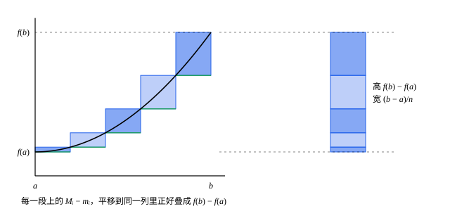

## 这一节要回答的问题

按定义判断:term[可积]{id="math.analysis.riemann-integral"}（Riemann integrable），要比较所有:term[分割]{id="math.analysis.partition"}（partition）的:term[上和]{id="math.analysis.upper-sum"}（upper sum）与:term[下和]{id="math.analysis.lower-sum"}（lower sum）；:term[可积准则]{id="math.analysis.integrability-criterion"}（Riemann's criterion）把它简化成「对每个$\varepsilon$找一个好分割」。可具体到一个函数，这个分割怎么找？常见的函数里，哪些一定可积？

狄利克雷函数（Dirichlet function）说明，:term[有界]{id="math.analysis.bounded-function"}（bounded function）的函数不一定可积。可积和不可积，差在哪里？

## 讲解

### 单调函数可积

**定理 1**　$[a,b]$上的单调函数都:term[可积]{id="math.analysis.riemann-integral"}。

**证明**：设$f$递增（递减时对$-f$论证），则$f(a)\le f(x)\le f(b)$，$f$:term[有界]{id="math.analysis.bounded-function"}。取等分:term[分割]{id="math.analysis.partition"}$P_n$，每段长$\frac{b-a}{n}$。$f$递增，第$i$段上的:term[上确界]{id="math.analysis.supremum"}（supremum，sup）和:term[下确界]{id="math.analysis.infimum"}（infimum，inf）就是右端点、左端点的值，于是

$$
U(f,P_n)-L(f,P_n)=\sum_{i=1}^n\bigl[f(x_i)-f(x_{i-1})\bigr]\frac{b-a}{n}=\frac{\bigl(f(b)-f(a)\bigr)(b-a)}{n} .
$$

任给$\varepsilon>0$，由:term[阿基米德性质]{id="math.analysis.archimedean-property"}（Archimedean property）取$n$大到右边小于$\varepsilon$，由:term[可积准则]{id="math.analysis.integrability-criterion"}，$f$可积。

为什么这么简单：方括号里的差一项接一项地相消，各段的振幅（oscillation）加起来正好是$f(b)-f(a)$，不管$f$在哪里跳、跳多少次。所以单调函数即使有无穷多个间断点（point of discontinuity），也照样可积（例 2）。

### 连续函数可积

**定理 2**　$[a,b]$上的:term[连续函数]{id="math.analysis.continuous-function"}（continuous function）都:term[可积]{id="math.analysis.riemann-integral"}。

**证明**：由:term[康托尔定理]{id="math.analysis.heine-cantor-theorem"}（Heine-Cantor theorem），$f$在$[a,b]$上:term[一致连续]{id="math.analysis.uniform-continuity"}（uniform continuity）。任给$\varepsilon>0$，有$\delta>0$，使$[a,b]$里$|x-y|<\delta$的两点都满足$|f(x)-f(y)|<\eta$，其中$\eta=\frac{\varepsilon}{2(b-a)}$。取一个每段都短于$\delta$的:term[分割]{id="math.analysis.partition"}$P$，比如等分成$n>\frac{b-a}{\delta}$段。

同一段里任意两点的函数值相差小于$\eta$。于是$f$在每一段上:term[有界]{id="math.analysis.bounded-function"}（不超过左端点的函数值的绝对值加$\eta$），段数有限，$f$在$[a,b]$上有界，:term[上和]{id="math.analysis.upper-sum"}、:term[下和]{id="math.analysis.lower-sum"}有意义。再由$f(x)<f(y)+\eta$，先对$x$取:term[上确界]{id="math.analysis.supremum"}、再对$y$取:term[下确界]{id="math.analysis.infimum"}，得$M_i-m_i\le\eta$，所以

$$
U(f,P)-L(f,P)=\sum_{i=1}^n(M_i-m_i)\Delta x_i\le\eta\,(b-a)=\frac\varepsilon2<\varepsilon .
$$

由:term[可积准则]{id="math.analysis.integrability-criterion"}，$f$可积。

为什么要一致连续：可积准则要的是一个分割，它必须在每一段上都把振幅压小。只知道每一点连续，每一点各有各的$\delta$，凑不出一个处处够细的分割；一致连续给的是一个对整个区间都管用的$\delta$。有界性这里直接从一致连续推出，也可以用[有界性定理与最值定理](lesson:math.analysis.extreme-value)里的:term[有界性定理]{id="math.analysis.boundedness-theorem"}（boundedness theorem）。

### 有界却不可积

狄利克雷函数$D(x)$在有理数处取$1$、无理数处取$0$。任何一个小区间里两种数都有，所以每一段上的振幅都是$1$，对每个:term[分割]{id="math.analysis.partition"}都有$U(D,P)-L(D,P)=b-a$，压不下去。按:term[可积准则]{id="math.analysis.integrability-criterion"}，$D$在$[a,b]$上不:term[可积]{id="math.analysis.riemann-integral"}。

为什么它不可积，而单调函数、:term[连续函数]{id="math.analysis.continuous-function"}可积：$D$在每一点都不连续，它的振幅在哪里都不变小。函数可积，要求「振幅大的地方」能被总长任意小的几段盖住；只有一个间断点（例 1）、有无穷多个跳跃的单调函数（例 2），都能做到这一点。到底间断点能有多少，见第 7 题。

## 几何图像

这是定理 1 的证明。左边每一段上的小矩形，底边在$m_i$、顶边在$M_i$，高就是$f$在那一段上的振幅$M_i-m_i$，宽是段长；所有小矩形的面积加起来就是$U-L$。把它们平移到右边的同一列，正好从$f(a)$叠到$f(b)$，所以$U-L=\bigl(f(b)-f(a)\bigr)\cdot\frac{b-a}{n}$，段数$n$越大越小。

:::anim{component="function-plot"}
range: { x: [0, 1], y: [0, 1.1] }
functions:
  - expr: "4 * x * (1 - x)"
    label: |
      $y=4x(1-x)$
  - expr: "4 * min(max(0.5, min(floor(k * x), k - 1) / k), min(floor(k * x), k - 1) / k + 1 / k) * (1 - min(max(0.5, min(floor(k * x), k - 1) / k), min(floor(k * x), k - 1) / k + 1 / k))"
    label: |
      上和的矩形顶边
  - expr: "min(4 * (min(floor(k * x), k - 1) / k) * (1 - min(floor(k * x), k - 1) / k), 4 * (min(floor(k * x), k - 1) / k + 1 / k) * (1 - min(floor(k * x), k - 1) / k - 1 / k))"
    label: |
      下和的矩形顶边
sliders:
  - name: k
    min: 1
    max: 40
    step: 1
    default: 6
    label: |
      等分的段数$k$
:::

$4x(1-x)$先升后降，不是单调函数，可它:term[连续]{id="math.analysis.continuous-function"}。把$[0,1]$等分成$k$段，上面的台阶是每一段上的:term[上确界]{id="math.analysis.supremum"}，下面的是:term[下确界]{id="math.analysis.infimum"}，两条台阶之间的面积就是$U-L$。$|4x(1-x)-4y(1-y)|=4|x-y|\,|1-x-y|\le4|x-y|$，所以每一段上的振幅不超过$\frac4k$，$U-L\le\frac4k$：拖动滑块把$k$调大，每一段同时变窄，这正是定理 2 证明里那个「对所有段都管用的段长」。

## 例题

### 例 1　只有一个间断点的有界函数

设$f(x)=\sin\frac1x$（$0<x\le1$），$f(0)=0$。证明$f$在$[0,1]$上:term[可积]{id="math.analysis.riemann-integral"}。

**为什么想到这么做**：$f$只在$0$附近摆动不停，在$0$处不:term[连续]{id="math.analysis.continuous-function"}；离开$0$，它是连续函数。把$0$附近的一小段单独拿出来：那里振幅虽然是$2$，段却可以取得很短；剩下的部分用定理 2。

**推导**：任给$\varepsilon>0$，取$\delta=\frac\varepsilon4$（不妨设$\delta<1$）。$f$在$[\delta,1]$上连续，由定理 2 可积，由:term[可积准则]{id="math.analysis.integrability-criterion"}，有$[\delta,1]$的:term[分割]{id="math.analysis.partition"}$Q$使它的:term[上和]{id="math.analysis.upper-sum"}与:term[下和]{id="math.analysis.lower-sum"}之差小于$\frac\varepsilon2$。在$Q$前面添上分点$0$，得到$[0,1]$的分割$P$。

$P$的上和、下和，就是$[0,\delta]$这一段的贡献加上$Q$的上和、下和。$|f|\le1$，$[0,\delta]$上的振幅不超过$2$，贡献至多$2\delta=\frac\varepsilon2$。所以$U(f,P)-L(f,P)<\frac\varepsilon2+\frac\varepsilon2=\varepsilon$，$f$可积。

### 例 2　有无穷多个间断点的单调函数

在$[0,1]$上，令$f(0)=0$，$x\in\bigl(\frac{1}{k+1},\frac1k\bigr]$时$f(x)=\frac1k$（$k=1,2,3,\dots$）。证明$f$:term[可积]{id="math.analysis.riemann-integral"}。

**为什么想到这么做**：$f$在每个$\frac1k$（$k\ge2$）处都有跳跃，有无穷多个间断点，用不上定理 2。可它是一级一级往上走的台阶，是递增函数，定理 1 根本不管它在哪里跳。

**推导**：$x$越大，所在的区间$\bigl(\frac{1}{k+1},\frac1k\bigr]$的$k$越小，$f(x)=\frac1k$越大；又$f(0)=0$小于其余所有的值，所以$f$在$[0,1]$上递增。由定理 1，$f$可积，等分成$n$段时$U-L=\frac{(1-0)\cdot1}{n}=\frac1n$。在每个$\frac1k$（$k\ge2$）处，左边的值是$\frac1k$，右边紧挨着的值是$\frac{1}{k-1}$，确实跳了一下。

## 常见误区

- 「:term[可积]{id="math.analysis.riemann-integral"}的函数一定:term[连续]{id="math.analysis.continuous-function"}。」不对：例 1 在$0$处不连续，例 2 有无穷多个间断点，都:term[可积]{id="math.analysis.riemann-integral"}。
- 「:term[有界]{id="math.analysis.bounded-function"}的函数都可积。」不对：狄利克雷函数有界，每个:term[分割]{id="math.analysis.partition"}下的:term[上和]{id="math.analysis.upper-sum"}都比:term[下和]{id="math.analysis.lower-sum"}大$b-a$。
- 「间断点有无穷多个，就一定不可积。」不对：例 2 有无穷多个间断点；第 6 题的托梅函数（Thomae's function）在每个有理点都不连续，也可积。
- 「证明连续函数可积，只要用每一点的连续性。」不对：要的是一个对所有段都管用的$\delta$，也就是:term[一致连续]{id="math.analysis.uniform-continuity"}，这正是要求区间是闭区间的地方。
