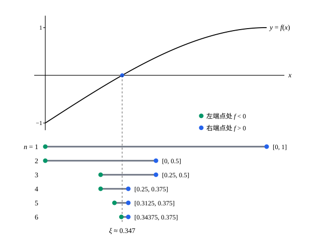

## 这一节要回答的问题

微积分里常这样找方程的根：$f$在$[a,b]$上:term[连续]{id="math.analysis.continuous-function"}（continuous），$f(a)<0<f(b)$，图像从横轴下方走到上方，中间总得穿过横轴。这看上去显然，可只用有理数就不对了：$f(x)=x^2-2$在$[1,2]$里的有理数上连续，$f(1)<0<f(2)$，却没有一个有理数零点。

所以这个结论一定用到了:term[实数的完备性]{id="math.analysis.real-completeness"}（completeness of the real numbers）。它到底是在哪一步用到的？

## 讲解

### 零点定理

::anchor{id="thm-bolzano"}
**定理 1**　设$f$在$[a,b]$上:term[连续]{id="math.analysis.continuous-function"}，$f(a)$与$f(b)$异号，则有$\xi\in(a,b)$使$f(\xi)=0$。这叫作:term[零点定理]{id="math.analysis.bolzano-theorem"}（Bolzano's theorem）。

**证明**：不妨设$f(a)<0<f(b)$，否则把$f$换成$-f$。用二分法造区间：令$[a_1,b_1]=[a,b]$；已有$[a_n,b_n]$且$f(a_n)<0<f(b_n)$时，取中点$m$。若$f(m)=0$，零点已经找到；若$f(m)<0$，令$[a_{n+1},b_{n+1}]=[m,b_n]$；若$f(m)>0$，令$[a_{n+1},b_{n+1}]=[a_n,m]$。

如果某一步的中点恰好是零点，证明就结束了。否则得到一串一个套一个的闭区间，每个都满足$f(a_n)<0<f(b_n)$，长度$\frac{b-a}{2^{n-1}}\to0$，这是一个:term[闭区间套]{id="math.analysis.nested-intervals"}（nested intervals）。由:term[闭区间套定理]{id="math.analysis.nested-interval-theorem"}（nested interval theorem），有$\xi$属于每一个区间，并且$a_n\to\xi$，$b_n\to\xi$。

$\xi\in[a,b]$，$f$在$\xi$处连续，由[连续函数的严格定义](lesson:math.analysis.continuity)的定理 1，$f(a_n)\to f(\xi)$，$f(b_n)\to f(\xi)$。由:term[保不等式性]{id="math.analysis.order-limit-theorem"}（order limit theorem），$f(a_n)<0$推出$f(\xi)\le0$，$f(b_n)>0$推出$f(\xi)\ge0$，所以$f(\xi)=0$。又$f(a)\ne0$、$f(b)\ne0$，所以$\xi\ne a,b$。

### 证明用到了什么

:term[完备性]{id="math.analysis.real-completeness"}用在:term[闭区间套定理]{id="math.analysis.nested-interval-theorem"}上，它保证二分出来的区间真的夹住了一个数。在有理数里，对$x^2-2$在$[1,2]$上做同样的二分，得到的区间端点都是有理数，一个套一个、长度趋于$0$，可它们夹住的是$\sqrt2$，没有一个有理数属于所有的区间。证明的其余部分在$\Q$里照样成立，唯独「存在$\xi$」这一步不成立。

:term[连续]{id="math.analysis.continuous-function"}用在$f(a_n)\to f(\xi)$这一步。去掉连续，结论就不对：在$[0,1]$上令$f(x)=-1$（$x<\frac12$）、$f(x)=1$（$x\ge\frac12$），两端异号，却没有零点；二分照样能做，$\xi=\frac12$也找得到，只是$f(\xi)=1$，不等于左端点处函数值的:term[极限]{id="math.analysis.sequence-limit"}（limit of a sequence，lim）$-1$。

定义域是一个区间也不能少。在$[0,1]\cup[2,3]$上令$f=-1$（前一段）、$f=1$（后一段），它在定义域的每一点都连续，两端异号，也没有零点：中间那段空着，二分会把区间伸进没有定义的地方。

### 介值定理

::anchor{id="thm-intermediate-value"}
**定理 2**　设$f$在$[a,b]$上:term[连续]{id="math.analysis.continuous-function"}，$c$严格介于$f(a)$与$f(b)$之间，则有$\xi\in(a,b)$使$f(\xi)=c$。这叫作:term[介值定理]{id="math.analysis.intermediate-value-theorem"}（intermediate value theorem）。

**证明**：令$g(x)=f(x)-c$，它在$[a,b]$上连续，$g(a)=f(a)-c$与$g(b)=f(b)-c$异号。由:term[零点定理]{id="math.analysis.bolzano-theorem"}，有$\xi\in(a,b)$使$g(\xi)=0$，即$f(\xi)=c$。

介值定理换个说法就是：区间上的连续函数，取到的值也组成一个区间。设$f$在区间$I$上连续，$y_1=f(x_1)$、$y_2=f(x_2)$是两个函数值，$y_1<y<y_2$，对$x_1$、$x_2$之间的闭区间用定理 2，$y$也是一个函数值。值的集合里两个数之间的数都在里面，这正是区间的特征。

它只保证零点存在，不保证唯一，也不告诉你在哪里；二分法倒是顺便给出了近似值，误差不超过最后那个区间的长度。

## 几何图像

上面是$f(x)=3x-x^3-1$的图像，$f(0)=-1<0<1=f(1)$。下面每一行是证明里的一个区间，左端点处$f<0$，右端点处$f>0$，下一行取上一行的左半或右半，看中点处$f$的符号。区间一个套一个地缩向图像和横轴的交点$\xi$。

:::anim{component="function-plot"}
range: { x: [-2.3, 2.3], y: [-2.6, 2.6] }
functions:
  - expr: "x^3 - 3 * x"
    label: |
      $y=x^3-3x$
  - expr: "c"
    label: |
      $y=c$
points:
  - { x: "2 * cos(acos(c / 2) / 3)", y: "c" }
  - { x: "2 * cos((acos(c / 2) + 2 * pi) / 3)", y: "c" }
  - { x: "2 * cos((acos(c / 2) - 2 * pi) / 3)", y: "c" }
sliders:
  - name: c
    min: -2
    max: 2
    step: 0.05
    default: 0.5
    label: |
      $c$
:::

$f(x)=x^3-3x$在$[-2,2]$上:term[连续]{id="math.analysis.continuous-function"}，$f(-2)=-2$，$f(2)=2$。拖动滑块改变$c$：只要$c$在$-2$和$2$之间，横线$y=c$就和曲线相交，这是:term[介值定理]{id="math.analysis.intermediate-value-theorem"}保证的。图上标出了所有的交点，$c$在$-2$和$2$之间时有三个：定理只说至少一个。

## 例题

### 例 1　奇数次多项式至少有一个实根

设$p(x)=x^n+a_{n-1}x^{n-1}+\cdots+a_1x+a_0$，$n$是奇数。证明$p$至少有一个实数零点。

**为什么想到这么做**：要用:term[零点定理]{id="math.analysis.bolzano-theorem"}，得找到两个函数值异号的点。$|x|$很大时，最高次项$x^n$压倒其余各项，$p(x)$的符号跟着$x^n$走；$n$是奇数，$x^n$在正、负两边符号相反。剩下的事是把「$|x|$很大」说具体。

**推导**：令$M=1+|a_{n-1}|+\cdots+|a_0|$，则$M\ge1$。当$|x|\ge M$时，$|x|^k\le|x|^{n-1}$（$k\le n-1$），所以

$$
\bigl|a_{n-1}x^{n-1}+\cdots+a_0\bigr|\le\bigl(|a_{n-1}|+\cdots+|a_0|\bigr)|x|^{n-1}<M|x|^{n-1}\le|x|^n .
$$

于是$|x|\ge M$时，$p(x)$与$x^n$同号。$n$是奇数，所以$p(M)>0$，$p(-M)<0$。多项式处处:term[连续]{id="math.analysis.continuous-function"}，由零点定理，$p$在$(-M,M)$里有零点。偶数次就不一定了：$x^2+1$没有实数零点。

### 例 2　$[0,1]$到自身的连续函数有不动点

设$f$在$[0,1]$上:term[连续]{id="math.analysis.continuous-function"}，并且所有的函数值都在$[0,1]$里。证明有$\xi\in[0,1]$使$f(\xi)=\xi$。

**为什么想到这么做**：$f(\xi)=\xi$就是$f(\xi)-\xi=0$，把找不动点（fixed point）变成找零点。看两端：$f(0)\ge0$，$f(1)\le1$，所以$f(x)-x$在$0$处不小于$0$、在$1$处不大于$0$，正好用:term[零点定理]{id="math.analysis.bolzano-theorem"}。几何上，从左边到右边的连续曲线，总得穿过对角线$y=x$。

**推导**：令$g(x)=f(x)-x$，它在$[0,1]$上连续，$g(0)=f(0)\ge0$，$g(1)=f(1)-1\le0$。若$g(0)=0$或$g(1)=0$，取$\xi=0$或$1$即可；否则$g(0)>0>g(1)$，由零点定理，有$\xi\in(0,1)$使$g(\xi)=0$，即$f(\xi)=\xi$。

## 常见误区

- 「$f(a)$、$f(b)$异号，中间就有零点。」还要$f$在整个闭区间上:term[连续]{id="math.analysis.continuous-function"}，定义域还得是一个区间，前面各有反例。
- 「:term[介值定理]{id="math.analysis.intermediate-value-theorem"}保证零点唯一。」不对，它只保证至少一个：$x^3-3x$在$(-2,2)$里取值$0$三次。
- 「$f(a)$、$f(b)$同号，中间就没有零点。」不对：$x^2-1$在$[-2,2]$两端都是$3$，中间有两个零点。定理只给充分条件。
- 「能取到两端之间每一个值的函数一定连续。」这是把介值定理倒过来说，不成立，第 4 题有反例。
