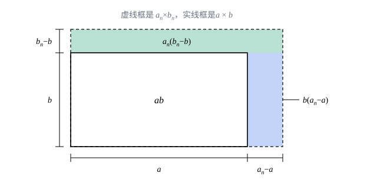

## 这一节要回答的问题

用定义证明$\frac{n^2+n}{2n^2-1}\to\frac12$，要专门做一番放大；每遇到一个新数列都从头来一遍，太累了。能不能像做算术一样，把复杂的数列拆成简单的，由简单数列的:term[极限]{id="math.analysis.sequence-limit"}（limit of a sequence，lim）直接算出复杂数列的极限？拆的时候又要守什么规矩？

## 讲解

### 四则运算法则

::anchor{id="thm-limit-arithmetic"}
**定理 1**　设$a_n\to a$，$b_n\to b$，则$a_n\pm b_n\to a\pm b$，$a_nb_n\to ab$；若还有$b\ne0$，则$\frac{a_n}{b_n}\to\frac{a}{b}$。这叫作:term[极限的四则运算法则]{id="math.analysis.algebraic-limit-theorem"}（algebraic limit theorem）。

商的那一条里，$b_n$可能有有限项等于$0$，那几项的$\frac{a_n}{b_n}$没有定义；不过[收敛数列的基本性质](lesson:math.analysis.limit-properties)的例 2 说过，从某一项起$|b_n|>\frac{|b|}{2}>0$，前面有限项不影响:term[极限]{id="math.analysis.sequence-limit"}，去掉就是。把$b_n$取成常数数列$c$，乘法那一条给出$ca_n\to ca$。

**和与差**：任给$\varepsilon>0$。把$a_n\to a$用在$\frac{\varepsilon}{2}$上，有$N_1$使$n>N_1$时$|a_n-a|<\frac{\varepsilon}{2}$；同样有$N_2$使$n>N_2$时$|b_n-b|<\frac{\varepsilon}{2}$。于是$n>\max\{N_1,N_2\}$时

$$
|(a_n\pm b_n)-(a\pm b)|\le|a_n-a|+|b_n-b|<\frac{\varepsilon}{2}+\frac{\varepsilon}{2}=\varepsilon .
$$

为什么用$\frac\varepsilon2$：总误差是两份误差之和，给每一份各分一半的额度，加起来正好不超过$\varepsilon$。$\varepsilon$是任意的，所以可以先拿它的一部分去用。

**积**：关键是把$a_nb_n-ab$拆成两份，每份里都有一个能任意小的因子：

$$
a_nb_n-ab=a_n(b_n-b)+b(a_n-a) .
$$

$\{a_n\}$是:term[收敛数列]{id="math.analysis.convergent-sequence"}（convergent sequence），由上一节的定理 2，它是:term[有界数列]{id="math.analysis.bounded-sequence"}（bounded sequence）：有$M>0$使$|a_n|\le M$对所有$n$成立。任给$\varepsilon>0$，有$N_1$使$n>N_1$时$|b_n-b|<\frac{\varepsilon}{2M}$，有$N_2$使$n>N_2$时$|a_n-a|<\frac{\varepsilon}{2(|b|+1)}$。于是$n>\max\{N_1,N_2\}$时

$$
|a_nb_n-ab|\le M|b_n-b|+|b|\,|a_n-a|<\frac{\varepsilon}{2}+\frac{|b|}{|b|+1}\cdot\frac{\varepsilon}{2}<\varepsilon .
$$

分母写$|b|+1$而不是$|b|$，是为了$b=0$时也不用除以零。证明里要用到有界：$|b_n-b|$再小，乘上一个可能很大的$a_n$也未必小，有界正好防住了这一点。

**商**：先证$\frac{1}{b_n}\to\frac1b$。从某一项起$|b_n|>\frac{|b|}{2}$，这时

$$
\left|\frac{1}{b_n}-\frac{1}{b}\right|=\frac{|b-b_n|}{|b_n|\,|b|}<\frac{2}{|b|^2}\,|b_n-b| .
$$

任给$\varepsilon>0$，再取$N$使$n>N$时$|b_n-b|<\frac{|b|^2}{2}\varepsilon$，两个条件都满足时上式就小于$\varepsilon$。最后$\frac{a_n}{b_n}=a_n\cdot\frac{1}{b_n}$，由积的法则趋于$a\cdot\frac1b=\frac ab$。

法则的前提是$\lim a_n$、$\lim b_n$都存在，不能反过来用。$a_n=(-1)^n$、$b_n=(-1)^{n+1}$时$a_n+b_n=0\to0$，两个数列本身却都是:term[发散数列]{id="math.analysis.divergent-sequence"}（divergent sequence）；$\sqrt{n^2+n}-n$里的两项都不收敛，不能拆成「$\lim\sqrt{n^2+n}-\lim n$」，例 1 会给出正确的算法。法则对有限个数列的和、积都成立（逐次用两个的情形），但项数随$n$增加的和不行，见「常见误区」。

### 夹逼定理

::anchor{id="thm-squeeze"}
**定理 2**　设从某一项起$b_n\le a_n\le c_n$，并且$b_n\to L$，$c_n\to L$，则$a_n\to L$。这叫作:term[夹逼定理]{id="math.analysis.squeeze-theorem"}（squeeze theorem）。

**证明**：设$n>N_0$时$b_n\le a_n\le c_n$。任给$\varepsilon>0$，有$N_1$使$n>N_1$时$b_n>L-\varepsilon$，有$N_2$使$n>N_2$时$c_n<L+\varepsilon$。于是$n>\max\{N_0,N_1,N_2\}$时

$$
L-\varepsilon<b_n\le a_n\le c_n<L+\varepsilon ,
$$

即$|a_n-L|<\varepsilon$。

为什么要这条定理：上一节的:term[保不等式性]{id="math.analysis.order-limit-theorem"}（order limit theorem）只能在已经知道$\{a_n\}$:term[收敛]{id="math.analysis.convergent-sequence"}时比较:term[极限]{id="math.analysis.sequence-limit"}的大小；夹逼定理连$\{a_n\}$收敛也一并证出来了。几何上看，两边的数列进了$L$的$\varepsilon$:term[邻域]{id="math.analysis.neighborhood"}（neighborhood），夹在中间的$a_n$也只好跟着进去。

最常用的是它的特殊情形：若$|a_n-L|\le c_n$且$c_n\to0$，则$a_n\to L$（取$L-c_n\le a_n\le L+c_n$）。例如$\bigl|\frac{\sin n}{n}\bigr|\le\frac1n$，所以$\frac{\sin n}{n}\to0$。

## 几何图像

积的法则里的拆分，就是两个矩形面积之差：$a_nb_n-ab$等于右边那条宽$a_n-a$、高$b$的窄带，加上顶上那条宽$a_n$、高$b_n-b$的窄带。两条窄带的「窄边」都趋于$0$，「长边」:term[有界]{id="math.analysis.bounded-sequence"}，面积就趋于$0$。

:::anim{component="function-plot"}
range: { x: [0, 41], y: [-1.05, 1.05] }
functions:
  - expr: "1 / x"
    label: |
      $y=\frac{1}{x}$
  - expr: "-1 / x"
    label: |
      $y=-\frac{1}{x}$
sequences:
  - expr: "sin(k * n) / n"
    n: [1, 40]
    label: |
      $a_n=\frac{\sin kn}{n}$
sliders:
  - name: k
    min: 0.1
    max: 3
    step: 0.1
    default: 1
    label: |
      $k$
:::

不管$k$取多少，$\frac{\sin kn}{n}$都被夹在曲线$y=\pm\frac1x$之间。两条曲线在整数点上的值$\pm\frac1n$都趋于$0$，由:term[夹逼定理]{id="math.analysis.squeeze-theorem"}，中间的数列也趋于$0$。拖动$k$，数列怎么上下跳都逃不出去。

## 例题

### 例 1　$\lim_{n\to\infty}\bigl(\sqrt{n^2+n}-n\bigr)=\frac12$

**为什么想到这么做**：$\sqrt{n^2+n}$和$n$都不:term[收敛]{id="math.analysis.convergent-sequence"}，不能直接用差的法则。两个越来越大的数相减，要先变形，把「大数相减」变成能用:term[极限的四则运算法则]{id="math.analysis.algebraic-limit-theorem"}的形式。根式相减，常用的办法是分子有理化。

**推导**：

$$
\sqrt{n^2+n}-n=\frac{(n^2+n)-n^2}{\sqrt{n^2+n}+n}=\frac{n}{\sqrt{n^2+n}+n}=\frac{1}{\sqrt{1+\frac1n}+1} .
$$

由和的法则，$1+\frac1n\to1$；由[上一节的例 1](lesson:math.analysis.limit-properties)，$\sqrt{1+\frac1n}\to\sqrt1=1$；再用和的法则，分母趋于$2$。分母的:term[极限]{id="math.analysis.sequence-limit"}不为$0$，由商的法则，原式的极限是$\frac12$。

### 例 2　$\lim_{n\to\infty}\sum_{k=1}^{n}\frac{1}{\sqrt{n^2+k}}=1$

**为什么想到这么做**：和里每一项都趋于$0$，可项数也跟着$n$增多，:term[极限的四则运算法则]{id="math.analysis.algebraic-limit-theorem"}只管固定个数的项，用不上。每一项都夹在最小的一项$\frac{1}{\sqrt{n^2+n}}$和最大的一项$\frac{1}{\sqrt{n^2+1}}$之间，把$n$项都换成最小项、最大项，就得到两个好算的数列。

**推导**：记这个和为$x_n$。对$k=1,2,\dots,n$，$\frac{1}{\sqrt{n^2+n}}\le\frac{1}{\sqrt{n^2+k}}\le\frac{1}{\sqrt{n^2+1}}$，把$n$个这样的不等式相加，得

$$
\frac{n}{\sqrt{n^2+n}}\le x_n\le\frac{n}{\sqrt{n^2+1}} .
$$

左边$=\frac{1}{\sqrt{1+\frac1n}}\to1$，右边$=\frac{1}{\sqrt{1+\frac{1}{n^2}}}\to1$（$\frac{1}{n^2}=\frac1n\cdot\frac1n\to0$，再用上一节的例 1 和商的法则）。由:term[夹逼定理]{id="math.analysis.squeeze-theorem"}，$x_n\to1$。

## 常见误区

- 「每一项都趋于$0$，所以$n$项的和也趋于$0$。」不对：$n$个$\frac1n$相加等于$1$。:term[极限的四则运算法则]{id="math.analysis.algebraic-limit-theorem"}只对固定个数的项成立，项数随$n$增多时要另想办法，例如用:term[夹逼定理]{id="math.analysis.squeeze-theorem"}。
- 「$\lim(a_n+b_n)$存在，所以$\lim a_n$、$\lim b_n$都存在。」不对：$(-1)^n+(-1)^{n+1}=0$。法则只能从「分别:term[收敛]{id="math.analysis.convergent-sequence"}」推出「和收敛」，不能倒过来。
- 「$\lim\frac{a_n}{b_n}=\frac{\lim a_n}{\lim b_n}$总能用。」要求$\lim b_n\ne0$。分子分母都趋于$0$时，商可以:term[发散]{id="math.analysis.divergent-sequence"}（如$\frac{1/n}{1/n^2}=n$），也可以收敛到任何数，要先变形。
- 「用夹逼定理时，两边的数列只要都收敛就行。」两边必须收敛到同一个数。$-1\le(-1)^n\le1$，两边的:term[极限]{id="math.analysis.sequence-limit"}不同，夹不出任何结论。
