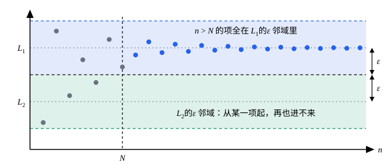

## 这一节要回答的问题

上一节给了:term[极限]{id="math.analysis.sequence-limit"}（limit of a sequence，lim）的定义。只从这个定义出发，:term[收敛数列]{id="math.analysis.convergent-sequence"}（convergent sequence）一定有哪些性质？

一个数列能不能同时收敛于两个数？收敛的数列会不会大得没边？每一项都是正数，极限是不是也一定是正数？

## 讲解

### 极限只有一个

**定理 1（:term[极限]{id="math.analysis.sequence-limit"}的唯一性）**　:term[收敛数列]{id="math.analysis.convergent-sequence"}只有一个极限。

**证明**：设$a_n\to L_1$，又$a_n\to L_2$，假设$L_1\ne L_2$。取$\varepsilon=\frac{|L_1-L_2|}{2}>0$，则有正整数$N_1$、$N_2$，使$n>N_1$时$|a_n-L_1|<\varepsilon$，$n>N_2$时$|a_n-L_2|<\varepsilon$。取一个$n>\max\{N_1,N_2\}$，两个不等式同时成立，于是

$$
|L_1-L_2|\le|L_1-a_n|+|a_n-L_2|<2\varepsilon=|L_1-L_2| ,
$$

矛盾。所以$L_1=L_2$。

为什么取$\varepsilon=\frac{|L_1-L_2|}{2}$：这时$L_1$和$L_2$的$\varepsilon$:term[邻域]{id="math.analysis.neighborhood"}（neighborhood）恰好在中点相接、没有公共部分，而数列从某一项起要同时待在两个邻域里，做不到。正因为极限唯一，记号$\lim_{n\to\infty}a_n$才有意义：它指的是一个确定的数。

### 收敛数列有界

::anchor{id="def-bounded"}
如果存在正数$M$，使数列的每一项都满足$|a_n|\le M$，就说$\{a_n\}$是:term[有界数列]{id="math.analysis.bounded-sequence"}（bounded sequence），也说它有界。这时数列的所有项都落在区间$[-M,M]$里。

为什么这样定义：有界说的是整个数列「不会跑得没边」，要求每一项都满足，不只是从某一项起。例如$\{(-1)^n\}$有界（取$M=1$）；$\{n\}$无界，因为任给$M>0$，大于$M$的正整数$n$都使$|a_n|>M$。

**定理 2**　:term[收敛数列]{id="math.analysis.convergent-sequence"}一定有界。

**证明**：设$a_n\to L$。取$\varepsilon=1$，有正整数$N$，使$n>N$时$|a_n-L|<1$，从而$|a_n|\le|a_n-L|+|L|<1+|L|$。前$N$项只有有限个，令

$$
M=\max\bigl\{|a_1|,|a_2|,\dots,|a_N|,\ 1+|L|\bigr\} ,
$$

则每一项都满足$|a_n|\le M$。

这个证明的思路以后会反复用：后面无穷多项用:term[极限]{id="math.analysis.sequence-limit"}管住，前面有限项单独处理。定理 2 反过来不成立：$\{(-1)^n\}$有界，却是:term[发散数列]{id="math.analysis.divergent-sequence"}（divergent sequence）。但它的逆否命题很有用：无界的数列一定发散，例如$\{n\}$和$\{(-2)^n\}$。

### 保号性

::anchor{id="thm-sign-preserving"}
**定理 3**　设$a_n\to L$。若$L>0$，则对任意满足$0<r<L$的数$r$，从某一项起都有$a_n>r$，特别地$a_n>0$；若$L<0$，则从某一项起$a_n<0$。这条性质叫作:term[保号性]{id="math.analysis.sign-preservation"}（sign-preserving property）。

**证明**：设$L>0$，$0<r<L$。取$\varepsilon=L-r>0$，有正整数$N$，使$n>N$时$|a_n-L|<L-r$，从而$a_n>L-(L-r)=r>0$。$L<0$时，由定义直接看出$-a_n\to-L>0$，对$\{-a_n\}$用刚证的结论即可。

为什么叫保号性：:term[极限]{id="math.analysis.sequence-limit"}不为零时，它的符号被数列从某一项起的所有项「继承」下来。$L=0$时什么也推不出：$\frac{(-1)^n}{n}\to0$，各项却一正一负地交替。

::anchor{id="thm-order-limit"}
**推论**　设$a_n\to a$，$b_n\to b$，并且从某一项起$a_n\le b_n$，则$a\le b$。这条性质叫作:term[保不等式性]{id="math.analysis.order-limit-theorem"}（order limit theorem）。

**证明**：设$n>N_0$时$a_n\le b_n$。假设$a>b$，取$\varepsilon=\frac{a-b}{2}$，有$N_1$、$N_2$，使$n>N_1$时$a_n>a-\varepsilon=\frac{a+b}{2}$，$n>N_2$时$b_n<b+\varepsilon=\frac{a+b}{2}$。取$n>\max\{N_0,N_1,N_2\}$，就有$a_n>b_n$，和$a_n\le b_n$矛盾。所以$a\le b$。

特别地，若从某一项起$a_n\ge0$，则$\lim_{n\to\infty}a_n\ge0$。不等号会变弱：$\frac1n>0$对每一项都成立，极限却是$0$。所以由$a_n<b_n$只能推出$a\le b$，推不出$a<b$。

## 几何图像

这是定理 1 的证明画成的图：取$\varepsilon=\frac{|L_1-L_2|}{2}$，两条横带在中点相接、没有公共部分。数列若:term[收敛]{id="math.analysis.convergent-sequence"}于$L_1$，从某一项起就全在上面的带子里，再也进不了下面那条，所以它不可能同时收敛于$L_2$。

:::anim{component="function-plot"}
range: { x: [0, 61], y: [-2, 2.6] }
functions:
  - expr: "L"
    label: |
      $y=L$
  - expr: "L / 2"
    label: |
      $y=\frac{L}{2}$
sequences:
  - expr: "L + 2 * (-1)^n / n"
    n: [1, 60]
    label: |
      $a_n=L+\frac{2(-1)^n}{n}$
points:
  - { x: "floor(4 / L)", y: "L / 2" }
sliders:
  - name: L
    min: 0.1
    max: 1.5
    step: 0.05
    default: 0.8
    label: |
      极限$L$
:::

这个数列收敛于$L>0$。横线$y=\frac L2$上单独标出的那个点，横坐标是不超过$\frac4L$的最大整数，记作$N$：$n>N$时$|a_n-L|=\frac2n<\frac L2$，所以$a_n>\frac L2>0$，这就是:term[保号性]{id="math.analysis.sign-preservation"}。把$L$往$0$拖，$N$越来越靠右，但总存在；$L$真到了$0$，就推不出项的符号了。

## 例题

### 例 1　若$a_n\ge0$且$a_n\to L$，则$\sqrt{a_n}\to\sqrt{L}$

**为什么想到这么做**：先得确认$\sqrt L$有意义，也就是$L\ge0$，这正是:term[保不等式性]{id="math.analysis.order-limit-theorem"}给的。要估计$|\sqrt{a_n}-\sqrt L|$，自然想到分子有理化，把根号的差变成$a_n-L$，后者由条件能任意小。$L=0$时分母会出问题，单独处理。

**推导**：把$\{a_n\}$和常数数列$0$比较，由保不等式性得$L\ge0$。

若$L=0$：任给$\varepsilon>0$，把$a_n\to0$用在$\varepsilon^2$上，有正整数$N$，使$n>N$时$0\le a_n<\varepsilon^2$，于是$0\le\sqrt{a_n}<\varepsilon$。

若$L>0$：

$$
\bigl|\sqrt{a_n}-\sqrt{L}\bigr|=\frac{|a_n-L|}{\sqrt{a_n}+\sqrt{L}}\le\frac{|a_n-L|}{\sqrt{L}} .
$$

任给$\varepsilon>0$，把$a_n\to L$用在$\sqrt{L}\,\varepsilon$上，有正整数$N$，使$n>N$时$|a_n-L|<\sqrt{L}\,\varepsilon$，从而$|\sqrt{a_n}-\sqrt L|<\varepsilon$。两种情况都得到$\sqrt{a_n}$:term[收敛]{id="math.analysis.convergent-sequence"}于$\sqrt L$。

### 例 2　让分母离开$0$

设$b_n\to b$，$b\ne0$。证明：从某一项起$|b_n|>\frac{|b|}{2}$，因而从某一项起$b_n\ne0$，并且$\bigl|\frac{1}{b_n}\bigr|<\frac{2}{|b|}$。

**为什么想到这么做**：下一节要证$\frac{1}{b_n}\to\frac1b$，得先保证$b_n$不会太靠近$0$。$b$到$0$的距离是$|b|$，取$\varepsilon$为这段距离的一半，$b$的$\varepsilon$:term[邻域]{id="math.analysis.neighborhood"}就整个离开了$0$，这和:term[保号性]{id="math.analysis.sign-preservation"}的证明是同一个想法。

**推导**：取$\varepsilon=\frac{|b|}{2}>0$，有正整数$N$，使$n>N$时$|b_n-b|<\frac{|b|}{2}$。于是

$$
|b_n|\ge|b|-|b-b_n|>|b|-\frac{|b|}{2}=\frac{|b|}{2}>0 ,
$$

所以$b_n\ne0$，且$\bigl|\frac{1}{b_n}\bigr|<\frac{2}{|b|}$。前$N$项里可能有等于$0$的，但那只是有限项，不影响后面的讨论。

## 常见误区

- 「:term[有界数列]{id="math.analysis.bounded-sequence"}一定:term[收敛]{id="math.analysis.convergent-sequence"}。」不对，$\{(-1)^n\}$有界，却是:term[发散数列]{id="math.analysis.divergent-sequence"}。有界只是收敛的必要条件。
- 「每一项都大于$0$，:term[极限]{id="math.analysis.sequence-limit"}就大于$0$。」不对，$\frac1n>0$，极限却是$0$。:term[保不等式性]{id="math.analysis.order-limit-theorem"}只能保住$\ge$。
- 「$a_n\to0$，所以从某一项起$a_n$保持同一个符号。」不对，:term[保号性]{id="math.analysis.sign-preservation"}要求极限不为零，$\frac{(-1)^n}{n}\to0$的项正负交替。
- 「证明数列有界，只要看从某一项起的项。」不对，有界要管住每一项；只是前面有限项总能用它们的最大值管住，所以收敛数列才一定有界。
