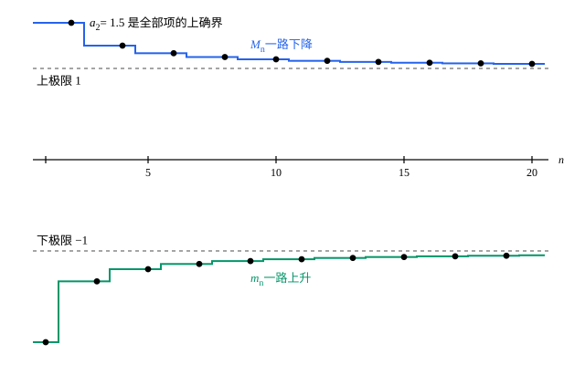

## 这一节要回答的问题

数列$a_n=(-1)^n\bigl(1+\frac1n\bigr)$是:term[发散数列]{id="math.analysis.divergent-sequence"}（divergent sequence），它的项越来越像在$-1$和$1$之间来回跳。全部项的:term[上确界]{id="math.analysis.supremum"}（supremum，sup）是$a_2=\frac32$，这只反映了开头那几项，说不出数列最终往上能到哪里。

能不能找一个总是存在的数，刻画数列最终的上沿和下沿？它们又能不能用来判断数列:term[收敛]{id="math.analysis.convergent-sequence"}（convergent sequence）？

## 讲解

### 去掉开头，再取上确界

还看$a_n=(-1)^n\bigl(1+\frac1n\bigr)$。去掉前$n-1$项，剩下的项$a_n,a_{n+1},\dots$的:term[上确界]{id="math.analysis.supremum"}记作$M_n$。偶数项$1+\frac1k$随$k$变小，奇数项都是负数，所以$M_n$就是第$n$项起的第一个偶数项：$M_1=M_2=\frac32$，$M_3=M_4=\frac54$，$M_5=M_6=\frac76$……它一路下降，趋于$1$。同样，剩下的项的:term[下确界]{id="math.analysis.infimum"}（infimum，inf）$m_n$一路上升，趋于$-1$。

一般地，设$\{a_n\}$是:term[有界数列]{id="math.analysis.bounded-sequence"}（bounded sequence）。由:term[确界原理]{id="math.analysis.supremum-principle"}（least-upper-bound property），$M_n=\sup\{a_k:k\ge n\}$和$m_n=\inf\{a_k:k\ge n\}$都存在。$n$变大时集合变小，所以$M_n$只会变小或不变，并且不小于全部项的下确界；由:term[单调有界原理]{id="math.analysis.monotone-convergence-theorem"}（monotone convergence theorem），$\{M_n\}$:term[收敛]{id="math.analysis.convergent-sequence"}。同理$\{m_n\}$单调递增、有:term[上界]{id="math.analysis.upper-bound"}（upper bound），也收敛。

### 上极限与下极限

::anchor{id="def-limsup"}
设$\{a_n\}$:term[有界]{id="math.analysis.bounded-sequence"}，$M_n=\sup\{a_k:k\ge n\}$，$m_n=\inf\{a_k:k\ge n\}$。数列$\{M_n\}$的:term[极限]{id="math.analysis.sequence-limit"}（limit of a sequence，lim）叫作$\{a_n\}$的:term[上极限]{id="math.analysis.limit-superior"}（limit superior，lim sup），记作$\limsup_{n\to\infty}a_n$；$\{m_n\}$的极限叫作:term[下极限]{id="math.analysis.limit-inferior"}（limit inferior，lim inf），记作$\liminf_{n\to\infty}a_n$。有的书写成$\varlimsup_{n\to\infty}a_n$和$\varliminf_{n\to\infty}a_n$。

为什么这样定义：去掉开头有限项，是为了不让早期出格的项说了算；剩下部分的:term[上确界]{id="math.analysis.supremum"}随$n$只降不升，所以一定有极限。这样一来，有界数列不一定有极限，却总有上极限和下极限。开头的例子里，全部项的上确界是$\frac32$，上极限却是$1$：上极限可以比上确界小。

由$m_n\le a_n\le M_n$和:term[保不等式性]{id="math.analysis.order-limit-theorem"}（order limit theorem），总有$\liminf_{n\to\infty}a_n\le\limsup_{n\to\infty}a_n$。改动前面有限项，$n$很大时的$M_n$、$m_n$不受影响，所以上、下极限也不变。

无界的数列也有约定。没有:term[上界]{id="math.analysis.upper-bound"}时，每个$M_n$都不存在，规定$\limsup_{n\to\infty}a_n=+\infty$；有上界、但$\{M_n\}$没有下界（lower bound）时（例如$a_n=-n$），规定$\limsup_{n\to\infty}a_n=-\infty$。下极限同样约定。下面只讨论有界数列。

### 上极限是最大的子列极限

::anchor{id="thm-limsup-subsequence"}
**定理 1**　设$\{a_n\}$:term[有界]{id="math.analysis.bounded-sequence"}，$L^*=\limsup_{n\to\infty}a_n$。任给$\varepsilon>0$：

1. 大于$L^*+\varepsilon$的项只有有限个；
2. 大于$L^*-\varepsilon$的项有无穷多个。

由此，有:term[子列]{id="math.analysis.subsequence"}（subsequence）:term[收敛]{id="math.analysis.convergent-sequence"}于$L^*$，并且每个收敛的子列，:term[极限]{id="math.analysis.sequence-limit"}都不超过$L^*$。所以$L^*$是所有子列极限里最大的一个。对称地，:term[下极限]{id="math.analysis.limit-inferior"}是最小的子列极限。

**证明**：(1) 由$M_n\to L^*$，有$N$使$M_N<L^*+\varepsilon$。对$k\ge N$，$a_k\le M_N<L^*+\varepsilon$，所以大于$L^*+\varepsilon$的项只可能在前$N-1$项里。

(2) 单调递减的$\{M_n\}$收敛于它的项的:term[下确界]{id="math.analysis.infimum"}，所以每个$M_n\ge L^*>L^*-\varepsilon$。于是$L^*-\varepsilon$不是$\{a_k:k\ge n\}$的:term[上界]{id="math.analysis.upper-bound"}（upper bound），有$k\ge n$使$a_k>L^*-\varepsilon$。$n$可以任意大，所以这样的项有无穷多个。

再造收敛于$L^*$的子列。由 (1)、(2)，对每个正整数$j$，落在$\bigl(L^*-\frac1j,\ L^*+\frac1j\bigr]$里的项有无穷多个。依次取$n_1<n_2<\cdots$，使$a_{n_j}$落在第$j$个区间里，则$|a_{n_j}-L^*|\le\frac1j$，由:term[夹逼定理]{id="math.analysis.squeeze-theorem"}（squeeze theorem），$a_{n_j}\to L^*$。

最后，设子列$a_{n_k}\to L'$。由$a_{n_k}\le M_{n_k}$，而$\{M_{n_k}\}$是$\{M_n\}$的子列，趋于$L^*$，由:term[保不等式性]{id="math.analysis.order-limit-theorem"}得$L'\le L^*$。

为什么要两种看法：尾巴:term[上确界]{id="math.analysis.supremum"}的定义保证:term[上极限]{id="math.analysis.limit-superior"}总存在，也好算；子列的看法说明它是数列能无穷多次靠近的最高处。证明「$\limsup_{n\to\infty}a_n\le q$」一类的结论时，最常用的是 (1)：从某一项起，所有的项都不超过$L^*+\varepsilon$。

### 用上、下极限判断收敛

::anchor{id="thm-limsup-convergence"}
**定理 2**　:term[有界数列]{id="math.analysis.bounded-sequence"}$\{a_n\}$:term[收敛]{id="math.analysis.convergent-sequence"}，当且仅当$\limsup_{n\to\infty}a_n=\liminf_{n\to\infty}a_n$；这时$\lim_{n\to\infty}a_n$就等于这个公共值。

**证明**：若$a_n\to L$，由[子列与致密性定理](lesson:math.analysis.subsequences)的定理 1，每个:term[子列]{id="math.analysis.subsequence"}都收敛于$L$；由定理 1，:term[上极限]{id="math.analysis.limit-superior"}和:term[下极限]{id="math.analysis.limit-inferior"}都是某个子列的:term[极限]{id="math.analysis.sequence-limit"}，所以都等于$L$。反过来，若两者都等于$L$，由$m_n\le a_n\le M_n$和:term[夹逼定理]{id="math.analysis.squeeze-theorem"}，$a_n\to L$。

$M_n-m_n$是第$n$项起所有项占据的范围的长度。定理 2 说的是：数列收敛，当且仅当这个长度趋于$0$。上极限减下极限，衡量的是数列最终来回摆动的幅度。

## 几何图像

上面的台阶是$M_n$，下面的台阶是$m_n$，每一级对应去掉前$n-1$项。$M_n$从全部项的:term[上确界]{id="math.analysis.supremum"}$\frac32$一路下降，趋于:term[上极限]{id="math.analysis.limit-superior"}$1$；$m_n$从$-2$一路上升，趋于:term[下极限]{id="math.analysis.limit-inferior"}$-1$。两条台阶各自贴向一条虚线，却永远碰不到它，彼此也不靠拢，所以这个数列:term[发散]{id="math.analysis.divergent-sequence"}。

:::anim{component="function-plot"}
range: { x: [0, 61], y: [-2.1, 1.7] }
functions:
  - expr: "1 + eps"
    label: |
      $y=1+\varepsilon$
  - expr: "1 - eps"
    label: |
      $y=1-\varepsilon$
sequences:
  - expr: "(-1)^n * (1 + 1/n)"
    n: [1, 60]
    label: |
      $a_n=(-1)^n\left(1+\frac1n\right)$
points:
  - { x: "2 * ceil(1 / (2 * eps)) - 2", y: "1 + 1 / (2 * ceil(1 / (2 * eps)) - 2)" }
sliders:
  - name: eps
    min: 0.05
    max: 0.4
    step: 0.01
    default: 0.15
    label: |
      $\varepsilon$
:::

这是定理 1 的两条：上极限$L^*=1$。横线$y=1+\varepsilon$上方只有有限项，单独标出的点是其中最后一项；横线$y=1-\varepsilon$上方却有无穷多项，所有偶数项都在那里。拖动滑块把$\varepsilon$调小，标出的点往右移，但它右边再也没有越过上面那条线的项。

## 例题

### 例 1　按定义求上、下极限

设$a_n=(-1)^n+\frac1n$，求$\limsup_{n\to\infty}a_n$和$\liminf_{n\to\infty}a_n$，并和全部项的:term[上确界]{id="math.analysis.supremum"}、:term[下确界]{id="math.analysis.infimum"}比较。

**为什么想到这么做**：按定义，要先算出每个$M_n$和$m_n$，也就是去掉前$n-1$项后的:term[上确界]{id="math.analysis.supremum"}、:term[下确界]{id="math.analysis.infimum"}。偶数项都大于$1$、奇数项都不超过$0$，最大的项一定在偶数项里找，最小的在奇数项里找。

**推导**：偶数项$1+\frac1k$随$k$增大而减小，所以$M_n$是第$n$项起的第一个偶数项：$n$为偶数时$M_n=1+\frac1n$，为奇数时$M_n=1+\frac{1}{n+1}$。两种情况都有$1<M_n\le1+\frac1n$，由:term[夹逼定理]{id="math.analysis.squeeze-theorem"}，$\limsup_{n\to\infty}a_n=\lim_{n\to\infty}M_n=1$。

奇数项$-1+\frac1k$随$k$增大而减小，越来越接近$-1$，却都大于$-1$。所以对每个$n$，$m_n=\inf\{-1+\frac1k: k\ge n,\ k\text{ 为奇数}\}=-1$，于是$\liminf_{n\to\infty}a_n=-1$。

全部项的上确界是$a_2=\frac32$，比:term[上极限]{id="math.analysis.limit-superior"}大；全部项的下确界是$-1$，等于:term[下极限]{id="math.analysis.limit-inferior"}，却不是任何一项。用:term[子列]{id="math.analysis.subsequence"}核对：偶数项子列趋于$1$，奇数项子列趋于$-1$，正好是最大和最小的子列:term[极限]{id="math.analysis.sequence-limit"}。

### 例 2　比值的上极限小于 1，数列趋于 0

设$a_n>0$，并且$\limsup_{n\to\infty}\frac{a_{n+1}}{a_n}<1$。证明$a_n\to0$。

**为什么想到这么做**：比值$\frac{a_{n+1}}{a_n}$不一定有:term[极限]{id="math.analysis.sequence-limit"}，例如可以在$\frac13$和$\frac23$之间来回跳，但:term[上极限]{id="math.analysis.limit-superior"}总有。上极限小于$1$，由定理 1 的 (1)，从某一项起所有的比值都不超过一个固定的$q<1$，数列就至少像公比为$q$的等比数列那样缩小。

**推导**：比值都是正数；它们的上极限小于$1$，说明比值数列有:term[上界]{id="math.analysis.upper-bound"}（没有上界时，按约定上极限是$+\infty$），所以比值数列:term[有界]{id="math.analysis.bounded-sequence"}，可以用定理 1。记$L^*=\limsup_{n\to\infty}\frac{a_{n+1}}{a_n}<1$，取$q=\frac{L^*+1}{2}$，则$L^*<q<1$。由定理 1 的 (1)（取$\varepsilon=q-L^*$），只有有限个比值大于$q$，所以有$N$使$n\ge N$时$\frac{a_{n+1}}{a_n}\le q$。由归纳法，$n\ge N$时$a_n\le a_Nq^{n-N}$。

于是$0<a_n\le\frac{a_N}{q^N}\,q^n$。由[数列的极限](lesson:math.analysis.sequences-limits)的例 2，$q^n\to0$，再由:term[夹逼定理]{id="math.analysis.squeeze-theorem"}，$a_n\to0$。以后判断级数（series）收敛的比值判别法（ratio test），用的就是这个想法，见[比值判别法与根值判别法](lesson:math.calculus.ratio-root-tests)。

## 常见误区

- 「:term[上极限]{id="math.analysis.limit-superior"}就是全部项的:term[上确界]{id="math.analysis.supremum"}。」不对：$(-1)^n\bigl(1+\frac1n\bigr)$的上确界是$\frac32$，上极限是$1$。总有上极限不超过上确界，两者可以不相等。
- 「上极限一定是数列的某一项。」不对：$(-1)^n\bigl(1+\frac1n\bigr)$的上极限$1$不是任何一项，偶数项都大于$1$，奇数项都是负数。它是某个:term[子列]{id="math.analysis.subsequence"}的:term[极限]{id="math.analysis.sequence-limit"}，不一定被取到；例 1 的:term[下极限]{id="math.analysis.limit-inferior"}$-1$也一样。
- 「$\limsup(a_n+b_n)=\limsup a_n+\limsup b_n$。」不对：$a_n=(-1)^n$、$b_n=(-1)^{n+1}$时左边是$0$，右边是$2$。一般只有「左边不超过右边」（第 5 题）。
- 「数列:term[发散]{id="math.analysis.divergent-sequence"}，就没有上极限。」:term[有界数列]{id="math.analysis.bounded-sequence"}总有上极限和下极限，这正是它们比极限好用的地方；发散的有界数列，只是两者不相等。
