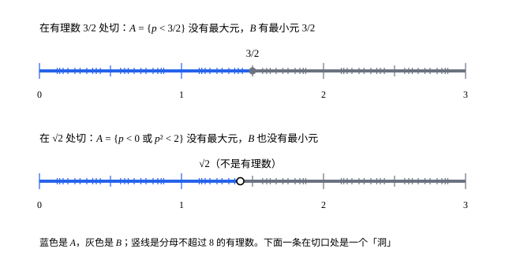

## 这一节要回答的问题

[实数的完备性](lesson:math.analysis.completeness)把:term[确界原理]{id="math.analysis.supremum-principle"}（least-upper-bound property）当作实数的基本性质接受了下来。可只是承认它，就得相信真有一个数系满足它，并且和有理数的运算相容。能不能只用有理数，把这样的数系实实在在地造出来？$\sqrt2$这种「洞」，拿什么来填？

## 讲解

### 用分割描述一个数

每个数都把有理数分成两部分：比它小的，和不比它小的。在$\frac32$处切，左边$\{p\in\Q:p<\frac32\}$没有:term[最大元]{id="math.analysis.maximum"}（maximum，max），右边有最小元$\frac32$；在$\sqrt2$处切，左边是$\{p\in\Q:p<0\}\cup\{p\in\Q:p^2<2\}$，它没有最大元，右边也没有最小元，切口落在一个「洞」上（几何图像）。不知道$\sqrt2$是什么，左边这个集合照样写得出来，于是可以反过来，用它来定义$\sqrt2$。

::anchor{id="def-dedekind-cut"}
有理数集的子集$\alpha$如果满足：(1) $\alpha$非空，并且$\alpha\ne\Q$；(2) 若$p\in\alpha$，有理数$q<p$，则$q\in\alpha$；(3) $\alpha$没有最大元，即每个$p\in\alpha$都有$r\in\alpha$使$r>p$；就叫作一个:term[戴德金分割]{id="math.analysis.dedekind-cut"}（Dedekind cut）。

为什么这样定义：(1)、(2) 说$\alpha$是有理数轴上的「左半边」，既不空，也不是全部；(3) 规定切口处的那个数（如果它是有理数）归右边，这样每个有理数只对应一个分割。边界情况：$\{p\in\Q:p\le\frac32\}$满足 (1)、(2)，却有最大元$\frac32$，不是分割；$\frac32$对应的是$\{p\in\Q:p<\frac32\}$。

::anchor{id="def-real-number"}
所有戴德金分割组成的集合记作$\R$，它的元素叫作实数（real number）。有理数$r$对应分割$r^*=\{p\in\Q:p<r\}$，叫作有理分割（rational cut）；不是有理分割的分割叫作无理数（irrational number）。

为什么这样定义：一个数完全由「哪些有理数比它小」决定，那就干脆把这个集合当作这个数。$r\mapsto r^*$把$\Q$放进了$\R$，下面定义的大小关系和加法用在$r^*$上，和有理数原来的一致（例 1）。边界情况：$\{p\in\Q:p<0\}\cup\{p\in\Q:p^2<2\}$是分割，却不等于任何$r^*$，它代表的正是无理数$\sqrt2$（第 5 题）。

### 大小关系与确界原理

::anchor{id="def-cut-order"}
对实数$\alpha$、$\beta$，规定$\alpha\le\beta$当且仅当$\alpha\subseteq\beta$，$\alpha<\beta$当且仅当$\alpha\subsetneq\beta$。

为什么这样定义：比一个数小的有理数越多，这个数就越大；对有理分割，$r^*\subseteq s^*$当且仅当$r\le s$。边界情况：一般的集合按包含关系比较，常常谁也不包含谁，比如$\{1\}$和$\{2\}$；:term[分割]{id="math.analysis.dedekind-cut"}却不会这样，这是下面的定理 1。

::anchor{id="thm-cut-total-order"}
**定理 1**　任意两个实数$\alpha$、$\beta$，$\alpha\le\beta$和$\beta\le\alpha$至少有一个成立。

**证明**：设$\alpha\not\subseteq\beta$，取$p\in\alpha$、$p\notin\beta$。对每个$q\in\beta$，若$q\ge p$，由 (2)，$p\in\beta$，矛盾，所以$q<p$；再由 (2)，$q\in\alpha$。于是$\beta\subseteq\alpha$。

::anchor{id="thm-cut-supremum"}
**定理 2**　$\R$的每个有:term[上界]{id="math.analysis.upper-bound"}（upper bound）的非空子集$A$，都有:term[上确界]{id="math.analysis.supremum"}（supremum，sup），它就是$A$里所有分割的并集$\gamma=\bigcup_{\alpha\in A}\alpha$。

**证明**：先看$\gamma$是分割。$A$非空，所以$\gamma$非空；设$\beta$是$A$的上界，则每个$\alpha\in A$都满足$\alpha\subseteq\beta$，所以$\gamma\subseteq\beta\ne\Q$。(2)、(3) 对每个$\alpha$成立，对并集也成立：$\gamma$里的数属于某个$\alpha$，比它小的有理数、比它大的那个$r$也都在这个$\alpha$里。最后，$\gamma$包含每个$\alpha$，是上界；若$\delta$也是上界，每个$\alpha\subseteq\delta$，所以$\gamma\subseteq\delta$，$\gamma$是最小的上界。

为什么想到这么做：上确界左边的有理数，就是「比$A$里某个数小」的有理数，正好是这些集合的并。把数定义成集合以后，:term[确界原理]{id="math.analysis.supremum-principle"}从公理变成了定理，证明只有一句话：取并集。

### 运算

::anchor{id="def-cut-sum"}
对实数$\alpha$、$\beta$，规定$\alpha+\beta=\{p+q:p\in\alpha,\ q\in\beta\}$。

为什么这样定义：比$\alpha+\beta$小的有理数，应该能拆成一个比$\alpha$小的有理数加一个比$\beta$小的有理数。边界情况：相反数不能照样定义成$\{-p:p\in\alpha\}$，那是有理数轴的「右半边」，不满足 (2)；正确的写法是：$-\alpha$由这样的有理数$p$组成，有某个有理数$s>0$使$-p-s\notin\alpha$。

**证明思路**：可以验证$\alpha+\beta$是:term[分割]{id="math.analysis.dedekind-cut"}（第 6 题），加法满足交换律、结合律，$0^*$是零元，$\alpha+(-\alpha)=0^*$。乘法先对正数定义，$\alpha\beta=\{p\in\Q:p\le0\}\cup\{rs:r\in\alpha,\ s\in\beta,\ r>0,\ s>0\}$，再按符号推广到一般情形。逐条验证域的公理和「$\alpha<\beta$时$\alpha+\gamma<\beta+\gamma$」等序的性质，繁琐，但没有新的想法。

这样造出来的$\R$是一个满足:term[确界原理]{id="math.analysis.supremum-principle"}的有序域（ordered field），并且在保持运算和大小的意义下，这样的数系只有一个。所以前面各节用到的实数性质，现在都有了来历。

## 几何图像

上面一条在有理数$\frac32$处切开，左半边没有:term[最大元]{id="math.analysis.maximum"}，右半边的最小元是$\frac32$。下面一条在$\sqrt2$处切开，两边都没有端点，切口落在洞上；:term[戴德金分割]{id="math.analysis.dedekind-cut"}只记左半边，用它来代表这个洞里的数。

## 例题

### 例 1　有理分割的加法

证明：对有理数$r$、$s$，$r^*+s^*=(r+s)^*$。

**为什么想到这么做**：两边都是有理数的集合，证明它们相等，就证明互相包含。

**推导**：若$p\in r^*$、$q\in s^*$，则$p<r$、$q<s$，所以$p+q<r+s$，$p+q\in(r+s)^*$。反过来，设$t<r+s$，令$h=\frac{r+s-t}{2}>0$，则$t=(r-h)+(s-h)$，而$r-h\in r^*$、$s-h\in s^*$，所以$t\in r^*+s^*$。

### 例 2　两个实数之间有有理数

设$\alpha<\beta$，证明有有理数$r$使$\alpha<r^*<\beta$。

**为什么想到这么做**：$\alpha<\beta$说明$\beta$里有不属于$\alpha$的有理数$p$；$\beta$没有:term[最大元]{id="math.analysis.maximum"}，比$p$再大一点的$r$还在$\beta$里，用它就够了。

**推导**：取$p\in\beta$、$p\notin\alpha$，再取$r\in\beta$使$r>p$。$\alpha$里的数都小于$p$（否则由 (2)，$p\in\alpha$），所以$\alpha\subseteq r^*$，又$p\in r^*$、$p\notin\alpha$，所以$\alpha<r^*$。比$r$小的有理数都在$\beta$里，所以$r^*\subseteq\beta$，又$r\in\beta$、$r\notin r^*$，所以$r^*<\beta$。

## 常见误区

- 「:term[分割]{id="math.analysis.dedekind-cut"}就是把有理数一分为二的两个集合。」这里只记左半边$\alpha$，右半边是$\Q\setminus\alpha$；并且规定左半边没有:term[最大元]{id="math.analysis.maximum"}，每个有理数才只对应一个分割。
- 「$\sqrt2$是先有的，分割只是描述它。」在这一节里次序反过来：先有集合$\{p\in\Q:p<0\}\cup\{p\in\Q:p^2<2\}$，再规定它就是$\sqrt2$，它的平方等于$2^*$是要证的定理。
- 「:term[确界原理]{id="math.analysis.supremum-principle"}在这个构造里还是假设。」不是：它是定理 2，:term[上确界]{id="math.analysis.supremum"}就是并集。
