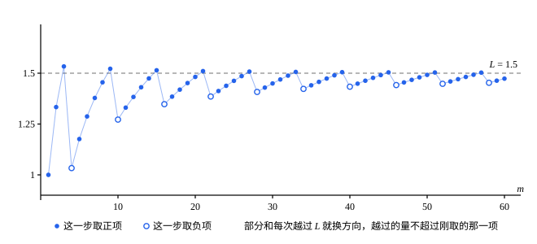
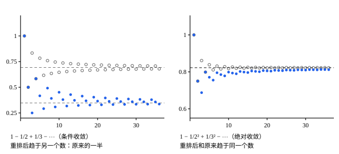

## 这一节要回答的问题

有限个数相加，换个顺序，和不变。交错调和级数（alternating harmonic series）$1-\frac12+\frac13-\frac14+\cdots$是一个:term[收敛级数]{id="math.analysis.convergent-series"}（convergent series）。把它的项重新排成「一正两负」：$1-\frac12-\frac14+\frac13-\frac16-\frac18+\cdots$，每一项都还在，也只出现一次，算出来的和却只有原来的一半（例 1）。

什么样的:term[级数]{id="math.analysis.series"}（series）可以放心地换顺序？换了顺序，和又能变成什么？

## 讲解

### 重排

上面「一正两负」的排法可以这样描述：新:term[级数]{id="math.analysis.series"}的第$n$项是原级数的第$\sigma(n)$项，$\sigma(1)=1$，$\sigma(2)=2$，$\sigma(3)=4$，$\sigma(4)=3$，$\sigma(5)=6$，$\sigma(6)=8$，$\sigma(7)=5$，……每个正整数在$\sigma(1),\sigma(2),\sigma(3),\dots$中恰好出现一次。

::anchor{id="def-rearrangement"}
设$\sigma$把正整数一一对应（bijection）到正整数，即每个正整数恰好是一个$\sigma(n)$。:term[级数]{id="math.analysis.series"}$\sum_{n=1}^\infty a_{\sigma(n)}$叫作$\sum_{n=1}^\infty a_n$的一个:term[重排]{id="math.analysis.rearrangement"}（rearrangement）。

为什么这样定义：「每个正整数恰好出现一次」保证原来的每一项都用上、只用一次，只是换了次序。只取奇数项（$\sigma(n)=2n-1$）不是重排，因为偶数项丢了；加括号也不是重排，它没有换顺序，只是少看了一些:term[部分和]{id="math.analysis.partial-sum"}（partial sum）。有限和换序不变，这里要问的是：无穷和换了序，还:term[收敛]{id="math.analysis.convergent-series"}吗？和变不变？

::anchor{id="thm-rearrangement-absolute"}
**定理 1**　若$\sum a_n$:term[绝对收敛]{id="math.analysis.absolute-convergence"}（absolute convergence），和是$S$，则它的每个:term[重排]{id="math.analysis.rearrangement"}$\sum a_{\sigma(n)}$也绝对收敛，和也是$S$。

**证明**：记$S_n=\sum_{k=1}^na_k$，$T_m=\sum_{j=1}^ma_{\sigma(j)}$。任给$\varepsilon>0$，由:term[级数的柯西准则]{id="math.analysis.series-cauchy-criterion"}（Cauchy criterion for series），有$N$，使$n>N$时$|a_{N+1}|+\cdots+|a_n|<\varepsilon$。令$n\to\infty$，得到「尾巴」$\sum_{k>N}|a_k|\le\varepsilon$，从而$|S-S_N|\le\varepsilon$。

$1,2,\dots,N$都在$\sigma(1),\sigma(2),\dots$中出现过，取$M$不小于它们出现的位置，则$m\ge M$时，$T_m$包含了$a_1,\dots,a_N$，$T_m-S_N$是一些下标都大于$N$、互不相同的$a_k$之和。所以$|T_m-S_N|\le\sum_{k>N}|a_k|\le\varepsilon$，于是$|T_m-S|\le|T_m-S_N|+|S_N-S|\le2\varepsilon$，即$T_m\to S$。对$\sum|a_n|$用同样的论证（它也绝对收敛），$\sum|a_{\sigma(n)}|$收敛，所以重排也绝对收敛。

为什么想到这么做：绝对收敛时，从第$N+1$项往后的所有项，绝对值加起来也不超过$\varepsilon$。重排后只要走得足够远，前$N$项都已经出现，剩下的差只来自这条尾巴，怎么排都不会超过$\varepsilon$。

### 黎曼重排定理

交错调和级数为什么能排出不同的和？把它的正项、负项分开：正项$1+\frac13+\frac15+\cdots$的:term[部分和]{id="math.analysis.partial-sum"}要多大有多大，负项也是。手里有两堆「要多少有多少」的项，而且项越来越小；想凑到哪个数，就先取正项把部分和推过它，再取负项拉回来，来回调整。

**引理**　设$\sum a_n$:term[条件收敛]{id="math.analysis.conditional-convergence"}（conditional convergence）。记$p_n=\max(a_n,0)$，$q_n=\max(-a_n,0)$，则$\sum p_n$和$\sum q_n$都:term[发散]{id="math.analysis.divergent-series"}（divergent series），部分和都趋于$+\infty$。

**证明**：$a_n=p_n-q_n$，$|a_n|=p_n+q_n$。若$\sum p_n$:term[收敛]{id="math.analysis.convergent-series"}，则$\sum q_n=\sum(p_n-a_n)$收敛，于是$\sum|a_n|=\sum(p_n+q_n)$收敛，和条件收敛矛盾；同理$\sum q_n$发散。它们的项都不小于$0$，部分和单调递增而发散，由:term[单调有界原理]{id="math.analysis.monotone-convergence-theorem"}（monotone convergence theorem），部分和没有:term[上界]{id="math.analysis.upper-bound"}（upper bound），趋于$+\infty$。

::anchor{id="thm-riemann-rearrangement"}
**定理 2**　设$\sum a_n$:term[条件收敛]{id="math.analysis.conditional-convergence"}，$L$是任意实数，则有:term[重排]{id="math.analysis.rearrangement"}$\sum a_{\sigma(n)}$收敛，并且和是$L$。这叫作:term[黎曼重排定理]{id="math.analysis.riemann-rearrangement-theorem"}（Riemann rearrangement theorem）。

**证明**：把$a_n\ge0$的项按原来的顺序记作$P_1,P_2,\dots$，把$a_n<0$的项的绝对值按原来的顺序记作$Q_1,Q_2,\dots$。由引理，$\sum P_k$和$\sum Q_k$的部分和都趋于$+\infty$；收敛级数的项趋于$0$，所以$P_k\to0$，$Q_k\to0$。

依次这样取：先取$P$，至少取一项，取到部分和第一次大于$L$为止；再取$-Q$，至少取一项，取到部分和第一次小于$L$为止；再取$P$……剩下的$P$加起来要多大有多大，$Q$也是，所以每一步都能在有限项内完成。每段至少用掉一项，所有的$P$、$Q$迟早都被用上，并且各用一次，得到的是一个重排。

从第二段起，取$P$的一段开始时部分和小于$L$，结束时大于$L$，并且不超过$L$加上这一段最后取的那个$P$；取$-Q$的一段同理。所以这一段里每个部分和与$L$的差，不超过这一段和上一段最后取的两项中较大的一个。被取到的$P$、$Q$下标越来越大，这些项趋于$0$，所以部分和趋于$L$。

为什么条件收敛才行：证明只用了两件事，正项、负项各自的和都是$+\infty$，而项趋于$0$。:term[绝对收敛]{id="math.analysis.absolute-convergence"}时$\sum P_k$和$\sum Q_k$都有限，正项取完了也可能推不过$L$，这和定理 1 一致。用同样的办法还能排出发散到$+\infty$的:term[级数]{id="math.analysis.series"}（例 2）。

### 两个级数相乘

两个有限和相乘，$(a_0+a_1)(b_0+b_1)$展开成四项$a_ib_j$，按$i+j$分组是$a_0b_0+(a_0b_1+a_1b_0)+a_1b_1$。两个:term[级数]{id="math.analysis.series"}相乘，展开以后是无穷多个$a_ib_j$，按$i+j$分组，就像多项式相乘时合并同次项。可无穷多项要先排成一列，才能谈论它们的和，排法不同，会不会出问题？

::anchor{id="def-cauchy-product"}
设$\sum_{n=0}^\infty a_n$、$\sum_{n=0}^\infty b_n$是两个:term[级数]{id="math.analysis.series"}，令$c_n=\sum_{k=0}^na_kb_{n-k}=a_0b_n+a_1b_{n-1}+\cdots+a_nb_0$，级数$\sum_{n=0}^\infty c_n$叫作它们的:term[柯西乘积]{id="math.analysis.cauchy-product"}（Cauchy product）。

为什么这样定义：$c_n$收集的是所有$i+j=n$的乘积$a_ib_j$，$\sum a_nx^n$与$\sum b_nx^n$相乘时，$x^n$的系数正是$c_n$。反例：两个:term[条件收敛]{id="math.analysis.conditional-convergence"}的级数，柯西乘积可能:term[发散]{id="math.analysis.divergent-series"}（第 6 题），所以要加条件。

::anchor{id="thm-cauchy-product"}
**定理 3**　若$\sum a_n$、$\sum b_n$都:term[绝对收敛]{id="math.analysis.absolute-convergence"}，和分别是$A$、$B$，则它们的:term[柯西乘积]{id="math.analysis.cauchy-product"}也绝对收敛，和是$AB$。

**证明**：把所有乘积$a_ib_j$（$i,j\ge0$）按任意一种顺序排成一列$d_1,d_2,\dots$，每个乘积恰好出现一次。前$m$项的下标$i$、$j$都不超过某个$K$，所以$|d_1|+\cdots+|d_m|\le\sum_{i=0}^K|a_i|\sum_{j=0}^K|b_j|\le\sum_{i=0}^\infty|a_i|\sum_{j=0}^\infty|b_j|$。:term[部分和]{id="math.analysis.partial-sum"}有:term[上界]{id="math.analysis.upper-bound"}，由:term[单调有界原理]{id="math.analysis.monotone-convergence-theorem"}，$\sum d_l$绝对收敛；由定理 1，它的和与排法无关。

先按「正方形」排：第$K$步把$i,j\le K$而还没排进去的乘积都排进去。第$K$步结束时，部分和恰好是$\bigl(\sum_{i=0}^Ka_i\bigr)\bigl(\sum_{j=0}^Kb_j\bigr)$，它趋于$AB$；这些部分和组成部分和数列的一个:term[子列]{id="math.analysis.subsequence"}（subsequence），所以$\sum d_l=AB$。

再按「对角线」排：依次排$i+j=0,1,2,\dots$的乘积。排完$i+j=n$那一组时，部分和是$c_0+c_1+\cdots+c_n$，它们也组成部分和数列的子列，所以$\sum c_n=AB$。最后，$|c_n|\le\sum_{k=0}^n|a_k||b_{n-k}|$，右边是$\sum|a_n|$与$\sum|b_n|$的柯西乘积的项，同样的道理说明它们的和有限，由:term[比较判别法]{id="math.analysis.comparison-test"}（comparison test），$\sum c_n$绝对收敛。

为什么想到这么做：绝对收敛时乘积$a_ib_j$怎么排都行（定理 1），就挑两种好算的排法。正方形排法的部分和是两个部分和之积，对角线排法分组后正好是柯西乘积。

## 几何图像

这是定理 2 的证明用在交错调和级数上，目标$L=1.5$。实心点是取正项后的:term[部分和]{id="math.analysis.partial-sum"}，空心点是取负项后的；每次越过$L$就换方向，越过的量不超过刚取的那一项。$L$比原来的和大，正项用得快：每次要连取好几个正项才越过$L$，负项往往取一个就拉回来了。

灰色空心点是原来顺序的部分和，实心点是「一正两负」:term[重排]{id="math.analysis.rearrangement"}后的部分和。左边是:term[条件收敛]{id="math.analysis.conditional-convergence"}的交错调和级数，重排后趋于原来的一半（例 1）；右边是:term[绝对收敛]{id="math.analysis.absolute-convergence"}的$1-\frac{1}{2^2}+\frac{1}{3^2}-\cdots$，同样的重排，部分和和原来趋于同一个数，这是定理 1。

## 例题

### 例 1　「一正两负」的重排

把交错调和级数:term[重排]{id="math.analysis.rearrangement"}成$1-\frac12-\frac14+\frac13-\frac16-\frac18+\frac15-\frac{1}{10}-\frac{1}{12}+\cdots$，即依次取一个正项、两个负项。证明重排后的:term[级数]{id="math.analysis.series"}:term[收敛]{id="math.analysis.convergent-series"}，和是原来的一半。

**为什么想到这么做**：三项一组，每组里正项和第一个负项能合并：$\frac{1}{2k-1}-\frac{1}{2(2k-1)}=\frac{1}{2(2k-1)}$。合并以后，每组恰好是原级数相邻两项的一半。

**推导**：记原级数的:term[部分和]{id="math.analysis.partial-sum"}为$S_n$，和为$S$；重排后的部分和为$T_m$。第$k$组是$\frac{1}{2k-1}-\frac{1}{4k-2}-\frac{1}{4k}=\frac{1}{4k-2}-\frac{1}{4k}=\frac12\Bigl(\frac{1}{2k-1}-\frac{1}{2k}\Bigr)$，所以$T_{3k}=\frac12S_{2k}\to\frac S2$。

$T_{3k+1}$、$T_{3k+2}$和$T_{3k}$只差一两项，这些项趋于$0$，所以也趋于$\frac S2$。三个:term[子列]{id="math.analysis.subsequence"}都趋于$\frac S2$，整个$\{T_m\}$就趋于$\frac S2$。由[级数的柯西准则与绝对收敛](lesson:math.analysis.series-cauchy)例 2 的推导，$S\ge S_2=\frac12>0$，所以重排确实改变了和。

### 例 2　重排成发散到$+\infty$

设$\sum a_n$:term[条件收敛]{id="math.analysis.conditional-convergence"}。证明它有一个:term[重排]{id="math.analysis.rearrangement"}，:term[部分和]{id="math.analysis.partial-sum"}趋于$+\infty$。

**为什么想到这么做**：定理 2 的办法里，目标$L$固定不动；让目标一步步升高，部分和就被一路推上去。

**推导**：沿用定理 2 的记号。先取$P$，直到部分和大于$1$，再取一个$-Q$；再取$P$，直到部分和大于$2$，再取一个$-Q$……剩下的$P$加起来要多大有多大，所以每一步都能完成；每一步至少用掉一个$P$和一个$Q$，所有的项都会被用上，这是一个重排。

取完第$k$个$-Q$以后，部分和大于$k-Q_k$；从这以后到取下一个$-Q$之前，部分和只增不减，之后又都大于$k+1-Q_{k+1}$。$Q_k\to0$，所以$k$足够大时$Q_k<1$，从那以后部分和都大于$k-1$，于是部分和趋于$+\infty$。

## 常见误区

- 「无穷和也满足加法交换律。」不对：:term[条件收敛]{id="math.analysis.conditional-convergence"}的:term[级数]{id="math.analysis.series"}换了顺序，和会变（例 1、定理 2）。只有:term[绝对收敛]{id="math.analysis.absolute-convergence"}的级数可以随便换（定理 1）。
- 「:term[黎曼重排定理]{id="math.analysis.riemann-rearrangement-theorem"}说，条件收敛的级数换了顺序，和一定变。」不对：只挪前面有限项（$n$足够大时$\sigma(n)=n$）时，从某一项起:term[部分和]{id="math.analysis.partial-sum"}和原来一样，和不变。每一项挪动的距离都不超过某个固定的数时，和也不变（第 5 题）。
- 「两个:term[收敛]{id="math.analysis.convergent-series"}级数的:term[柯西乘积]{id="math.analysis.cauchy-product"}一定收敛，和是两个和的积。」不对：两个都条件收敛时，柯西乘积可能:term[发散]{id="math.analysis.divergent-series"}（第 6 题）。定理 3 要求两个都绝对收敛；其实一个绝对收敛就够了，这里不证。
