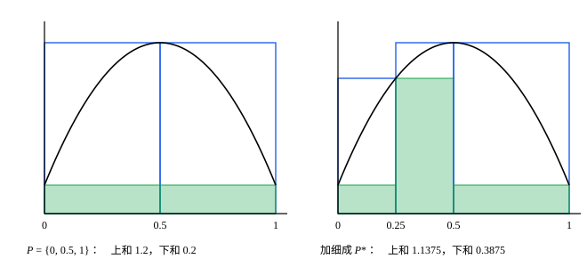

## 这一节要回答的问题

微积分里，定积分是黎曼和（Riemann sum）$\sum f(\xi_i)\Delta x_i$在:term[分割]{id="math.analysis.partition"}（partition）越来越细时的极限。可这个「极限」很特别：和式既随分割变，又随每一小段里挑的点$\xi_i$变，它不是一个数列的:term[极限]{id="math.analysis.sequence-limit"}（limit of a sequence，lim）。

不借助这种说不清的「极限」，能不能说清积分是什么？什么样的函数才有积分？

## 讲解

### 分割、上和与下和

::anchor{id="def-darboux-sums"}
设$f$在$[a,b]$上:term[有界]{id="math.analysis.bounded-function"}（bounded function），即有$K$使所有$x\in[a,b]$都满足$|f(x)|\le K$。有限个点$a=x_0<x_1<\cdots<x_n=b$叫作$[a,b]$的一个:term[分割]{id="math.analysis.partition"}（partition），记作$P$，第$i$个小区间$[x_{i-1},x_i]$的长度记作$\Delta x_i$。记$M_i$、$m_i$为$f$在第$i$个小区间上的:term[上确界]{id="math.analysis.supremum"}（supremum，sup）和:term[下确界]{id="math.analysis.infimum"}（infimum，inf），称$U(f,P)=\sum_{i=1}^nM_i\Delta x_i$为$f$关于$P$的:term[上和]{id="math.analysis.upper-sum"}（upper sum），$L(f,P)=\sum_{i=1}^nm_i\Delta x_i$为:term[下和]{id="math.analysis.lower-sum"}（lower sum）。

为什么这样定义：不管每一小段里挑哪个点$\xi_i$，都有$m_i\le f(\xi_i)\le M_i$，所以黎曼和总夹在$L(f,P)$和$U(f,P)$之间。上和、下和不依赖挑点，是黎曼和在这个分割下最大、最小的可能（虽然不一定取得到）。几何上，上和是各段以上确界为高的矩形面积之和，下和是以下确界为高的。

$M_i$、$m_i$的存在靠:term[确界原理]{id="math.analysis.supremum-principle"}（least-upper-bound property），这正是要求$f$有界的原因。$f(x)=\frac1x$（$0<x\le1$）、$f(0)=0$在$[0,1]$上无界：不管怎么分割，含$0$的那一段上$f$没有:term[上界]{id="math.analysis.upper-bound"}（upper bound），$M_1$不存在，上和根本无从谈起。

### 加细

::anchor{id="def-refinement"}
如果:term[分割]{id="math.analysis.partition"}$P^*$包含$P$的所有分点，就说$P^*$是$P$的:term[加细]{id="math.analysis.refinement"}（refinement）。

为什么这样定义：加细只许添点、不许挪点，原来的每一段只会被切成几段。$\{0,\frac12,1\}$和$\{0,\frac13,\frac23,1\}$谁也不是谁的加细，后者的每一段虽然更短，分点却挪了位置；两者合起来的$\{0,\frac13,\frac12,\frac23,1\}$是它们共同的加细。

**定理 1**　(1) 若$P^*$是$P$的:term[加细]{id="math.analysis.refinement"}，则$L(f,P)\le L(f,P^*)\le U(f,P^*)\le U(f,P)$。(2) 对任意两个分割$P$、$Q$，都有$L(f,P)\le U(f,Q)$。

**证明**：(1) 先看只添一个点$t\in(x_{i-1},x_i)$的情形，只有第$i$段变了。$[x_{i-1},t]$和$[t,x_i]$上的:term[下确界]{id="math.analysis.infimum"}都不小于$m_i$，因为它们是在更小的集合上取的，所以这两段对:term[下和]{id="math.analysis.lower-sum"}的贡献之和不小于$m_i(t-x_{i-1})+m_i(x_i-t)=m_i\Delta x_i$，下和不减；同理:term[上和]{id="math.analysis.upper-sum"}不增。添多个点时一个一个地添，$L(f,P^*)\le U(f,P^*)$则因为每一段上$m_i\le M_i$。

(2) $P\cup Q$同时是$P$和$Q$的加细，由 (1)，$L(f,P)\le L(f,P\cup Q)\le U(f,P\cup Q)\le U(f,Q)$。

### 黎曼积分

由定理 1，所有的:term[下和]{id="math.analysis.lower-sum"}都不超过任何一个:term[上和]{id="math.analysis.upper-sum"}，所以下和有:term[上界]{id="math.analysis.upper-bound"}，上和有下界（lower bound）。由:term[确界原理]{id="math.analysis.supremum-principle"}，$\sup_PL(f,P)$和$\inf_PU(f,P)$都存在，这里$P$取遍$[a,b]$的所有:term[分割]{id="math.analysis.partition"}。每个上和$U(f,Q)$都是下和的上界，所以$\sup_PL(f,P)\le U(f,Q)$；这对每个$Q$都成立，于是$\sup_PL(f,P)\le\inf_QU(f,Q)$。

::anchor{id="def-upper-lower-integral"}
$\underline I=\sup_PL(f,P)$叫作$f$在$[a,b]$上的下积分（lower integral），$\overline I=\inf_PU(f,P)$叫作$f$在$[a,b]$上的上积分（upper integral）。前一段已经说明，$\underline I\le\overline I$。

::anchor{id="def-riemann-integral"}
如果$\underline I=\overline I$，就说$f$在$[a,b]$上:term[可积]{id="math.analysis.riemann-integral"}（Riemann integrable），这个公共值叫作$f$在$[a,b]$上的:term[黎曼积分]{id="math.analysis.riemann-integral"}（Riemann integral），记作$\int_a^bf(x)\dd x$。

为什么这样定义：积分应当不小于每一个下和、不大于每一个上和，就像曲边梯形的面积夹在内接矩形和外接矩形的面积之间。$\underline I$和$\overline I$之间的数都满足这个要求；只有它们相等时，满足要求的数才只有一个，积分才确定下来。这样定义的积分也确实是黎曼和的「极限」：黎曼和总夹在$L(f,P)$和$U(f,P)$之间，而对可积的$f$，这两者都能离积分任意近。

反例：狄利克雷函数（Dirichlet function）$D(x)$，$x$是有理数时取$1$，无理数时取$0$。任何一个小区间里既有有理数也有无理数，所以每一段上$M_i=1$、$m_i=0$，对每个:term[分割]{id="math.analysis.partition"}都有$U(D,P)=1$、$L(D,P)=0$。于是$\overline I=1\ne0=\underline I$，$D$在$[0,1]$上:term[有界]{id="math.analysis.bounded-function"}，却不可积。

### 可积准则

::anchor{id="thm-integrability-criterion"}
**定理 2**　:term[有界函数]{id="math.analysis.bounded-function"}$f$在$[a,b]$上:term[可积]{id="math.analysis.riemann-integral"}，当且仅当任给$\varepsilon>0$，都有:term[分割]{id="math.analysis.partition"}$P$使$U(f,P)-L(f,P)<\varepsilon$。这叫作:term[可积准则]{id="math.analysis.integrability-criterion"}（Riemann's criterion）。

**证明**：若条件成立，对每个分割$P$都有$L(f,P)\le\underline I\le\overline I\le U(f,P)$，所以$0\le\overline I-\underline I\le U(f,P)-L(f,P)$。任给$\varepsilon$都能让右边小于$\varepsilon$，所以$\overline I=\underline I$。

反过来，设$f$可积，积分是$I$。任给$\varepsilon>0$，$I-\frac\varepsilon2$不是:term[下和]{id="math.analysis.lower-sum"}的:term[上界]{id="math.analysis.upper-bound"}，$I+\frac\varepsilon2$不是:term[上和]{id="math.analysis.upper-sum"}的下界，所以有分割$P_1$、$P_2$，使$L(f,P_1)>I-\frac\varepsilon2$，$U(f,P_2)<I+\frac\varepsilon2$。取$P=P_1\cup P_2$，由定理 1，$L(f,P)\ge L(f,P_1)$，$U(f,P)\le U(f,P_2)$，所以$U(f,P)-L(f,P)<\varepsilon$。

为什么它有用：按定义判断可积，要对所有分割取:term[上确界]{id="math.analysis.supremum"}、:term[下确界]{id="math.analysis.infimum"}；有了准则，只要对每个$\varepsilon$找出一个够好的分割。

::anchor{id="def-oscillation"}
$f$在第$i$段上的上确界与下确界之差$M_i-m_i$，叫作$f$在这一段上的振幅（oscillation）。

为什么看振幅：$U(f,P)-L(f,P)=\sum_{i=1}^n(M_i-m_i)\Delta x_i$，准则要的正是各段的振幅乘段长、加起来能任意小，每一段上$f$起伏得小，上和、下和就靠得近。段里任意两点的函数值都在$m_i$和$M_i$之间，相差不超过振幅。狄利克雷函数在每一段上的振幅都是$1$，这个和总等于区间的长度，怎么分割都小不下去。

## 几何图像

:::anim{component="function-plot"}
range: { x: [0, 1], y: [0, 1.05] }
functions:
  - expr: "x^2"
    label: |
      $y=x^2$
  - expr: "(min(floor(k * x) + 1, k) / k)^2"
    label: |
      上和的矩形顶边
  - expr: "(min(floor(k * x), k - 1) / k)^2"
    label: |
      下和的矩形顶边
sliders:
  - name: k
    min: 1
    max: 40
    step: 1
    default: 4
    label: |
      等分的段数$k$
:::

把$[0,1]$等分成$k$段，$x^2$递增，每一段上的:term[上确界]{id="math.analysis.supremum"}、:term[下确界]{id="math.analysis.infimum"}分别在右端点、左端点取到。上面的台阶是:term[上和]{id="math.analysis.upper-sum"}那些矩形的顶边，下面的台阶是:term[下和]{id="math.analysis.lower-sum"}的，两条台阶之间的面积就是$U-L=\frac1k$：每一段上的差$\frac{i^2-(i-1)^2}{k^2}$乘段长$\frac1k$，加起来正好是$\frac{1}{k}$。拖动滑块把$k$调大，台阶贴着曲线，差趋于$0$，这就是:term[可积准则]{id="math.analysis.integrability-criterion"}在说的事。

空心矩形对应:term[上和]{id="math.analysis.upper-sum"}，实心矩形对应:term[下和]{id="math.analysis.lower-sum"}。添上分点$0.25$以后，左边那一段被切成两段，上和从$1.2$降到$1.1375$，下和从$0.2$升到$0.3875$，这就是定理 1 的 (1)。右边那一段没动，它的两个矩形也没变。

## 例题

### 例 1　$f(x)=x$在$[0,b]$上可积，积分是$\frac{b^2}{2}$

**为什么想到这么做**：$f$递增，每一段上的:term[上确界]{id="math.analysis.supremum"}、:term[下确界]{id="math.analysis.infimum"}就是右端点、左端点的值；:term[分割]{id="math.analysis.partition"}取等分，:term[上和]{id="math.analysis.upper-sum"}、:term[下和]{id="math.analysis.lower-sum"}都是等差数列求和，算得出来。先用:term[可积准则]{id="math.analysis.integrability-criterion"}说明:term[可积]{id="math.analysis.riemann-integral"}，再用「积分夹在上和、下和之间」定出它的值。

**推导**：取等分分割$P_n$，$x_i=\frac{ib}{n}$，则$M_i=x_i$，$m_i=x_{i-1}$，

$$
U(f,P_n)=\sum_{i=1}^n\frac{ib}{n}\cdot\frac bn=\frac{b^2}{n^2}\cdot\frac{n(n+1)}{2}=\frac{b^2}{2}+\frac{b^2}{2n},\qquad L(f,P_n)=\frac{b^2}{2}-\frac{b^2}{2n} .
$$

$U(f,P_n)-L(f,P_n)=\frac{b^2}{n}$。任给$\varepsilon>0$，由:term[阿基米德性质]{id="math.analysis.archimedean-property"}（Archimedean property）取正整数$n>\frac{b^2}{\varepsilon}$，差就小于$\varepsilon$，由准则，$f$可积。设积分是$I$，则对每个$n$都有$L(f,P_n)\le I\le U(f,P_n)$，即$\bigl|I-\frac{b^2}{2}\bigr|\le\frac{b^2}{2n}$。$n$可以任意大，所以$I=\frac{b^2}{2}$。

### 例 2　只在一点不为零的函数

设$c\in[a,b]$，$f(c)=1$，其余点上$f=0$。证明$f$在$[a,b]$上:term[可积]{id="math.analysis.riemann-integral"}，积分是$0$。

**为什么想到这么做**：每一段上都有$f=0$的点，:term[下和]{id="math.analysis.lower-sum"}总是$0$；:term[上和]{id="math.analysis.upper-sum"}只在含$c$的那一两段上不为零，把这一两段取得很短，上和就很小。

**推导**：每一段上$f\ge0$，又有$f=0$的点，所以$m_i=0$，$L(f,P)=0$。任给$\varepsilon>0$，取一个:term[分割]{id="math.analysis.partition"}，使含$c$的段（$c$是$x_1,\dots,x_{n-1}$中的一个时有两段）的总长小于$\varepsilon$。这些段上$M_i=1$，其余段上$M_i=0$，所以$U(f,P)<\varepsilon$，$U(f,P)-L(f,P)<\varepsilon$。由:term[可积准则]{id="math.analysis.integrability-criterion"}，$f$可积，积分夹在$L(f,P)=0$和$U(f,P)<\varepsilon$之间，只能是$0$。

结合第 5 题的线性性：改动一个函数在有限个点上的值，不改变它可不可积，也不改变积分。

## 常见误区

- 「:term[有界]{id="math.analysis.bounded-function"}的函数都:term[可积]{id="math.analysis.riemann-integral"}。」不对：狄利克雷函数在$[0,1]$上有界，上积分是$1$，下积分是$0$。
- 「:term[上和]{id="math.analysis.upper-sum"}用的是每一段上的最大值。」不对，用的是:term[上确界]{id="math.analysis.supremum"}。最大值不一定取得到：$f(x)=x$（$0\le x<1$）、$f(1)=0$在$\bigl[\frac12,1\bigr]$上的上确界是$1$，却没有一点取到$1$。
- 「每一段都更短，上和就更小。」不一定，要是:term[加细]{id="math.analysis.refinement"}才行。$f$只在$x=\frac13$处取$1$、其余点取$0$时，$\{0,\frac12,1\}$的上和是$\frac12$，每段更短的$\{0,\frac13,\frac23,1\}$的上和却是$\frac23$，因为$\frac13$同时属于两段。
