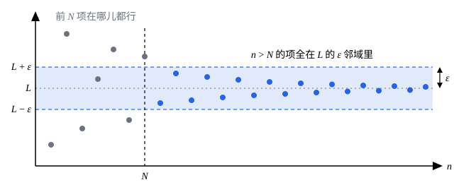

## 这一节要回答的问题

数列$1,\frac12,\frac13,\frac14,\dots$「趋于$0$」，这话在微积分里说过很多次。可它也「越来越接近」$-1$；而数列$1,2,1,\frac32,1,\frac43,\dots$离$1$时远时近，看上去却也趋于$1$。「趋于」到底是什么意思？能不能把它写成一句既能拿来证明、又能拿来否定的话？

## 讲解

### 「越来越接近」说不清

先看$a_n=\frac{1}{n}$。它到$0$的距离$\frac1n$越来越小，到$-1$的距离$1+\frac1n$也越来越小，所以「越来越接近」分不出它趋向哪个数。两者真正的区别是：到$0$的距离能小于你指定的任何正数，到$-1$的距离却总大于$1$。

再看$d_n=1+\frac{1+(-1)^n}{n}$，也就是$1,2,1,\frac32,1,\frac43,\dots$。它到$1$的距离依次是$0,1,0,\frac12,0,\frac13,\dots$，并不是越来越小。可这个距离总不超过$\frac{2}{n}$：要它小于$0.01$，只要$n>200$；要它小于$0.0001$，只要$n>20000$。

两个例子合起来看，「趋于$L$」该说的是：不管要求多近，从某一项起，后面所有的项都离$L$那么近。要求越高，这个「某一项」可以越靠后，但总找得到。

### 数列极限的定义

::anchor{id="def-limit"}
设$\{a_n\}$是一个数列，$L$是一个实数。如果任给$\varepsilon>0$，都存在正整数$N$，使得当$n>N$时都有$|a_n-L|<\varepsilon$，就说$L$是数列$\{a_n\}$的:term[极限]{id="math.analysis.sequence-limit"}（limit of a sequence，lim），记作$\lim_{n\to\infty}a_n=L$，或$a_n\to L\ (n\to\infty)$。有极限的数列叫作:term[收敛数列]{id="math.analysis.convergent-sequence"}（convergent sequence），也说$\{a_n\}$收敛于$L$。

用量词写出来是

$$
\forall\varepsilon>0,\ \exists N\in\N^+,\ \forall n>N,\quad |a_n-L|<\varepsilon .
$$

为什么这样定义：$\varepsilon$是对「多近」的要求，可以任意小；$N$是对这个要求的回应，可以随$\varepsilon$变，$\varepsilon$越小，$N$往往越大。定义只要求$N$存在，不要求它最小，所以证明时找到一个够用的就行。「当$n>N$时都有」说的是从第$N+1$项起无一例外，前面有限项怎样都无所谓：改动、删去或添上有限项，既不影响数列收不收敛，也不影响极限是多少。

::anchor{id="def-neighborhood"}
不等式$|a_n-L|<\varepsilon$就是$L-\varepsilon<a_n<L+\varepsilon$。开区间$(L-\varepsilon,L+\varepsilon)$叫作$L$的$\varepsilon$:term[邻域]{id="math.analysis.neighborhood"}（neighborhood）。所以$a_n\to L$的意思是：$L$的每一个$\varepsilon$邻域，都装得下数列从某一项起的全部项；落在邻域外面的，最多只有有限项。

两个边界情况。常数数列$c,c,c,\dots$收敛于$c$：每一项都满足$|c-c|=0<\varepsilon$，取$N=1$就行。数列$\{(-1)^n\}$有无穷多项等于$1$，$1$的每个邻域里都有它的项，可它并不收敛于$1$：等于$-1$的那无穷多项，永远落在$1$的$\frac12$邻域外面。

### 用定义证明极限

按定义证明$\lim_{n\to\infty}a_n=L$，套路是三步：任给$\varepsilon>0$；找出$N$；验证$n>N$时$|a_n-L|<\varepsilon$。找$N$时常要用到一条你早就熟悉的事实：对任意实数$x$，都有正整数大于$x$。它叫作:term[阿基米德性质]{id="math.analysis.archimedean-property"}（Archimedean property）；这里先承认它，[实数的完备性](lesson:math.analysis.completeness)那一节会证明它。

先证$\lim_{n\to\infty}\frac{1}{n}=0$。分析：$\bigl|\frac1n-0\bigr|=\frac1n$，要它小于$\varepsilon$，只要$n>\frac1\varepsilon$。证明：任给$\varepsilon>0$，由阿基米德性质取正整数$N>\frac{1}{\varepsilon}$；当$n>N$时，$\bigl|\frac1n-0\bigr|=\frac{1}{n}<\frac{1}{N}<\varepsilon$。

再证$d_n\to1$。$|d_n-1|$等于$0$或$\frac{2}{n}$，总有$|d_n-1|\le\frac{2}{n}$；任给$\varepsilon>0$，取正整数$N>\frac{2}{\varepsilon}$，当$n>N$时$|d_n-1|\le\frac2n<\frac2N<\varepsilon$。这里没有去解$|d_n-1|<\varepsilon$，而是先把它放大成简单的$\frac{2}{n}$，再让$\frac{2}{n}$小于$\varepsilon$。这种「放大」是找$N$最常用的办法：只要放大后的式子仍能任意小，由它找到的$N$就够用。

### 不收敛是什么意思

把定义里的量词逐个否定（任意变存在，存在变任意，最后的不等式取反），就得到「$\{a_n\}$不:term[收敛]{id="math.analysis.convergent-sequence"}于$L$」：

$$
\exists\varepsilon_0>0,\ \forall N\in\N^+,\ \exists n>N,\quad |a_n-L|\ge\varepsilon_0 .
$$

也就是说，有一个固定的距离$\varepsilon_0$，无论从多靠后的地方看起，后面总还有离$L$至少$\varepsilon_0$远的项。

::anchor{id="def-divergent"}
如果没有任何实数$L$能让$\{a_n\}$收敛于$L$，就说$\{a_n\}$是:term[发散数列]{id="math.analysis.divergent-sequence"}（divergent sequence），也说它发散。要证明数列发散，就要对每一个实数$L$都找出上面那样的$\varepsilon_0$。

例如$\{(-1)^n\}$发散。任取实数$L$，取$\varepsilon_0=1$。由$|1-L|+|-1-L|\ge|(1-L)-(-1-L)|=2$，$|1-L|$和$|-1-L|$中至少有一个不小于$1$；而偶数项都是$1$、奇数项都是$-1$，无论$N$多大，$n>N$里两种项都有。所以总有$n>N$使$|(-1)^n-L|\ge1$。

数列$a_n=n$也发散：任取$L$，取$\varepsilon_0=1$，对每个$N$，大于$N$和$L+1$的正整数$n$都满足$|n-L|>1$。它「趋于无穷」，可$\infty$不是实数，按这里的定义它没有:term[极限]{id="math.analysis.sequence-limit"}。

## 几何图像

横轴是项的序号$n$，纵轴是项的值，阴影横带是$L$的$\varepsilon$:term[邻域]{id="math.analysis.neighborhood"}。前$N$项落在哪儿都行，从第$N+1$项起，所有的点都在带子里；把$\varepsilon$调小，带子变窄，$N$就要往右挪。

:::anim{component="function-plot"}
range: { x: [0, 61], y: [-0.2, 1.7] }
functions:
  - expr: "1 + eps"
    label: |
      $y=1+\varepsilon$
  - expr: "1 - eps"
    label: |
      $y=1-\varepsilon$
sequences:
  - expr: "1 + (-1)^n / n"
    n: [1, 60]
    label: |
      $a_n=1+\frac{(-1)^n}{n}$
points:
  - { x: "floor(1 / eps)", y: "1" }
sliders:
  - name: eps
    min: 0.02
    max: 0.5
    step: 0.01
    default: 0.2
    label: |
      $\varepsilon$
:::

这里$|a_n-1|=\frac1n$。图上高度为$1$、单独标出的那个点，横坐标是不超过$\frac1\varepsilon$的最大整数，就是这个数列能取的最小的$N$。拖动滑块把$\varepsilon$调小，两条横线夹成的带子变窄，这个点往右移，它右边的项始终全在带子里。

## 例题

### 例 1　$\lim_{n\to\infty}\frac{n^2+n}{2n^2-1}=\frac12$

**为什么想到这么做**：直接解不等式$\bigl|\frac{n^2+n}{2n^2-1}-\frac12\bigr|<\varepsilon$，要解一个二次不等式，很麻烦。可定义只要求找到某个$N$，不要求最小的，所以先把差放大成$\frac{C}{n}$这样的简单式子，再让它小于$\varepsilon$。放大时，分子往大里放，分母往小里放。

**推导**：通分得

$$
\left|\frac{n^2+n}{2n^2-1}-\frac12\right|=\frac{2n+1}{2(2n^2-1)} .
$$

当$n\ge1$时，分子$2n+1\le3n$，分母$2(2n^2-1)=2n^2+2(n^2-1)\ge2n^2$，所以这个差不超过$\frac{3n}{2n^2}=\frac{3}{2n}$。任给$\varepsilon>0$，取正整数$N>\frac{3}{2\varepsilon}$，当$n>N$时

$$
\left|\frac{n^2+n}{2n^2-1}-\frac12\right|\le\frac{3}{2n}<\frac{3}{2N}<\varepsilon ,
$$

所以这个数列的:term[极限]{id="math.analysis.sequence-limit"}是$\frac12$。

### 例 2　$|q|<1$时$\lim_{n\to\infty}q^n=0$

**为什么想到这么做**：要让$|q|^n<\varepsilon$，直接解得用对数，而且每一步都要小心不等号的方向。更顺手的是像例 1 那样，把$|q|^n$放大成$\frac{C}{n}$的形式。$0<|q|<1$时，可以把$\frac{1}{|q|}$写成$1+h$（$h>0$），而由二项式定理，$(1+h)^n$至少有$1+nh$那么大，这就把乘方换成了乘积。

**推导**：$q=0$时每一项都是$0$，结论显然。设$0<|q|<1$，令$h=\frac{1}{|q|}-1$，则$h>0$，$|q|=\frac{1}{1+h}$。由二项式定理，$(1+h)^n=1+nh+\dots\ge1+nh>nh$（展开式里每一项都非负），所以

$$
|q^n-0|=\frac{1}{(1+h)^n}<\frac{1}{nh} .
$$

任给$\varepsilon>0$，取正整数$N>\frac{1}{h\varepsilon}$，当$n>N$时$|q^n-0|<\frac{1}{nh}<\frac{1}{Nh}<\varepsilon$。所以$\{q^n\}$:term[收敛]{id="math.analysis.convergent-sequence"}于$0$。例如$q=\frac12$时$h=1$，得到$\frac{1}{2^n}<\frac{1}{n}$。

## 常见误区

- 「$a_n$越来越接近$L$，所以$a_n\to L$。」不对：$\frac1n$越来越接近$-1$，却:term[收敛]{id="math.analysis.convergent-sequence"}于$0$。反过来，收敛也不要求越来越近，$d_n=1+\frac{1+(-1)^n}{n}$就是例子。
- 「$N$要取满足条件的最小的那个。」不必：定义只要求$N$存在，比够用的$N$更大的数也都够用。所以放大不等式时可以放得很粗，只要放大后仍能任意小。
- 「有无穷多项落在$L$的每个$\varepsilon$:term[邻域]{id="math.analysis.neighborhood"}里，就收敛于$L$。」不对：$\{(-1)^n\}$有无穷多项等于$1$，它却是:term[发散数列]{id="math.analysis.divergent-sequence"}。收敛要求的是从某一项起全部落在邻域里。
- 「先取定$N$，再让$\varepsilon$任意。」量词的顺序不能换：「存在$N$，使对一切$\varepsilon>0$，$n>N$时都有$|a_n-L|<\varepsilon$」，等于要求$n>N$的项全都等于$L$。$\frac1n$满足原来的定义，却不满足这个说法。
