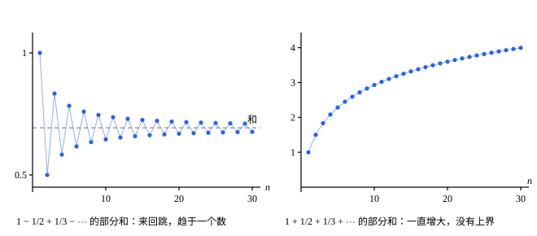

## 这一节要回答的问题

微积分里，:term[级数]{id="math.analysis.series"}（series）$\sum a_n$的和，是它的:term[部分和]{id="math.analysis.partial-sum"}（partial sum）$S_n=a_1+a_2+\cdots+a_n$在$n\to\infty$时的:term[极限]{id="math.analysis.sequence-limit"}（limit of a sequence，lim）。判断一个级数是不是:term[收敛级数]{id="math.analysis.convergent-series"}（convergent series），常用的判别法多半是对各项都不小于$0$的级数说的。可$\sum\frac{\sin n}{n^2}$的项有正有负，部分和忽大忽小，和也猜不出来。

不知道和是多少，怎么判断一个级数收敛？项有正有负的级数，能不能借用那些判别法？

## 讲解

### 级数与部分和

把$\frac12+\frac14+\frac18+\cdots$加到第$n$项，得到$1-\frac{1}{2^n}$。$n$越大，它越接近$1$，所以人们说这个无穷和等于$1$。无穷多个数没法真的一个一个加完，「加到无穷」只能理解成：前$n$项的和在$n\to\infty$时趋于什么。

::anchor{id="def-series"}
给定数列$\{a_n\}$，$S_n=a_1+a_2+\cdots+a_n$叫作:term[级数]{id="math.analysis.series"}$\sum_{n=1}^\infty a_n$的第$n$个:term[部分和]{id="math.analysis.partial-sum"}。如果部分和组成的数列是:term[收敛数列]{id="math.analysis.convergent-sequence"}（convergent sequence），:term[极限]{id="math.analysis.sequence-limit"}是$S$，就说级数收敛，它是:term[收敛级数]{id="math.analysis.convergent-series"}，$S$叫作它的和，记作$\sum_{n=1}^\infty a_n=S$。部分和组成的数列是:term[发散数列]{id="math.analysis.divergent-sequence"}（divergent sequence）时，就说级数发散，它是:term[发散级数]{id="math.analysis.divergent-series"}（divergent series）。

为什么这样定义：这样一来，级数的问题都变成了数列的问题，前面关于数列极限的定理全都用得上。比如由:term[极限的四则运算法则]{id="math.analysis.algebraic-limit-theorem"}（algebraic limit theorem），两个收敛级数可以逐项相加，也可以逐项乘同一个常数。

反例：$\sum_{n=1}^\infty(-1)^{n+1}=1-1+1-\cdots$的部分和是$1,0,1,0,\dots$，它发散。写成$(1-1)+(1-1)+\cdots$像是$0$，写成$1-(1-1)-(1-1)-\cdots$又像是$1$。$\sum$是部分和数列的极限，不能像有限和那样随意加括号（第 7 题）。

### 级数的柯西准则

数列有:term[柯西收敛准则]{id="math.analysis.cauchy-criterion"}（Cauchy criterion）：不用知道:term[极限]{id="math.analysis.sequence-limit"}，只看项与项之间是不是越来越近。:term[部分和]{id="math.analysis.partial-sum"}之差$S_n-S_m=a_{m+1}+a_{m+2}+\cdots+a_n$正是从第$m+1$项到第$n$项的一段和，把准则用到部分和上，就得到下面的定理。

::anchor{id="thm-series-cauchy"}
**定理 1**　:term[级数]{id="math.analysis.series"}$\sum a_n$:term[收敛]{id="math.analysis.convergent-series"}，当且仅当任给$\varepsilon>0$，都存在正整数$N$，使得当$n>m>N$时都有$|a_{m+1}+a_{m+2}+\cdots+a_n|<\varepsilon$。这叫作:term[级数的柯西准则]{id="math.analysis.series-cauchy-criterion"}（Cauchy criterion for series）。

**证明**：$a_{m+1}+\cdots+a_n=S_n-S_m$，所以条件说的是：任给$\varepsilon>0$，有$N$，使$n>m>N$时$|S_n-S_m|<\varepsilon$。$m=n$时差是$0$，交换$m$、$n$差只变号，所以这正是说部分和组成的数列是:term[柯西列]{id="math.analysis.cauchy-sequence"}（Cauchy sequence）。由柯西收敛准则，这又等价于部分和组成的数列:term[收敛]{id="math.analysis.convergent-sequence"}，也就是级数收敛。

为什么它有用：判断收敛，用不着先猜出和，只要说明从某项以后，任意一段连续的项加起来都很小。:term[完备性]{id="math.analysis.real-completeness"}（completeness of the real numbers）藏在柯西收敛准则里。在$\Q$里，$\sqrt2$的十进制展开$1+\frac{4}{10}+\frac{1}{10^2}+\frac{4}{10^3}+\cdots$各项都是有理数，部分和组成柯西列，可是没有有理数的和。

**推论**　级数收敛，则$a_n\to0$。

**证明**：在定理 1 里取$n=m+1$：$m>N$时$|a_{m+1}|<\varepsilon$，所以$a_n\to0$。

反过来不成立。调和级数（harmonic series）$\sum\frac1n$的项趋于$0$，可是取$n=2m$，$\frac{1}{m+1}+\frac{1}{m+2}+\cdots+\frac{1}{2m}\ge m\cdot\frac{1}{2m}=\frac12$。不管$N$多大，取$m>N$，这样的一段和都不小于$\frac12$，柯西准则对$\varepsilon=\frac12$不成立，所以调和级数:term[发散]{id="math.analysis.divergent-series"}。

### 绝对收敛

$\sum\frac{\sin n}{n^2}$的项有正有负，可每一项的绝对值都不超过$\frac{1}{n^2}$，而$\sum\frac{1}{n^2}$:term[收敛]{id="math.analysis.convergent-series"}（例 1）。把各项都换成绝对值，:term[部分和]{id="math.analysis.partial-sum"}只会走得更远；换成绝对值以后还收敛，原来的:term[级数]{id="math.analysis.series"}应当也收敛。

::anchor{id="def-absolute-convergence"}
如果$\sum|a_n|$收敛，就说$\sum a_n$:term[绝对收敛]{id="math.analysis.absolute-convergence"}（absolute convergence）；如果$\sum a_n$收敛，而$\sum|a_n|$:term[发散]{id="math.analysis.divergent-series"}，就说$\sum a_n$:term[条件收敛]{id="math.analysis.conditional-convergence"}（conditional convergence）。

为什么这样定义：$\sum|a_n|$的项都不小于$0$，部分和单调递增，判断起来容易得多，正项级数（series of nonnegative terms）的判别法都能用。「绝对收敛」把有正有负的级数的问题，变成了正项级数的问题。边界情况：交错调和级数（alternating harmonic series）$1-\frac12+\frac13-\cdots$收敛（例 2），各项取绝对值后却是发散的调和级数，所以它条件收敛。

::anchor{id="thm-absolute-convergence"}
**定理 2**　:term[绝对收敛]{id="math.analysis.absolute-convergence"}的级数一定收敛，并且$\bigl|\sum_{n=1}^\infty a_n\bigr|\le\sum_{n=1}^\infty|a_n|$。

**证明**：任给$\varepsilon>0$，由:term[级数的柯西准则]{id="math.analysis.series-cauchy-criterion"}，有$N$，使$n>m>N$时$|a_{m+1}|+\cdots+|a_n|<\varepsilon$。由三角不等式，$|a_{m+1}+\cdots+a_n|\le|a_{m+1}|+\cdots+|a_n|<\varepsilon$，所以$\sum a_n$也满足柯西准则，它收敛。记$T=\sum_{k=1}^\infty|a_k|$，单调递增数列的项都不超过它的:term[极限]{id="math.analysis.sequence-limit"}，所以$|S_n|\le|a_1|+\cdots+|a_n|\le T$，即$-T\le S_n\le T$；由:term[保不等式性]{id="math.analysis.order-limit-theorem"}（order limit theorem）取极限，得$-T\le\sum a_n\le T$。

为什么想到这么做：不知道$\sum a_n$的和，自然想到柯西准则；一段和的绝对值，用三角不等式就能放大成$\sum|a_n|$的一段和。反过来不成立：条件收敛的级数收敛，各项的绝对值组成的级数却发散。

::anchor{id="thm-comparison"}
**定理 3**　若从某一项起$|a_n|\le b_n$，并且$\sum b_n$收敛，则$\sum a_n$绝对收敛。这叫作:term[比较判别法]{id="math.analysis.comparison-test"}（comparison test）。

**证明**：设$n>N_0$时$|a_n|\le b_n$。任给$\varepsilon>0$，由柯西准则，有$N$，使$n>m>N$时$b_{m+1}+\cdots+b_n<\varepsilon$，不妨设$N\ge N_0$。于是$|a_{m+1}|+\cdots+|a_n|\le b_{m+1}+\cdots+b_n<\varepsilon$，$\sum|a_n|$满足柯西准则，它收敛。

## 几何图像

:::anim{component="function-plot"}
range: { x: [0, 81], y: [0.2, 1.8] }
functions:
  - expr: "1 + (-1)^ceil(4 / eps) / ceil(4 / eps) + eps / 2"
    label: |
      $y=S_N+\frac{\varepsilon}{2}$
  - expr: "1 + (-1)^ceil(4 / eps) / ceil(4 / eps) - eps / 2"
    label: |
      $y=S_N-\frac{\varepsilon}{2}$
sequences:
  - expr: "1 + (-1)^(n + 1) / (n + 1)"
    n: [1, 80]
    label: |
      部分和$S_n$
points:
  - { x: "ceil(4 / eps) - 1", y: "1 + (-1)^ceil(4 / eps) / ceil(4 / eps)" }
sliders:
  - name: eps
    min: 0.1
    max: 1
    step: 0.05
    default: 0.4
    label: |
      $\varepsilon$
:::

这个:term[级数]{id="math.analysis.series"}的项是$a_n=(-1)^{n+1}\bigl(\frac1n+\frac{1}{n+1}\bigr)$。相邻两项里的$\frac{1}{n+1}$一正一负，互相抵消，:term[部分和]{id="math.analysis.partial-sum"}是$S_n=1+\frac{(-1)^{n+1}}{n+1}$，在$1$的两边来回跳。

图上的带子以标出的那个点$S_N$为中心，宽$\varepsilon$，$N$取得使$\frac{2}{N+1}\le\frac{\varepsilon}{2}$。$n>N$时$|S_n-S_N|\le\frac{1}{n+1}+\frac{1}{N+1}<\frac{\varepsilon}{2}$，后面的部分和全落在带子里，任意两个相差小于$\varepsilon$，这正是:term[级数的柯西准则]{id="math.analysis.series-cauchy-criterion"}。带子的位置只用到$S_N$，用不着事先知道和；把$\varepsilon$调小，$N$就得往后挪。

这个级数是:term[条件收敛]{id="math.analysis.conditional-convergence"}的：各项的绝对值是$\frac1n+\frac{1}{n+1}$，比调和级数的项还大。

左边是交错调和级数的部分和，它:term[收敛]{id="math.analysis.convergent-series"}，和是$\ln2$（见[泰勒级数](lesson:math.calculus.taylor-series)）。右边把各项换成绝对值，得到调和级数，部分和单调递增、没有:term[上界]{id="math.analysis.upper-bound"}（upper bound），所以交错调和级数条件收敛。:term[绝对收敛]{id="math.analysis.absolute-convergence"}要求右边那种部分和也收敛，这比左边的收敛强得多。

## 例题

### 例 1　$\sum\frac{\sin n}{n^2}$绝对收敛

证明$\sum_{n=1}^\infty\frac{1}{n^2}$:term[收敛]{id="math.analysis.convergent-series"}，再说明$\sum_{n=1}^\infty\frac{\sin n}{n^2}$:term[绝对收敛]{id="math.analysis.absolute-convergence"}。

**为什么想到这么做**：$\sum\frac{1}{n^2}$的:term[部分和]{id="math.analysis.partial-sum"}没有简单的式子，和也不好猜，自然用:term[级数的柯西准则]{id="math.analysis.series-cauchy-criterion"}。一段和不好直接算，可$\frac{1}{k^2}<\frac{1}{(k-1)k}=\frac{1}{k-1}-\frac1k$，放大以后一项接一项地相消。

**推导**：$k\ge2$时$\frac{1}{k^2}<\frac{1}{k-1}-\frac1k$。所以$n>m\ge1$时，

$$
\frac{1}{(m+1)^2}+\cdots+\frac{1}{n^2}<\Bigl(\frac1m-\frac{1}{m+1}\Bigr)+\cdots+\Bigl(\frac{1}{n-1}-\frac1n\Bigr)=\frac1m-\frac1n<\frac1m .
$$

任给$\varepsilon>0$，由:term[阿基米德性质]{id="math.analysis.archimedean-property"}（Archimedean property）取正整数$N>\frac{1}{\varepsilon}$，则$n>m>N$时这段和小于$\frac1m<\frac1N<\varepsilon$，由柯西准则，$\sum\frac{1}{n^2}$收敛。又$\bigl|\frac{\sin n}{n^2}\bigr|\le\frac{1}{n^2}$，由:term[比较判别法]{id="math.analysis.comparison-test"}，$\sum\frac{\sin n}{n^2}$绝对收敛。

### 例 2　交错级数判别法

设数列$\{a_n\}$单调递减，并且$a_n\to0$。证明$\sum_{n=1}^\infty(-1)^{n+1}a_n=a_1-a_2+a_3-\cdots$:term[收敛]{id="math.analysis.convergent-series"}，并且它的和$S$与第$m$个:term[部分和]{id="math.analysis.partial-sum"}$S_m$相差不超过$a_{m+1}$。

**为什么想到这么做**：和不知道，还是用:term[级数的柯西准则]{id="math.analysis.series-cauchy-criterion"}。交错的一段和，正负两两相消，算出来不会比第一项大，这正好用上$a_n\to0$。

**推导**：$\{a_n\}$递减趋于$0$，由:term[保不等式性]{id="math.analysis.order-limit-theorem"}，每个$a_n\ge0$。对$n>m$，记$T=a_{m+1}-a_{m+2}+a_{m+3}-\cdots\pm a_n$，则$S_n-S_m=(-1)^mT$。从前往后两两加括号，$T=(a_{m+1}-a_{m+2})+(a_{m+3}-a_{m+4})+\cdots$，每个括号都不小于$0$，项数是奇数时最后剩下的$a_n$也不小于$0$，所以$T\ge0$。

换一种加括号的方式，$T=a_{m+1}-(a_{m+2}-a_{m+3})-(a_{m+4}-a_{m+5})-\cdots$，每个括号都不小于$0$，项数是偶数时最后剩下的$-a_n$不大于$0$，所以$T\le a_{m+1}$。于是$|S_n-S_m|=T\le a_{m+1}$。

任给$\varepsilon>0$，由$a_n\to0$，有$N$，使$m>N$时$a_{m+1}<\varepsilon$，于是$n>m>N$时$|S_n-S_m|<\varepsilon$。由柯西准则，:term[级数]{id="math.analysis.series"}收敛；在$|S_n-S_m|\le a_{m+1}$里令$n\to\infty$，得$|S-S_m|\le a_{m+1}$。微积分里的交错级数判别法（alternating series test）说的就是这件事，这里补上了证明；取$a_n=\frac1n$，就知道交错调和级数收敛。

## 常见误区

- 「$a_n\to0$，:term[级数]{id="math.analysis.series"}就:term[收敛]{id="math.analysis.convergent-series"}。」不对：调和级数的项趋于$0$，却:term[发散]{id="math.analysis.divergent-series"}（定理 1 的推论后面那一段）。$a_n\to0$只是收敛的必要条件。
- 「收敛的级数都:term[绝对收敛]{id="math.analysis.absolute-convergence"}。」不对：交错调和级数收敛（例 2），各项取绝对值后是调和级数，发散。定理 2 只有一个方向。
- 「:term[级数的柯西准则]{id="math.analysis.series-cauchy-criterion"}只要相邻两个:term[部分和]{id="math.analysis.partial-sum"}越来越近。」不对：$|S_{m+1}-S_m|=|a_{m+1}|\to0$对调和级数也成立。准则要的是从第$m+1$项到第$n$项的任意一段，$n$可以比$m$大得多。
- 「级数可以像有限和一样随便加括号、换顺序。」不对：$1-1+1-\cdots$加括号的方式不同，算出的「和」就不同（第 7 题）。:term[条件收敛]{id="math.analysis.conditional-convergence"}的级数换了顺序，和也会变，见[级数的重排](lesson:math.analysis.rearrangement)。
