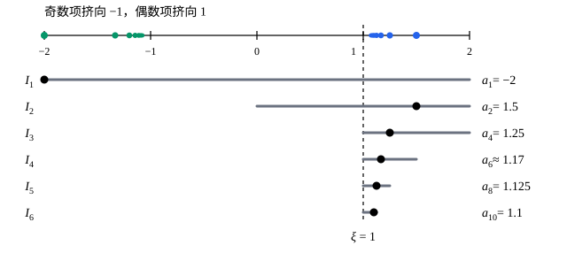

## 这一节要回答的问题

$\{(-1)^n\}$是:term[发散数列]{id="math.analysis.divergent-sequence"}（divergent sequence），可只看偶数项，是一串$1$；只看奇数项，是一串$-1$，各自都:term[收敛]{id="math.analysis.convergent-sequence"}（convergent sequence）。从一个数列里按顺序挑出无穷多项，能看出它的哪些结构？一个:term[有界]{id="math.analysis.bounded-sequence"}（bounded sequence）的数列可能不收敛，但能不能总从里面挑出一串收敛的项？

## 讲解

### 子列

::anchor{id="def-subsequence"}
设$\{a_n\}$是一个数列，$n_1<n_2<n_3<\cdots$是一串严格递增（strictly increasing）的正整数。按顺序取出$a_{n_1},a_{n_2},a_{n_3},\dots$，得到的数列$\{a_{n_k}\}$（$k=1,2,3,\dots$）叫作$\{a_n\}$的:term[子列]{id="math.analysis.subsequence"}（subsequence）。

子列的编号是$k$：$a_{n_k}$是子列的第$k$项，它在原数列里排第$n_k$位。偶数项$\{a_{2k}\}$（$n_k=2k$）、奇数项$\{a_{2k-1}\}$、$\{a_{k^2}\}$都是子列，$\{a_n\}$本身（$n_k=k$）和去掉前$N$项剩下的$\{a_{N+k}\}$也是。

为什么这样定义：子列可以跳过任意多项，但要保持原来的先后顺序（$n_k$严格递增），而且要取无穷多项，这样才谈得上它自己的:term[极限]{id="math.analysis.sequence-limit"}（limit of a sequence，lim）。$a_2,a_1,a_4,a_3,\dots$换了顺序，$a_1,a_1,a_2,a_2,\dots$重复了项，都不是子列。由$n_1\ge1$和$n_{k+1}>n_k$，用归纳法得$n_k\ge k$：子列的第$k$项，在原数列里至少排第$k$位。

### 收敛数列的子列

**定理 1**　若$a_n\to L$，则$\{a_n\}$的每个:term[子列]{id="math.analysis.subsequence"}都:term[收敛]{id="math.analysis.convergent-sequence"}于$L$。

**证明**：任给$\varepsilon>0$，有正整数$N$，使$n>N$时$|a_n-L|<\varepsilon$。当$k>N$时，$n_k\ge k>N$，所以$|a_{n_k}-L|<\varepsilon$。这说明$a_{n_k}\to L$。

定理 1 的逆否形式是判断:term[发散]{id="math.analysis.divergent-sequence"}最快的办法：只要找到两个子列收敛于不同的数，或者找到一个不收敛的子列，原数列就是:term[发散数列]{id="math.analysis.divergent-sequence"}。例如$\{(-1)^n\}$的偶数项子列收敛于$1$，奇数项子列收敛于$-1$，所以它发散。

### 致密性定理

::anchor{id="thm-bolzano-weierstrass"}
**定理 2**　:term[有界数列]{id="math.analysis.bounded-sequence"}一定有:term[收敛]{id="math.analysis.convergent-sequence"}的:term[子列]{id="math.analysis.subsequence"}。这叫作:term[致密性定理]{id="math.analysis.bolzano-weierstrass"}（Bolzano-Weierstrass theorem），也叫波尔查诺-魏尔斯特拉斯定理。

**证明**：设$|a_n|\le M$对所有$n$成立。说一个区间「含无穷多项」，是指有无穷多个$n$使$a_n$在这个区间里。

$I_1=[-M,M]$含所有的项。把它平分成左右两个闭区间：每个$n$的$a_n$至少落在其中一个里，所以两半中至少有一个含无穷多项，取这样的一半作为$I_2$。这样一直二分下去，得到一串一个套一个的闭区间$I_k$，每个都含无穷多项，$I_k$的长度是$\frac{2M}{2^{k-1}}$，趋于$0$。

这是一个:term[闭区间套]{id="math.analysis.nested-intervals"}（nested intervals），由:term[闭区间套定理]{id="math.analysis.nested-interval-theorem"}（nested interval theorem），有一个$\xi$属于每个$I_k$。再挑下标：取$n_1=1$；已经取好$n_k$时，$I_{k+1}$含无穷多项，其中一定有下标大于$n_k$的，取一个作为$n_{k+1}$。这样$n_1<n_2<\cdots$，并且$a_{n_k}$和$\xi$都在$I_k$里，两者的距离不超过$I_k$的长度：

$$
|a_{n_k}-\xi|\le\frac{2M}{2^{k-1}}\to0 .
$$

由:term[夹逼定理]{id="math.analysis.squeeze-theorem"}（squeeze theorem），$a_{n_k}\to\xi$。

为什么要盯住「含无穷多项」：我们要挑出无穷多项、下标还要越来越大，所以每一步留下的区间里，必须有用不完的项可挑。只含有限项的那一半，再往后挑几次就没得挑了。定理只说收敛的子列存在，不说它唯一，也不说:term[极限]{id="math.analysis.sequence-limit"}是多少：$\{(-1)^n\}$就有收敛于$1$和收敛于$-1$的两种子列。

两个条件都不能少。$\{n\}$无界，它的任何子列都满足$a_{n_k}=n_k\ge k$，没有一个收敛。在$\Q$里定理也不成立：$\sqrt2$的不足近似值$1,1.4,1.41,\dots$有界，可它的每个子列在$\R$里都收敛于$\sqrt2$，在$\Q$里就都没有极限。

## 几何图像

最上面是数列$a_n=(-1)^n\bigl(1+\frac1n\bigr)$的项：奇数项从左边挤向$-1$，偶数项从右边挤向$1$。下面每一行是证明里的一个区间$I_k$，留下的总是含无穷多项的那一半（两半都含时这里取右边），区间上那个较大的圆点是在$I_k$里挑出的那一项，下标越来越大。区间缩向$\xi=1$，挑出的$a_1,a_2,a_4,a_6,a_8,a_{10},\dots$就是一个:term[收敛]{id="math.analysis.convergent-sequence"}于$1$的:term[子列]{id="math.analysis.subsequence"}。

:::anim{component="function-plot"}
range: { x: [0, 41], y: [-2.1, 1.7] }
functions:
  - expr: "1"
    label: |
      $y=1$
  - expr: "-1"
    label: |
      $y=-1$
sequences:
  - expr: "1 + 1/n"
    n: [2, 40]
    step: 2
    label: |
      偶数项$a_{2k}$
  - expr: "-(1 + 1/n)"
    n: [1, 39]
    step: 2
    label: |
      奇数项$a_{2k-1}$
:::

同一个数列，偶数项、奇数项分开着色：两个子列各自收敛，:term[极限]{id="math.analysis.sequence-limit"}不同，所以整个数列:term[发散]{id="math.analysis.divergent-sequence"}。鼠标移到第$n$项附近时，两个子列里只有$a_n$所属的那一个显示读数。

## 例题

### 例 1　找出几个收敛于不同极限的子列

设$a_n=\bigl(1+\frac1n\bigr)\sin\frac{n\pi}{2}$。证明$\{a_n\}$:term[发散]{id="math.analysis.divergent-sequence"}。

**为什么想到这么做**：$\sin\frac{n\pi}{2}$随$n$每 4 个一循环地取$1,0,-1,0$。按$n$除以$4$的余数把项分组，每一组都是一个:term[子列]{id="math.analysis.subsequence"}，组内的$\sin\frac{n\pi}{2}$是常数，:term[极限]{id="math.analysis.sequence-limit"}一眼就能看出。找到两个极限不同的子列，就能用定理 1 断定发散。

**推导**：取$n=4k$，$\sin\frac{4k\pi}{2}=\sin2k\pi=0$，所以$a_{4k}=0\to0$。取$n=4k+1$，$\sin\frac{(4k+1)\pi}{2}=\sin\bigl(2k\pi+\frac{\pi}{2}\bigr)=1$，所以$a_{4k+1}=1+\frac{1}{4k+1}\to1$。这两个子列的极限不同，由定理 1，$\{a_n\}$发散。同样，$a_{4k+3}=-1-\frac{1}{4k+3}\to-1$，还有第三个子列极限。

### 例 2　所有收敛子列的极限都相同，数列就收敛

设$\{a_n\}$:term[有界]{id="math.analysis.bounded-sequence"}，并且它的每个:term[收敛]{id="math.analysis.convergent-sequence"}的:term[子列]{id="math.analysis.subsequence"}都收敛于同一个数$L$。证明$a_n\to L$。

**为什么想到这么做**：要证收敛，正面不好下手，就用反证：假设$a_n$不收敛于$L$，按否定形式，会有无穷多项离$L$至少$\varepsilon_0$远。这无穷多项组成一个有界的子列，:term[致密性定理]{id="math.analysis.bolzano-weierstrass"}又能从中挑出收敛的子列，它的:term[极限]{id="math.analysis.sequence-limit"}离$L$也至少$\varepsilon_0$远，和条件矛盾。

**推导**：假设$a_n$不收敛于$L$。由[数列的极限](lesson:math.analysis.sequences-limits)里不收敛的否定形式，有$\varepsilon_0>0$，使对每个$N$都有$n>N$满足$|a_n-L|\ge\varepsilon_0$，所以这样的$n$有无穷多个。把它们从小到大排成$m_1<m_2<\cdots$，得到子列$\{a_{m_j}\}$，它的每一项都满足$|a_{m_j}-L|\ge\varepsilon_0$。

$\{a_{m_j}\}$和$\{a_n\}$一样有界，由致密性定理，它有收敛的子列，记作$b_i=a_{m_{j_i}}$（$i=1,2,\dots$），设$b_i\to L'$。下标$m_{j_1}<m_{j_2}<\cdots$严格递增，所以$\{b_i\}$也是$\{a_n\}$的子列，按条件$L'=L$。

另一方面，$b_i$都是$\{a_{m_j}\}$里的项，所以$|b_i-L|\ge\varepsilon_0$。取$x=b_i-L$、$y=L'-L$，由$\bigl||x|-|y|\bigr|\le|x-y|$得$\bigl||b_i-L|-|L'-L|\bigr|\le|b_i-L'|$，右边趋于$0$，由:term[夹逼定理]{id="math.analysis.squeeze-theorem"}得$|b_i-L|\to|L'-L|$。再由:term[保不等式性]{id="math.analysis.order-limit-theorem"}（order limit theorem）得$|L'-L|\ge\varepsilon_0>0$，和$L'=L$矛盾。所以$a_n\to L$。

## 常见误区

- 「有一个:term[子列]{id="math.analysis.subsequence"}:term[收敛]{id="math.analysis.convergent-sequence"}，原数列就收敛。」不对：$\{(-1)^n\}$的偶数项子列收敛，它本身却:term[发散]{id="math.analysis.divergent-sequence"}。要所有子列都收敛于同一个数才行（$\{a_n\}$本身也是自己的子列）。
- 「:term[致密性定理]{id="math.analysis.bolzano-weierstrass"}说:term[有界数列]{id="math.analysis.bounded-sequence"}收敛。」不对，它只保证有收敛的子列。
- 「$a_{n_k}$的下标$n_k$就是子列的第几项。」子列的第$k$项是$a_{n_k}$，编号是$k$；$n_k$是它在原数列里的位置，而且$n_k\ge k$。
- 「两个子列收敛于同一个数，原数列就收敛。」要看这两个子列合起来是否用尽了从某一项起的所有项：偶数项和奇数项子列都收敛于$L$时，原数列收敛于$L$（第 5 题）；$\{a_{3k}\}$和$\{a_{3k+1}\}$都收敛于$L$，却管不住$\{a_{3k+2}\}$。
