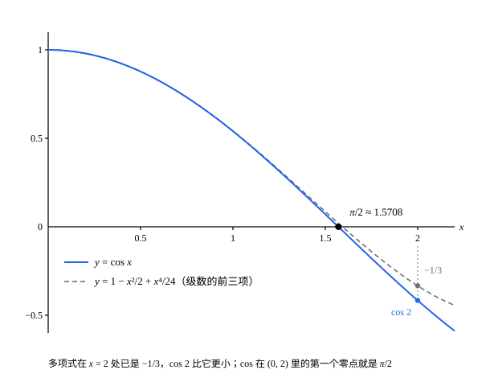

## 这一节要回答的问题

中学里，$\sin x$、$\cos x$由单位圆（unit circle）上的角定义：角的大小用弧长（arc length）来量，而弧长要用积分才说得清。上一节用:term[幂级数]{id="math.analysis.power-series"}（power series）定义了$e^x$，三角函数（trigonometric functions）能不能也这样定义？定义出来以后，$\sin^2x+\cos^2x=1$、和角公式、周期性，连同:term[圆周率]{id="math.analysis.pi"}（pi）$\pi$本身，都要从头证明。

## 讲解

### 正弦与余弦的定义

微积分里，$\sin x$和$\cos x$的泰勒级数（Taylor series）是

$$\sin x=x-\frac{x^3}{3!}+\frac{x^5}{5!}-\cdots,\qquad\cos x=1-\frac{x^2}{2!}+\frac{x^4}{4!}-\cdots.$$

和上一节一样，这两个:term[级数]{id="math.analysis.series"}（series）也能从导数关系找出来。设:term[幂级数]{id="math.analysis.power-series"}$s$、$c$满足$s'=c$、$c'=-s$、$s(0)=0$、$c(0)=1$，则$s''=-s$，比较系数得$(n+2)(n+1)a_{n+2}=-a_n$；再由$a_0=0$、$a_1=1$，就得到上面$\sin x$的系数，$\cos x$同理。

::anchor{id="def-sin-cos"}
对每个实数$x$，令$\sin x=\sum_{n=0}^\infty\frac{(-1)^nx^{2n+1}}{(2n+1)!}$，$\cos x=\sum_{n=0}^\infty\frac{(-1)^nx^{2n}}{(2n)!}$，这样定义的两个函数分别叫作:term[正弦]{id="math.analysis.sine"}（sine，sin）和:term[余弦]{id="math.analysis.cosine"}（cosine，cos）。

两个级数各项的绝对值，都是$e^{|x|}$的级数里的项，所以:term[部分和]{id="math.analysis.partial-sum"}（partial sum）取绝对值后不超过$e^{|x|}$；由:term[单调有界原理]{id="math.analysis.monotone-convergence-theorem"}（monotone convergence theorem），两个级数对每个$x$都:term[绝对收敛]{id="math.analysis.absolute-convergence"}（absolute convergence），:term[收敛半径]{id="math.analysis.radius-of-convergence"}（radius of convergence）是$+\infty$。

为什么这样定义：上面的推导说明，满足这些导数关系和初值的幂级数只有这一对；有了级数，每一点的值都能算，用不到角和弧长。边界情况：一次以上的部分和都是多项式，$x\to+\infty$时绝对值趋于$+\infty$，而定理 2 会证明$\sin x$、$\cos x$都在$[-1,1]$里。截断到哪一项，都得不到:term[有界]{id="math.analysis.bounded-function"}（bounded function）的周期函数，要的是整个级数。

::anchor{id="thm-sin-cos-derivative"}
**定理 1**　$\sin$、$\cos$在$\R$上:term[可导]{id="math.analysis.differentiable-function"}（differentiable），$\sin'=\cos$，$\cos'=-\sin$；$\sin 0=0$，$\cos 0=1$；$\sin(-x)=-\sin x$，$\cos(-x)=\cos x$。

**证明**：收敛半径是$+\infty$，由[幂级数的收敛理论](lesson:math.analysis.power-series-theory#thm-termwise)的定理 3，可以逐项求导：

$$\sin'x=\sum_{n=0}^\infty\frac{(-1)^n(2n+1)x^{2n}}{(2n+1)!}=\cos x,\qquad\cos'x=\sum_{n=1}^\infty\frac{(-1)^n(2n)x^{2n-1}}{(2n)!}=-\sin x.$$

第二式里令$n=m+1$，$\frac{(-1)^{m+1}x^{2m+1}}{(2m+1)!}$正是$-\sin x$的项。代入$x=0$得初值；$\sin$的级数只含奇次项，$\cos$的只含偶次项，所以前者是奇函数（odd function），后者是偶函数（even function）。

::anchor{id="thm-pythagoras"}
**定理 2**　对每个实数$x$，$\sin^2x+\cos^2x=1$；因此$|\sin x|\le1$，$|\cos x|\le1$。

**证明**：令$h(x)=\sin^2x+\cos^2x$，由定理 1，$h'(x)=2\sin x\cos x-2\cos x\sin x=0$。由[中值定理的证明](lesson:math.analysis.mean-value-proofs)的例 1，$h$是常数，$h(x)=h(0)=1$。

### 和角公式

::anchor{id="thm-oscillator-unique"}
**定理 3**　设$f$在$\R$上二阶:term[可导]{id="math.analysis.differentiable-function"}，$f''=-f$，$f(0)=f'(0)=0$，则$f$恒等于$0$。

**证明**：令$E(x)=f(x)^2+f'(x)^2$，则$E'=2ff'+2f'f''=2f'(f+f'')=0$，所以$E$恒等于$E(0)=0$。平方和等于$0$，所以$f(x)=0$。

为什么想到这么做：在物理上，$f''=-f$描述弹簧上的振子，$\frac12(f^2+f'^2)$是它的能量。能量守恒，一开始既没有位移也没有速度，振子就一直不动。

::anchor{id="thm-addition"}
**定理 4**　对任意实数$x$、$y$，$\sin(x+y)=\sin x\cos y+\cos x\sin y$，$\cos(x+y)=\cos x\cos y-\sin x\sin y$。

**证明**：固定$y$，令$f(x)=\sin(x+y)-\sin x\cos y-\cos x\sin y$。由定理 1 和:term[链式法则]{id="math.analysis.chain-rule"}（chain rule），$f'(x)=\cos(x+y)-\cos x\cos y+\sin x\sin y$，$f''(x)=-f(x)$；又$f(0)=\sin y-\sin y=0$，$f'(0)=\cos y-\cos y=0$。由定理 3，$f$恒等于$0$，这是第一式；于是$f'$也恒等于$0$，这正是第二式。

为什么想到这么做：要证一个恒等式，就把两边之差看成$x$的函数，证明它满足一个只有零解的方程。[用幂级数定义指数函数与对数](lesson:math.analysis.exp-log-construction#thm-exp-unique)的定理 3 用的也是这个想法；也可以像那里的加法公式一样用:term[柯西乘积]{id="math.analysis.cauchy-product"}（Cauchy product）硬算，只是麻烦得多。

### π 的定义

$\cos 0=1>0$。下面的引理说明$\cos 2<0$，由:term[零点定理]{id="math.analysis.bolzano-theorem"}（Bolzano's theorem），$\cos$在$(0,2)$里有零点。

**引理**　$\cos 2<-\frac13$。

**证明**：$\cos 2=\sum_{n=0}^\infty(-1)^na_n$，其中$a_n=\frac{2^{2n}}{(2n)!}$：$a_0=1$，$a_1=2$，$a_2=\frac23$；$n\ge1$时$\frac{a_{n+1}}{a_n}=\frac{4}{(2n+1)(2n+2)}<1$，$a_n$递减。从第四项起两两结合，$\cos 2=1-2+\frac23-\bigl[(a_3-a_4)+(a_5-a_6)+\cdots\bigr]$，结合后的:term[级数]{id="math.analysis.series"}的:term[部分和]{id="math.analysis.partial-sum"}是原来部分和的:term[子列]{id="math.analysis.subsequence"}（subsequence），和不变。方括号里每一对都是正数，所以$\cos 2<1-2+\frac23=-\frac13$。

记$Z$为$\cos$在$(0,2)$里的零点组成的集合，它非空、以$0$为下界（lower bound），设$t$是它的:term[下确界]{id="math.analysis.infimum"}（infimum，inf）。$Z$里有一列点趋于$t$，$\cos$:term[连续]{id="math.analysis.continuous-function"}（continuous），所以$\cos t=0$；又$\cos 0=1$，所以$t>0$。因此$t$本身是$\cos$的零点，并且没有比它更小的正零点。

::anchor{id="def-pi"}
$\cos$的最小正零点记作$\frac{\pi}{2}$，即:term[圆周率]{id="math.analysis.pi"}$\pi$定义为这个零点的$2$倍。

为什么这样定义：几何里$\pi$是圆的周长与直径之比，要先有弧长；这里只用到级数和连续函数的性质。下面会证明$2\pi$正是$\sin$、$\cos$的周期，它和圆周长的关系见第 7 题。边界情况：$\cos$有无穷多个正零点，只有取最小的那个，定义才确定；几何图像里的图说明它约等于$1.5708$。

::anchor{id="thm-periodic"}
**定理 5**　(1) $\sin\frac{\pi}{2}=1$；(2) $\sin\bigl(x+\frac{\pi}{2}\bigr)=\cos x$，$\cos\bigl(x+\frac{\pi}{2}\bigr)=-\sin x$；(3) $\sin$和$\cos$都以$2\pi$为周期（period）。

**证明**：(1) 在$\bigl(0,\frac{\pi}{2}\bigr)$上$\cos x>0$：否则由零点定理，$\cos$在$(0,x]$里有零点，比$\frac{\pi}{2}$还小。由:term[拉格朗日中值定理]{id="math.analysis.mean-value-theorem"}（mean value theorem），$\sin\frac{\pi}{2}-\sin 0=\frac{\pi}{2}\cos\xi>0$，又$\sin^2\frac{\pi}{2}=1-\cos^2\frac{\pi}{2}=1$，所以$\sin\frac{\pi}{2}=1$。

(2) 由定理 4，$\sin\bigl(x+\frac{\pi}{2}\bigr)=\sin x\cdot0+\cos x\cdot1=\cos x$，$\cos\bigl(x+\frac{\pi}{2}\bigr)=\cos x\cdot0-\sin x\cdot1=-\sin x$。(3) 用两次 (2)，得$\sin(x+\pi)=-\sin x$，$\cos(x+\pi)=-\cos x$；再用两次，$x+2\pi$处的值就和$x$处相同。

### 单位圆

::anchor{id="thm-unit-circle"}
**定理 6**　满足$a^2+b^2=1$的每个点$(a,b)$，都恰好对应一个$t\in[0,2\pi)$，使$(a,b)=(\cos t,\sin t)$。

**证明**：先看$(0,\pi)$上$\sin>0$：$\bigl(0,\frac{\pi}{2}\bigr]$上$\sin x=\cos\bigl(x-\frac{\pi}{2}\bigr)$，而$\cos$在$\bigl(-\frac{\pi}{2},0\bigr]$上是正的（偶函数，用定理 5 证明里的结论）；$\bigl[\frac{\pi}{2},\pi\bigr)$上同理，因为$x-\frac{\pi}{2}\in\bigl[0,\frac{\pi}{2}\bigr)$。于是在$(0,\pi)$上$\cos'=-\sin<0$，$\cos$在$[0,\pi]$上从$1$严格递减到$-1$。由:term[介值定理]{id="math.analysis.intermediate-value-theorem"}（intermediate value theorem），有唯一的$t_0\in[0,\pi]$使$\cos t_0=a$，这时$\sin t_0\ge0$，$\sin t_0=\sqrt{1-a^2}=|b|$。

$b\ge0$时取$t=t_0$；$b<0$时$t_0\in(0,\pi)$，取$t=2\pi-t_0$，这时$\cos t=\cos t_0=a$，$\sin t=-\sin t_0=b$。唯一性：$[0,\pi]$上$\sin\ge0$，$(\pi,2\pi)$上$\sin x=-\sin(x-\pi)<0$，而$\cos$在这两段上各自严格单调，所以不同的$t$给出不同的点。

于是单位圆上的点和$[0,2\pi)$里的数一一对应，$t$可以当作这个点的「角」。这个$t$恰好是从$(1,0)$沿单位圆走到这个点的弧长，$\pi$也就是几何里的$\pi$，见第 7 题。

## 几何图像

:::anim{component="function-plot"}
range: { x: [-13, 13], y: [-2.5, 2.5] }
functions:
  - expr: "cos(x)"
    label: |
      $y=\cos x$
  - expr: "sum(k, 0, N, (-1)^k * prod(j, 1, 2k, x / j))"
    label: |
      部分和$y=\sum_{k=0}^{N}\frac{(-1)^kx^{2k}}{(2k)!}$
points:
  - { x: "pi/2", y: "0" }
sliders:
  - name: N
    min: 1
    max: 13
    step: 1
    default: 3
    label: |
      部分和到第$N$项
:::

拖动$N$：:term[部分和]{id="math.analysis.partial-sum"}是$2N$次多项式，在原点附近贴着$\cos x$，离原点远了就冲出画面；$N$越大，贴得越远，跟着$\cos x$起伏的次数也越多。多项式不可能是周期函数，周期性只有整个:term[级数]{id="math.analysis.series"}才有。标出的点是:term[余弦]{id="math.analysis.cosine"}的最小正零点$\bigl(\frac{\pi}{2},0\bigr)$。

这是引理和$\pi$的定义：虚线是$\cos x$的级数的前三项，它在$x=2$处等于$-\frac13$，引理说$\cos 2$比它还小。由:term[零点定理]{id="math.analysis.bolzano-theorem"}，$\cos$在$(0,2)$里有零点，最小的那个就是$\frac{\pi}{2}\approx1.5708$。

## 例题

### 例 1　$\cos\frac{\pi}{4}$与$\sin\frac{\pi}{4}$

证明$\cos\frac{\pi}{4}=\sin\frac{\pi}{4}=\frac{\sqrt2}{2}$。

**为什么想到这么做**：$\frac{\pi}{4}$的两倍是$\frac{\pi}{2}$，那里的:term[余弦]{id="math.analysis.cosine"}值已知是$0$；和角公式把$\cos\frac{\pi}{2}$写成$\frac{\pi}{4}$处的值，再配上$\sin^2+\cos^2=1$，就能解出两个平方。符号要另外确定。

**推导**：记$c=\cos\frac{\pi}{4}$，$s=\sin\frac{\pi}{4}$。由定理 4，$0=\cos\frac{\pi}{2}=c^2-s^2$；由定理 2，$c^2+s^2=1$，所以$c^2=s^2=\frac12$。$\frac{\pi}{4}\in\bigl(0,\frac{\pi}{2}\bigr)$，定理 5 的证明说明那里$\cos>0$，定理 6 的证明说明那里$\sin>0$，所以$c=s=\frac{1}{\sqrt2}=\frac{\sqrt2}{2}$。

### 例 2　$\lim_{x\to0}\frac{\sin x}{x}=1$

**为什么想到这么做**：微积分里证这个:term[极限]{id="math.analysis.function-limit"}（limit of a function），要在单位圆上比较三角形和扇形的面积，用到了面积和弧长。现在$\sin x$是:term[级数]{id="math.analysis.series"}，除以$x$以后仍是:term[幂级数]{id="math.analysis.power-series"}，直接看它在$0$处的值即可。

**推导**：$x\ne0$时，$\frac{\sin x}{x}=\sum_{n=0}^\infty\frac{(-1)^nx^{2n}}{(2n+1)!}$。右边是:term[收敛半径]{id="math.analysis.radius-of-convergence"}为$+\infty$的幂级数，由[幂级数的收敛理论](lesson:math.analysis.power-series-theory#thm-power-series-uniform)的定理 2，它的和函数$g$在$\R$上:term[连续]{id="math.analysis.continuous-function"}，$g(0)=1$。所以$x\to0$时$\frac{\sin x}{x}=g(x)\to g(0)=1$。

## 常见误区

- 「$\pi$要先有圆才能定义。」这一节的$\pi$只用:term[级数]{id="math.analysis.series"}定义：$\frac{\pi}{2}$是:term[余弦]{id="math.analysis.cosine"}的最小正零点。它是圆周长与直径之比，这是定理（第 7 题），不是定义。
- 「$\sin x$的:term[部分和]{id="math.analysis.partial-sum"}在整个$\R$上都接近$\sin x$。」部分和是多项式，$|x|$大了就冲出$[-1,1]$（几何图像的动画），只在每个闭区间上:term[一致收敛]{id="math.analysis.uniform-convergence"}（uniform convergence）。
- 「$\cos$的零点就是$\frac{\pi}{2}$。」$\frac{\pi}{2}$只是最小的正零点；由定理 5，$\frac{\pi}{2}+k\pi$（$k$为整数）都是零点，第 6 题会说明没有别的。
- 「由$\sin^2x+\cos^2x=1$就能定出$\sin x$。」只能定出$|\sin x|=\sqrt{1-\cos^2x}$，符号要看$x$在哪一段，例 1 就是这样定的。
