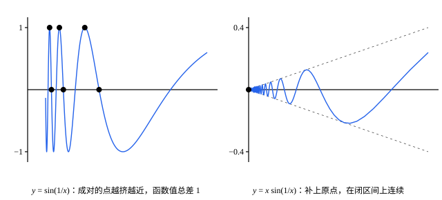

## 这一节要回答的问题

证明$x^2$在$a$处:term[连续]{id="math.analysis.continuous-function"}（continuous）时，取的$\delta=\min\bigl\{1,\frac{\varepsilon}{1+2|a|}\bigr\}$随$|a|$变大而变小；$\frac1x$在$a$处连续，$a$越靠近$0$，$\delta$也得越小。能不能找到一个只依赖$\varepsilon$、对所有点都管用的$\delta$？

这不只是好看。把一个区间切成小段，用每段上的一个函数值代替整段时，我们希望「切得足够细，处处都准」，而不是每个地方各要各的细度。什么样的函数、在什么样的区间上，做得到这一点？

## 讲解

### 一个 δ 管住整个区间

先看两个例子。$f(x)=2x+1$：$|f(x)-f(y)|=2|x-y|$，只要$|x-y|<\frac\varepsilon2$，不管$x$、$y$在哪里，都有$|f(x)-f(y)|<\varepsilon$。$f(x)=x^2$在$[0,+\infty)$上就不行：$x_n=n+\frac1n$和$y_n=n$越来越近，可$x_n^2-y_n^2=2+\frac{1}{n^2}>2$，无论$\delta$多小，总有相距不到$\delta$、函数值却相差超过$2$的两点。

::anchor{id="def-uniform-continuity"}
设$f$定义在区间$I$上。如果任给$\varepsilon>0$，都存在$\delta>0$，使得对$I$里所有满足$|x-y|<\delta$的$x$、$y$，都有$|f(x)-f(y)|<\varepsilon$，就说$f$在$I$上:term[一致连续]{id="math.analysis.uniform-continuity"}（uniformly continuous）。

把它和「在$I$上处处:term[连续]{id="math.analysis.continuous-function"}」用量词并排写出来：

$$
\begin{aligned}
\text{连续：}&\quad\forall a\in I,\ \forall\varepsilon>0,\ \exists\delta>0,\ \forall x\in I\ \bigl(|x-a|<\delta\bigr),\ |f(x)-f(a)|<\varepsilon ;\\
\text{一致连续：}&\quad\forall\varepsilon>0,\ \exists\delta>0,\ \forall a\in I,\ \forall x\in I\ \bigl(|x-a|<\delta\bigr),\ |f(x)-f(a)|<\varepsilon .
\end{aligned}
$$

为什么这样定义：两行只差「$\forall a$」和「$\exists\delta$」的先后。连续时先给定点$a$再找$\delta$，所以$\delta$可以随$a$变；一致连续时$\delta$在$a$之前就选定了，只能依赖$\varepsilon$，对所有点「一致」地管用。所以一致连续的函数一定连续，反过来不一定；它是函数在整个区间上的性质，不是在某一点的性质。

把定义否定，就得到「不一致连续」的数列说法：有$\varepsilon_0>0$和$I$里的两串点$x_n$、$y_n$，使$x_n-y_n\to0$，而$|f(x_n)-f(y_n)|\ge\varepsilon_0$。前面的$x^2$就是这样；$\frac1x$在$(0,1]$上也是：$x_n=\frac1n$、$y_n=\frac{1}{n+1}$越来越近，函数值却总相差$1$。

### 康托尔定理

::anchor{id="thm-heine-cantor"}
**定理**　闭区间$[a,b]$上的:term[连续函数]{id="math.analysis.continuous-function"}（continuous function）一定:term[一致连续]{id="math.analysis.uniform-continuity"}。这叫作:term[康托尔定理]{id="math.analysis.heine-cantor-theorem"}（Heine-Cantor theorem）。

**证明**：用反证法。假设$f$在$[a,b]$上不一致连续，由数列说法，有$\varepsilon_0>0$和$[a,b]$里的$x_n$、$y_n$，使$|x_n-y_n|<\frac1n$，而$|f(x_n)-f(y_n)|\ge\varepsilon_0$。$\{x_n\}$:term[有界]{id="math.analysis.bounded-sequence"}（bounded sequence），由:term[致密性定理]{id="math.analysis.bolzano-weierstrass"}（Bolzano-Weierstrass theorem），有:term[子列]{id="math.analysis.subsequence"}（subsequence）$x_{n_k}\to\xi$；由$a\le x_{n_k}\le b$和:term[保不等式性]{id="math.analysis.order-limit-theorem"}（order limit theorem），$\xi\in[a,b]$。

$|y_{n_k}-\xi|\le|y_{n_k}-x_{n_k}|+|x_{n_k}-\xi|<\frac{1}{n_k}+|x_{n_k}-\xi|$，右边趋于$0$，所以$y_{n_k}\to\xi$。$f$在$\xi$处连续，由[连续函数的严格定义](lesson:math.analysis.continuity)的定理 1，$f(x_{n_k})\to f(\xi)$，$f(y_{n_k})\to f(\xi)$，于是$f(x_{n_k})-f(y_{n_k})\to0$。可这个差的绝对值总不小于$\varepsilon_0$，矛盾。

为什么想到这么做：不一致连续意味着「坏点对」$x_n$、$y_n$越挤越近，致密性定理让它们一起挤到某一点$\xi$；而在$\xi$处，连续本身就不允许附近有函数值相差$\varepsilon_0$的两点。三个条件各用在一处：区间有界，才有:term[收敛]{id="math.analysis.convergent-sequence"}（convergent sequence）的子列（$x^2$在$[0,+\infty)$上，坏点对跑向无穷）；区间是闭的，$\xi$才在定义域里（$\frac1x$在$(0,1]$上，坏点对挤向$0$）；$f$在$\xi$处连续，最后一步才成立。

定理给的是充分条件：$\sqrt x$在无界的$[0,+\infty)$上也一致连续（例 1），$x\sin\frac1x$在不闭的$(0,1]$上也一致连续（例 2），只是这些都得另外证明。

## 几何图像

:::anim{component="function-plot"}
range: { x: [-0.5, 4], y: [-1.5, 11.5] }
functions:
  - expr: "x^2"
    label: |
      $y=x^2$
  - expr: "a^2 + eps"
    label: |
      $y=a^2+\varepsilon$
  - expr: "a^2 - eps"
    label: |
      $y=a^2-\varepsilon$
points:
  - { x: "a", y: "a^2" }
  - { x: "a - (sqrt(a^2 + eps) - a)", y: "(a - (sqrt(a^2 + eps) - a))^2" }
  - { x: "sqrt(a^2 + eps)", y: "a^2 + eps" }
sliders:
  - name: a
    min: 0.85
    max: 3
    step: 0.05
    default: 1
    label: |
      点$a$
  - name: eps
    min: 0.2
    max: 2
    step: 0.1
    default: 1
    label: |
      $\varepsilon$
:::

中间的点是$(a,a^2)$，两条横线夹出$a^2$的$\varepsilon$:term[邻域]{id="math.analysis.neighborhood"}（neighborhood）。左右两个点的横坐标是$a\pm\delta$，$\delta=\sqrt{a^2+\varepsilon}-a$是在$a$处能取的最大的$\delta$：右边那个点正好碰到上面那条横线。把$a$往右拖，曲线越来越陡，同样高的横带只装得下越来越窄的一段$x$，$\delta$趋于$0$，所以$x^2$在$[0,+\infty)$上不:term[一致连续]{id="math.analysis.uniform-continuity"}；在$[0,3]$上，最坏的点是$a=3$，取那里的$\delta$就对整个区间都管用。滑块$a$从$0.85$起，是为了让左边那个点留在$[0,+\infty)$里。

两个函数都在$0$附近摆动无穷多次，这是例 2 的图。左边$\sin\frac1x$的每一对点，横坐标越来越近，高度却总是$0$和$1$，它在$(0,1]$上不:term[一致连续]{id="math.analysis.uniform-continuity"}。右边$x\sin\frac1x$的摆幅被$y=\pm x$压住，补上$f(0)=0$就成了$[0,1]$上的:term[连续函数]{id="math.analysis.continuous-function"}，由:term[康托尔定理]{id="math.analysis.heine-cantor-theorem"}，它一致连续。

## 例题

### 例 1　$\sqrt x$在$[0,+\infty)$上一致连续

**为什么想到这么做**：$[0,+\infty)$不是闭区间，:term[康托尔定理]{id="math.analysis.heine-cantor-theorem"}用不上，只能直接找$\delta$。$\sqrt x$在$0$附近很陡，越往右越平，最难的地方是$0$附近，在那里$|\sqrt x-\sqrt y|$大约是$\sqrt{|x-y|}$。所以猜想$|\sqrt x-\sqrt y|\le\sqrt{|x-y|}$对所有点都成立。

**推导**：设$x\ge y\ge0$。$\sqrt x\le\sqrt y+\sqrt{x-y}$，因为两边平方后，右边是$y+2\sqrt{y(x-y)}+(x-y)\ge x$。所以$0\le\sqrt x-\sqrt y\le\sqrt{x-y}$，一般地

$$
\bigl|\sqrt x-\sqrt y\bigr|\le\sqrt{|x-y|} .
$$

任给$\varepsilon>0$，取$\delta=\varepsilon^2$，则$|x-y|<\delta$时$|\sqrt x-\sqrt y|<\sqrt\delta=\varepsilon$，$\delta$和$x$、$y$在哪里无关。所以$\sqrt x$在$[0,+\infty)$上:term[一致连续]{id="math.analysis.uniform-continuity"}，虽然它在$0$处无限陡。

### 例 2　$\sin\frac1x$与$x\sin\frac1x$

证明$\sin\frac1x$在$(0,1]$上不:term[一致连续]{id="math.analysis.uniform-continuity"}，而$x\sin\frac1x$在$(0,1]$上一致连续。

**为什么想到这么做**：两个函数都在$(0,1]$的每一点:term[连续]{id="math.analysis.continuous-function"}，区别在$0$附近。$\sin\frac1x$在那里来回摆动、摆幅不减，正好找「越挤越近、函数值却总差$1$」的点对。$x\sin\frac1x$的摆幅越来越小，补上$0$处的值，就成了闭区间上的连续函数，可以用:term[康托尔定理]{id="math.analysis.heine-cantor-theorem"}。

**推导**：取$x_n=\frac{1}{2n\pi}$，$y_n=\frac{1}{2n\pi+\pi/2}$，它们都在$(0,1]$里，$x_n-y_n\to0$，而$\sin\frac1{x_n}=0$，$\sin\frac1{y_n}=1$，函数值总相差$1$。由数列说法，$\sin\frac1x$在$(0,1]$上不一致连续。

令$g(x)=x\sin\frac1x$（$0<x\le1$），$g(0)=0$。$g$在$(0,1]$上连续；在$0$处，$|g(x)-g(0)|\le|x|$，也连续。所以$g$是$[0,1]$上的连续函数，由康托尔定理，它在$[0,1]$上一致连续，在更小的$(0,1]$上当然也一致连续。

## 常见误区

- 「在区间的每一点都:term[连续]{id="math.analysis.continuous-function"}，就:term[一致连续]{id="math.analysis.uniform-continuity"}。」不对：$x^2$在$[0,+\infty)$上、$\frac1x$在$(0,1]$上都处处连续，却不一致连续。区间是闭区间时才有:term[康托尔定理]{id="math.analysis.heine-cantor-theorem"}。
- 「:term[有界]{id="math.analysis.bounded-function"}（bounded function）的连续函数一定一致连续。」不对：$\sin\frac1x$在$(0,1]$上有界、连续，却不一致连续（例 2）。
- 「一致连续的函数，导数一定有界。」不对：$\sqrt x$在$0$处无限陡，在$[0,+\infty)$上照样一致连续（例 1）。
- 「一致连续是函数在某一点的性质。」不对，它说的是一个$\delta$对整个区间都管用，离开了区间就没有意义：同一个$x^2$，在$[0,3]$上一致连续，在$[0,+\infty)$上就不是。
