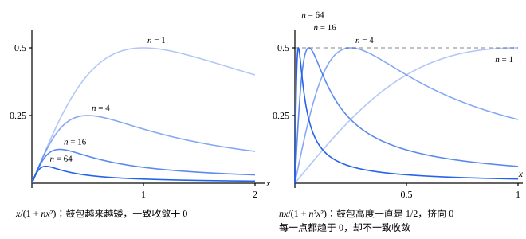

## 这一节要回答的问题

$f_n(x)=x^n$在$[0,1]$上每一个都是:term[连续函数]{id="math.analysis.continuous-function"}（continuous function）。固定$x$，让$n\to\infty$：$0\le x<1$时$x^n\to0$，$x=1$时$x^n=1$，得到的函数在$1$处断开了。

连续函数一个个逼近过去，极限却不连续，毛病出在哪里？「$f_n$趋于$f$」能不能要求得更整齐一些，又怎么判断？

## 讲解

### 逐点收敛

上面的$x^n$，是对每个$x$分别看数列$\{x^n\}$的:term[极限]{id="math.analysis.sequence-limit"}（limit of a sequence，lim）。不同的$x$，数列趋近极限的快慢不一样：要$x^n<\varepsilon$，$x=\frac12$时只要$2^{-n}<\varepsilon$，$x=0.99$时却要$n>\frac{\ln\varepsilon}{\ln0.99}$。$x$越接近$1$，要的$n$越大。

::anchor{id="def-pointwise"}
设函数列（sequence of functions）$\{f_n\}$和函数$f$都定义在集合$D$上。如果对每个$x\in D$，数列$\{f_n(x)\}$都是:term[收敛数列]{id="math.analysis.convergent-sequence"}（convergent sequence），极限是$f(x)$，就说$\{f_n\}$在$D$上:term[逐点收敛]{id="math.analysis.pointwise-convergence"}（pointwise convergence）于$f$，$f$叫作极限函数（limit function）。

为什么这样定义：这是最自然的说法，每个点各管各的。用$\varepsilon$-$N$写出来是：任给$x\in D$和$\varepsilon>0$，都有$N$，使$n>N$时$|f_n(x)-f(x)|<\varepsilon$。这里的$N$可以随$x$变，$x^n$的例子里，$x$越接近$1$，$N$就得越大。反例：逐点收敛保不住:term[连续]{id="math.analysis.continuous-function"}，$x^n$个个连续，极限函数却在$1$处断开。

### 一致收敛

::anchor{id="def-uniform-convergence"}
如果任给$\varepsilon>0$，都存在正整数$N$，使得当$n>N$时，对所有$x\in D$都有$|f_n(x)-f(x)|<\varepsilon$，就说$\{f_n\}$在$D$上:term[一致收敛]{id="math.analysis.uniform-convergence"}（uniform convergence）于$f$。

为什么这样定义：和:term[逐点收敛]{id="math.analysis.pointwise-convergence"}相比，只是把「任给$x$」挪到了「存在$N$」的后面，$N$只能依赖$\varepsilon$，一个$N$要管住所有的$x$。几何上，$n>N$以后，$f_n$的整个图像都落在$f$上下各宽$\varepsilon$的带子里。一致收敛一定逐点收敛，反过来不成立。

反例：$x^n$在$[0,1)$上逐点收敛于$0$，却不一致收敛。不管$n$多大，取$x=\bigl(\frac12\bigr)^{1/n}\in[0,1)$，就有$x^n=\frac12$，所以$\varepsilon=\frac12$时找不到管用的$N$。可在$[0,r]$上（$0<r<1$），$0\le x^n\le r^n\to0$，它一致收敛：同一个函数列，在不同的集合上答案可以不同。

开头的问题也有了答案：$x^n$在$[0,1]$上不一致收敛。以后会看到，:term[连续函数]{id="math.analysis.continuous-function"}列一致收敛时，极限函数一定连续，见[一致收敛与极限交换](lesson:math.analysis.uniform-limit-theorems)。

### 上确界距离

验证:term[一致收敛]{id="math.analysis.uniform-convergence"}，要对所有$x$同时估计$|f_n(x)-f(x)|$，很自然地去看它在$D$上的:term[上确界]{id="math.analysis.supremum"}（supremum，sup）：所有$x$都满足$|f_n(x)-f(x)|<\varepsilon$，差不多就是这个上确界不超过$\varepsilon$。

::anchor{id="def-uniform-distance"}
设$f$、$g$都定义在$D$上，记$\|f-g\|_\infty=\sup_{x\in D}|f(x)-g(x)|$（$|f-g|$在$D$上无界时记作$+\infty$），叫作$f$和$g$在$D$上的:term[上确界距离]{id="math.analysis.uniform-distance"}（uniform distance）。

为什么这样定义：它用一个数衡量两个函数在整个$D$上最多差多少，也就是两个图像之间最宽的那道缝。它满足三角不等式$\|f-h\|_\infty\le\|f-g\|_\infty+\|g-h\|_\infty$，因为每一点都有$|f(x)-h(x)|\le|f(x)-g(x)|+|g(x)-h(x)|\le\|f-g\|_\infty+\|g-h\|_\infty$。边界情况：上确界不一定取得到，在$[0,1)$上$\|x^n-0\|_\infty=1$，可没有一点让$x^n=1$。

::anchor{id="thm-uniform-sup"}
**定理 1**　$\{f_n\}$在$D$上:term[一致收敛]{id="math.analysis.uniform-convergence"}于$f$，当且仅当$\|f_n-f\|_\infty\to0$。

**证明**：设一致收敛。任给$\varepsilon>0$，有$N$，使$n>N$时所有$x$都满足$|f_n(x)-f(x)|<\varepsilon$，于是上确界$\|f_n-f\|_\infty\le\varepsilon$，所以$\|f_n-f\|_\infty\to0$。反过来，若$\|f_n-f\|_\infty\to0$，任给$\varepsilon>0$，有$N$，使$n>N$时$\|f_n-f\|_\infty<\varepsilon$，每个$x$都满足$|f_n(x)-f(x)|\le\|f_n-f\|_\infty<\varepsilon$。

为什么它有用：一致收敛本来要对无穷多个$x$同时说话，现在变成一个数列$\|f_n-f\|_\infty$趋于$0$。要说明不一致收敛，只要找到$x_n\in D$，使$|f_n(x_n)-f(x_n)|$不趋于$0$，因为它不超过$\|f_n-f\|_\infty$。

## 几何图像

:::anim{component="function-plot"}
range: { x: [0, 1.04], y: [-0.06, 1.1] }
functions:
  - expr: "x^k + 0 * sqrt(1 - x)"
    label: |
      $y=x^k$
  - expr: "eps"
    label: |
      $y=\varepsilon$
points:
  - { x: "eps^(1 / k)", y: "eps" }
  - { x: "1", y: "1" }
sliders:
  - name: k
    min: 1
    max: 60
    step: 1
    default: 5
    label: |
      函数列的下标$k$
  - name: eps
    min: 0.05
    max: 0.5
    step: 0.05
    default: 0.2
    label: |
      $\varepsilon$
:::

$x^k$在$[0,1)$上的极限函数是$0$，横线$y=\varepsilon$是以它为中心、上下各宽$\varepsilon$的带子的上沿。标出的点在横线上，横坐标是$\varepsilon^{1/k}$，它右边的$x^k$都跑出了带子。把$k$调大，这个点往右挪，可永远到不了$1$：不管$k$多大，$[0,1)$上总有一段在带子外面，这就是不:term[一致收敛]{id="math.analysis.uniform-convergence"}。只看$[0,r]$（$r<1$）时，$k$大到$r^k<\varepsilon$以后，整段都进了带子。

右上角的点$(1,1)$是极限函数在$x=1$处的值：$[0,1]$上的极限函数在那里断开。

左边是例 1 的$\frac{x}{1+nx^2}$，鼓包越来越矮，:term[上确界距离]{id="math.analysis.uniform-distance"}趋于$0$，一致收敛。右边是例 2 的$\frac{nx}{1+n^2x^2}$，鼓包高度一直是$\frac12$，只是越来越挤向$0$：每个$x$处的值都趋于$0$，可上确界距离一直是$\frac12$，只:term[逐点收敛]{id="math.analysis.pointwise-convergence"}，不一致收敛。

## 例题

### 例 1　$\frac{x}{1+nx^2}$在$\R$上一致收敛

证明$f_n(x)=\frac{x}{1+nx^2}$在$\R$上:term[一致收敛]{id="math.analysis.uniform-convergence"}于$0$。

**为什么想到这么做**：用定理 1，求出:term[上确界距离]{id="math.analysis.uniform-distance"}$\|f_n-0\|_\infty=\sup_{x\in\R}\frac{|x|}{1+nx^2}$。分母里$1$和$nx^2$加在一起，用均值不等式$1+nx^2\ge2\sqrt n\,|x|$，正好和分子约掉$|x|$。

**推导**：$x\ne0$时，$1+nx^2\ge2\sqrt n\,|x|$，所以$|f_n(x)|\le\frac{|x|}{2\sqrt n\,|x|}=\frac{1}{2\sqrt n}$；$x=0$时$f_n(0)=0$。$x=\frac{1}{\sqrt n}$时等号成立，所以$\|f_n\|_\infty=\frac{1}{2\sqrt n}\to0$。由定理 1，$f_n$在$\R$上一致收敛于$0$。

### 例 2　$\frac{nx}{1+n^2x^2}$逐点收敛而不一致收敛

设$g_n(x)=\frac{nx}{1+n^2x^2}$，$0\le x\le1$。证明$g_n$在$[0,1]$上:term[逐点收敛]{id="math.analysis.pointwise-convergence"}于$0$，但不:term[一致收敛]{id="math.analysis.uniform-convergence"}；在$[\delta,1]$（$0<\delta<1$）上却一致收敛。

**为什么想到这么做**：逐点收敛就是固定$x$看数列；要否定一致收敛，按定理 1 后面说的，找一串$x_n$，使$g_n(x_n)$不趋于$0$。$g_n(x)$只和$nx$有关，$nx=1$时$g_n=\frac12$，所以取$x_n=\frac1n$。

**推导**：$x=0$时$g_n(0)=0$；$0<x\le1$时，$0\le g_n(x)\le\frac{nx}{n^2x^2}=\frac{1}{nx}\to0$。所以$g_n$在$[0,1]$上逐点收敛于$0$。可是$g_n\bigl(\frac1n\bigr)=\frac12$，所以$\|g_n-0\|_\infty\ge\frac12$，不趋于$0$，由定理 1，不一致收敛。

在$[\delta,1]$上，$0\le g_n(x)\le\frac{1}{nx}\le\frac{1}{n\delta}$，所以$\|g_n\|_\infty\le\frac{1}{n\delta}\to0$，一致收敛。毛病只出在$0$附近：鼓包的最高点$x=\frac1n$越来越靠近$0$，任何离开$0$的闭区间，迟早都躲开了它。

## 常见误区

- 「每一点都:term[收敛]{id="math.analysis.convergent-sequence"}，就是:term[一致收敛]{id="math.analysis.uniform-convergence"}。」不对：例 2 的$g_n$在$[0,1]$上:term[逐点收敛]{id="math.analysis.pointwise-convergence"}于$0$，:term[上确界距离]{id="math.analysis.uniform-distance"}却一直不小于$\frac12$。
- 「判断一致收敛，看$|f_n(x)-f(x)|$的最大值。」要看的是:term[上确界]{id="math.analysis.supremum"}，最大值不一定取得到：在$[0,1)$上，$|x^n-0|$的上确界是$1$，却没有一点取到$1$。
- 「在每个$[0,r]$（$r<1$）上一致收敛，就在$[0,1)$上一致收敛。」不对：$x^n$就是反例。在每个闭子区间上一致收敛，比在整个区间上一致收敛弱（第 8 题）。
- 「极限函数:term[连续]{id="math.analysis.continuous-function"}，收敛就是一致的。」不对：例 2 的极限函数是$0$，连续，收敛却不一致。
