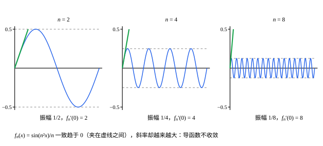

## 这一节要回答的问题

三个例子。$x^n$在$[0,1]$上个个:term[连续]{id="math.analysis.continuous-function"}（continuous），极限函数却在$1$处断开。高为$n$、底为$\bigl[0,\frac2n\bigr]$的「帐篷」函数（tent function，$n\ge2$），积分都是$1$，可每一点处的值最终都是$0$。$\frac{\sin n^2x}{n}$整体趋于$0$，它在$0$处的导数却是$n$。

先取极限再求连续性、积分、导数，和先求再取极限，什么时候结果一样？上一节的:term[一致收敛]{id="math.analysis.uniform-convergence"}（uniform convergence）够不够用？

## 讲解

### 一致收敛保持连续

::anchor{id="thm-uniform-limit-continuous"}
**定理 1**　设每个$f_n$在$D$上:term[连续]{id="math.analysis.continuous-function"}，$\{f_n\}$在$D$上:term[一致收敛]{id="math.analysis.uniform-convergence"}于$f$，则$f$在$D$上连续。

**证明**：任取$x_0\in D$和$\varepsilon>0$。由一致收敛，有$n$使:term[上确界距离]{id="math.analysis.uniform-distance"}（uniform distance）$\|f_n-f\|_\infty<\frac\varepsilon3$，把这个$n$固定下来。$f_n$在$x_0$处连续，有$\delta>0$，使$x\in D$、$|x-x_0|<\delta$时$|f_n(x)-f_n(x_0)|<\frac\varepsilon3$。于是这样的$x$都满足

$$
|f(x)-f(x_0)|\le|f(x)-f_n(x)|+|f_n(x)-f_n(x_0)|+|f_n(x_0)-f(x_0)|<\frac\varepsilon3+\frac\varepsilon3+\frac\varepsilon3=\varepsilon ,
$$

所以$f$在$x_0$处连续。

为什么想到这么做：$f$本身不好直接估计，就借一个处处都离它很近的$f_n$过渡，把$|f(x)-f(x_0)|$拆成三段。一致收敛的作用是：同一个$n$，在$x$和$x_0$两处都管用。只是:term[逐点收敛]{id="math.analysis.pointwise-convergence"}（pointwise convergence）的话，$x$变了，$n$也得跟着变，中间那一段就没法用$f_n$的连续性了。

定理 1 也是一种交换极限的次序：它说$\lim_{x\to x_0}\lim_{n\to\infty}f_n(x)=\lim_{n\to\infty}\lim_{x\to x_0}f_n(x)$。$x^n$在$[0,1]$上不一致收敛，在$x_0=1$处，左边是$0$，右边是$1$。证明只用到$x_0$附近的一致收敛，所以只要每一点附近一致收敛就够了：$x^n$在每个$[0,r]$（$r<1$）上一致收敛，极限函数在$[0,1)$上连续。

### 积分与极限交换

::anchor{id="thm-integral-interchange"}
**定理 2**　设每个$f_n$在$[a,b]$上:term[可积]{id="math.analysis.riemann-integral"}（Riemann integrable），$\{f_n\}$在$[a,b]$上:term[一致收敛]{id="math.analysis.uniform-convergence"}于$f$，则$f$在$[a,b]$上可积，并且$\Bigl|\int_a^bf-\int_a^bf_n\Bigr|\le(b-a)\|f-f_n\|_\infty$，从而$\int_a^bf=\lim_{n\to\infty}\int_a^bf_n$。

**证明**：记$\eta=\|f-f_n\|_\infty$。$f_n$可积，所以:term[有界]{id="math.analysis.bounded-function"}（bounded function），$|f|\le|f_n|+\eta$也有界。任取$[a,b]$的:term[分割]{id="math.analysis.partition"}（partition）$P$，在每一段上$f\le f_n+\eta$，所以$f$的:term[上确界]{id="math.analysis.supremum"}（supremum，sup）不超过$f_n$的上确界加$\eta$；同理$f$的:term[下确界]{id="math.analysis.infimum"}（infimum，inf）不小于$f_n$的下确界减$\eta$。于是

$$
L(f_n,P)-\eta(b-a)\le L(f,P)\le U(f,P)\le U(f_n,P)+\eta(b-a) .
$$

可积：$U(f,P)-L(f,P)\le U(f_n,P)-L(f_n,P)+2\eta(b-a)$。任给$\varepsilon>0$，先取$n$使$2\eta(b-a)<\frac\varepsilon2$，再由:term[可积准则]{id="math.analysis.integrability-criterion"}（Riemann's criterion）取$P$使$U(f_n,P)-L(f_n,P)<\frac\varepsilon2$，就有$U(f,P)-L(f,P)<\varepsilon$，所以$f$可积。

积分的值：$\int_a^bf$夹在$L(f,P)$和$U(f,P)$之间，$\int_a^bf_n$夹在$L(f_n,P)$和$U(f_n,P)$之间，由上式，两者之差不超过$U(f_n,P)-L(f_n,P)+\eta(b-a)$。$P$可以取得使$U(f_n,P)-L(f_n,P)$任意小，所以$\bigl|\int_a^bf-\int_a^bf_n\bigr|\le\eta(b-a)\to0$。

为什么想到这么做：一致收敛让$f$和$f_n$在每一小段上的上确界、下确界都只差$\eta$，:term[上和]{id="math.analysis.upper-sum"}（upper sum）、:term[下和]{id="math.analysis.lower-sum"}（lower sum）也就只差$\eta(b-a)$，而积分的事全由上和、下和管着。反例：开头的帐篷函数:term[逐点收敛]{id="math.analysis.pointwise-convergence"}于$0$，积分却一直是$1$；它不一致收敛，:term[上确界距离]{id="math.analysis.uniform-distance"}是$n$。

### 求导与极限交换

:term[一致收敛]{id="math.analysis.uniform-convergence"}管不住导数：$f_n(x)=\frac{\sin n^2x}{n}$满足$\|f_n\|_\infty\le\frac1n\to0$，可$f_n'(x)=n\cos n^2x$，$f_n'(0)=n$，导函数根本不:term[收敛]{id="math.analysis.convergent-sequence"}（convergent sequence）。函数值一致地小，并不妨碍它抖得越来越快。要交换求导和极限，得对导函数提要求。

::anchor{id="thm-derivative-interchange"}
**定理 3**　设每个$f_n$在$[a,b]$上:term[可导]{id="math.analysis.differentiable-function"}（differentiable），导函数$f_n'$在$[a,b]$上:term[连续]{id="math.analysis.continuous-function"}，$\{f_n'\}$在$[a,b]$上:term[一致收敛]{id="math.analysis.uniform-convergence"}于$g$，并且$\{f_n(a)\}$收敛。则$\{f_n\}$在$[a,b]$上一致收敛于某个函数$f$，$f$可导，并且$f'=g$，即$\bigl(\lim f_n\bigr)'=\lim f_n'$。

**证明**：$f_n'$连续，所以:term[可积]{id="math.analysis.riemann-integral"}，由:term[牛顿-莱布尼茨公式]{id="math.analysis.newton-leibniz-formula"}（Newton-Leibniz formula），$f_n(x)=f_n(a)+\int_a^xf_n'(t)\dd t$。由定理 1，$g$连续。记$A=\lim f_n(a)$，令$f(x)=A+\int_a^xg(t)\dd t$。

把定理 2 用在$[a,x]$上，$\bigl|\int_a^xf_n'-\int_a^xg\bigr|\le(x-a)\|f_n'-g\|_\infty$，所以对所有$x\in[a,b]$，$|f_n(x)-f(x)|\le|f_n(a)-A|+(b-a)\|f_n'-g\|_\infty$。右边和$x$无关，并且趋于$0$，所以$f_n$一致收敛于$f$。$g$连续，由:term[微积分基本定理]{id="math.analysis.fundamental-theorem-of-calculus"}（fundamental theorem of calculus），$f'(x)=g(x)$。

为什么想到这么做：导函数一致收敛，积分以后就得到函数本身的一致收敛（定理 2），再用微积分基本定理求一次导回来。「$f_n(a)$收敛」也不能少：$f_n=n$的导函数都是$0$，$f_n$却不收敛。「导函数连续」这个条件其实可以去掉，证明要换成:term[中值定理]{id="math.analysis.mean-value-theorem"}（mean value theorem），见第 6 题。

## 几何图像

:::anim{component="function-plot"}
range: { x: [0, 1], y: [-0.5, 21] }
functions:
  - expr: "max(0, k - k^2 * abs(x - 1 / k))"
    label: |
      帐篷函数$y=f_k(x)$
points:
  - { x: "1 / k", y: "k" }
sliders:
  - name: k
    min: 2
    max: 20
    step: 1
    default: 4
    label: |
      $k$
:::

$f_k$是底为$\bigl[0,\frac2k\bigr]$、高为$k$的帐篷，面积是$\frac12\cdot\frac2k\cdot k=1$。把$k$调大，帐篷越来越窄、越来越高，面积不变。固定$x>0$，$k$大到$\frac2k<x$以后$f_k(x)=0$，而$f_k(0)=0$，所以$f_k$:term[逐点收敛]{id="math.analysis.pointwise-convergence"}于$0$：积分的:term[极限]{id="math.analysis.sequence-limit"}（limit of a sequence，lim）是$1$，极限函数的积分却是$0$。毛病出在不:term[一致收敛]{id="math.analysis.uniform-convergence"}，:term[上确界距离]{id="math.analysis.uniform-distance"}$\|f_k-0\|_\infty=k$越来越大。

$f_n(x)=\frac{\sin n^2x}{n}$夹在两条虚线$y=\pm\frac1n$之间，一致趋于$0$；粗短线是它在$0$处的切线，斜率是$n$。$n$越大，曲线抖得越快，导函数$n\cos n^2x$在$0$处趋于无穷。定理 3 要的是导函数一致收敛，函数本身一致收敛不够。

## 例题

### 例 1　$\lim\int_0^1\sqrt{x^2+\frac1n}\,\dd x$

求$\lim_{n\to\infty}\int_0^1\sqrt{x^2+\frac1n}\,\dd x$。

**为什么想到这么做**：被积函数的原函数不好求，可$n$大时它贴近$x$。如果它在$[0,1]$上:term[一致收敛]{id="math.analysis.uniform-convergence"}于$x$，由定理 2，积分的:term[极限]{id="math.analysis.sequence-limit"}就是$\int_0^1x\dd x$。

**推导**：$0\le\sqrt{x^2+\frac1n}-x=\frac{1/n}{\sqrt{x^2+1/n}+x}\le\frac{1/n}{\sqrt{1/n}}=\frac{1}{\sqrt n}$，所以:term[上确界距离]{id="math.analysis.uniform-distance"}不超过$\frac{1}{\sqrt n}\to0$，一致收敛于$x$。每个被积函数都:term[连续]{id="math.analysis.continuous-function"}，因而:term[可积]{id="math.analysis.riemann-integral"}，由定理 2，极限是$\int_0^1x\dd x=\frac12$。

### 例 2　光滑函数一致收敛到$|x|$

设$f_n(x)=\sqrt{x^2+\frac1n}$，$-1\le x\le1$。证明$f_n$在$[-1,1]$上:term[一致收敛]{id="math.analysis.uniform-convergence"}于$|x|$，并说明定理 3 的哪个条件不满足。

**为什么想到这么做**：每个$f_n$都:term[可导]{id="math.analysis.differentiable-function"}，极限$|x|$却在$0$处不可导，所以定理 3 的条件一定有不满足的；最可疑的是导函数是不是一致收敛。

**推导**：和例 1 一样，$0\le f_n(x)-|x|=\frac{1/n}{\sqrt{x^2+1/n}+|x|}\le\frac{1}{\sqrt n}$，所以一致收敛于$|x|$。$f_n'(x)=\frac{x}{\sqrt{x^2+1/n}}$:term[连续]{id="math.analysis.continuous-function"}，$x>0$时趋于$1$，$x<0$时趋于$-1$，而$f_n'(0)=0$，极限函数在$0$处断开。

由定理 1，连续函数一致收敛的极限一定连续，所以$f_n'$不一致收敛，定理 3 用不上。函数值一致收敛时，导函数可以:term[收敛]{id="math.analysis.convergent-sequence"}得很不整齐，极限函数甚至可以不可导。

## 常见误区

- 「:term[逐点收敛]{id="math.analysis.pointwise-convergence"}就能交换积分和极限。」不对：帐篷函数逐点收敛于$0$，积分却一直是$1$（几何图像里的动画）。
- 「$f_n$:term[一致收敛]{id="math.analysis.uniform-convergence"}，导函数也跟着:term[收敛]{id="math.analysis.convergent-sequence"}。」不对：$\frac{\sin n^2x}{n}$一致趋于$0$，导函数在$0$处是$n$。
- 「一致收敛的:term[可导]{id="math.analysis.differentiable-function"}函数列，极限函数也可导。」不对：例 2 的$f_n$一致收敛于在$0$处不可导的$|x|$。
- 「要极限函数:term[连续]{id="math.analysis.continuous-function"}，必须在整个$D$上一致收敛。」不对：只要每一点附近一致收敛就够了。$x^n$在$[0,1)$上不一致收敛，极限函数在$[0,1)$上照样连续。
