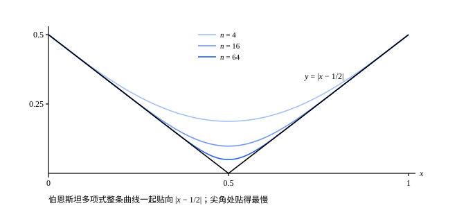

## 这一节要回答的问题

多项式是最简单的函数，只用加法和乘法就能算。泰勒多项式（Taylor polynomial，见[泰勒公式](lesson:math.calculus.taylor-polynomial)）能在一点附近近似一个光滑的函数，可$|x-\frac12|$在$\frac12$处有尖角，在那里不:term[可导]{id="math.analysis.differentiable-function"}（differentiable），泰勒多项式无从谈起。

能不能找一个多项式，在整个$[0,1]$上同时离$|x-\frac12|$不超过$0.01$？一般地，闭区间上的:term[连续函数]{id="math.analysis.continuous-function"}（continuous function），是不是都有一列多项式:term[一致收敛]{id="math.analysis.uniform-convergence"}（uniform convergence）于它？

## 讲解

### 伯恩斯坦多项式

想在$[0,1]$上用多项式模仿$f$，一个自然的办法是取$f$在$0,\frac1n,\frac2n,\dots,1$处的值做加权平均，权重是$x$的多项式，并且在$\frac kn$离$x$近时大、远时小。二项式定理给出了现成的权重：$1=\bigl(x+(1-x)\bigr)^n=\sum_{k=0}^n\binom nkx^k(1-x)^{n-k}$，记$p_{n,k}(x)=\binom nkx^k(1-x)^{n-k}$，在$[0,1]$上它们都不小于$0$，加起来是$1$。

::anchor{id="def-bernstein"}
设$f$定义在$[0,1]$上，$n$是正整数。多项式$B_nf(x)=\sum_{k=0}^nf\bigl(\frac kn\bigr)p_{n,k}(x)=\sum_{k=0}^nf\bigl(\frac kn\bigr)\binom nkx^k(1-x)^{n-k}$叫作$f$的第$n$个:term[伯恩斯坦多项式]{id="math.analysis.bernstein-polynomial"}（Bernstein polynomial）。

为什么这样定义：对固定的$x$，$B_nf(x)$是$f$在各节点处的值的加权平均，权重$p_{n,k}(x)$在$k$接近$nx$时大，离得越远越小（下面的引理把这句话说准）。所以$B_nf(x)$主要由$x$附近的函数值决定。边界情况：$B_nf(0)=f(0)$，$B_nf(1)=f(1)$；中间的节点上一般不相等，比如$f(x)=x^2$时$B_2f\bigl(\frac12\bigr)=\frac38\ne\frac14$。

**引理**　对每个$x$，(1) $\sum_{k=0}^np_{n,k}(x)=1$；(2) $\sum_{k=0}^nk\,p_{n,k}(x)=nx$；(3) $\sum_{k=0}^n(k-nx)^2p_{n,k}(x)=nx(1-x)$。

**证明**：(1) 是二项式定理。(2) 用$k\binom nk=n\binom{n-1}{k-1}$：$\sum_kk\,p_{n,k}(x)=nx\sum_{k=1}^n\binom{n-1}{k-1}x^{k-1}(1-x)^{n-k}=nx\bigl(x+(1-x)\bigr)^{n-1}=nx$。

(3) 同理，用$k(k-1)\binom nk=n(n-1)\binom{n-2}{k-2}$得$\sum_kk(k-1)p_{n,k}(x)=n(n-1)x^2$，于是$\sum_kk^2p_{n,k}(x)=n(n-1)x^2+nx$。展开$(k-nx)^2=k^2-2nxk+n^2x^2$，由 (1)(2)，和为$n(n-1)x^2+nx-2n^2x^2+n^2x^2=nx(1-x)$。

(3) 说的正是权重集中在$k\approx nx$附近：$|k-nx|\ge n\delta$的那些$k$，权重加起来不超过$\sum_k\frac{(k-nx)^2}{n^2\delta^2}p_{n,k}(x)=\frac{x(1-x)}{n\delta^2}\le\frac{1}{4n\delta^2}$，$n$大时很小。

### 魏尔斯特拉斯逼近定理

::anchor{id="thm-weierstrass-approximation"}
**定理**　设$f$在$[a,b]$上:term[连续]{id="math.analysis.continuous-function"}，则任给$\varepsilon>0$，都有多项式$p$，使所有$x\in[a,b]$都满足$|f(x)-p(x)|<\varepsilon$；也就是说，有一列多项式在$[a,b]$上:term[一致收敛]{id="math.analysis.uniform-convergence"}于$f$。这叫作:term[魏尔斯特拉斯逼近定理]{id="math.analysis.weierstrass-approximation-theorem"}（Weierstrass approximation theorem）。

**证明**：先化到$[0,1]$上。$g(t)=f\bigl(a+(b-a)t\bigr)$在$[0,1]$上连续；若多项式$q$满足$|g(t)-q(t)|<\varepsilon$，则$p(x)=q\bigl(\frac{x-a}{b-a}\bigr)$也是多项式，并且$|f(x)-p(x)|<\varepsilon$。下面设$[a,b]=[0,1]$，证明$B_nf$一致收敛于$f$。

由:term[康托尔定理]{id="math.analysis.heine-cantor-theorem"}（Heine-Cantor theorem），$f$在$[0,1]$上:term[一致连续]{id="math.analysis.uniform-continuity"}（uniform continuity）。取$\varepsilon=1$对应的$\delta_1$，把$[0,1]$分成长度小于$\delta_1$的有限段，每段上$|f|$不超过左端点处的值的绝对值加$1$，所以$f$:term[有界]{id="math.analysis.bounded-function"}（bounded function），设$|f|\le M$。

任给$\varepsilon>0$，由一致连续，有$\delta>0$，使$|s-t|<\delta$时$|f(s)-f(t)|<\frac\varepsilon2$。由引理 (1)，$f(x)-B_nf(x)=\sum_k\bigl(f(x)-f(\frac kn)\bigr)p_{n,k}(x)$。把$k$分成两类：$|\frac kn-x|<\delta$的，$|f(x)-f(\frac kn)|<\frac\varepsilon2$，这部分的和不超过$\frac\varepsilon2\sum_kp_{n,k}(x)=\frac\varepsilon2$；其余的，$|f(x)-f(\frac kn)|\le2M$，而权重之和不超过$\frac{1}{4n\delta^2}$，这部分不超过$\frac{M}{2n\delta^2}$。

所以$|f(x)-B_nf(x)|<\frac\varepsilon2+\frac{M}{2n\delta^2}$，右边和$x$无关。$n>\frac{M}{\varepsilon\delta^2}$时它小于$\varepsilon$，所以$B_nf$在$[0,1]$上一致收敛于$f$。

为什么想到这么做：$B_nf(x)$是加权平均。离$x$近的节点，函数值和$f(x)$差得少，用一致连续；离得远的节点差得可能多，但权重之和很小，用有界和引理 (3)。一致连续给出的$\delta$对所有$x$都管用，所以最后的估计和$x$无关，这正是一致收敛。

定理里的两个条件都不能少。区间不闭：$\frac1x$在$(0,1]$上连续，却不能被多项式一致逼近（例 2）。不连续：令$x<\frac12$时$f(x)=0$、$x\ge\frac12$时$f(x)=1$，若多项式$p$处处满足$|f-p|<\frac14$，则$\frac12$左边$p<\frac14$，而$p\bigl(\frac12\bigr)>\frac34$，$p$在$\frac12$处就不连续了，矛盾。

## 几何图像

:::anim{component="function-plot"}
range: { x: [0, 1], y: [-0.05, 1.1] }
functions:
  - expr: "x^2"
    label: |
      $y=x^2$
  - expr: "x^2 + x * (1 - x) / k"
    label: |
      伯恩斯坦多项式$y=B_kf(x)$
points:
  - { x: "0.5", y: "0.25 + 0.25 / k" }
  - { x: "0.5", y: "0.25" }
sliders:
  - name: k
    min: 1
    max: 40
    step: 1
    default: 3
    label: |
      $k$
:::

这是例 1 里$f(x)=x^2$的:term[伯恩斯坦多项式]{id="math.analysis.bernstein-polynomial"}，$B_kf(x)=x^2+\frac{x(1-x)}{k}$。两条曲线在两端重合，中间$B_kf$高出一截，差在$x=\frac12$处最大，图上标出了这两点。把$k$调大，整条曲线一起贴向$x^2$，这是:term[一致收敛]{id="math.analysis.uniform-convergence"}。

$|x-\frac12|$在$\frac12$处有尖角，没有泰勒多项式可用，伯恩斯坦多项式照样整条地贴上去。尖角处贴得最慢：$n=64$时那里还差约$0.05$。

## 例题

### 例 1　$x^2$的伯恩斯坦多项式

求$f(x)=x^2$的:term[伯恩斯坦多项式]{id="math.analysis.bernstein-polynomial"}$B_nf$，以及它和$f$在$[0,1]$上的:term[上确界距离]{id="math.analysis.uniform-distance"}（uniform distance）。

**为什么想到这么做**：$B_nf(x)=\sum_k\frac{k^2}{n^2}p_{n,k}(x)$，引理的证明里正好算过$\sum_kk^2p_{n,k}(x)$。

**推导**：由引理的证明，$\sum_kk^2p_{n,k}(x)=n(n-1)x^2+nx$，所以$B_nf(x)=\frac{n(n-1)x^2+nx}{n^2}=x^2+\frac{x(1-x)}{n}$。于是$B_nf(x)-x^2=\frac{x(1-x)}{n}\ge0$，在$x=\frac12$处最大，$\|B_nf-f\|_\infty=\frac{1}{4n}\to0$。

误差是$\frac1n$量级：即使对这样光滑的函数，伯恩斯坦多项式逼近得也不快。它的好处是对所有:term[连续函数]{id="math.analysis.continuous-function"}都管用。

### 例 2　$\frac1x$不能在$(0,1]$上被多项式一致逼近

证明：没有多项式$p$能使所有$x\in(0,1]$都满足$\bigl|\frac1x-p(x)\bigr|<1$。由此，$\frac1x$在$(0,1]$上不能被多项式:term[一致收敛]{id="math.analysis.uniform-convergence"}地逼近。

**为什么想到这么做**：多项式在$[0,1]$上:term[有界]{id="math.analysis.bounded-function"}，而$\frac1x$在$(0,1]$上无界；处处相差不到$1$，就会把有界性传过去。

**推导**：设$p(x)=c_0+c_1x+\cdots+c_mx^m$。$x\in[0,1]$时$|p(x)|\le|c_0|+|c_1|+\cdots+|c_m|$，记右边为$K$。若所有$x\in(0,1]$都满足$\bigl|\frac1x-p(x)\bigr|<1$，则$\frac1x<|p(x)|+1\le K+1$，取$x=\frac{1}{K+2}$就矛盾了。

所以没有多项式能在$(0,1]$上与$\frac1x$处处相差小于$1$，更谈不上一致逼近。毛病出在区间不闭：$(0,1]$上的:term[连续函数]{id="math.analysis.continuous-function"}可以在$0$附近跑到无穷，而多项式在$[0,1]$上有界。

## 常见误区

- 「用多项式逼近，就是泰勒展开。」不对：$|x-\frac12|$在$\frac12$处不:term[可导]{id="math.analysis.differentiable-function"}，没有泰勒多项式，却能被多项式一致逼近。泰勒多项式只在一点附近好；:term[伯恩斯坦多项式]{id="math.analysis.bernstein-polynomial"}在整个区间上同时好。
- 「伯恩斯坦多项式在节点$\frac kn$处等于$f\bigl(\frac kn\bigr)$。」不对：一般只在$0$和$1$两端相等，$x^2$的$B_2$在$\frac12$处是$\frac38$，不是$\frac14$。
- 「开区间上的:term[连续函数]{id="math.analysis.continuous-function"}也都能用多项式:term[一致收敛]{id="math.analysis.uniform-convergence"}地逼近。」不对：例 2 的$\frac1x$。
- 「伯恩斯坦多项式逼近得很快。」不对：光滑的$x^2$，误差也有$\frac{1}{4n}$；有尖角的$|x-\frac12|$，$n=64$时尖角处还差约$0.05$。定理只保证能逼近，不保证快。
