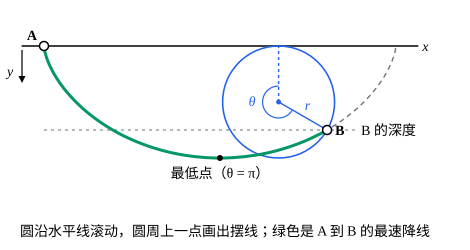

## 这一节要回答的问题

:term[最速降线]{id="math.calculus-of-variations.brachistochrone"}（brachistochrone）和两个圆环之间的肥皂膜（soap film），被积函数都不显含自变量$x$。:term[欧拉-拉格朗日方程]{id="math.calculus-of-variations.euler-lagrange-equation"}（Euler–Lagrange equation）一般是二阶的，这时能不能先积分一次？积出来以后，最快的轨道和肥皂膜到底是什么形状？

## 讲解

### 贝尔特拉米恒等式

先看一个例子。$J[y]=\int\bigl(y'^2+y^2\bigr)\dd x$的方程是$2y-2y''=0$，即$y''=y$。两边乘$y'$，$y'y''=yy'$，也就是$\dv{}{x}\bigl(y'^2-y^2\bigr)=0$，所以沿每条:term[极值曲线]{id="math.calculus-of-variations.extremal"}（extremal），$y'^2-y^2$是常数。这里能这样做，靠的是被积函数不含$x$。

::anchor{id="thm-beltrami"}
定理（:term[贝尔特拉米恒等式]{id="math.calculus-of-variations.beltrami-identity"}，Beltrami identity）：设$F=F(y,y')$不显含$x$，有连续的二阶偏导数（partial derivative）。则沿$J[y]=\int_a^bF(y,y')\,\dd x$的每条极值曲线，$F-y'F_{y'}$都是常数：$F-y'F_{y'}=C$。

证明思路：$F$不含$x$，求导时没有$F_x$这一项，$\dv{}{x}\bigl(F-y'F_{y'}\bigr)=F_yy'+F_{y'}y''-y''F_{y'}-y'\dv{}{x}F_{y'}=y'\Bigl(F_y-\dv{}{x}F_{y'}\Bigr)$。极值曲线上括号里为零，所以$F-y'F_{y'}$的导数为零。上面的例子里$F=p^2+y^2$，$F-y'F_{y'}=y^2-y'^2$，正是那个常数的相反数。

::anchor{id="def-first-integral"}
沿每条极值曲线都保持为常数的量，叫作这个:term[变分问题]{id="math.calculus-of-variations.variational-problem"}（variational problem）的:term[首次积分]{id="math.calculus-of-variations.first-integral"}（first integral）。$F$不含$x$时的$F-y'F_{y'}$是一个；$F$不含$y$时的$F_{y'}$也是一个（见[第一变分与欧拉-拉格朗日方程](lesson:math.calculus-of-variations.euler-lagrange)）。

为什么这样定义：知道一个首次积分，二阶方程就降成了一阶方程，名字的意思是「已经积分了一次」。把$x$看成时间、$F$看成:term[拉格朗日量]{id="physics.analytical-mechanics.lagrangian"}（Lagrangian），$F-y'F_{y'}$是能量的相反数，贝尔特拉米恒等式就是能量守恒（conservation of energy），以后在[能量函数与能量守恒](lesson:physics.analytical-mechanics.energy-function)里会看到。边界情况：反过来不成立。上面的证明说$F-y'F_{y'}$的导数是$y'$乘方程的左边，所以在$y'\equiv0$的地方，常函数自动满足$F-y'F_{y'}=C$，却可能不满足方程；解完首次积分，要把这样的常函数挑出来检查（下面的肥皂膜就有一个）。

### 最速降线是摆线

[泛函与变分问题](lesson:math.calculus-of-variations.functionals)里，:term[最速降线]{id="math.calculus-of-variations.brachistochrone"}问题的被积函数是$\frac{1}{\sqrt{2g}}\sqrt{\frac{1+y'^2}{y}}$（$y$轴向下）。常数因子不影响:term[极值曲线]{id="math.calculus-of-variations.extremal"}，取$F=\sqrt{(1+p^2)/y}$，它不含$x$。$F$只在$y>0$时有定义，下面的推导都在曲线上$y>0$的部分（起点以外）进行。$F_{y'}=\frac{y'}{\sqrt y\sqrt{1+y'^2}}$，所以

$$
F-y'F_{y'}=\frac{1+y'^2-y'^2}{\sqrt y\sqrt{1+y'^2}}=\frac{1}{\sqrt{y\bigl(1+y'^2\bigr)}}=C ,\qquad\text{即}\qquad y\bigl(1+y'^2\bigr)=2r ,
$$

$2r=1/C^2$是一个正的常数。

引入参数$\theta$，令$y=r(1-\cos\theta)$。代入得$1+y'^2=\frac{2}{1-\cos\theta}$，$y'^2=\frac{1+\cos\theta}{1-\cos\theta}=\cot^2\frac\theta2$；小球先往下走，$y'>0$，所以$\dv{y}{x}=\cot\frac\theta2$。又$\dv{y}{\theta}=r\sin\theta$，由参数曲线（parametric curve）的求导关系，

$$
\dv{x}{\theta}=\frac{\dd y/\dd\theta}{\dd y/\dd x}=r\sin\theta\tan\frac\theta2=2r\sin^2\frac\theta2=r(1-\cos\theta) .
$$

$\theta=0$对应起点$A$，所以$x=r(\theta-\sin\theta)$。$\theta$过了$\pi$以后$\cot\frac\theta2<0$，曲线转而上升，上面的式子照样成立。

::anchor{id="def-cycloid"}
半径为$r$的圆沿一条直线滚动时，圆周上一个固定点画出的曲线叫作摆线（cycloid）。这里圆在水平线$y=0$的下侧滚动，转过角度$\theta$时圆心在$(r\theta,r)$，那个点在$\bigl(r(\theta-\sin\theta),\,r(1-\cos\theta)\bigr)$，正是上面解出的曲线。

为什么这样定义：滚圆的说法一眼就能看出曲线的样子，参数$\theta$就是圆转过的角度。边界情况：$\theta=0$和$\theta=2\pi$时，那个点正贴着直线，摆线在这里出现尖点，切线是竖直的。所以最速降线在起点处竖直下落，斜率无界，严格地说不在导数连续的:term[容许函数]{id="math.calculus-of-variations.admissible-function"}（admissible function）之列。

终点$B=(b,h)$定下$r$和$\theta_B$：$\frac{\theta_B-\sin\theta_B}{1-\cos\theta_B}=\frac bh$在$(0,2\pi)$内恰有一个解（p6），再由$h=r(1-\cos\theta_B)$得$r$。$\frac bh>\frac\pi2$时$\theta_B>\pi$，曲线先降到比$B$更低的最低点再升上来。至于这条极值曲线确实是最快的，而不只是:term[第一变分]{id="math.calculus-of-variations.first-variation"}（first variation）为零，证明要用更多的工具，这里不展开。

### 肥皂膜：悬链线

两个半径为$R$的圆环放在$x=\pm a$处，肥皂膜的面积是$2\pi\int_{-a}^ay\sqrt{1+y'^2}\,\dd x$。取$F=y\sqrt{1+p^2}$，$F_{y'}=\frac{yy'}{\sqrt{1+y'^2}}$，:term[贝尔特拉米恒等式]{id="math.calculus-of-variations.beltrami-identity"}给出

$$
F-y'F_{y'}=\frac{y}{\sqrt{1+y'^2}}=c ,\qquad\text{即}\qquad y'^2=\frac{y^2}{c^2}-1 ,
$$

$c>0$。常函数$y\equiv c$满足这个式子，但它不是:term[极值曲线]{id="math.calculus-of-variations.extremal"}：代进方程，$F_y=\sqrt{1+y'^2}=1$，而$\dv{}{x}F_{y'}=0$，方程不成立。这和[泛函与变分问题](lesson:math.calculus-of-variations.functionals)例 1 的结论一致：圆柱面（cylinder）连:term[第一变分]{id="math.calculus-of-variations.first-variation"}都不为零。

令$y=c\cosh u$，$u$是$x$的未知函数，则$y'=c\sinh u\cdot u'$，$\frac{y^2}{c^2}-1=\sinh^2u$。代入得$c^2u'^2\sinh^2u=\sinh^2u$，$u'=\pm\frac1c$，所以$u=\pm\frac{x-x_0}{c}$，而$\cosh$是偶函数：

$$
y=c\cosh\frac{x-x_0}{c} .
$$

::anchor{id="def-catenary"}
曲线$y=c\cosh\frac{x-x_0}{c}$（$c>0$）叫作悬链线（catenary），它绕$x$轴转出的曲面叫作:term[悬链面]{id="math.calculus-of-variations.catenoid"}（catenoid）。

为什么这样定义：两端挂起的均匀链条就是这个形状，名字由此而来，[等周问题](lesson:math.calculus-of-variations.isoperimetric-problems)会说明为什么。$c$是曲线的最低点到$x$轴的距离，也就是肥皂膜最细处的半径。边界情况：给定两个圆环，悬链线族里不一定有经过两环的那一条，这时连接两环的肥皂膜不存在（例 2）。

## 几何图像

蓝色的圆在水平线下侧向右滚动，圆周上一点画出摆线（虚线是完整的一拱）。绿色是从$A$到$B$的:term[最速降线]{id="math.calculus-of-variations.brachistochrone"}，这里$\frac bh>\frac\pi2$，它先降到比$B$低的最低点，再升到$B$；在起点$A$处，曲线是竖直的。

:::anim{component="function-plot"}
range: { x: [0, 1.6], y: [0, 3] }
functions:
  - expr: "x*cosh(a/x)"
    label: |
      $c\cosh\frac ac$
  - expr: "1"
    label: |
      $R=1$
sliders:
  - name: a
    min: 0.2
    max: 0.9
    step: 0.01
    default: 0.35
    label: |
      圆环到中点的距离$a$（圆环半径$R=1$）
:::

横轴是$c$，曲线是$c\cosh\frac ac$，即悬链线$y=c\cosh\frac xc$在$x=a$处的高度。它和水平线$R=1$的每个交点给出一个经过两环的:term[悬链面]{id="math.calculus-of-variations.catenoid"}。把$a$从小往大拖：起初有两个交点，$a$超过约$0.66$以后一个也没有，两个圆环之间就撑不起悬链面了。

## 例题

### 例 1　滑到摆线的最低点

$B=(\frac{\pi}{2}h,h)$（$y$轴向下）。求从$A=(0,0)$到$B$的:term[最速降线]{id="math.calculus-of-variations.brachistochrone"}、小球所用的时间，并和直线比较。

**为什么想到这么做**：最速降线是从$A$出发的摆线，只要由$\frac bh=\frac\pi2$定出$\theta_B$和$r$。时间用摆线的参数$\theta$来积分，可以避开起点处的反常积分（improper integral）。

**推导**：$\theta=\pi$时$\frac{\theta-\sin\theta}{1-\cos\theta}=\frac\pi2$，所以$\theta_B=\pi$，$B$正是摆线的最低点，$r=\frac h2$，那里$\dv{y}{x}=\cot\frac\pi2=0$，曲线水平地到达$B$。沿摆线，$\dd s=\sqrt{x'(\theta)^2+y'(\theta)^2}\,\dd\theta=r\sqrt{2-2\cos\theta}\,\dd\theta=2r\sin\frac\theta2\,\dd\theta$，速率$v=\sqrt{2gy}=2\sqrt{gr}\sin\frac\theta2$，所以

$$
\dd t=\frac{\dd s}{v}=\sqrt{\frac rg}\,\dd\theta ,\qquad T=\theta_B\sqrt{\frac rg}=\pi\sqrt{\frac{h}{2g}}\approx2.22\sqrt{\frac hg} .
$$

沿直线$y=\frac{2}{\pi}x$算那一节的$T[y]$，得$T=\sqrt{\frac{\pi^2}{2}+2}\,\sqrt{\frac hg}\approx2.63\sqrt{\frac hg}$，摆线快了约$16\%$。取$h=2\,\mathrm m$，就是那一节几何图像里的$1.004\,\mathrm s$和$1.190\,\mathrm s$。

### 例 2　圆环能拉开多远

两个半径为$R$的圆环相距$2a$。什么时候存在经过两环的:term[悬链面]{id="math.calculus-of-variations.catenoid"}？

**为什么想到这么做**：图形关于$x=0$对称，取$x_0=0$，悬链线是$y=c\cosh\frac xc$，经过两环的条件是$R=c\cosh\frac ac$。这是关于$c$的方程，有几个解，要看函数$c\cosh\frac ac$的形状。

**推导**：令$t=\frac ac>0$，条件变成$\frac Ra=\frac{\cosh t}{t}$。记$g(t)=\frac{\cosh t}{t}$，$t\to0^+$和$t\to+\infty$时它都趋于$+\infty$，而

$$
g'(t)=\frac{t\sinh t-\cosh t}{t^2}=\frac{\cosh t}{t^2}\bigl(t\tanh t-1\bigr) .
$$

$t\tanh t$在$t>0$上严格递增，从$0$增到$+\infty$，所以$g$只有一个最小值点$t_*$，满足$t_*\tanh t_*=1$，数值上$t_*\approx1.200$，$g(t_*)\approx1.509$。$\frac Ra>1.509$时方程有两个解，相等时一个，小于时没有。所以只有$\frac aR\le\frac{1}{1.509}\approx0.663$，即两环的距离$2a$不超过约$1.33R$时，悬链面才存在。再拉开，肥皂膜就会断开，变成分别封住两个圆环的两张圆片。

## 常见误区

- 「满足:term[贝尔特拉米恒等式]{id="math.calculus-of-variations.beltrami-identity"}的函数都是:term[极值曲线]{id="math.calculus-of-variations.extremal"}。」常函数可能是多出来的解，肥皂膜问题里的$y\equiv c$就是。
- 「:term[最速降线]{id="math.calculus-of-variations.brachistochrone"}就是直线，或者是一段圆弧。」直线最短却最慢；圆弧也比摆线慢（[泛函与变分问题](lesson:math.calculus-of-variations.functionals)的几何图像）。
- 「最速降线总在终点的上方。」$\frac bh>\frac\pi2$时，它先降到比终点还低的地方，再升上去。
- 「两个圆环之间总能撑起一个:term[悬链面]{id="math.calculus-of-variations.catenoid"}。」两环的距离超过约$1.33R$时不存在；距离较小时有两个，哪一个是真正的极小，要用[第二变分与勒让德条件](lesson:math.calculus-of-variations.second-variation)以后的工具判断。
