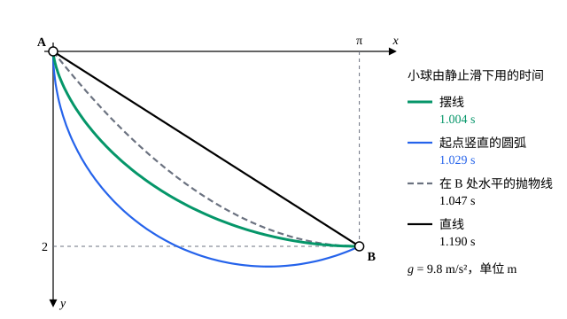

## 这一节要回答的问题

平面上两点之间，哪条曲线最短？一颗小球从$A$由静止出发，沿光滑的轨道滑到低一些的$B$，轨道做成什么形状用时最少？这两个问题都要在「所有可能的曲线」里挑出最好的一条，未知的不是一个数，而是整个函数。怎样把它们写成数学问题，「最好」又该怎样理解？

## 讲解

### 三个例子

**曲线的长度**。从$A=(a,y_a)$到$B=(b,y_b)$的曲线写成$y=y(x)$，由弧长（arc length）公式，它的长度是

$$
L[y]=\int_a^b\sqrt{1+y'^2}\,\dd x .
$$

每条这样的曲线对应一个数$L[y]$，问题是让它最小。

**最快的轨道**。取$A$为原点、$y$轴竖直向下，$B=(b,h)$，$b>0$，$h>0$。小球由静止沿轨道$y=y(x)$无摩擦地滑下，下降高度$y$时速率是$v=\sqrt{2gy}$，这是机械能守恒（conservation of mechanical energy）的结论，见[势能与机械能守恒](lesson:physics.newtonian-mechanics.potential-energy)。走过弧长$\dd s=\sqrt{1+y'^2}\,\dd x$要用时间$\dd s/v$，所以总时间是

$$
T[y]=\frac{1}{\sqrt{2g}}\int_0^b\sqrt{\frac{1+y'^2}{y}}\,\dd x .
$$

起点处$y=0$，被积函数无界，这是一个反常积分（improper integral）。对直线，被积函数在$x\to0$时像$1/\sqrt x$那样增大，积分仍是有限的。

::anchor{id="def-brachistochrone"}
使$T[y]$最小的曲线叫作:term[最速降线]{id="math.calculus-of-variations.brachistochrone"}（brachistochrone），这个词在希腊文里是「最短时间」的意思。

为什么值得单独起名：1696 年约翰·伯努利（Johann Bernoulli）把它作为挑战题公开征解，牛顿（Isaac Newton）、莱布尼茨（Gottfried Leibniz）等人都给出了解答，变分法就是从这类问题发展起来的。边界情况：$B$在$A$正下方（$b=0$）时，最速降线就是竖直的线段，也是最短的路；只要$B$不在正下方，最快的轨道就不是直线（见几何图像）。

**旋转曲面的面积**。两个半径都是$R$的圆环套在同一根轴上，相距$2a$，中间张着一层肥皂膜（soap film）。把轴取作$x$轴，圆环放在$x=\pm a$处，肥皂膜是曲线$y=y(x)>0$绕$x$轴转出来的旋转曲面（surface of revolution），面积是

$$
A[y]=2\pi\int_{-a}^{a}y\sqrt{1+y'^2}\,\dd x ,\qquad y(\pm a)=R .
$$

表面张力（surface tension）让肥皂膜收缩，它会停在面积比附近的形状都小的形状上。

### 泛函

::anchor{id="def-functional"}
如果某一类函数里的每个函数$y$都对应一个确定的实数$J[y]$，这个对应关系叫作:term[泛函]{id="math.calculus-of-variations.functional"}（functional）。上面的$L[y]$、$T[y]$、$A[y]$都是泛函，方括号提醒我们：自变量是整个函数，不是某一点的值。

这个领域主要研究积分型的泛函$J[y]=\int_a^bF(x,y,y')\,\dd x$：$F(x,y,p)$是三个变量的函数，积分时第三个变量换成$y'(x)$。例如$L[y]$的$F=\sqrt{1+p^2}$，$A[y]$的$F=2\pi y\sqrt{1+p^2}$。下一节要用到$F$对这三个变量的偏导数（partial derivative），所以总假定它们连续。

为什么这样定义：要比较的是整条曲线，衡量好坏的是一个数，所以需要「把函数对应到数」的规则。长度、时间、面积都是各处局部贡献之和，所以写成积分，被积函数只依赖这一点的位置和斜率。边界情况：$y\mapsto y(\frac12)$、$y\mapsto\max_{[0,1]}|y|$也是泛函，只是不是积分型的；而求导$y\mapsto y'$把一个函数变成另一个函数，结果不是一个数，不是泛函。

### 容许函数与变分问题

::anchor{id="def-admissible-function"}
在$[a,b]$上有连续导数、满足端点条件$y(a)=y_a$、$y(b)=y_b$的函数，叫作这个问题的:term[容许函数]{id="math.calculus-of-variations.admissible-function"}（admissible function）。

为什么这样定义：被积函数里有$y'$，导数连续，积分才有意义；端点是问题给定的，只在连接同样两点的曲线之间比较。边界情况：从$(-1,0)$到$(1,0)$的上半圆$y=\sqrt{1-x^2}$长度有限，却不是容许函数，因为它在两端的斜率无界。容许函数的范围是我们选的，选得太窄，最优的曲线可能恰好被排除在外，:term[最速降线]{id="math.calculus-of-variations.brachistochrone"}就会遇到这个问题。

::anchor{id="def-variational-problem"}
在容许函数里找使:term[泛函]{id="math.calculus-of-variations.functional"}$J$取最小值（或最大值）的函数，叫作:term[变分问题]{id="math.calculus-of-variations.variational-problem"}（variational problem）。两个容许函数的远近用$d(y,\hat y)=\max_{[a,b]}|y-\hat y|+\max_{[a,b]}|y'-\hat y'|$衡量：如果有$\delta>0$，使所有满足$d(y,\hat y)<\delta$的容许函数$\hat y$都有$J[\hat y]\ge J[y]$，就说$J$在$y$处取局部极小值（local minimum）。

为什么距离里要算上导数：泛函依赖$y'$，只要求函数值接近是不够的。例如在$[0,\pi]$上，$y_n=\frac1n\sin(n^2x)$和$y=0$的函数值相差不超过$\frac1n$，但$y_n'=n\cos(n^2x)$很大，曲线的长度随$n$趋于无穷。边界情况：变分问题不一定有解。在$y(0)=0$、$y(1)=1$的容许函数里，$\int_0^1y^2\,\dd x$总是正的，而$y=x^n$给出的值$\frac{1}{2n+1}$可以任意接近$0$，所以最小值不存在。

### 化成一元函数的问题

怎样检验一个:term[容许函数]{id="math.calculus-of-variations.admissible-function"}是不是局部极小？固定$y$，再取一个在$[a,b]$上有连续导数、两端为零的函数$\eta$，则对每个实数$\varepsilon$，$y+\varepsilon\eta$也是容许函数。令

$$
\Phi(\varepsilon)=J[y+\varepsilon\eta] ,
$$

这是一个普通的一元函数，而$d(y+\varepsilon\eta,y)=|\varepsilon|\bigl(\max|\eta|+\max|\eta'|\bigr)$随$\varepsilon\to0$趋于零。

如果$J$在$y$处取局部极小值，$\Phi$就在$\varepsilon=0$处取局部极小值；$\Phi$可导时，由费马定理（Fermat's theorem），$\Phi'(0)=0$。反过来，只要找到一个$\eta$使$\Phi'(0)\ne0$，$y$就不是局部极小。$\Phi'(0)$怎样用$F$的偏导数算出来、对所有$\eta$都为零又能推出什么，是[第一变分与欧拉-拉格朗日方程](lesson:math.calculus-of-variations.euler-lagrange)的内容。

## 几何图像

四条轨道都从$A=(0,0)$连到$B=(\pi,2)$（单位 m，$y$轴向下），时间按$T[y]$数值积分得到。直线最短，却最慢；起点陡一些的轨道一开始就获得较大的速度，路程虽长，总时间反而更少。绿色的摆线（cycloid）最快，[贝尔特拉米恒等式与最速降线](lesson:math.calculus-of-variations.beltrami-identity)会证明它就是:term[最速降线]{id="math.calculus-of-variations.brachistochrone"}。

## 例题

### 例 1　圆柱面不是面积最小的

两个半径为$R$的圆环相距$2a$，套在同一根轴上，连接它们的圆柱面（cylinder）对应常函数$y=R$。证明它不是$A[y]$的局部极小。

**为什么想到这么做**：肥皂膜如果是圆柱面，把中间往里收一点，应该能省面积。按上面的办法，取一个两端为零、中间为负的$\eta$，看$\Phi(\varepsilon)=A[R+\varepsilon\eta]$在$\varepsilon$稍大于零时是不是比$\Phi(0)$小。

**推导**：取$\eta=x^2-a^2$，它在$x=\pm a$处为零，在两环之间为负。$\varepsilon$很小时$R+\varepsilon\eta>0$，再用不等式$\sqrt{1+t}\le1+\frac t2$（两边平方即得），

$$
\Phi(\varepsilon)\le2\pi\int_{-a}^{a}(R+\varepsilon\eta)\Bigl(1+\frac{\varepsilon^2\eta'^2}{2}\Bigr)\dd x=2\pi\Bigl(2aR-\frac{4a^3}{3}\varepsilon\Bigr)+\varepsilon^2C(\varepsilon) ,
$$

其中$C(\varepsilon)=\pi\int_{-a}^{a}(R+\varepsilon\eta)\eta'^2\,\dd x$在$0\le\varepsilon\le1$上有界。于是$\varepsilon>0$足够小时$\Phi(\varepsilon)<4\pi aR=\Phi(0)$：往里收一点，面积确实变小了。圆柱面不是局部极小，肥皂膜真正的形状在[贝尔特拉米恒等式与最速降线](lesson:math.calculus-of-variations.beltrami-identity)里求。

### 例 2　直线是最短的

证明：连接$A=(a,y_a)$、$B=(b,y_b)$的:term[容许函数]{id="math.calculus-of-variations.admissible-function"}中，直线的长度最小，而且只有直线取到这个最小值。

**为什么想到这么做**：有些:term[变分问题]{id="math.calculus-of-variations.variational-problem"}不必求导，直接用不等式就能比较。如果能把$\sqrt{1+y'^2}$压到一个关于$y'$是一次式的下界上，积分以后就只剩端点的值，而端点对所有容许函数都一样。

**推导**：记直线的斜率$m=\frac{y_b-y_a}{b-a}$。对任意实数$p$，$(1+mp)^2\le(1+p^2)(1+m^2)$，因为两边相减是$(p-m)^2\ge0$，所以

$$
\sqrt{1+p^2}\ge\frac{1+mp}{\sqrt{1+m^2}} ,
$$

等号只在$p=m$时成立。把$p$换成$y'(x)$再积分，用$\int_a^by'\,\dd x=y_b-y_a=m(b-a)$，得

$$
L[y]\ge\frac{(b-a)+m^2(b-a)}{\sqrt{1+m^2}}=(b-a)\sqrt{1+m^2}=|AB| .
$$

等号要求处处$y'=m$，即$y$是直线。这样得到的是在所有容许函数中最小，比「$\Phi'(0)=0$」强得多；但大多数问题找不到这样的不等式，还得走下一节的路。

## 常见误区

- 「$J[y]$是$x$的函数。」积分已经把$x$用掉了，$J[y]$是一个数，变的是整个函数$y$。
- 「两个函数的值处处很接近，:term[泛函]{id="math.calculus-of-variations.functional"}的值也就很接近。」泛函依赖导数时不成立：讲解里的$\frac1n\sin(n^2x)$离$0$越来越近，长度却越来越大。
- 「有下界的泛函一定取得到最小值。」讲解里的$\int_0^1y^2\,\dd x$值能任意接近$0$，却取不到。
- 「找到一个$\eta$使$\Phi'(0)=0$，$y$就是极小。」这只是一个方向上的必要条件；要对所有$\eta$都成立，而且即使都成立，也只说明$y$处是驻值（stationary value），不一定是极小。
