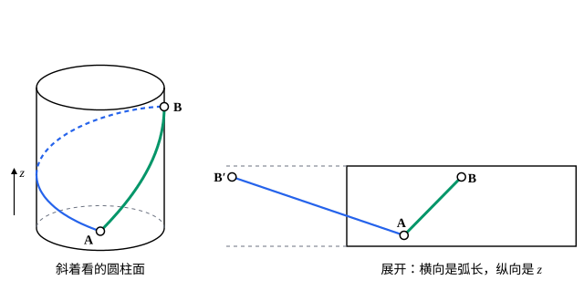

## 这一节要回答的问题

地球表面上两点之间，最短的路线是什么？曲线不能离开曲面时，:term[变分问题]{id="math.calculus-of-variations.variational-problem"}（variational problem）在曲线的每一点都多了一个约束（constraint）。它和:term[等周问题]{id="math.calculus-of-variations.isoperimetric-problem"}（isoperimetric problem）那种「整条曲线只有一个条件」的积分约束（integral constraint）有什么不同，又该怎样处理？

## 讲解

### 完整约束

空间曲线写成$\mathbf r(t)=\bigl(x(t),y(t),z(t)\bigr)$，$t\in[0,1]$，两端固定，长度是$\int_0^1|\mathbf r'|\,\dd t$，未知的是三个函数（见[多个未知函数与高阶导数](lesson:math.calculus-of-variations.several-functions)）。曲线要落在曲面$G(x,y,z)=0$上，就是要求对每个$t$都有$G\bigl(\mathbf r(t)\bigr)=0$：不是一个条件，而是每一点一个。

::anchor{id="def-holonomic-constraint"}
未知函数在每一点都必须满足的、不含导数的方程$G(t,y_1,\dots,y_n)=0$，叫作:term[完整约束]{id="math.calculus-of-variations.holonomic-constraint"}（holonomic constraint）。

为什么这样定义：几何上「曲线落在曲面上」、力学上「珠子穿在铁丝上」都是这种限制位置的条件，它们只涉及函数值，不涉及导数。它和积分约束不同：积分约束管整条曲线，只有一个；完整约束在每一点各有一个。边界情况：如果能从$G=0$解出一个变量，例如$z=g(x,y)$，代进去就成了少一个未知函数、不带约束的问题；但这样的公式不一定能在整张曲面上一次写出来（球面的上半和下半要分开写），下面的乘子法则（multiplier rule）不需要这样做。

### 函数作乘子

::anchor{id="thm-holonomic-multiplier"}
定理（:term[完整约束]{id="math.calculus-of-variations.holonomic-constraint"}的乘子法则）：设$J=\int_a^bF(t,y_1,\dots,y_n,y_1',\dots,y_n')\,\dd t$在完整约束$G(t,y_1,\dots,y_n)=0$下取局部极值，并且沿曲线$\nabla G=(G_{y_1},\dots,G_{y_n})$处处不为零。那么有一个函数$\lambda(t)$，使$F_{y_k}-\dv{}{t}F_{y_k'}+\lambda(t)\,G_{y_k}=0$，$k=1,\dots,n$。

证明思路：记方程左边前两项为$E_k$，$E=(E_1,\dots,E_n)$。只考虑每一点都和曲面相切的变动$\eta$，即$\nabla G\cdot\eta=0$，这时$\delta J=\int_a^bE\cdot\eta\,\dd t=0$。取$\eta=\varphi(t)\mathbf v(t)$，$\mathbf v$在每一点都和$\nabla G$垂直，由:term[变分法基本引理]{id="math.calculus-of-variations.fundamental-lemma"}（fundamental lemma of the calculus of variations）得$E\cdot\mathbf v=0$：$E$和所有与$\nabla G$垂直的向量都垂直，所以和$\nabla G$平行，记作$E=-\lambda(t)\nabla G$。严格地说，$y+\varepsilon\eta$并不正好落在曲面上，要沿法向（normal direction）挪回去，挪动的量是$\varepsilon^2$量级，不影响一阶的计算，细节这里不展开。

和[等周问题](lesson:math.calculus-of-variations.isoperimetric-problems)比较：那里一个积分约束配一个常数乘子；这里每一点一个约束，乘子就成了随$t$变化的函数。

### 测地线

取$F=|\mathbf r'|$、约束$G\bigl(\mathbf r(t)\bigr)=0$，乘子法则给出$\dv{}{t}\frac{\mathbf r'}{|\mathbf r'|}=\lambda(t)\nabla G$。长度和参数的取法无关，可以用弧长（arc length）$s$作参数，这时$|\mathbf r'|=1$，方程化成

$$
\mathbf r''(s)=\lambda(s)\,\nabla G .
$$

::anchor{id="def-geodesic"}
曲面上以弧长为参数、满足$\mathbf r''=\lambda\nabla G$的曲线，叫作这张曲面的测地线（geodesic）。

为什么这样定义：$\nabla G$是曲面的法向量（normal vector），方程说曲线的「弯曲」全都朝着曲面的法向，在曲面里看没有左右拐弯，是曲面上的「直线」。两点间最短的:term[光滑曲线]{id="math.vector-calculus.smooth-curve"}（smooth curve）一定是测地线，因为它是长度在约束下的局部极值。边界情况：反过来，测地线不一定最短，圆柱面（cylinder）上两点之间可以绕不同的圈数连出许多条测地线（几何图像），球面上超过半个大圆（great circle）的弧也不是最短的（见[雅可比条件与共轭点](lesson:math.calculus-of-variations.jacobi-condition)）。微分几何（differential geometry）会从曲面本身的角度再讲测地线，见[测地线](lesson:math.differential-geometry.geodesics)。

## 几何图像

圆柱面可以剪开展平而不改变长度，展平以后测地线就是直线段。从$A$到$B$，逆时针转四分之一圈的螺旋线（helix）画成绿色，展开后是连到$B$的线段；顺时针转四分之三圈的画成蓝色，展开后是连到$B$的另一个像$B'$的线段。两条都是测地线，绿色的更短。

## 例题

### 例 1　球面上的最短路径

在球面$x^2+y^2+z^2=R^2$上，求两点之间长度的:term[极值曲线]{id="math.calculus-of-variations.extremal"}（extremal）。

**为什么想到这么做**：用测地线方程$\mathbf r''=\lambda\nabla G$。$\nabla G=2\mathbf r$，方程说$\mathbf r''$和$\mathbf r$平行，叉积（cross product）$\mathbf r\times\mathbf r''$就是零，而它正是$\mathbf r\times\mathbf r'$的导数。

**推导**：$G=x^2+y^2+z^2-R^2$，方程是$\mathbf r''=2\lambda\mathbf r$。于是$\dv{}{s}(\mathbf r\times\mathbf r')=\mathbf r'\times\mathbf r'+\mathbf r\times\mathbf r''=\mathbf 0$，$\mathbf r\times\mathbf r'$是一个常向量$\mathbf n$。$\mathbf n$和$\mathbf r(s)$垂直，所以整条曲线落在过球心、法向量为$\mathbf n$的平面上：极值曲线是大圆的弧。乘子也能求出：$|\mathbf r|^2=R^2$求两次导数得$\mathbf r'\cdot\mathbf r'+\mathbf r\cdot\mathbf r''=0$，即$1+2\lambda R^2=0$，$\lambda=-\frac{1}{2R^2}$，在球面上是常数。

### 例 2　圆柱面上的测地线

在圆柱面$x^2+y^2=R^2$上，求以弧长为参数的测地线。

**为什么想到这么做**：$\nabla G=(2x,2y,0)$没有$z$分量，方程的第三个分量是$z''=0$；前两个分量用圆柱的角度$\theta$表示。

**推导**：$z''=0$，所以$z=ks+z_0$。前两个分量说$(x'',y'')$平行于$(x,y)$，记$x=R\cos\theta(s)$、$y=R\sin\theta(s)$，弧长条件$R^2\theta'^2+k^2=1$说明$\theta'$是常数。所以$\theta$和$z$都是$s$的一次函数：测地线是螺旋线，$k=0$时是水平的圆，$\theta'=0$时是竖直的母线（generatrix）。展开以后$R\theta$和$z$成正比，正是平面上的直线，和几何图像一致。

## 常见误区

- 「:term[完整约束]{id="math.calculus-of-variations.holonomic-constraint"}也只配一个常数乘子。」每一点各有一个约束，乘子是函数$\lambda(t)$；只有积分约束才配常数乘子。
- 「测地线就是两点之间最短的路。」最短的:term[光滑曲线]{id="math.vector-calculus.smooth-curve"}是测地线，反过来不一定：圆柱面上绕更多圈的螺旋线、球面上超过半个大圆的弧，都是测地线却不是最短的。
- 「测地线都像球面的大圆那样，落在一个平面里。」圆柱面上的螺旋线（例 2）就不在任何平面里；球面上能用平面来描述，靠的是例 1 里$\mathbf r\times\mathbf r'$守恒这个特殊的性质。
- 「乘子$\lambda$总是常数。」球面上用弧长作参数时恰好是常数（例 1），一般它随位置变化。
