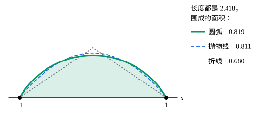

## 这一节要回答的问题

传说迦太基的女王狄多（Dido）得到许可，可以占有「一张牛皮能圈住的土地」，她把牛皮切成细条连成长绳，靠着海岸圈出了一大块地。长度一定的绳子，怎样围出的面积最大？这类问题除了要让:term[泛函]{id="math.calculus-of-variations.functional"}（functional）取极值，还多了一个积分形式的约束（constraint），该怎样处理？

## 讲解

### 等周问题

把海岸取作$x$轴，绳子从$(-a,0)$拉到$(a,0)$，写成$y=y(x)\ge0$。围出的面积是$A[y]=\int_{-a}^{a}y\,\dd x$，绳长$L[y]=\int_{-a}^{a}\sqrt{1+y'^2}\,\dd x$必须等于给定的$\ell$（$\ell>2a$）。要在$L[y]=\ell$的前提下让$A[y]$最大。

::anchor{id="def-isoperimetric-problem"}
在:term[容许函数]{id="math.calculus-of-variations.admissible-function"}（admissible function）中求$J[y]=\int_a^bF(x,y,y')\,\dd x$的极值，同时要求另一个:term[泛函]{id="math.calculus-of-variations.functional"}$K[y]=\int_a^bG(x,y,y')\,\dd x$等于给定的值$\ell$，这样的:term[变分问题]{id="math.calculus-of-variations.variational-problem"}（variational problem）叫作:term[等周问题]{id="math.calculus-of-variations.isoperimetric-problem"}（isoperimetric problem），$K[y]=\ell$叫作积分约束（integral constraint）。

为什么这样定义：名字来自「在周长相等的曲线中比较面积」，但只要约束本身是一个积分，处理的办法都一样，所以统称等周问题。积分约束管的是整条曲线，不是每一点，这和「曲线必须落在一张曲面上」那种逐点的约束不同（见[约束在曲面上的变分问题](lesson:math.calculus-of-variations.holonomic-constraints)）。边界情况：如果$\ell$恰好等于两端点间的距离，满足约束的容许函数只有直线段一条，「求极值」就没有内容了，下面的乘子法则（multiplier rule）在这种情况下也不适用。

### 乘子法则

::anchor{id="thm-multiplier-rule"}
定理（乘子法则，multiplier rule）：设$F$、$G$有连续的二阶偏导数（partial derivative），$y$是:term[等周问题]{id="math.calculus-of-variations.isoperimetric-problem"}的局部极值，并且$y$不是$K$的:term[极值曲线]{id="math.calculus-of-variations.extremal"}（extremal）。那么有常数$\lambda$，使$y$满足$H=F-\lambda G$的:term[欧拉-拉格朗日方程]{id="math.calculus-of-variations.euler-lagrange-equation"}（Euler–Lagrange equation）$H_y-\dv{}{x}H_{y'}=0$。

证明思路：只沿一个方向$y+\varepsilon\eta$变动，一般会破坏约束，所以用两个方向：$y+\varepsilon_1\eta_1+\varepsilon_2\eta_2$。令$\varphi(\varepsilon_1,\varepsilon_2)$、$\psi(\varepsilon_1,\varepsilon_2)$分别是$J$和$K-\ell$在这条曲线上的值，问题就变成：在曲线$\psi=0$上，$\varphi$在原点取局部极值。$y$不是$K$的极值曲线，所以能选$\eta_2$使$\frac{\partial\psi}{\partial\varepsilon_2}=\delta K[y;\eta_2]\ne0$，由拉格朗日乘数法（Lagrange multiplier method），原点处两个梯度（gradient）平行：$\delta J[y;\eta_i]=\lambda\,\delta K[y;\eta_i]$，$i=1,2$。

第二个式子定出$\lambda=\frac{\delta J[y;\eta_2]}{\delta K[y;\eta_2]}$，它和$\eta_1$无关；第一个式子于是对每个$\eta_1$都说$\delta(J-\lambda K)[y;\eta_1]=0$，再由:term[变分法基本引理]{id="math.calculus-of-variations.fundamental-lemma"}（fundamental lemma of the calculus of variations）得到$H$的方程（完整的证明见 p5）。解出来的通解含两个常数，再加上$\lambda$，共三个未知数，正好由两个端点条件和约束$K[y]=\ell$定出。有几个积分约束，就引入几个乘子：$H=F-\sum_i\lambda_iG_i$。

### 狄多问题的解

$\ell>2a$时满足约束的曲线不是直线，而长度的:term[极值曲线]{id="math.calculus-of-variations.extremal"}只有直线，所以乘子法则适用。$H=y-\lambda\sqrt{1+y'^2}$，$H_y=1$，$H_{y'}=-\frac{\lambda y'}{\sqrt{1+y'^2}}$，方程是$1+\dv{}{x}\frac{\lambda y'}{\sqrt{1+y'^2}}=0$。积分一次，$\frac{\lambda y'}{\sqrt{1+y'^2}}=-(x-c)$，$c$是常数。两边平方解出$y'$，

$$
y'=-\frac{x-c}{\sqrt{\lambda^2-(x-c)^2}} ,
$$

而$\dv{}{x}\sqrt{\lambda^2-(x-c)^2}$正是右边，所以$y=\sqrt{\lambda^2-(x-c)^2}+d$，即$(x-c)^2+(y-d)^2=\lambda^2$：极值曲线是半径为$\lambda$的圆弧。

由对称性$c=0$，圆弧过$(\pm a,0)$定出圆心$(0,d)$。若圆弧的圆心角是$2\alpha$，则$\sin\alpha=\frac a\lambda$，弧长（arc length）$\ell=2\lambda\alpha$，由此定出$\lambda$。$\ell$增大到$\pi a$时圆弧变成半圆，它在两端是竖直的；$\ell$再大，圆弧超过半圆，不能再写成$y=y(x)$，要改用参数曲线（parametric curve），但答案仍是圆弧。把海岸另一侧的图形对称地补上，就得到古老的结论：周长一定的闭曲线中，圆围成的面积最大（p7）。

## 几何图像

三条曲线都从$(-1,0)$连到$(1,0)$，长度都是$\ell=\frac{4\pi}{3\sqrt3}\approx2.418$，阴影是圆弧和$x$轴围成的区域。圆弧（例 2 的解）围出的面积最大；抛物线已经很接近，但仍小一点；折线差得多。

## 例题

### 例 1　带一个积分约束的二次问题

在$y(0)=y(1)=0$、$\int_0^1xy\,\dd x=1$的条件下，求$J[y]=\int_0^1y'^2\,\dd x$的最小值。

**为什么想到这么做**：这是:term[等周问题]{id="math.calculus-of-variations.isoperimetric-problem"}，$F=p^2$，$G=xy$。用乘子法则写$H=p^2-\lambda xy$的方程，解出含$\lambda$的函数族，再用约束定出$\lambda$。$J$是二次的，最小性可以直接展开验证。

**推导**：$H_y=-\lambda x$，$H_{y'}=2y'$，方程是$-\lambda x-2y''=0$，即$y''=-\frac{\lambda}{2}x$。积分两次并用$y(0)=y(1)=0$，$y=\frac{\lambda}{12}(x-x^3)$。约束$\int_0^1x\cdot\frac{\lambda}{12}(x-x^3)\,\dd x=\frac{\lambda}{12}\cdot\frac{2}{15}=\frac{\lambda}{90}=1$，所以$\lambda=90$，$y=\frac{15}{2}(x-x^3)$，$J=\int_0^1\frac{225}{4}(1-3x^2)^2\,\dd x=45$。

最小性：设$y+\eta$也满足条件，则$\eta(0)=\eta(1)=0$、$\int_0^1x\eta\,\dd x=0$。$J[y+\eta]=J[y]+2\int_0^1y'\eta'\,\dd x+\int_0^1\eta'^2\,\dd x$，中间一项分部积分（integration by parts）得$-2\int_0^1y''\eta\,\dd x=\lambda\int_0^1x\eta\,\dd x=0$，所以$J[y+\eta]\ge J[y]=45$。约束保证了交叉项消失，这正是乘子在起作用。

### 例 2　狄多问题的一个具体情形

绳子长$\ell=\frac{4\pi}{3\sqrt3}$，两端在$(\pm1,0)$。求它和$x$轴围成的最大面积。

**为什么想到这么做**：讲解已经得出，最优的曲线是过$(\pm1,0)$的圆弧，只要由弦长$2$和弧长$\ell$定出半径和圆心角，面积等于扇形减去三角形。

**推导**：设圆心角为$2\alpha$、半径为$\lambda$，则$\lambda\sin\alpha=1$、$2\lambda\alpha=\ell$。试$\alpha=\frac\pi3$：$\lambda=\frac{2}{\sqrt3}$，$2\lambda\alpha=\frac{4\pi}{3\sqrt3}$，正好；而$\frac{\alpha}{\sin\alpha}$在$(0,\frac\pi2]$上递增，解只有这一个。面积是扇形减去三角形：

$$
\frac12\lambda^2\cdot2\alpha-\frac12\lambda^2\sin2\alpha=\frac43\Bigl(\frac\pi3-\frac{\sqrt3}{4}\Bigr)=\frac{4\pi}{9}-\frac{\sqrt3}{3}\approx0.819 .
$$

几何图像里同样长度的抛物线围出约$0.811$，折线只有约$0.680$。

## 常见误区

- 「把约束解出来代进去就行。」积分约束没法逐点解出$y$；乘子法则把带约束的问题变成了不带约束的:term[欧拉-拉格朗日方程]{id="math.calculus-of-variations.euler-lagrange-equation"}，代价是多一个未知常数$\lambda$。
- 「乘子$\lambda$只是个辅助的未知数。」它有意义：狄多问题里它就是圆弧的半径，一般地，它是最优值随约束值$\ell$变化的变化率（p8）。
- 「乘子法则总能用。」$y$恰好是$K$的:term[极值曲线]{id="math.calculus-of-variations.extremal"}时可能失效，例如约束的长度正好等于两端点间的距离。
- 「:term[等周问题]{id="math.calculus-of-variations.isoperimetric-problem"}的答案总是圆。」那只是面积和长度这一对；悬挂的链条也是等周问题，答案是悬链线（catenary，p6）。
