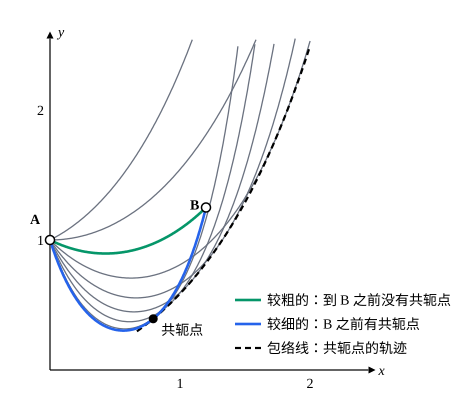

## 这一节要回答的问题

[第二变分与勒让德条件](lesson:math.calculus-of-variations.second-variation)看到，满足:term[勒让德条件]{id="math.calculus-of-variations.legendre-condition"}（Legendre condition）的:term[极值曲线]{id="math.calculus-of-variations.extremal"}（extremal）也可能不是极小：$\int_0^b(y'^2-y^2)\,\dd x$在$b>\pi$时就不是。临界的长度$\pi$是从哪里来的？对一般的:term[泛函]{id="math.calculus-of-variations.functional"}（functional），怎样判断区间是不是「太长」了？

## 讲解

### 雅可比方程

沿一条:term[极值曲线]{id="math.calculus-of-variations.extremal"}，:term[第二变分]{id="math.calculus-of-variations.second-variation"}（second variation）是$\delta^2J=\int_a^b\bigl(P\eta'^2+Q\eta^2\bigr)\dd x$，$P=F_{y'y'}$、$Q=F_{yy}-\dv{}{x}F_{yy'}$都是$x$的已知函数。把它看成以$\eta$为未知函数的二次:term[泛函]{id="math.calculus-of-variations.functional"}，它的:term[欧拉-拉格朗日方程]{id="math.calculus-of-variations.euler-lagrange-equation"}（Euler–Lagrange equation）是$2Q\eta-(2P\eta')'=0$。

::anchor{id="def-jacobi-equation"}
以$h(x)$为未知函数的方程$-(Ph')'+Qh=0$，叫作这条极值曲线的:term[雅可比方程]{id="math.calculus-of-variations.jacobi-equation"}（Jacobi equation）。

为什么这样定义：它有两个来历。一是第二变分的欧拉-拉格朗日方程；二是相邻极值曲线之差满足的方程：若$y(x,\alpha)$对每个$\alpha$都是极值曲线，把它们的方程对$\alpha$求导，$h=\frac{\partial y}{\partial\alpha}$就满足雅可比方程。边界情况：下面总设$P>0$（强化的:term[勒让德条件]{id="math.calculus-of-variations.legendre-condition"}），这时它是二阶齐次线性方程（linear equation），解组成二维的向量空间（见[二阶线性方程的解的结构](lesson:math.ode.second-order-linear)）；$P$在某处为零，方程在那里退化，下面的讨论不适用。

例如$F=p^2-y^2$：$P=2$，$Q=-2$，雅可比方程是$h''+h=0$。直接求导可以验证$\cos x$、$\sin x$都是解，它们线性无关（linearly independent），所以通解（general solution）是$A\cos x+B\sin x$。另一方面，这个泛函的极值曲线满足$y''+y=0$，经过$(0,0)$的是$y=\alpha\sin x$，$\frac{\partial y}{\partial\alpha}=\sin x$，正是雅可比方程的一个解。

### 共轭点

::anchor{id="def-conjugate-point"}
设$P>0$。:term[雅可比方程]{id="math.calculus-of-variations.jacobi-equation"}满足$h(a)=0$、$h'(a)=1$的解只有一个；如果它在$a$的右边又等于零，第一个这样的点$c$叫作$a$的:term[共轭点]{id="math.calculus-of-variations.conjugate-point"}（conjugate point）。

为什么这样定义：从$A=(a,y(a))$出发、初始斜率稍有不同的:term[极值曲线]{id="math.calculus-of-variations.extremal"}，和原来那条的差约为$\Delta\alpha\cdot h(x)$。$h$再次为零的地方，相邻的极值曲线（准到一阶）又和它交在一起；$F=p^2-y^2$时，$y=\alpha\sin x$全都在$x=\pi$处相交，$\pi$就是$0$的共轭点。解的唯一性由常微分方程（ordinary differential equation）的存在唯一性定理（existence and uniqueness theorem）保证，见[解的存在唯一性](lesson:math.ode.existence-uniqueness#thm-systems)。边界情况：共轭点可能根本不存在，例如雅可比方程是$h''=0$时，满足条件的解是$x-a$，它不会再为零。

### 雅可比条件

::anchor{id="thm-jacobi"}
定理（:term[雅可比条件]{id="math.calculus-of-variations.jacobi-condition"}，Jacobi condition）：设沿:term[极值曲线]{id="math.calculus-of-variations.extremal"}$y$处处$P=F_{y'y'}>0$。(1) 若$y$是局部极小，则开区间$(a,b)$内没有$a$的:term[共轭点]{id="math.calculus-of-variations.conjugate-point"}。(2) 若:term[雅可比方程]{id="math.calculus-of-variations.jacobi-equation"}有一个在整个$[a,b]$上恒正的解$h$，则对所有不恒为零、两端为零的$\eta$都有$\delta^2J>0$，并且$y$是局部极小。

(2) 的证明思路：$h$满足雅可比方程时，直接求导可以验证

$$
P\eta'^2+Q\eta^2=P\Bigl(\eta'-\frac{h'}{h}\eta\Bigr)^2+\dv{}{x}\Bigl(\frac{Ph'}{h}\eta^2\Bigr) .
$$

积分以后最后一项因$\eta$两端为零而消失，所以$\delta^2J=\int_a^bP\bigl(\eta'-\frac{h'}{h}\eta\bigr)^2\dd x\ge0$；等号要求$\eta$是$h$的常数倍，而$\eta(a)=0\ne h(a)$，只能$\eta\equiv0$（验证和细节见 p6）。从$\delta^2J>0$推到局部极小还要一些估计，这里不展开。

(1) 的证明思路：若$(a,b)$内有共轭点$c$，取$\eta$在$[a,c]$上等于$h$、在$[c,b]$上为零，分部积分（integration by parts）并用雅可比方程可知$\delta^2J=0$；这个$\eta$在$c$处有个折角，把折角磨圆一点就能使$\delta^2J<0$（p5）。可以证明，(2) 的条件和「$(a,b]$内没有共轭点」等价，所以两半合起来说：区间伸到第一个共轭点为止，极值曲线都是局部极小，再往外就不是。

## 几何图像

:::anim{component="function-plot"}
range: { x: [0, 4], y: [-1.1, 1.1] }
functions:
  - expr: "0.3*sin(x)"
  - expr: "0.6*sin(x)"
  - expr: "-0.3*sin(x)"
  - expr: "-0.6*sin(x)"
  - expr: "a*sin(x)"
    label: |
      $y=\alpha\sin x$
points:
  - { x: "pi", y: "0" }
sliders:
  - name: a
    min: -1
    max: 1
    step: 0.05
    default: 0.9
    label: |
      初始斜率$\alpha$
:::

$\int(y'^2-y^2)\,\dd x$从$(0,0)$出发的:term[极值曲线]{id="math.calculus-of-variations.extremal"}$y=\alpha\sin x$：不管$\alpha$取多少，都在$x=\pi$（图中的点）再次交于一点，那里是$0$的:term[共轭点]{id="math.calculus-of-variations.conjugate-point"}。区间不超过$\pi$时$y=0$是局部极小，超过$\pi$就不是。

肥皂膜（soap film）问题里，从$A$出发的:term[悬链面]{id="math.calculus-of-variations.catenoid"}（catenoid）的母线（generatrix）是一族悬链线（catenary），每条都在包络线（envelope）上和相邻的曲线相交，包络线就是$A$的共轭点的轨迹。经过$B$的悬链线有两条：较粗的（绿色）到$B$之前没有碰到包络线；较细的（蓝色）在$B$之前就碰到了，按:term[雅可比条件]{id="math.calculus-of-variations.jacobi-condition"}它不是局部极小。

## 例题

### 例 1　谐振子型泛函能取多长

$J[y]=\int_0^b\bigl(y'^2-y^2\bigr)\dd x$，$y(0)=y(b)=0$。$b$满足什么条件时，:term[极值曲线]{id="math.calculus-of-variations.extremal"}$y=0$是局部极小？

**为什么想到这么做**：$P=2>0$，:term[勒让德条件]{id="math.calculus-of-variations.legendre-condition"}满足，关键是找$0$的:term[共轭点]{id="math.calculus-of-variations.conjugate-point"}。:term[雅可比方程]{id="math.calculus-of-variations.jacobi-equation"}是常系数的，满足初始条件的解可以直接写出来。

**推导**：雅可比方程$h''+h=0$满足$h(0)=0$、$h'(0)=1$的解是$h=\sin x$，它在$x=\pi$处第一次再为零，$0$的共轭点是$\pi$。$b<\pi$时，把起点挪到$-\delta$，$h=\sin(x+\delta)$在$[0,b]$上恒正（$\delta$取得比$\pi-b$小），由定理的 (2)，$y=0$是局部极小；$b>\pi$时，共轭点在$(0,b)$内，由 (1)，它不是局部极小，和上一节例 1 的结论一致。$b=\pi$时$J[\alpha\sin x]=0$对所有$\alpha$成立，$y=0$仍是最小，但不是唯一的。

### 例 2　哪个悬链面是肥皂膜

两个半径为$R$的圆环放在$x=\pm a$处，[贝尔特拉米恒等式与最速降线](lesson:math.calculus-of-variations.beltrami-identity)例 2 说，$\frac aR$不太大时有两条悬链线$y=c\cosh\frac xc$经过两环。用:term[雅可比方程]{id="math.calculus-of-variations.jacobi-equation"}判断哪一条是局部极小。

**为什么想到这么做**：$y=c\cosh\frac xc$对每个$c$都是:term[极值曲线]{id="math.calculus-of-variations.extremal"}，所以$h=\frac{\partial y}{\partial c}$满足雅可比方程，不用另外解方程。看它在$[-a,a]$上是不是恒正。

**推导**：记$t=\frac xc$，$h=\frac{\partial}{\partial c}\Bigl(c\cosh\frac xc\Bigr)=\cosh t-t\sinh t$。它是偶函数，$h(0)=1>0$，$h'$在$t>0$时为负，零点满足$t\tanh t=1$，即$t=\pm t_*$，$t_*\approx1.200$，正是那一节例 2 里的同一个数。$P=\frac{c}{\cosh^2(x/c)}>0$。

- 若$\frac ac<t_*$，$h$在$[-a,a]$上恒正，由定理的 (2)，这个:term[悬链面]{id="math.calculus-of-variations.catenoid"}是局部极小。
- 若$\frac ac>t_*$，取$\eta$在$|x|\le ct_*$上等于$h$、在别处为零，和定理 (1) 的证明一样可以使$\delta^2J<0$，它不是局部极小。

那一节例 2 的两个解里，较粗的（$c$较大）满足$\frac ac<t_*$，较细的满足$\frac ac>t_*$，所以肥皂膜是较粗的那个。两环拉开到临界距离时两个解合并，正好$\frac ac=t_*$，再拉开就没有局部极小，肥皂膜破裂。

## 常见误区

- 「:term[共轭点]{id="math.calculus-of-variations.conjugate-point"}就是另一条:term[极值曲线]{id="math.calculus-of-variations.extremal"}和它的交点。」是从同一个起点出发、和它无限接近的那些极值曲线（准到一阶）和它再次相交的地方，也就是一族曲线的包络线和它相切的点。
- 「过了共轭点，曲线就不满足:term[欧拉-拉格朗日方程]{id="math.calculus-of-variations.euler-lagrange-equation"}了。」它仍然是极值曲线，只是不再是局部极小。
- 「没有共轭点，就是所有曲线里最小的。」:term[雅可比条件]{id="math.calculus-of-variations.jacobi-condition"}只给出局部极小；要说明是全局最小，还要别的论证，例如[第二变分与勒让德条件](lesson:math.calculus-of-variations.second-variation)p6 的凸性（convexity）。
- 「欧拉-拉格朗日方程是非线性的，:term[雅可比方程]{id="math.calculus-of-variations.jacobi-equation"}也很难解。」雅可比方程总是线性的；而且只要知道一族极值曲线，对参数求导就得到它的解，例 2 就是这样做的。
