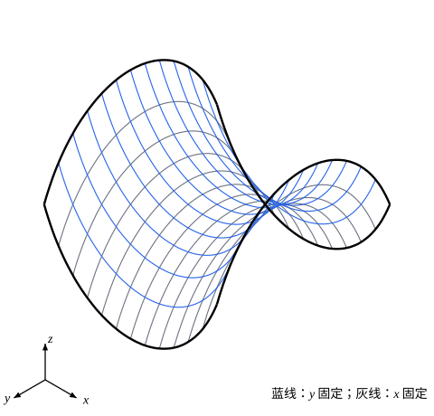

## 这一节要回答的问题

绷在铁丝框上的肥皂膜（soap film）、四周固定的一块薄膜（membrane），形状都是一个二元函数$u(x,y)$。:term[泛函]{id="math.calculus-of-variations.functional"}（functional）写成区域上的二重积分时，:term[欧拉-拉格朗日方程]{id="math.calculus-of-variations.euler-lagrange-equation"}（Euler–Lagrange equation）变成什么样？「面积最小」和「能量最小」又各给出什么方程？

## 讲解

### 二重积分型的泛函

设$D$是平面上的有界区域，边界$\partial D$是分段光滑的闭曲线。考虑

$$
J[u]=\iint_DF(x,y,u,u_x,u_y)\,\dd x\,\dd y ,
$$

$u$在$D$及其边界上有连续的二阶偏导数（partial derivative），在边界上取给定的值。例如肥皂膜$z=u(x,y)$的面积：由参数曲面（parametric surface）$\mathbf r=(x,y,u(x,y))$的面积公式，$|\mathbf r_x\times\mathbf r_y|=\sqrt{1+u_x^2+u_y^2}$，所以$F=\sqrt{1+u_x^2+u_y^2}$。

把$u$换成$u+\varepsilon\eta$，$\eta$在边界上为零。和一元时一样，

$$
\delta J=\iint_D\bigl(F_u\eta+F_{u_x}\eta_x+F_{u_y}\eta_y\bigr)\dd x\,\dd y .
$$

一元时靠分部积分（integration by parts）把$\eta'$挪走，这里靠格林公式（Green's theorem）：取$P=F_{u_x}\eta$、$Q=F_{u_y}\eta$，$\iint_D(P_x+Q_y)\,\dd x\,\dd y=\oint_{\partial D}(P\,\dd y-Q\,\dd x)$，右边因$\eta=0$而为零。展开$P_x+Q_y$，得

$$
\delta J=\iint_D\Bigl(F_u-\frac{\partial}{\partial x}F_{u_x}-\frac{\partial}{\partial y}F_{u_y}\Bigr)\eta\,\dd x\,\dd y .
$$

这里$\frac{\partial}{\partial x}F_{u_x}$是先代入$u(x,y)$、$u_x$、$u_y$，再固定$y$对$x$求导，$u$、$u_x$、$u_y$都跟着变。

::anchor{id="thm-fundamental-lemma-2d"}
引理（二维的:term[变分法基本引理]{id="math.calculus-of-variations.fundamental-lemma"}，fundamental lemma of the calculus of variations）：设$g$在$D$及其边界上连续。如果对所有有连续一阶偏导数、在边界上为零的$\eta$，都有$\iint_Dg\,\eta\,\dd x\,\dd y=0$，那么$g$在$D$内恒为零。

证明思路：假如某点$P_0\in D$处$g(P_0)>0$，由连续性，$g$在以$P_0$为圆心的某个小圆盘里都是正的。取$\eta=(\rho^2-r^2)^2$（$r$是到$P_0$的距离，$\rho$是小圆盘的半径），在圆盘外取$0$，它有连续的一阶偏导数、在边界上为零，而$\iint_Dg\,\eta\,\dd x\,\dd y>0$，矛盾（完整的证明见 p5）。

::anchor{id="thm-el-2d"}
定理（二元函数的:term[欧拉-拉格朗日方程]{id="math.calculus-of-variations.euler-lagrange-equation"}）：设$F$有连续的二阶偏导数。如果$J[u]$在$u$处取局部极值，那么在$D$内

$$
F_u-\frac{\partial}{\partial x}F_{u_x}-\frac{\partial}{\partial y}F_{u_y}=0 .
$$

证明思路：局部极值处$\delta J=0$对所有$\eta$成立，由上面的式子和二维的基本引理即得。方程一般是二阶偏微分方程（partial differential equation），边界上的值就是它的边界条件。把$y$换成时间$t$，就是分析力学里场的运动方程（[场的拉格朗日表述](lesson:physics.analytical-mechanics.field-lagrangian)）。

### 狄利克雷积分与拉普拉斯方程

::anchor{id="def-dirichlet-integral"}
$D[u]=\frac12\iint_D\bigl(u_x^2+u_y^2\bigr)\dd x\,\dd y$叫作$u$的:term[狄利克雷积分]{id="math.calculus-of-variations.dirichlet-integral"}（Dirichlet integral）。

为什么这样定义：它衡量$u$在区域里起伏得有多厉害，常函数的狄利克雷积分为零。一块绷紧的薄膜，偏离平面的位移是$u$、坡度很小时，弹性势能近似正比于它；它也是只依赖梯度（gradient）大小、在旋转下不变的最简单的二次:term[泛函]{id="math.calculus-of-variations.functional"}。边界情况：给定的边界值不是常数时，满足边界条件的函数$D[u]$都大于零；而有些边界值很「粗糙」时，所有满足边界条件的函数的狄利克雷积分都是无穷大（p7）。

$F=\frac12(p^2+q^2)$，$F_u=0$，$F_{u_x}=u_x$，$F_{u_y}=u_y$，方程是$u_{xx}+u_{yy}=0$。反过来，满足这个方程的函数确实使$D$最小：

::anchor{id="thm-dirichlet-principle"}
定理（:term[狄利克雷原理]{id="math.calculus-of-variations.dirichlet-principle"}，Dirichlet principle）：设$u$在$D$内满足拉普拉斯方程（Laplace's equation）$u_{xx}+u_{yy}=0$，并取给定的边界值。那么对每个取同样边界值的:term[容许函数]{id="math.calculus-of-variations.admissible-function"}（admissible function）$v$，都有$D[v]\ge D[u]$，等号只在$v=u$时成立。

证明：记$v=u+\eta$，$\eta$在边界上为零，则$D[v]=D[u]+\iint_D(u_x\eta_x+u_y\eta_y)\,\dd x\,\dd y+D[\eta]$。中间一项按上面用格林公式的办法化成$-\iint_D(u_{xx}+u_{yy})\eta\,\dd x\,\dd y=0$，所以$D[v]=D[u]+D[\eta]\ge D[u]$。等号要求$\eta_x=\eta_y=0$，$\eta$是常数，而它在边界上为零，所以$\eta\equiv0$。拉普拉斯方程在偏微分方程里会专门讲（[拉普拉斯方程与调和函数](lesson:math.pde.laplace-equation)）。

### 极小曲面方程

面积$A[u]=\iint_D\sqrt{1+u_x^2+u_y^2}\,\dd x\,\dd y$。记$W=\sqrt{1+u_x^2+u_y^2}$，$F_{u_x}=\frac{u_x}{W}$，$F_{u_y}=\frac{u_y}{W}$，$F_u=0$，方程是$\frac{\partial}{\partial x}\frac{u_x}{W}+\frac{\partial}{\partial y}\frac{u_y}{W}=0$。展开再乘$W^3$，

$$
\bigl(1+u_y^2\bigr)u_{xx}-2u_xu_yu_{xy}+\bigl(1+u_x^2\bigr)u_{yy}=0 .
$$

::anchor{id="def-minimal-surface"}
满足这个方程的函数$u$的图像叫作:term[极小曲面]{id="math.calculus-of-variations.minimal-surface"}（minimal surface），这个方程叫作极小曲面方程（minimal surface equation）。

为什么这样定义：它是面积的:term[第一变分]{id="math.calculus-of-variations.first-variation"}（first variation）为零的条件，铁丝框上的肥皂膜在表面张力（surface tension）作用下停在这样的曲面上。名字是历史沿用的，方程只保证面积取驻值（stationary value），不一定是最小：[贝尔特拉米恒等式与最速降线](lesson:math.calculus-of-variations.beltrami-identity)里较细的那个:term[悬链面]{id="math.calculus-of-variations.catenoid"}（catenoid）也满足同样的条件，面积却比较粗的那个大。边界情况：平面$u=ax+by+c$的二阶导数全为零，是极小曲面；坡度很小时$W\approx1$，方程近似为拉普拉斯方程，绷得很平的肥皂膜和薄膜满足同一个方程。

## 几何图像

这是$z=\ln\cos y-\ln\cos x$在$|x|,|y|\le1.2$上的一块，例 2 验证它是:term[极小曲面]{id="math.calculus-of-variations.minimal-surface"}，十九世纪舍尔克（Heinrich Scherk）找到了它。蓝线沿$x$方向向上弯，灰线沿$y$方向向下弯，在每一点两者弯曲的程度正好抵消，例 2 的计算说的就是这件事。粗线是边界，像一个弯曲的铁丝框，中间的曲面就是框上的肥皂膜。

## 例题

### 例 1　狄利克雷原理的一次验证

在单位正方形$D=[0,1]^2$上，$u=xy$满足拉普拉斯方程。$v=xy+x(1-x)y(1-y)$和$u$的边界值相同。比较$D[u]$和$D[v]$。

**为什么想到这么做**：按:term[狄利克雷原理]{id="math.calculus-of-variations.dirichlet-principle"}的证明，$D[v]=D[u]+D[\eta]$，$\eta=x(1-x)y(1-y)$，交叉项为零。只要分别算$D[u]$和$D[\eta]$，再直接算一遍$D[v]$核对。

**推导**：$D[u]=\frac12\iint_D(y^2+x^2)\,\dd x\,\dd y=\frac12\bigl(\frac13+\frac13\bigr)=\frac13$。$\eta_x=(1-2x)\,y(1-y)$，$\iint_D\eta_x^2\,\dd x\,\dd y=\int_0^1(1-2x)^2\,\dd x\int_0^1y^2(1-y)^2\,\dd y=\frac13\cdot\frac1{30}=\frac1{90}$，$\eta_y$同样，所以$D[\eta]=\frac1{90}$，$D[v]=\frac13+\frac1{90}=\frac{31}{90}$。直接算$v_x=y+(1-2x)y(1-y)$，$\frac12\iint_Dv_x^2\,\dd x\,\dd y=\frac16+0+\frac1{180}$（交叉项$\int_0^1(1-2x)\,\dd x=0$），$v_y$同样，合起来也是$\frac{31}{90}$。

### 例 2　舍尔克曲面

验证$u=\ln\cos y-\ln\cos x$（$|x|,|y|<\frac\pi2$）满足极小曲面方程。

**为什么想到这么做**：$u$是「$x$的函数加$y$的函数」，混合偏导数$u_{xy}=0$，方程的中间一项消失，只需检查剩下两项。

**推导**：$u_x=\tan x$，$u_y=-\tan y$，$u_{xx}=\frac{1}{\cos^2x}$，$u_{yy}=-\frac{1}{\cos^2y}$，$u_{xy}=0$。于是

$$
\bigl(1+\tan^2y\bigr)\frac{1}{\cos^2x}-\bigl(1+\tan^2x\bigr)\frac{1}{\cos^2y}=\frac{1}{\cos^2y\cos^2x}-\frac{1}{\cos^2x\cos^2y}=0 .
$$

反过来，假设:term[极小曲面]{id="math.calculus-of-variations.minimal-surface"}形如$u=f(x)+g(y)$，方程化成$\frac{f''}{1+f'^2}=-\frac{g''}{1+g'^2}$，两边分别只依赖$x$和$y$，只能等于同一个常数，舍尔克曲面就是这样找到的（常数为$1$的情形）。

## 常见误区

- 「$\frac{\partial}{\partial x}F_{u_x}$是把$u$看成不动，只对$F_{u_x}$里显含的$x$求偏导。」$u$、$u_x$、$u_y$都随$x$变，要按链式法则（chain rule）全部算进去；对:term[狄利克雷积分]{id="math.calculus-of-variations.dirichlet-integral"}，它给出的是$u_{xx}$。
- 「:term[极小曲面]{id="math.calculus-of-variations.minimal-surface"}就是面积最小的曲面。」方程只保证面积取驻值；较细的:term[悬链面]{id="math.calculus-of-variations.catenoid"}就是一个满足方程却不取最小的例子。
- 「满足拉普拉斯方程的函数使狄利克雷积分最小，所以任给边界值，总能找到一个使它最小的函数，再由它得到方程的解。」后半句是历史上的:term[狄利克雷原理]{id="math.calculus-of-variations.dirichlet-principle"}的反向用法，最小值的存在并不显然，见 p7。
- 「边界上$\eta=0$，所以格林公式里的边界积分总会消失。」那是因为边界值给定；边界值不给定的部分会留下边界积分，给出二维的:term[自然边界条件]{id="math.calculus-of-variations.natural-boundary-condition"}（natural boundary condition，p8）。
