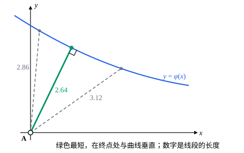

## 这一节要回答的问题

前几节的:term[变分问题]{id="math.calculus-of-variations.variational-problem"}（variational problem）两个端点都是给定的。如果只规定起点，终点可以在一条竖直线上任意选，或者在一条曲线上滑动，最优的曲线在终点处要满足什么条件？这个条件又是从哪里来的？

## 讲解

### 自由端点

从$A=(0,0)$到竖直线$x=1$的最短曲线，显然是水平的线段，它和那条竖直线垂直。用变分法看，终点的高度$y(1)$不给定，可以随意挑；下面看「可以随意挑」会给:term[极值曲线]{id="math.calculus-of-variations.extremal"}（extremal）加上什么条件。

设$J[y]=\int_a^bF(x,y,y')\,\dd x$只给定$y(a)=y_a$，$y(b)$不限。参加比较的函数只需满足左端的条件，所以$\eta$只要求$\eta(a)=0$。照[第一变分与欧拉-拉格朗日方程](lesson:math.calculus-of-variations.euler-lagrange)的算法分部积分（integration by parts），右端的边界项不再消失：

$$
\delta J=\int_a^b\Bigl(F_y-\dv{}{x}F_{y'}\Bigr)\eta\,\dd x+F_{y'}\big|_{x=b}\,\eta(b) .
$$

如果$J$在$y$处取局部极值，对所有这样的$\eta$都有$\delta J=0$。先只取$\eta(b)=0$的$\eta$，由:term[变分法基本引理]{id="math.calculus-of-variations.fundamental-lemma"}（fundamental lemma of the calculus of variations），$y$满足:term[欧拉-拉格朗日方程]{id="math.calculus-of-variations.euler-lagrange-equation"}（Euler–Lagrange equation），积分那一项为零。剩下$F_{y'}\big|_{x=b}\,\eta(b)=0$，而$\eta(b)$可以任取，所以$F_{y'}\big|_{x=b}=0$。

::anchor{id="def-natural-boundary-condition"}
端点$x=b$处的值不给定时，局部极值在那里满足的条件$F_{y'}\big|_{x=b}=0$，叫作:term[自然边界条件]{id="math.calculus-of-variations.natural-boundary-condition"}（natural boundary condition）；左端点不给定时，同样有$F_{y'}\big|_{x=a}=0$。

为什么这样定义：它不是题目给的，而是由「取极值」自动产生的，所以叫「自然」；二阶方程需要两个条件，给定的$y(a)=y_a$加上它，正好定出两个常数。对开头的例子，$F=\sqrt{1+p^2}$，$F_{y'}=\frac{y'}{\sqrt{1+y'^2}}=0$给出$y'(1)=0$，直线水平地到达竖直线，和直觉一致。边界情况：两个端点都不给定时，两端都要满足自然边界条件，这两个条件可能互相矛盾，这时极值曲线不存在（p5）。

### 终点在曲线上滑动

现在终点要落在曲线$y=\varphi(x)$上，终点的横坐标也不给定。设极值在$y$处取到，终点横坐标是$b$，$y(b)=\varphi(b)$。比较的曲线写成$y+\varepsilon\eta$，定义在$[a,\,b+\varepsilon\xi]$上（把$y$在$b$的右边光滑地延长一点），$\eta(a)=0$，终点仍在曲线上：$y(b+\varepsilon\xi)+\varepsilon\eta(b+\varepsilon\xi)=\varphi(b+\varepsilon\xi)$。对$\varepsilon$求导再令$\varepsilon=0$，得$y'(b)\xi+\eta(b)=\varphi'(b)\xi$，即$\eta(b)=(\varphi'-y')\xi$。

积分的上限也随$\varepsilon$变，由微积分基本定理（fundamental theorem of calculus），$J$对$\varepsilon$的导数多出一项：

$$
\dv{}{\varepsilon}J\Big|_{\varepsilon=0}=F\big|_{x=b}\,\xi+\int_a^b\Bigl(F_y-\dv{}{x}F_{y'}\Bigr)\eta\,\dd x+F_{y'}\big|_{x=b}\,\eta(b) .
$$

和上一小节一样，先推出$y$是:term[极值曲线]{id="math.calculus-of-variations.extremal"}，积分为零；再代入$\eta(b)$，得$\bigl[F+(\varphi'-y')F_{y'}\bigr]_{x=b}\,\xi=0$，而$\xi$可以任取。

::anchor{id="def-transversality-condition"}
终点在曲线$y=\varphi(x)$上滑动时，局部极值在终点满足的条件$\bigl[F+(\varphi'-y')F_{y'}\bigr]_{x=b}=0$，叫作:term[横截条件]{id="math.calculus-of-variations.transversality-condition"}（transversality condition）。

为什么这样定义：终点沿曲线挪动时，曲线既在横向伸长了$\xi$，又在纵向跟着变了$\eta(b)$，横截条件要求这两部分的一阶影响合起来为零。边界情况：端点曲线越来越陡（$\varphi'\to\infty$）时，两边除以$\varphi'$，条件趋于$F_{y'}=0$，回到竖直线上的:term[自然边界条件]{id="math.calculus-of-variations.natural-boundary-condition"}；端点曲线水平（$\varphi'=0$）时，条件是$F-y'F_{y'}=0$。

长度一类的:term[泛函]{id="math.calculus-of-variations.functional"}（functional）$F=n(x,y)\sqrt{1+p^2}$（$n>0$），横截条件化成$\frac{n(1+\varphi'y')}{\sqrt{1+y'^2}}=0$，即$\varphi'y'=-1$：极值曲线和端点曲线在终点处垂直。一般的$F$没有这个性质（p4）。

## 几何图像

长度的:term[极值曲线]{id="math.calculus-of-variations.extremal"}是直线。终点在蓝色曲线上滑动时，最短的那条（绿色）在终点处和曲线垂直，这就是长度的:term[横截条件]{id="math.calculus-of-variations.transversality-condition"}；终点挪到别处，线段都更长。

:::anim{component="function-plot"}
range: { x: [0, 1], y: [-1.6, 1.1] }
functions:
  - expr: "x^2/2 + c*x"
    label: |
      $y=\frac{x^2}{2}+cx$
  - expr: "1/2 + c + (1 + c)*(x - 1)"
    label: |
      在$x=1$处的切线
sliders:
  - name: c
    min: -2
    max: 0.5
    step: 0.05
    default: 0
    label: |
      常数$c$
:::

:::anim{component="function-plot"}
range: { x: [-2, 0.5], y: [-0.5, 2.1] }
functions:
  - expr: "x^2 + 2*x + 2/3"
    label: |
      $J\bigl[\frac{x^2}{2}+cx\bigr]$，横轴是$c$
points:
  - { x: "c", y: "c^2 + 2*c + 2/3" }
sliders:
  - name: c
    min: -2
    max: 0.5
    step: 0.05
    default: 0
    label: |
      常数$c$
:::

两张图对应例 1：$y=\frac{x^2}{2}+cx$都满足:term[欧拉-拉格朗日方程]{id="math.calculus-of-variations.euler-lagrange-equation"}和$y(0)=0$，右端的高度随$c$变。下图是$J$随$c$的变化，最低点在$c=-1$；把上图的$c$也拖到$-1$，切线变成水平的，这正是:term[自然边界条件]{id="math.calculus-of-variations.natural-boundary-condition"}$y'(1)=0$。

## 例题

### 例 1　右端自由

求$J[y]=\int_0^1\bigl(y'^2+2y\bigr)\dd x$在$y(0)=0$、$y(1)$不给定时的:term[极值曲线]{id="math.calculus-of-variations.extremal"}，并说明它使$J$最小。

**为什么想到这么做**：右端自由，极值曲线要同时满足:term[欧拉-拉格朗日方程]{id="math.calculus-of-variations.euler-lagrange-equation"}、$y(0)=0$和右端的:term[自然边界条件]{id="math.calculus-of-variations.natural-boundary-condition"}，三个条件正好定出二阶方程的解。$J$是二次的，最小性可以照那一节例 1 的办法直接展开。

**推导**：$F_y=2$，$F_{y'}=2y'$，方程是$y''=1$，由$y(0)=0$得$y=\frac{x^2}{2}+C_1x$。自然边界条件$F_{y'}\big|_{x=1}=2y'(1)=0$给出$1+C_1=0$，所以$y=\frac{x^2}{2}-x$。任取$\eta$，$\eta(0)=0$，

$$
J[y+\eta]=J[y]+\int_0^1\bigl(2y'\eta'+2\eta\bigr)\dd x+\int_0^1\eta'^2\,\dd x ,
$$

中间一项分部积分后是$\int_0^1(2-2y'')\eta\,\dd x+2y'(1)\eta(1)=0$，所以$J[y+\eta]\ge J[y]$，最小值是$J\bigl[\frac{x^2}{2}-x\bigr]=-\frac13$。如果端点也像以前那样固定，就不会有$y'(1)=0$这个条件，是自然边界条件挑出了最好的端点高度。

### 例 2　到一条曲线的最短距离

求从$A=(0,0)$到曲线$y=\varphi(x)=3-0.6x+0.05x^2$的最短曲线（几何图像里的那条）。

**为什么想到这么做**：长度的:term[极值曲线]{id="math.calculus-of-variations.extremal"}是直线，终点在曲线上滑动，用:term[横截条件]{id="math.calculus-of-variations.transversality-condition"}，它对长度就是「垂直」。

**推导**：极值曲线是$y=kx$，终点$(t,\varphi(t))$，$k=\frac{\varphi(t)}{t}$。垂直的条件$\varphi'(t)\,k=-1$即$t+\varphi(t)\varphi'(t)=0$，也就是向量$(t,\varphi(t))$和:term[切向量]{id="math.vector-calculus.tangent-vector"}（tangent vector）$(1,\varphi'(t))$的点积为零。代入$\varphi$，用二分法解得$t\approx1.152$，最短距离$\sqrt{t^2+\varphi(t)^2}\approx2.640$。这个方程和直接对$t^2+\varphi(t)^2$求导所得的一样：终点只有一个:term[自由度]{id="physics.analytical-mechanics.degrees-of-freedom"}（degree of freedom）时，变分法的条件退化成了一元函数的极值条件。

## 常见误区

- 「端点不给定，那里就没有条件。」:term[自然边界条件]{id="math.calculus-of-variations.natural-boundary-condition"}是取极值自动给出的，少了它，方程的解定不下来。
- 「自然边界条件总是$y'=0$。」它是$F_{y'}=0$，具体是什么要看$F$。例如$F=y'^2+2xy'$时，$F_{y'}=2y'+2x$，条件是$y'(b)=-b$。
- 「:term[横截条件]{id="math.calculus-of-variations.transversality-condition"}就是垂直。」只有$F=n(x,y)\sqrt{1+y'^2}$这一类才是；一般的$F$在终点处和端点曲线不一定垂直（p4）。
- 「终点在曲线上滑动时，只要满足:term[欧拉-拉格朗日方程]{id="math.calculus-of-variations.euler-lagrange-equation"}就行。」还要加上终点在曲线上、横截条件两个条件，它们定出终点的位置和方程里的常数。
