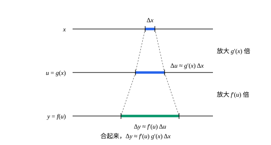

## 这一节要回答的问题

$(x^2+1)^{10}$展开有$11$项，逐项求导很费事；$\sqrt{1+x^2}$干脆没法展开。它们都是「函数套函数」：先算$u=x^2+1$，再算$u^{10}$或$\sqrt u$。这样的函数，:term[导数]{id="math.calculus.derivative"}（derivative）能不能由里外两层各自的导数算出来？

## 讲解

### 链式法则

先看一个能展开的例子。$y=(3x+1)^2=9x^2+6x+1$，$y'=18x+6=2(3x+1)\cdot3$：外层$y=u^2$对$u$的:term[导数]{id="math.calculus.derivative"}是$2u$，里层$u=3x+1$对$x$的导数是$3$，复合函数（composite function）的导数正好是两者的乘积。这不是巧合：$x$变一点，$u$的变化是它的$3$倍；$u$变一点，$y$的变化是它的$2u$倍；所以$y$的变化大约是$x$的变化的$2u\cdot3$倍。

::anchor{id="thm-chain-rule"}
**:term[链式法则]{id="math.calculus.chain-rule"}（chain rule）**　设$u=g(x)$在$x$处:term[可导]{id="math.calculus.differentiable"}（differentiable），$y=f(u)$在$u=g(x)$处可导，则复合函数$y=f(g(x))$在$x$处可导，并且$\bigl(f(g(x))\bigr)'=f'(g(x))\,g'(x)$，也写成$\dv yx=\dv yu\cdot\dv ux$。

道理：$x$的增量（increment）是$\Delta x$时，$u$的增量是$\Delta u=g(x+\Delta x)-g(x)$，$y$的增量是$\Delta y=f(u+\Delta u)-f(u)$。假定$\Delta x$足够小时$\Delta u\ne0$，就可以把:term[差商]{id="math.calculus.difference-quotient"}（difference quotient）拆成两个差商相乘：$\frac{\Delta y}{\Delta x}=\frac{\Delta y}{\Delta u}\cdot\frac{\Delta u}{\Delta x}$。$\Delta x\to0$时，$g$可导所以:term[连续]{id="math.calculus.continuous"}（continuous），$\Delta u\to0$，由[连续与间断](lesson:math.calculus.continuity)里换元的定理，第一个因子趋于$f'(u)$；第二个因子趋于$g'(x)$，乘起来就是结论。

上面假定了$\Delta x$很小时$\Delta u\ne0$，这正是换元的定理要的条件。如果$g$在$x$附近又取到$g(x)$这个值，比如$g$是常数，或者像$x^2\sin\frac1x$（$x=0$时取$0$）那样在$0$附近无穷多次回到$0$，第一个分式就没有意义。结论照样成立，只是要换一种写法绕开除以零，见数学分析的[可导性与链式法则的证明](lesson:math.analysis.differentiability)和第 5 题。

为什么叫「链式」：函数一层套一层时，导数是从外到里各层导数的连乘，像一节节链条，比如$\bigl(f(g(h(x)))\bigr)'=f'(g(h(x)))\cdot g'(h(x))\cdot h'(x)$。边界情况：链式法则的条件够用，但不是非有不可，$|x|$在$0$处不可导，$|x|^2=x^2$却可导（第 7 题）。

### 怎样用

求复合函数的:term[导数]{id="math.calculus.derivative"}，先认出外层和里层：设$u$是里层，外层是$u$的函数，两层分别求导再相乘，最后把$u$换回$x$。下面几种最常见（$n$是整数，分母不为零）：

$$
\bigl([g(x)]^n\bigr)'=n[g(x)]^{n-1}g'(x),\qquad \bigl(\sqrt{g(x)}\bigr)'=\frac{g'(x)}{2\sqrt{g(x)}},\qquad \bigl(f(ax+b)\bigr)'=af'(ax+b).
$$

第一个的外层用[求导的四则运算法则](lesson:math.calculus.derivative-rules)里的:term[幂法则]{id="math.calculus.power-rule"}（power rule），第二个的外层用[导数的定义](lesson:math.calculus.derivative)例 1 的$(\sqrt u)'=\frac1{2\sqrt u}$。第三个的里层是一次函数，导数是常数$a$，以后最常用。

$\dv yx=\dv yu\cdot\dv ux$看上去像是约掉了$\dd u$，很好记。但这只是记号上的方便：:term[链式法则]{id="math.calculus.chain-rule"}的道理在上面，不在「约分」。

## 几何图像

$x$附近的一小段，经过$g$变成$u$轴上大约$g'(x)$倍长的一段，再经过$f$变成大约$f'(u)$倍长的一段，两次放大的倍数相乘，就是:term[链式法则]{id="math.calculus.chain-rule"}。图里画的是$g'(x)=3$、$f'(u)=2$；倍数是负数时，小段还会掉个头。

## 例题

### 例 1　逐层求导

求$y=(x^2+1)^{10}$和$y=\sqrt{1+x^2}$的:term[导数]{id="math.calculus.derivative"}。

**为什么想到这么做**：两个都是「先算$u=x^2+1$，再算关于$u$的一个简单函数」，外层分别是$u^{10}$和$\sqrt u$，它们的导数都会求，用:term[链式法则]{id="math.calculus.chain-rule"}。

**推导**：$y=u^{10}$，$u=x^2+1$，所以$y'=10u^9\cdot2x=20x(x^2+1)^9$。$y=\sqrt u$，$u=1+x^2$，所以$y'=\frac1{2\sqrt u}\cdot2x=\frac{x}{\sqrt{1+x^2}}$。两个都不用展开，也不用回到:term[差商]{id="math.calculus.difference-quotient"}。

### 例 2　乘积里套着复合函数

求$y=x\sqrt{1-x^2}$（$-1<x<1$）的:term[导数]{id="math.calculus.derivative"}，并找出曲线上:term[切线]{id="math.calculus.tangent-line"}（tangent line）水平的点。

**为什么想到这么做**：$y$是$x$和$\sqrt{1-x^2}$的乘积，先用:term[乘积法则]{id="math.calculus.product-rule"}（product rule）；第二个因子是复合函数，对它用:term[链式法则]{id="math.calculus.chain-rule"}。切线水平，就是$y'=0$。

**推导**：$\bigl(\sqrt{1-x^2}\bigr)'=\frac{-2x}{2\sqrt{1-x^2}}=-\frac{x}{\sqrt{1-x^2}}$，所以$y'=\sqrt{1-x^2}-\frac{x^2}{\sqrt{1-x^2}}=\frac{1-2x^2}{\sqrt{1-x^2}}$。$y'=0$即$x=\pm\frac1{\sqrt2}$，对应的点是$\bigl(\frac1{\sqrt2},\frac12\bigr)$和$\bigl(-\frac1{\sqrt2},-\frac12\bigr)$。

## 常见误区

- 「里层不用管，$\bigl(f(g(x))\bigr)'=f'(g(x))$。」$\bigl((3x+1)^2\bigr)'=6(3x+1)$，不是$2(3x+1)$，漏了里层的:term[导数]{id="math.calculus.derivative"}$3$。
- 「外层的导数在$x$处取值，$\bigl(f(g(x))\bigr)'=f'(x)g'(x)$。」外层的导数要在$u=g(x)$处取值：$\bigl((x^2+1)^{10}\bigr)'=10(x^2+1)^9\cdot2x$，不是$10x^9\cdot2x$。
- 「$f(g(x))$和$g(f(x))$的导数一样。」取$f(u)=u^2$、$g(x)=x+1$：$(x+1)^2$的导数是$2(x+1)$，$x^2+1$的导数是$2x$。
