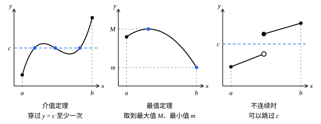

## 这一节要回答的问题

方程$\cos x=x$没有求根公式。可是$g(x)=\cos x-x$在$x=0$处是$1$，在$x=\frac\pi2$处是$-\frac\pi2$，图像从横轴上方走到下方，中间总得穿过横轴。这个「总得穿过」靠的是什么？

在闭区间上求最大值、最小值时，为什么从来不担心最值不存在？这两件事都要求函数:term[连续]{id="math.calculus.continuous"}（continuous），区间是闭的。

## 讲解

### 有界与最值

::anchor{id="def-bounded"}
设$f$在区间$I$上有定义。如果存在正数$M$，使$I$里所有的$x$都满足$|f(x)|\le M$，就说$f$在$I$上有界，也说$f$是$I$上的:term[有界函数]{id="math.calculus.bounded-function"}（bounded function）。

为什么这样定义：有界说的是函数值关在一个范围$[-M,M]$里，冲不出去，一个也不能漏。有界不有界和区间有关：$\tan x$在$\bigl(-\frac\pi2,\frac\pi2\bigr)$上无界，$x\to\frac\pi2^-$时它是:term[无穷大]{id="math.calculus.infinity"}（infinity）；同一个函数在$[-1,1]$上就有界，$|\tan x|\le\tan1$。

::anchor{id="def-max-min"}
如果区间$I$里有一点$x_0$，使$I$里所有的$x$都满足$f(x)\le f(x_0)$，就说$f(x_0)$是$f$在$I$上的最大值（maximum value）；把$\le$换成$\ge$，就是最小值（minimum value）。

为什么这样定义：要紧的是「取得到」，最大值必须是某一点处的函数值。$x^2$在开区间$(-1,1)$上的值越来越靠近$1$，却碰不到$1$，所以它在$(-1,1)$上没有最大值；最小值是$0$，在$x=0$处取到。

### 最值定理

::anchor{id="thm-extreme-value"}
**:term[最值定理]{id="math.calculus.extreme-value-theorem"}（extreme value theorem）**　闭区间$[a,b]$上的:term[连续函数]{id="math.calculus.continuous"}（continuous function）在$[a,b]$上有界，并且取得到最大值和最小值。

道理：在$[a,b]$里取一串点，让$f$在这些点的值越来越接近$f$能达到的「最高处」（$f$无界的话，就让函数值越来越大）。这串点跑不出$[a,b]$，从中可以挑出一部分，挤向某一点$c$；区间包括两个端点，$c$仍在$[a,b]$里。$f$在$c$处连续，挤向$c$的那些点上的函数值都靠近$f(c)$；$f(c)$是一个数，不是:term[无穷大]{id="math.calculus.infinity"}，所以函数值不可能越来越大，$f$有界。同样，那个「最高处」就是$f(c)$，它是最大值。

「挑出一部分挤向一点」要用到实数没有空隙，严格的证明见数学分析的[有界性定理与最值定理](lesson:math.analysis.extreme-value)，这里不证。这个道理只用到三件事：函数连续；点跑不出去；挤到的那一点还在范围里。所以它在圆周、闭矩形这类有界又包括边界的集合上照样成立。

两个条件缺一不可，各对应道理里的一步。区间是开的，挤到的$c$可能是被挖掉的端点：$x^2$在$(-1,1)$上取不到最大值，$\tan x$在$\bigl(-\frac\pi2,\frac\pi2\bigr)$上无界。函数不连续，$f(c)$可能和附近合不上：$x-\lfloor x\rfloor$（$\lfloor x\rfloor$是不超过$x$的最大整数）在$[0,1]$上的值从$0$一直增大到接近$1$，可在$x=1$处突然变回$0$，最大值取不到。

### 介值定理

::anchor{id="thm-intermediate-value"}
**:term[介值定理]{id="math.calculus.intermediate-value-theorem"}（intermediate value theorem）**　设$f$在$[a,b]$上:term[连续]{id="math.calculus.continuous"}，$c$严格介于$f(a)$与$f(b)$之间，那么至少有一点$\xi\in(a,b)$，使$f(\xi)=c$。

::anchor{id="thm-zero"}
**:term[零点定理]{id="math.calculus.zero-theorem"}（Bolzano's theorem）**　设$f$在$[a,b]$上连续，$f(a)$与$f(b)$异号，那么至少有一点$\xi\in(a,b)$，使$f(\xi)=0$。

零点定理是介值定理里$c=0$的情形；反过来，对$f(x)-c$用零点定理，就得到介值定理。道理：图像是一笔画下来的，从直线$y=c$的一侧走到另一侧，跳不过去，总得在某处碰到它。证明同样要用到实数没有空隙（只在有理数上就不对），见数学分析的[介值定理](lesson:math.analysis.intermediate-value)，这里不证。

条件不能少：$\frac1x$在$x=-1$处是$-1$，在$x=1$处是$1$，可它在$[-1,1]$上没有零点，因为它在$0$处没有定义，不连续。结论只说至少有一点，不说有几个、在哪里。两个定理合起来，$[a,b]$上的连续函数取遍最小值$m$和最大值$M$之间的每一个值：在取到$m$和取到$M$的两点之间用介值定理。

### 二分法

::anchor{id="def-bisection"}
设$f$在$[a,b]$上:term[连续]{id="math.calculus.continuous"}，$f(a)$与$f(b)$异号。取中点$m$，若$f(m)=0$，根就找到了；否则$f(m)$和$f(a)$、$f(b)$中的一个异号，留下两端异号的那一半。重复下去，区间一次缩短一半，里面总有根，这个找根的办法叫作二分法（bisection method）。

为什么可靠：每一步留下的区间两端都异号，由:term[零点定理]{id="math.calculus.zero-theorem"}，里面总有根；做$n$步，区间长度是$\frac{b-a}{2^n}$，取最后的中点，误差不超过它的一半。例如$x^3+x-1=0$，$f(0)=-1<0$，$f(1)=1>0$：

| 第几步 | 中点$m$ | $f(m)$ | 留下的区间 |
| --- | --- | --- | --- |
| 1 | $0.5$ | $-0.375$ | $[0.5,1]$ |
| 2 | $0.75$ | $0.1719$ | $[0.5,0.75]$ |
| 3 | $0.625$ | $-0.1309$ | $[0.625,0.75]$ |
| 4 | $0.6875$ | $0.0125$ | $[0.625,0.6875]$ |

四步之后根落在长$0.0625$的区间里，再算下去会趋于$0.6823\cdots$。边界情况：函数值在根两侧不变号时，二分法没法开始，比如$x^2$在$0$处的根，$f(-1)$、$f(1)$都是正的。

## 几何图像

左图：曲线从$y=c$的下方连到上方，至少穿过一次，这里穿了三次，:term[介值定理]{id="math.calculus.intermediate-value-theorem"}只保证至少一次。中图：最大值在区间中间取到，最小值在端点取到，两种都可能。右图：函数在中间跳了一下，跳过了$c$，方程$f(x)=c$在$[a,b]$上无解，所以介值定理离不开:term[连续]{id="math.calculus.continuous"}。

## 例题

### 例 1　方程至少有几个实根

说明方程$x^5-3x+1=0$至少有三个实根。

**为什么想到这么做**：五次方程没有求根公式，只能看函数值的正负。$f(x)=x^5-3x+1$是多项式，处处:term[连续]{id="math.calculus.continuous"}；找到几个变号的区间，每个区间里就有一个根。

**推导**：$f(-2)=-25$，$f(-1)=3$，$f(0)=1$，$f(1)=-1$，$f(2)=27$。在$(-2,-1)$、$(0,1)$、$(1,2)$上两端都异号，由:term[零点定理]{id="math.calculus.zero-theorem"}，三个区间里各有一个根。三个区间互不重叠，所以至少有三个不同的实根。

### 例 2　上山和下山

一个人早上$6$点从山脚出发，沿一条山路上山，傍晚$6$点到达山顶；第二天早上$6$点沿原路下山，傍晚$6$点回到山脚。说明有某个时刻，他两天在路上的同一个位置。

**为什么想到这么做**：「两天位置相同」是一个方程。把两天的位置都看成时间的函数，相减，问题就变成「差在某个时刻等于零」，正好用:term[零点定理]{id="math.calculus.zero-theorem"}。

**推导**：从山脚沿山路量起，第一天$t$时刻的位置是$u(t)$，第二天是$d(t)$，$t\in[6,18]$；人走路时位置连续变化，$u$、$d$都:term[连续]{id="math.calculus.continuous"}。设山路长$L$，令$h(t)=u(t)-d(t)$，则$h(6)=0-L<0$，$h(18)=L-0>0$。$h$在$[6,18]$上连续，所以有$\xi$使$h(\xi)=0$，即$\xi$时刻两天在同一位置。

## 常见误区

- 「$f(a)$、$f(b)$同号，方程$f(x)=0$在$(a,b)$里就没有根。」:term[零点定理]{id="math.calculus.zero-theorem"}只说异号时一定有根；$x^2-\frac14$在$[-1,1]$的两端都是正的，却有两个根$\pm\frac12$。
- 「开区间上的:term[连续函数]{id="math.calculus.continuous"}取不到最值。」:term[最值定理]{id="math.calculus.extreme-value-theorem"}给的是充分条件：$\sin x$在开区间$(0,2\pi)$上照样取到最大值$1$和最小值$-1$。
- 「零点定理说根只有一个。」它只说至少一个，例 1 的方程就有三个以上。
- 「最值一定在区间端点取到。」可以在区间中间取到，几何图像的中图就是。
