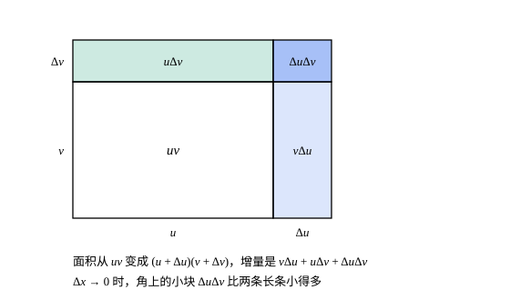

## 这一节要回答的问题

用定义求$x^3-5x^2+\frac1x$的:term[导数]{id="math.calculus.derivative"}（derivative），要把整个式子代进:term[差商]{id="math.calculus.difference-quotient"}（difference quotient）、展开、约分，很费事。能不能像:term[极限的四则运算法则]{id="math.calculus.limit-laws"}（limit laws）那样，由简单函数的导数一步步算出复杂函数的导数？乘积的导数是导数的乘积吗？

## 讲解

### 和、差与常数倍

::anchor{id="thm-linearity"}
**定理 1**　$u$、$v$在$x$处:term[可导]{id="math.calculus.differentiable"}（differentiable），$c$是常数，则$u\pm v$、$cu$在$x$处可导，并且$(u\pm v)'=u'\pm v'$，$(cu)'=cu'$。

道理：$u+v$的:term[差商]{id="math.calculus.difference-quotient"}正是两个差商之和，$\frac{[u(x+h)+v(x+h)]-[u(x)+v(x)]}{h}=\frac{u(x+h)-u(x)}{h}+\frac{v(x+h)-v(x)}{h}$，由:term[极限的四则运算法则]{id="math.calculus.limit-laws"}，$h\to0$时趋于$u'+v'$；差、常数倍同理。配上[导数的定义](lesson:math.calculus.derivative)里算过的$(x^n)'=nx^{n-1}$，多项式可以逐项求导，例如$(3x^4-5x^2+7)'=12x^3-10x$。

### 乘积法则

乘积的:term[导数]{id="math.calculus.derivative"}不是导数的乘积：$(x\cdot x)'=(x^2)'=2x$，而$(x)'\cdot(x)'=1$。

::anchor{id="thm-product-rule"}
**:term[乘积法则]{id="math.calculus.product-rule"}（product rule）**　$u$、$v$在$x$处:term[可导]{id="math.calculus.differentiable"}，则$uv$在$x$处可导，并且$(uv)'=u'v+uv'$。

道理：在分子里减去再加上$u(x)v(x+h)$，乘积的:term[差商]{id="math.calculus.difference-quotient"}拆成两项：

$$
\frac{u(x+h)v(x+h)-u(x)v(x)}{h}=\frac{u(x+h)-u(x)}{h}\,v(x+h)+u(x)\,\frac{v(x+h)-v(x)}{h}.
$$

$h\to0$时，第一项趋于$u'(x)v(x)$，这里用到$v$在$x$处可导、所以:term[连续]{id="math.calculus.continuous"}（continuous），$v(x+h)\to v(x)$；第二项趋于$u(x)v'(x)$。几何图像里的长方形把这件事画了出来：两条长条是$u'v$和$uv'$，角上的小块趋于零。

### 商法则

::anchor{id="thm-quotient-rule"}
**:term[商法则]{id="math.calculus.quotient-rule"}（quotient rule）**　$u$、$v$在$x$处:term[可导]{id="math.calculus.differentiable"}，$v(x)\ne0$，则$\frac uv$在$x$处可导，并且$\left(\frac uv\right)'=\frac{u'v-uv'}{v^2}$。

道理：先求$\frac1v$的:term[导数]{id="math.calculus.derivative"}。$\frac{1}{h}\left(\frac1{v(x+h)}-\frac1{v(x)}\right)=-\frac{v(x+h)-v(x)}{h}\cdot\frac{1}{v(x+h)v(x)}$，$v$:term[连续]{id="math.calculus.continuous"}且$v(x)\ne0$，$h\to0$时它趋于$-\frac{v'}{v^2}$。再把$\frac uv$看成$u\cdot\frac1v$，用:term[乘积法则]{id="math.calculus.product-rule"}，$u'\cdot\frac1v+u\cdot\bigl(-\frac{v'}{v^2}\bigr)=\frac{u'v-uv'}{v^2}$。

分子的顺序不能换：$uv'-u'v$正好差一个负号。条件$v(x)\ne0$也不能少，$\frac uv$在$v=0$的点上根本没有定义。

### 整数次幂

::anchor{id="thm-power-rule"}
**:term[幂法则]{id="math.calculus.power-rule"}（power rule）**　对任何整数$n$，$(x^n)'=nx^{n-1}$；$n\le0$时要求$x\ne0$。

道理：$n$是正整数的情形在[导数的定义](lesson:math.calculus.derivative)里算过；$n=0$时$x^0=1$，:term[导数]{id="math.calculus.derivative"}是$0=0\cdot x^{-1}$。$n=-m$（$m$是正整数）时，由:term[商法则]{id="math.calculus.quotient-rule"}，$\left(\frac{1}{x^m}\right)'=\frac{0\cdot x^m-1\cdot mx^{m-1}}{x^{2m}}=-mx^{-m-1}$，正是$nx^{n-1}$。

有了这四条，多项式和有理函数的导数都能一步步算出来：有理函数的导数还是有理函数，定义域不变。指数不是整数的幂函数也满足同样的公式，比如$(\sqrt x)'=\frac12x^{-\frac12}$，和[导数的定义](lesson:math.calculus.derivative)例 1 的结果一致，一般的证明见[初等函数的导数](lesson:math.calculus.elementary-derivatives)。

## 几何图像

把$u(x)$、$v(x)$看成长方形的两条边，面积是$uv$。$x$变成$x+\Delta x$时，两边各增加$\Delta u$、$\Delta v$，面积增加$v\Delta u+u\Delta v+\Delta u\Delta v$。除以$\Delta x$，得$v\frac{\Delta u}{\Delta x}+u\frac{\Delta v}{\Delta x}+\Delta u\cdot\frac{\Delta v}{\Delta x}$；$\Delta x\to0$时最后一项趋于$0\cdot v'=0$，剩下的就是:term[乘积法则]{id="math.calculus.product-rule"}$u'v+uv'$。

## 例题

### 例 1　商法则

求$\left(\frac{x^2-1}{x^2+1}\right)'$。

**为什么想到这么做**：分子、分母都是多项式，:term[导数]{id="math.calculus.derivative"}一眼就看出来，直接套:term[商法则]{id="math.calculus.quotient-rule"}；分母$x^2+1$处处不为零，没有限制。

**推导**：$u=x^2-1$，$u'=2x$；$v=x^2+1$，$v'=2x$。$\left(\frac uv\right)'=\frac{2x(x^2+1)-(x^2-1)\cdot2x}{(x^2+1)^2}=\frac{2x\cdot2}{(x^2+1)^2}=\frac{4x}{(x^2+1)^2}$。

### 例 2　水平切线

曲线$y=\frac{x}{x^2+1}$上哪些点的:term[切线]{id="math.calculus.tangent-line"}（tangent line）是水平的？

**为什么想到这么做**：水平的切线斜率为$0$，切线斜率就是:term[导数]{id="math.calculus.derivative"}，所以求出$y'$，解$y'=0$。

**推导**：由:term[商法则]{id="math.calculus.quotient-rule"}，$y'=\frac{1\cdot(x^2+1)-x\cdot2x}{(x^2+1)^2}=\frac{1-x^2}{(x^2+1)^2}$。$y'=0$即$1-x^2=0$，$x=\pm1$。对应的点是$\bigl(1,\frac12\bigr)$和$\bigl(-1,-\frac12\bigr)$。

## 常见误区

- 「$(uv)'=u'v'$。」$(x\cdot x)'=2x$，而$1\cdot1=1$；正确的是:term[乘积法则]{id="math.calculus.product-rule"}$u'v+uv'$。
- 「$\left(\frac uv\right)'=\frac{u'}{v'}$。」$\frac{x^2}{x}=x$（$x\ne0$），:term[导数]{id="math.calculus.derivative"}是$1$，而$\frac{(x^2)'}{(x)'}=2x$。
- 「:term[商法则]{id="math.calculus.quotient-rule"}的分子写成$uv'-u'v$也一样。」差一个负号。
- 「$(x^{-2})'=-2x^{-1}$。」:term[幂法则]{id="math.calculus.power-rule"}要把指数减$1$：$-2-1=-3$，所以$(x^{-2})'=-2x^{-3}$。
