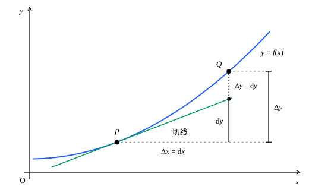

## 这一节要回答的问题

$\sqrt{4.1}$不好心算，可$\sqrt4=2$一眼就知道，$4.1$又离$4$很近，能不能从$x=4$处的信息估出$\sqrt{4.1}$？量正方形的边长时差了一点点，算出的面积会差多少？这两个问题问的是同一件事：自变量变一点点，函数值大约变多少。

## 讲解

### 线性近似

曲线$y=\sqrt x$在$x=4$处的:term[切线]{id="math.calculus.tangent-line"}（tangent line）是$y=\frac x4+1$，这是[导数的定义](lesson:math.calculus.derivative)例 1 算出的。$x$靠近$4$时，曲线和切线贴得很紧，用切线上的值代替曲线上的值：$\sqrt{4.1}\approx\frac{4.1}4+1=2.025$，真值是$2.02485\cdots$，只差约$0.00015$。离得远就不行了：$\sqrt9=3$，切线给的是$3.25$。

::anchor{id="def-linear-approximation"}
设$f$在$a$处:term[可导]{id="math.calculus.differentiable"}（differentiable）。一次函数$L(x)=f(a)+f'(a)(x-a)$叫作$f$在$a$处的:term[线性近似]{id="math.calculus.linear-approximation"}（linear approximation），它的图像就是曲线在$(a,f(a))$处的切线；$x$靠近$a$时，用$L(x)$作为$f(x)$的近似值。

为什么这样定义：误差$f(x)-L(x)$不但趋于$0$，和$x-a$相比也趋于$0$，因为$\frac{f(x)-L(x)}{x-a}=\frac{f(x)-f(a)}{x-a}-f'(a)$，由:term[导数]{id="math.calculus.derivative"}（derivative）的定义，它趋于$0$。上面的例子里，$x-4$从$0.1$缩小到$0.01$，误差从约$0.00015$缩小到约$0.0000016$，大约是原来的$\frac1{100}$。过$(a,f(a))$的别的直线$y=f(a)+k(x-a)$做不到这一点：误差和$x-a$之比趋于$f'(a)-k\ne0$。

边界情况：$f$在$a$处不可导时，没有线性近似。$|x|$在$0$处的图像是两条方向不同的射线，不论取哪条过原点的直线$y=kx$，误差和$x$之比在$x>0$时是$1-k$、在$x<0$时是$-1-k$，总有一侧不趋于$0$。

在$0$处做线性近似，要的是函数在$0$处的导数，它正是[两个重要极限](lesson:math.calculus.special-limits)里求过的:term[极限]{id="math.calculus.limit"}（limit，lim）。比如$\sin x$在$0$处的:term[差商]{id="math.calculus.difference-quotient"}（difference quotient）是$\frac{\sin h}{h}$，由:term[第一个重要极限]{id="math.calculus.first-special-limit"}（limit of $\frac{\sin x}{x}$）趋于$1$，所以$\sin x$在$0$处的线性近似是$x$。同样，$\frac{\tan h}h$、$\frac{e^h-1}h$、$\frac{\ln(1+h)}h$都趋于$1$；$(1+x)^n$、$\sqrt{1+x}$、$\frac1{1+x}$在$0$处的差商，就是$x^n$、$\sqrt x$、$\frac1x$在$1$处的差商，它们的导数在导数的定义里都算过。于是得到$0$附近常用的几个近似（$x$用弧度，$n$是正整数）：

$$
\begin{gathered}
\sin x\approx x,\qquad \tan x\approx x,\qquad e^x\approx1+x,\qquad \ln(1+x)\approx x,\\
(1+x)^n\approx1+nx,\qquad \sqrt{1+x}\approx1+\frac x2,\qquad \frac1{1+x}\approx1-x.
\end{gathered}
$$

### 微分

$y=x^2$在$x=3$处，自变量的增量（increment）是$\Delta x$时，函数的增量是$\Delta y=(3+\Delta x)^2-9=6\Delta x+(\Delta x)^2$。第一项和$\Delta x$成正比；第二项在$\Delta x$很小时小得多，$\Delta x=0.01$时两项是$0.06$和$0.0001$。把和$\Delta x$成正比的那一项单独拿出来，就得到下面的定义。

::anchor{id="def-differential"}
设$f$在$x$处:term[可导]{id="math.calculus.differentiable"}，自变量的增量是$\Delta x$。$f'(x)\Delta x$叫作函数$y=f(x)$在$x$处的:term[微分]{id="math.calculus.differential"}（differential），记作$\dd y$或$\dd f$，即$\dd y=f'(x)\Delta x$。函数$y=x$的微分是$\dd x=1\cdot\Delta x$，即自变量的微分就是它的增量，所以微分也写成$\dd y=f'(x)\dd x$。

为什么这样定义：在$(x,f(x))$处的:term[切线]{id="math.calculus.tangent-line"}上，横坐标增加$\Delta x$，纵坐标正好增加$f'(x)\Delta x$，所以$\dd y$是沿切线走的增量，$\Delta y$是沿曲线走的增量（见几何图像）。两者之差$\Delta y-\dd y$就是:term[线性近似]{id="math.calculus.linear-approximation"}的误差，和$\Delta x$相比趋于$0$；$\dd y$和$\Delta x$成正比，好算，$\Delta x$很小时就用$\dd y$代替$\Delta y$。有了微分，$\dv yx=f'(x)$里的$\dd y$、$\dd x$各有意思，:term[导数]{id="math.calculus.derivative"}正好是它们的商。

边界情况：$\dd y$由$x$和$\dd x$两个量决定。$f'(x)=0$时$\dd y=0$，$\Delta y$却一般不是$0$：$y=x^2$在$x=0$处，$\Delta y=(\Delta x)^2$。

常数倍、和差的微分可以直接从:term[差商]{id="math.calculus.difference-quotient"}看出来：$cf$的差商是$f$的差商的$c$倍，$f\pm g$的差商是两个差商的和差，由:term[极限的四则运算法则]{id="math.calculus.limit-laws"}（limit laws），$\dd(cf)=c\,\dd f$，$\dd(f\pm g)=\dd f\pm\dd g$。比如$\dd\bigl(\frac43\pi r^3\bigr)=\frac43\pi\cdot3r^2\dd r=4\pi r^2\dd r$。

### 用微分估计误差

::anchor{id="def-error"}
测量$x$时有误差$\Delta x$，算出的$y=f(x)$跟着有误差$\Delta y$；$|\Delta y|$叫作$y$的绝对误差（absolute error），$\bigl|\frac{\Delta y}{y}\bigr|$叫作相对误差（relative error）。$\Delta x$很小时，用:term[微分]{id="math.calculus.differential"}估计它们：$|\Delta y|\approx|f'(x)|\,|\Delta x|$，$\bigl|\frac{\Delta y}{y}\bigr|\approx\bigl|\frac{f'(x)}{f(x)}\bigr|\,|\Delta x|$。

为什么要分两种：绝对误差说差了多少，相对误差说差了百分之几，比较大小不同的量时后者更有用。$y=x^n$（$n$是正整数）时，$\frac{\dd y}{y}=\frac{nx^{n-1}\dd x}{x^n}=n\frac{\dd x}{x}$，相对误差大约变成$x$的相对误差的$n$倍，和$x$本身多大无关。边界情况：在$f'(x)=0$的地方，微分给出的估计是$0$，真正的误差由$(\Delta x)^2$这样的项决定，要另算。

## 几何图像

从$P$往右走$\Delta x$，沿:term[切线]{id="math.calculus.tangent-line"}升高$\dd y$，沿曲线升高$\Delta y$，中间那一小段$\Delta y-\dd y$就是:term[线性近似]{id="math.calculus.linear-approximation"}的误差。$Q$向$P$靠拢时，这一段比$\Delta x$缩得更快，曲线和切线越来越难分开。

## 例题

### 例 1　球的体积变了多少

钢球的半径从$10\,\mathrm{cm}$增加到$10.1\,\mathrm{cm}$，用:term[微分]{id="math.calculus.differential"}估计体积增加了多少，并和真实的增量比较。

**为什么想到这么做**：半径只变了$1\%$，体积的增量$\Delta V$可以用微分$\dd V=V'(r)\dd r$代替，只要做一次乘法，不用算$10.1^3$。

**推导**：$V=\frac43\pi r^3$，$\dd V=4\pi r^2\dd r=4\pi\cdot100\cdot0.1=40\pi\approx125.7\,\mathrm{cm}^3$。真实的增量是$\Delta V=\frac43\pi(10.1^3-10^3)=\frac43\pi\cdot30.301\approx126.9\,\mathrm{cm}^3$，两者只差约$1\%$。差出来的部分来自$(\Delta r)^2$、$(\Delta r)^3$的项：$\Delta V=4\pi r^2\Delta r+4\pi r(\Delta r)^2+\frac43\pi(\Delta r)^3$。

### 例 2　边长的误差传到面积

正方形的边长量得$10\,\mathrm{cm}$，误差不超过$0.05\,\mathrm{cm}$。估计面积的绝对误差和相对误差。

**为什么想到这么做**：面积$A=x^2$，误差$\Delta x$很小，用$\dd A=2x\,\dd x$估计$\Delta A$；相对误差直接用$y=x^n$的结论。

**推导**：$|\dd A|\le2\cdot10\cdot0.05=1\,\mathrm{cm}^2$，面积是$100\,\mathrm{cm}^2$，相对误差约为$1\%$。边长的相对误差是$0.5\%$，面积的是它的$2$倍，和$n=2$的结论一致。真实的误差最多是$10.05^2-100=1.0025\,\mathrm{cm}^2$，和估计只差$0.0025\,\mathrm{cm}^2$。

## 常见误区

- 「$\dd y$就是$\Delta y$。」$\dd y$是沿:term[切线]{id="math.calculus.tangent-line"}的增量，$\Delta y$是沿曲线的增量；$y=x^2$在$x=0$处，$\dd y=0$，而$\Delta y=(\Delta x)^2$。
- 「$\sin x\approx x$里的$x$用角度也行。」$\sin1^\circ\approx0.01745$，不是$1$；角度要先化成弧度，$1^\circ=\frac{\pi}{180}$。
- 「函数在$a$处:term[连续]{id="math.calculus.continuous"}（continuous），就能在$a$处做:term[线性近似]{id="math.calculus.linear-approximation"}。」$|x|$在$0$处连续，可没有线性近似；要的是:term[可导]{id="math.calculus.differentiable"}。
