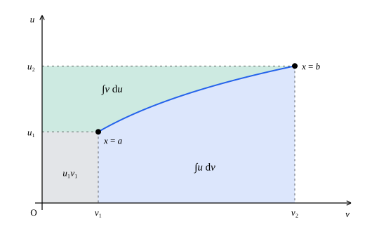

## 这一节要回答的问题

$x\cos x$、$x^2e^x$、$\ln x$、$e^x\sin x$的:term[原函数]{id="math.calculus.antiderivative"}（antiderivative）是什么？它们不是复合函数，而是乘积（$\ln x$看成$\ln x\cdot1$）。求导时有:term[乘积法则]{id="math.calculus.product-rule"}（product rule）对付乘积，把它倒过来，能不能求乘积的积分？

## 讲解

### 分部积分公式

::anchor{id="thm-integration-by-parts"}
**定理（:term[分部积分法]{id="math.calculus.integration-by-parts"}，integration by parts）**　设$u(x)$、$v(x)$有:term[连续]{id="math.calculus.continuous"}（continuous）的:term[导数]{id="math.calculus.derivative"}（derivative），则$\int u(x)v'(x)\,\dd x=u(x)v(x)-\int u'(x)v(x)\,\dd x$。

道理：由:term[乘积法则]{id="math.calculus.product-rule"}，$(uv)'=u'v+uv'$，所以$uv$是$u'v+uv'$的一个:term[原函数]{id="math.calculus.antiderivative"}，$\int(u'v+uv')\,\dd x=uv+C$，移项就是要证的式子。形式上把$v'(x)\,\dd x$写成$\dd v$，公式也写成$\int u\,\dd v=uv-\int v\,\dd u$。

为什么有用：公式把导数从$v$挪到了$u$上。把:term[被积函数]{id="math.calculus.integrand"}（integrand）拆成$u$和$v'$两个因子时，$u$选求导以后变简单的，$v'$选好积分的。$\int x\cos x\,\dd x$取$u=x$、$v'=\cos x$，$v=\sin x$，得$x\sin x-\int\sin x\,\dd x=x\sin x+\cos x+C$。$\int\ln x\,\dd x$取$u=\ln x$、$v'=1$，$v=x$，得$x\ln x-\int x\cdot\frac1x\,\dd x=x\ln x-x+C$。

边界情况：选反了会越积越难。$\int x\cos x\,\dd x$如果取$u=\cos x$、$v'=x$，$v=\frac{x^2}2$，得$\frac{x^2}2\cos x+\int\frac{x^2}2\sin x\,\dd x$，剩下的积分比原来的还复杂。

### 反复用，或者回到原式

多项式乘$e^x$、$\sin x$、$\cos x$时，每用一次，多项式降一次，$n$次多项式要用$n$次：

$$
\int x^2e^x\,\dd x=x^2e^x-2\int xe^x\,\dd x=x^2e^x-2\Bigl(xe^x-\int e^x\,\dd x\Bigr)=\bigl(x^2-2x+2\bigr)e^x+C.
$$

$e^x\sin x$里两个因子求导、积分都不变简单，可用两次以后会回到原来的积分。记$I=\int e^x\sin x\,\dd x$，两次都取三角函数为$u$：$I=e^x\sin x-\int e^x\cos x\,\dd x=e^x\sin x-\Bigl(e^x\cos x+\int e^x\sin x\,\dd x\Bigr)$，即$I=e^x(\sin x-\cos x)-I$，解出$I=\frac12e^x(\sin x-\cos x)+C$。边界情况：第二次要接着取三角函数为$u$；改取$e^x$为$u$，就把第一次的结果原样退回去，只得到$I=I$。

### 定积分的分部积分

::anchor{id="thm-parts-definite"}
**定理**　设$u$、$v$在$[a,b]$上有:term[连续]{id="math.calculus.continuous"}的:term[导数]{id="math.calculus.derivative"}，则$\int_a^bu(x)v'(x)\,\dd x=u(x)v(x)\Big|_a^b-\int_a^bu'(x)v(x)\,\dd x$。

道理：$(uv)'=u'v+uv'$在$[a,b]$上连续，由:term[牛顿-莱布尼茨公式]{id="math.calculus.newton-leibniz-formula"}（Newton-Leibniz formula），$\int_a^b(u'v+uv')\,\dd x=uv\Big|_a^b$，再用:term[定积分]{id="math.calculus.definite-integral"}（definite integral）的线性（linearity）移项。比如$\int_0^\pi x\sin x\,\dd x=-x\cos x\Big|_0^\pi+\int_0^\pi\cos x\,\dd x$，前一项是$\pi$，后一项是$0$，结果是$\pi$。

为什么重要：$uv$在两端都是$0$时，端点项消失，$\int_a^buv'\,\dd x=-\int_a^bu'v\,\dd x$，导数从一个因子挪到另一个因子上，只差一个负号。变分法和常微分方程里常这样用，见[第一变分与欧拉-拉格朗日方程](lesson:math.calculus-of-variations.euler-lagrange)、[拉普拉斯变换](lesson:math.ode.laplace-transform)。边界情况：端点项不为$0$时不能丢。$\int_0^1xe^x\,\dd x$的端点项是$xe^x\Big|_0^1=e$，丢了它，结果就成了$-\int_0^1e^x\,\dd x=-(e-1)$，是负的，可:term[被积函数]{id="math.calculus.integrand"}在$(0,1]$上是正的（例 2）。

## 几何图像

$x$从$a$走到$b$时，点$\bigl(v(x),u(x)\bigr)$画出一条曲线。蓝色一块竖着切，面积是$\int u\,\dd v$，由[定积分的换元](lesson:math.calculus.substitution#thm-substitution-definite)，它等于$\int_a^bu(x)v'(x)\,\dd x$；绿色一块横着切，面积是$\int v\,\dd u$，同样等于$\int_a^bv(x)u'(x)\,\dd x$。两块加上灰色的小长方形，正好拼成以$u_2$、$v_2$为边的大长方形，所以$\int u\,\dd v+\int v\,\dd u=u_2v_2-u_1v_1=uv\Big|_a^b$：:term[分部积分公式]{id="math.calculus.integration-by-parts"}就是这两块面积的关系。

## 例题

### 例 1　对数乘幂函数

求$\int x\ln x\,\dd x$。

**为什么想到这么做**：$\ln x$求导变成$\frac1x$，简单得多；$x$好积分。所以取$u=\ln x$、$v'=x$，反过来取，就要积$\ln x$，绕远了。

**推导**：$v=\frac{x^2}2$，

$$
\int x\ln x\,\dd x=\frac{x^2}2\ln x-\int\frac{x^2}2\cdot\frac1x\,\dd x=\frac{x^2}2\ln x-\frac{x^2}4+C.
$$

### 例 2　递推公式

记$I_n=\int_0^1x^ne^x\,\dd x$（$n=0,1,2,\dots$）。求$I_n$和$I_{n-1}$的关系，并算出$I_3$。

**为什么想到这么做**：取$u=x^n$、$v'=e^x$，:term[分部积分]{id="math.calculus.integration-by-parts"}一次，$x^n$降成$x^{n-1}$，剩下的积分正是$I_{n-1}$；端点项在$x=0$处为$0$，在$x=1$处是$e$。

**推导**：$n\ge1$时，

$$
I_n=x^ne^x\Big|_0^1-n\int_0^1x^{n-1}e^x\,\dd x=e-nI_{n-1}.
$$

$I_0=e-1$，于是$I_1=e-I_0=1$，$I_2=e-2I_1=e-2$，$I_3=e-3I_2=6-2e\approx0.563$。

## 常见误区

- 「$\int uv'\,\dd x=uv+\int u'v\,\dd x$。」符号错了：$(uv)'=u'v+uv'$，移项时$u'v$那一项变号，是减号。
- 「哪个因子当$u$都一样。」取法决定剩下的积分是变简单还是变复杂，$\int x\cos x\,\dd x$取$u=\cos x$就越积越难。
- 「:term[定积分]{id="math.calculus.definite-integral"}:term[分部积分]{id="math.calculus.integration-by-parts"}时，只换掉积分，$uv$不用代上下限。」$\int_a^buv'\,\dd x=uv\Big|_a^b-\int_a^bu'v\,\dd x$，端点项要算出来；写成$uv-\int_a^bu'v\,\dd x$，结果里就混进了$x$。
