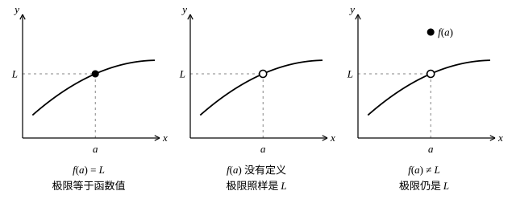

## 这一节要回答的问题

$f(x)=\frac{x^2-1}{x-1}$在$x=1$处没有定义：分母是零。可是用计算器算$x=0.99$、$1.01$处的值，得到的数都离$2$很近。函数在一点「附近」往哪里走，和它在这一点等于多少，是两回事。

这个走向叫作:term[极限]{id="math.calculus.limit"}（limit，lim）。怎样从图像和数值表读出它？它什么时候不存在？

## 讲解

### 从数值表看走向

先列表。$x\ne1$时分子可以分解，$\frac{x^2-1}{x-1}=\frac{(x-1)(x+1)}{x-1}=x+1$，所以表里的数就是$x+1$。

| $x$ | $0.9$ | $0.99$ | $0.999$ | $1.001$ | $1.01$ | $1.1$ |
| --- | --- | --- | --- | --- | --- | --- |
| $f(x)$ | $1.9$ | $1.99$ | $1.999$ | $2.001$ | $2.01$ | $2.1$ |

$x$从左右两边靠近$1$，$f(x)$都靠近$2$；$x$离$1$越近，$f(x)$离$2$也越近。图像是直线$y=x+1$挖掉了点$(1,2)$，只差这一个点。$x$永远取不到$1$，可这不妨碍我们说「$x$靠近$1$时，$f(x)$靠近$2$」。

### 极限

::anchor{id="def-limit"}
设函数$f$在$a$附近有定义（$a$本身可以除外）。如果$x$从两侧无限靠近$a$、但不等于$a$时，$f(x)$无限接近一个确定的数$L$，就说$x$趋于$a$时$f(x)$的:term[极限]{id="math.calculus.limit"}是$L$，记作$\lim_{x\to a}f(x)=L$，也写成$x\to a$时$f(x)\to L$。

「无限接近」的意思是要多近就有多近：不管事先要求$f(x)$和$L$相差不到$0.01$、$0.0001$还是更小的数，只要$x$离$a$足够近（$x\ne a$），这个要求都能满足。把这句话写成能拿来证明的形式，是数学分析里[函数极限的严格定义](lesson:math.analysis.function-limits)要做的事；这里先靠图像和数值表。

为什么这样定义：我们关心的是$f$在$a$附近的走向，不是$f(a)$。$f(a)$可能根本没有定义，比如上面的$\frac{x^2-1}{x-1}$；也可能和附近的值合不上，比如把$x^2$在$x=2$处的值改成$0$，附近的值仍然靠近$4$。所以定义里只看$x\ne a$的那些点，极限和$f(a)$是多少、有没有定义都无关。

边界情况：「越来越近」不等于「无限接近」。$x\to0$时$x^2+1$离$0$越来越近，可它到$0$的距离总大于$1$，所以它的极限不是$0$，而是$1$。

### 单侧极限

看$g(x)=\frac{|x|}{x}$：$x>0$时它等于$1$，$x<0$时等于$-1$，$x=0$时没有定义。$x$从右边靠近$0$，$g(x)$一直是$1$；从左边靠近，一直是$-1$。两边各有各的走向，合起来却没有一个$L$。

::anchor{id="def-one-sided-limit"}
只让$x$从$a$的左边（$x<a$）无限靠近$a$时，$f(x)$无限接近的数叫作$f$在$a$处的:term[左极限]{id="math.calculus.left-limit"}（left-hand limit），记作$\lim_{x\to a^-}f(x)$；只让$x$从右边（$x>a$）靠近，得到:term[右极限]{id="math.calculus.right-limit"}（right-hand limit），记作$\lim_{x\to a^+}f(x)$。两者统称:term[单侧极限]{id="math.calculus.one-sided-limit"}（one-sided limit）。

为什么要分开看两侧：有的函数在两侧走向不同，比如上面的$g$，$\lim_{x\to0^-}g(x)=-1$，$\lim_{x\to0^+}g(x)=1$；有的函数只在一侧有定义，比如$\sqrt x$在$0$处只有右极限$0$。记号里的$a^-$、$a^+$只表示从哪边靠近，不是两个数。

::anchor{id="thm-two-sides"}
**定理**　$\lim_{x\to a}f(x)=L$，当且仅当$f$在$a$处的左极限和右极限都存在，并且都等于$L$。

道理：「$x$从两侧靠近$a$」就是从左边靠近、从右边靠近两件事一起成立。左、右极限都是$L$，两边的$f(x)$就都靠近$L$；有一侧的单侧极限不存在或不等于$L$，$x$从那一侧靠近$a$时，$f(x)$就不靠近$L$。所以$g(x)=\frac{|x|}{x}$在$0$处没有:term[极限]{id="math.calculus.limit"}。

### 极限与函数值

:term[极限]{id="math.calculus.limit"}只看$a$附近，$f(a)$只看$a$这一点，两者的关系有三种。可以相等：$x^2$在$2$处，极限和函数值都是$4$。可以一个存在、一个没有定义：$\frac{x^2-1}{x-1}$在$1$处。也可以都存在但不相等：在$2$处改过值的$x^2$。

极限等于函数值的点最省事，求极限只要把$a$代进去，这时说函数在这一点:term[连续]{id="math.calculus.continuous"}（continuous），见[连续与间断](lesson:math.calculus.continuity)。在别的点上，代入得到的数和极限可能毫不相干。

### 极限不存在的几种情形

第一种是两侧走向不同，像$\frac{|x|}{x}$在$0$处。第二种是函数值无限增大：$x\to0$时$\frac1{x^2}$依次取到$100$、$10^4$、$10^6$……没有哪个数是它靠近的目标。第三种是来回摆动：$x\to0$时$\sin\frac1x$在$-1$和$1$之间摆动无穷多次，也不靠近哪一个数。

::anchor{id="def-infinity"}
如果$x\to a$时$|f(x)|$无限增大，也就是只要$x$离$a$足够近（$x\ne a$），$|f(x)|$就大过任何事先给定的正数，就说$x\to a$时$f(x)$是:term[无穷大]{id="math.calculus.infinity"}（infinity），记作$\lim_{x\to a}f(x)=\infty$。$f(x)$保持为正、无限增大时，记作$\lim_{x\to a}f(x)=+\infty$；保持为负、$|f(x)|$无限增大时，记作$-\infty$。单侧的情形照样写，比如$\lim_{x\to a^+}f(x)=+\infty$。

为什么要这个记号：这时:term[极限]{id="math.calculus.limit"}不存在，因为$\infty$不是一个数；记号只是把「怎样不存在」说清楚。函数值往一个方向冲出去，图像贴着竖线$x=a$往上或往下走，例如$\lim_{x\to0}\frac1{x^2}=+\infty$。边界情况：$\lim_{x\to0^+}\frac1x=+\infty$，$\lim_{x\to0^-}\frac1x=-\infty$，两侧的符号不同，所以只能写$\lim_{x\to0}\frac1x=\infty$，不能写成$+\infty$。

## 几何图像

三幅图里的曲线只在$x=a$这一点不同：实心点是$f(a)$，空心圆表示那一点不属于图像。$x$从两边靠近$a$时，三条曲线都靠近高度$L$，所以三种情形的:term[极限]{id="math.calculus.limit"}都是$L$。$f(a)$等于$L$、没有定义、不等于$L$，都不影响极限。

:::anim{component="function-plot"}
range: { x: [-1, 3], y: [-0.5, 4.5] }
functions:
  - expr: "x^2 + 0*sqrt(1 - x)"
    label: |
      $x<1$的一段：$x^2$
  - expr: "x + c + 0*sqrt(x - 1)"
    label: |
      $x>1$的一段：$x+c$
sliders:
  - name: c
    min: -1
    max: 1
    step: 0.1
    default: 0.5
    label: |
      右边一段上下平移$c$
:::

这个函数在$x<1$时是$x^2$，$x>1$时是$x+c$，$x=1$处不定义。拖动$c$：左边一段的末端一直停在高度$1$，这是$1$处的:term[左极限]{id="math.calculus.left-limit"}；右边一段的起点在高度$1+c$，这是:term[右极限]{id="math.calculus.right-limit"}。只有$c=0$时两段接上，$x\to1$时的极限才存在。

## 例题

### 例 1　分段点处的极限

设

$$
f(x)=\begin{cases}x^2,&x<1,\\3,&x=1,\\2-x,&x>1.\end{cases}
$$

求$f$在$1$处的:term[左极限]{id="math.calculus.left-limit"}、:term[右极限]{id="math.calculus.right-limit"}和:term[极限]{id="math.calculus.limit"}，并和$f(1)$比较。

**为什么想到这么做**：分段点两侧用的是不同的式子，所以分开看两侧，再用「左、右极限相等才有极限」那条定理。

**推导**：$x<1$时$f(x)=x^2$，$x$从左边靠近$1$，$x^2$靠近$1$，所以左极限是$1$。$x>1$时$f(x)=2-x$，从右边靠近$1$，$2-x$也靠近$1$，右极限是$1$。两者相等，$\lim_{x\to1}f(x)=1$，而$f(1)=3$：极限存在，但不等于函数值。

### 例 2　数值表会骗人

列出$\sin\frac{\pi}{x}$在$x=0.1$、$0.01$、$0.001$处的值，能不能由此断定$\lim_{x\to0^+}\sin\frac{\pi}{x}=0$？

**为什么想到这么做**：表里的$x$都是$\frac1{10^k}$，$\frac{\pi}{x}$正好是$\pi$的整数倍，正弦都是零，这像是挑过的点。要检验，就换一串别的、也趋于$0$的点。

**推导**：$x=\frac1n$时$\sin\frac\pi x=\sin n\pi=0$，表里三个值都是$0$。可是取$x=\frac{2}{4n+1}$（$n=1,2,3,\dots$），$\frac{\pi}{x}=2n\pi+\frac\pi2$，$\sin\frac\pi x=1$，这些点也无限靠近$0$。$x$从右边靠近$0$时，函数值在$-1$和$1$之间来回取，不靠近任何一个数，所以:term[右极限]{id="math.calculus.right-limit"}不存在。数值表只能帮我们猜，猜完要用别的办法确认。

## 常见误区

- 「求:term[极限]{id="math.calculus.limit"}就是把$x=a$代进去。」只有极限等于函数值时才行：$\frac{x^2-1}{x-1}$在$1$处根本代不进去；例 1 的$f$代进去得$3$，极限却是$1$。
- 「$f(a)$没有定义，$x\to a$时的极限就不存在。」极限不看$f(a)$：$\frac{x^2-1}{x-1}$在$1$处没有定义，极限是$2$。
- 「$\lim_{x\to0}\frac1{x^2}=+\infty$，说明极限存在，等于:term[正无穷大]{id="math.calculus.infinity"}。」$+\infty$不是数，这个记号说的是极限不存在、函数值无限增大。
- 「:term[左极限]{id="math.calculus.left-limit"}和:term[右极限]{id="math.calculus.right-limit"}都存在，极限就存在。」还要两者相等：$\frac{|x|}{x}$在$0$处的两个:term[单侧极限]{id="math.calculus.one-sided-limit"}分别是$-1$和$1$。
