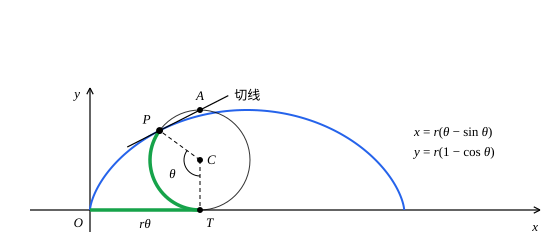

## 这一节要回答的问题

车轮在地上滚，轮边上一点画出一串拱形的曲线。这条曲线写不成$y=f(x)$的简单式子，可轮子转过一个角时那一点在哪里，很容易写出来。只知道$x$、$y$各自怎样随一个变量变化，能不能求曲线的:term[切线]{id="math.calculus.tangent-line"}（tangent line）斜率和:term[弧长]{id="math.calculus.arc-length"}（arc length）？

## 讲解

### 参数方程

::anchor{id="def-parametric-equations"}
设$x(t)$、$y(t)$是区间$I$上的:term[连续]{id="math.calculus.continuous"}（continuous）函数，$t$取遍$I$时，点$\bigl(x(t),y(t)\bigr)$画出一条曲线。$x=x(t)$、$y=y(t)$（$t\in I$）叫作这条曲线的:term[参数方程]{id="math.calculus.parametric-equations"}（parametric equations），$t$叫作参数（parameter），这样给出的曲线叫作参数曲线（parametric curve）。

为什么用参数：圆、和自己相交的曲线都不是一个函数的图像，用参数一笔就能写出来，参数还记下了点沿曲线走的方向和快慢。单位圆可以写成$x=\cos t$、$y=\sin t$（$0\le t\le2\pi$），逆时针走一圈；写成$x=\cos2t$、$y=\sin2t$（$0\le t\le\pi$），是同一个圆，点走动的速度是前一种的$2$倍。函数$y=f(x)$的图像是$x=t$、$y=f(t)$的情形。边界情况：$t$取遍$[0,4\pi]$时，$x=\cos t$、$y=\sin t$把圆走两遍，画出的点和走一遍一样，作为一次运动却不一样。

### 摆线

::anchor{id="def-cycloid"}
半径为$r$的圆沿一条直线滚动而不打滑，圆周上一个固定点画出的曲线叫作摆线（cycloid）。

取这条直线作$x$轴，开始时那一点在原点、是圆的最低点，用圆转过的角$\theta$作参数。不打滑，圆心走过的距离等于圆周上滚过的:term[弧长]{id="math.calculus.arc-length"}$r\theta$，圆心在$(r\theta,r)$；那一点从圆心正下方顺时针转过$\theta$，相对圆心的位置是$(-r\sin\theta,-r\cos\theta)$。所以摆线的:term[参数方程]{id="math.calculus.parametric-equations"}是

$$
x=r(\theta-\sin\theta),\qquad y=r(1-\cos\theta).
$$

$\theta$从$0$到$2\pi$，轮子转一圈，那一点从原点出发，升到最高处$y=2r$，再落回$x$轴上的$(2\pi r,0)$，画出一拱。

### 切线的斜率

::anchor{id="thm-parametric-derivative"}
**定理**　设$x(t)$、$y(t)$在$t_0$附近有:term[连续]{id="math.calculus.continuous"}的:term[导数]{id="math.calculus.derivative"}（derivative），并且$x'(t_0)\ne0$。则在$t_0$附近，曲线是某个函数$y=y(x)$的图像，并且在对应的点上$\dv yx=\frac{y'(t_0)}{x'(t_0)}$。

道理：$x'$连续而$x'(t_0)\ne0$，所以$t_0$附近$x'$不变号，由:term[拉格朗日中值定理]{id="math.calculus.mean-value-theorem"}（mean value theorem），$x(t)$严格单调，有反函数$t=t(x)$。由:term[反函数的求导法则]{id="math.calculus.inverse-function-rule"}（inverse function rule），$t'(x)=\frac1{x'(t)}$；$y$经过$t$成为$x$的函数$y\bigl(t(x)\bigr)$，由:term[链式法则]{id="math.calculus.chain-rule"}（chain rule），$\dv yx=y'(t)\,t'(x)=\frac{y'(t)}{x'(t)}$。

为什么有用：不用先解出$y=f(x)$，就能求:term[切线]{id="math.calculus.tangent-line"}。单位圆$x=\cos t$、$y=\sin t$上，$\sin t\ne0$时$\dv yx=\frac{\cos t}{-\sin t}$，和由$x^2+y^2=1$求出的$-\frac xy$一致。边界情况：$x'(t_0)=0$而$y'(t_0)\ne0$时切线是竖直的，比如单位圆在$t=0$处；$x'(t_0)$、$y'(t_0)$都是$0$时什么都可能发生，$x=t^3$、$y=t^2$在$t=0$处画出一个尖角，消去$t$得$y=x^{2/3}$，原点两侧的切线斜率分别趋于$-\infty$和$+\infty$。

### 弧长

::anchor{id="thm-parametric-arc-length"}
**定理**　设$x(t)$、$y(t)$在$[\alpha,\beta]$上有:term[连续]{id="math.calculus.continuous"}的:term[导数]{id="math.calculus.derivative"}，$t$从$\alpha$增大到$\beta$时，点沿曲线从一端走到另一端，不走回头路。则这段曲线的:term[弧长]{id="math.calculus.arc-length"}是$s=\int_\alpha^\beta\sqrt{x'(t)^2+y'(t)^2}\,\dd t$。

道理：在$[\alpha,\beta]$上取分点$t_0<t_1<\cdots<t_n$，曲线上对应的点依次连成折线，第$i$段长$\sqrt{(\Delta x_i)^2+(\Delta y_i)^2}$。由:term[中值定理]{id="math.calculus.mean-value-theorem"}，$\Delta x_i=x'(\xi_i)\Delta t_i$、$\Delta y_i=y'(\eta_i)\Delta t_i$，这一段长$\sqrt{x'(\xi_i)^2+y'(\eta_i)^2}\,\Delta t_i$；分点越来越密时，$\xi_i$、$\eta_i$挤在同一小段里，折线的总长趋于上面的积分。用:term[微元法]{id="math.calculus.element-method"}（method of differential elements）说，$\dd s=\sqrt{\dd x^2+\dd y^2}=\sqrt{x'(t)^2+y'(t)^2}\,\dd t$，正是[弧长与旋转曲面的面积](lesson:math.calculus.arc-length#thm-arc-length)里的弧长:term[微元]{id="math.calculus.differential-element"}（differential element）。

为什么有用：$y=f(x)$是$x=t$、$y=f(t)$的情形，公式变回$\int_a^b\sqrt{1+f'(x)^2}\,\dd x$；写不成函数图像的曲线也能算。单位圆$x=\cos t$、$y=\sin t$（$0\le t\le2\pi$）的周长是$\int_0^{2\pi}\sqrt{\sin^2t+\cos^2t}\,\dd t=2\pi$。

弧长和参数的取法无关：同一段曲线换一个参数，只要仍然从一端走到另一端、不走回头路，算出的弧长不变，因为弧长是用曲线上的折线定义的，和怎样给曲线上的点标上参数无关。比如$x=\cos2t$、$y=\sin2t$（$0\le t\le\pi$），:term[被积函数]{id="math.calculus.integrand"}（integrand）是$2$，积分仍是$2\pi$。边界情况：走回头路时，积分算的是走过的路程，不是曲线的长度，$t$取遍$[0,4\pi]$时单位圆的积分是$4\pi$。

## 几何图像

蓝色的是摆线的一拱。滚动的圆转过$\theta$角时和$x$轴切于$T$，不打滑，地面上从$O$到$T$的长$r\theta$等于圆上从$T$到$P$的那段弧，两段都画成绿色。$P$处的:term[切线]{id="math.calculus.tangent-line"}正好经过滚动圆的最高点$A$（第 6 题）：$P$像是在绕着接触点$T$转动，$TA$是直径，切线$PA$和$PT$垂直。

## 例题

### 例 1　摆线的切线和一拱的长度

求摆线$x=r(\theta-\sin\theta)$、$y=r(1-\cos\theta)$在$0<\theta<2\pi$处的:term[切线]{id="math.calculus.tangent-line"}斜率，以及一拱（$0\le\theta\le2\pi$）的:term[弧长]{id="math.calculus.arc-length"}。

**为什么想到这么做**：曲线由:term[参数方程]{id="math.calculus.parametric-equations"}给出，斜率用$\frac{y'}{x'}$，长度用参数形式的弧长公式。被积式里会出现$1-\cos\theta$，用半角公式$1-\cos\theta=2\sin^2\frac\theta2$化成平方，开方就去掉了根号。

**推导**：$x'(\theta)=r(1-\cos\theta)$，$y'(\theta)=r\sin\theta$。$0<\theta<2\pi$时$x'>0$，

$$
\dv yx=\frac{r\sin\theta}{r(1-\cos\theta)}=\frac{2\sin\frac\theta2\cos\frac\theta2}{2\sin^2\frac\theta2}=\cot\frac\theta2.
$$

又$x'^2+y'^2=r^2(2-2\cos\theta)=4r^2\sin^2\frac\theta2$，$0\le\theta\le2\pi$时$\sin\frac\theta2\ge0$，所以弧长的:term[微元]{id="math.calculus.differential-element"}是$2r\sin\frac\theta2\,\dd\theta$，

$$
s=\int_0^{2\pi}2r\sin\frac\theta2\,\dd\theta=\Bigl[-4r\cos\frac\theta2\Bigr]_0^{2\pi}=8r.
$$

一拱的长恰好是半径的$8$倍，不带$\pi$。在$\theta=0$、$2\pi$处，$\cot\frac\theta2$趋于无穷，摆线落地处的切线是竖直的，那里是尖点。

### 例 2　星形线的周长

求星形线（astroid）$x=\cos^3t$、$y=\sin^3t$（$0\le t\le2\pi$）的周长。

**为什么想到这么做**：$x'$、$y'$都含$\sin t\cos t$，平方和能提出公因式；曲线关于两条坐标轴对称，先算第一象限的一段。

**推导**：$x'=-3\cos^2t\sin t$，$y'=3\sin^2t\cos t$，$x'^2+y'^2=9\sin^2t\cos^2t(\cos^2t+\sin^2t)=9\sin^2t\cos^2t$。$0\le t\le\frac\pi2$时开方得$3\sin t\cos t$，它的:term[原函数]{id="math.calculus.antiderivative"}（antiderivative）是$\frac32\sin^2t$，这一段长$\frac32$。四段一样长，周长是$6$。在$t=0,\frac\pi2,\pi,\frac{3\pi}2$处$x'$、$y'$都是$0$，曲线有四个尖角，可公式照样能用。

## 常见误区

- 「$\dv yx=\frac{x'(t)}{y'(t)}$。」反了：斜率是$y$的变化比$x$的变化，应当是$\frac{y'(t)}{x'(t)}$。
- 「:term[参数方程]{id="math.calculus.parametric-equations"}里的$t$就是$x$。」$t$是另一个变量，只有$x=t$时两者才一样；参数形式的:term[弧长]{id="math.calculus.arc-length"}公式对$t$积分，上下限是$t$的范围。
- 「同一条曲线，参数取法不同，弧长就不同。」只要从一端走到另一端、不走回头路，弧长就一样；走两遍时积分是两倍，算的是路程。
