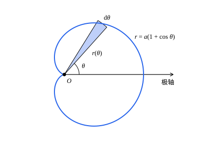

## 这一节要回答的问题

以原点为圆心的圆，直角坐标方程是$x^2+y^2=a^2$，可它说的只是「到原点的距离是$a$」。绕着原点转的螺线、心形的曲线，用「距离和角度」描述更自然。这样描述的曲线，围成的面积怎么求？竖着切成窄条已经不顺手，换成从原点出发切成细扇形呢？

## 讲解

### 极坐标

::anchor{id="def-polar-coordinates"}
在平面上取一点$O$，叫作极点（pole），从$O$引一条射线，叫作极轴（polar axis）。平面上异于$O$的点$P$，由距离$r=|OP|$和从极轴逆时针转到$OP$的角$\theta$确定，$(r,\theta)$叫作$P$的:term[极坐标]{id="math.calculus.polar-coordinates"}（polar coordinates），$r$叫作极径（radial coordinate），$\theta$叫作极角（polar angle）。

为什么这样定义：圆心在$O$的圆是$r=a$，过$O$的射线是$\theta=\alpha$，绕$O$转的曲线写成$r=r(\theta)$，都比直角坐标简单。把极点放在原点、极轴沿$x$轴正方向，两种坐标的关系是$x=r\cos\theta$，$y=r\sin\theta$；反过来$r=\sqrt{x^2+y^2}$，$\theta$由$\cos\theta=\frac xr$、$\sin\theta=\frac yr$定出。物理里极角常写成$\varphi$。

边界情况：极坐标不唯一，$(r,\theta)$和$(r,\theta+2\pi)$是同一个点；极点的$r=0$，$\theta$取什么都行。这里约定$r\ge0$。

### 极坐标方程

$r=2a\cos\theta$（$a>0$）两边乘以$r$，得$r^2=2ar\cos\theta$，即$x^2+y^2=2ax$，是圆心在$(a,0)$、过极点的圆；要$r\ge0$，$\theta$取在$\bigl[-\frac\pi2,\frac\pi2\bigr]$上，正好把圆走一遍。$r=a\theta$（$\theta\ge0$）是阿基米德螺线（Archimedean spiral），每转一圈，离极点远$2\pi a$。$r=a(1+\cos\theta)$（$0\le\theta\le2\pi$）是心形线（cardioid），$\theta=\pi$时$r=0$，曲线在极点处凹进去一个尖。边界情况：同一条曲线，$\theta$的范围取得不同，可能只画出一部分，也可能把一段画两遍。

### 极坐标下的面积

::anchor{id="thm-polar-area"}
**定理**　设$r(\theta)$在$[\alpha,\beta]$上:term[连续]{id="math.calculus.continuous"}（continuous）、$r\ge0$，$0<\beta-\alpha\le2\pi$，则曲线$r=r(\theta)$和射线$\theta=\alpha$、$\theta=\beta$围成的图形，面积是$A=\frac12\int_\alpha^\beta r(\theta)^2\,\dd\theta$。

道理：用:term[微元法]{id="math.calculus.element-method"}（method of differential elements），这回以$\theta$为:term[积分变量]{id="math.calculus.integration-variable"}（variable of integration）。$[\theta,\theta+\dd\theta]$上的那一片近似是半径$r(\theta)$、圆心角$\dd\theta$的扇形，扇形面积是$\frac12r^2\cdot$圆心角，所以面积的:term[微元]{id="math.calculus.differential-element"}（differential element）是$\dd A=\frac12r(\theta)^2\,\dd\theta$。这一片夹在以$r$在这一小段上的最小值、最大值为半径的两个扇形之间，$r$连续，误差和$\dd\theta$相比趋于$0$。

比如心形线$r=a(1+\cos\theta)$围成的面积：用$\cos^2\theta=\frac{1+\cos2\theta}2$；求导可以验证$\bigl(\frac{\sin2\theta}2\bigr)'=\cos2\theta$，所以$\cos\theta$和$\cos2\theta$在$[0,2\pi]$上积分都是$0$，

$$
A=\frac{a^2}2\int_0^{2\pi}\bigl(1+2\cos\theta+\cos^2\theta\bigr)\dd\theta=\frac{a^2}2\bigl(2\pi+0+\pi\bigr)=\frac32\pi a^2.
$$

为什么是$\frac12r^2\,\dd\theta$：细扇形近似一个三角形，底是:term[弧长]{id="math.calculus.arc-length"}（arc length）$r\,\dd\theta$，高是$r$。行星和太阳的连线扫过的面积正是这样一片片加起来的，开普勒第二定律（Kepler's second law）说它随时间均匀增加（第 5 题）。边界情况：要$r\ge0$，并且$\theta$的范围不能把图形盖两遍，否则面积会算多。

## 几何图像

心形线$r=a(1+\cos\theta)$围成的图形，从极点出发切成许多细扇形。蓝色的那一片，圆心角$\dd\theta$，半径近似是$r(\theta)$，面积$\frac12r(\theta)^2\,\dd\theta$；$\theta$从$0$转到$2\pi$，所有细扇形拼成整个图形。和直角坐标里竖着切的窄条比，这里每一片都从极点出发，宽度随半径变大。

## 例题

### 例 1　过极点的圆

求曲线$r=2a\cos\theta$（$a>0$）围成的面积。

**为什么想到这么做**：讲解里已经知道它是半径$a$的圆，面积应当是$\pi a^2$，正好用来检验公式。$\theta$取$\bigl[-\frac\pi2,\frac\pi2\bigr]$，$r\ge0$，圆走一遍。$\cos2\theta$的:term[原函数]{id="math.calculus.antiderivative"}（antiderivative）仍用$\frac{\sin2\theta}2$。

**推导**：

$$
A=\frac12\int_{-\pi/2}^{\pi/2}4a^2\cos^2\theta\,\dd\theta=a^2\int_{-\pi/2}^{\pi/2}\bigl(1+\cos2\theta\bigr)\dd\theta=a^2\Bigl(\theta+\frac{\sin2\theta}2\Bigr)\Big|_{-\pi/2}^{\pi/2}=\pi a^2.
$$

### 例 2　两条极坐标曲线之间

求在圆$r=3\cos\theta$里面、在心形线$r=1+\cos\theta$外面的那部分面积。

**为什么想到这么做**：和两条曲线之间的面积一样，外面的减里面的，只是:term[微元]{id="math.calculus.differential-element"}换成两个扇形之差$\frac12\bigl(r_1^2-r_2^2\bigr)\dd\theta$。先求交点：$3\cos\theta=1+\cos\theta$，$\cos\theta=\frac12$，$\theta=\pm\frac\pi3$；在$-\frac\pi3<\theta<\frac\pi3$时圆在外面。

**推导**：$9\cos^2\theta-(1+\cos\theta)^2=8\cos^2\theta-2\cos\theta-1=3+4\cos2\theta-2\cos\theta$，而$(2\sin2\theta)'=4\cos2\theta$，所以

$$
\begin{aligned}
A&=\frac12\int_{-\pi/3}^{\pi/3}\bigl(3+4\cos2\theta-2\cos\theta\bigr)\dd\theta\\
&=\frac12\Bigl(3\theta+2\sin2\theta-2\sin\theta\Bigr)\Big|_{-\pi/3}^{\pi/3}\\
&=\frac12\Bigl(2\pi+2\sqrt3-2\sqrt3\Bigr)=\pi.
\end{aligned}
$$

## 常见误区

- 「:term[极坐标]{id="math.calculus.polar-coordinates"}下的面积是$\int_\alpha^\beta r(\theta)\,\dd\theta$。」细扇形的面积是$\frac12r^2\,\dd\theta$。看量纲也知道：$r\,\dd\theta$是长度，面积要再乘一个长度。
- 「$\theta$从$0$积到$2\pi$总不会错。」$r=2a\cos\theta$在$\frac\pi2<\theta<\frac{3\pi}2$时是负的；照样从$0$积到$2\pi$，得$\frac12\int_0^{2\pi}4a^2\cos^2\theta\,\dd\theta=2\pi a^2$，把圆算了两遍。
- 「一个点的极坐标是唯一的。」$(1,0)$和$(1,2\pi)$是同一个点，极点的极角更是任意的；从极坐标换到直角坐标是唯一的，反过来不是。
