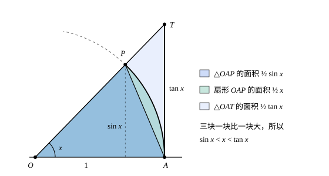

## 这一节要回答的问题

$\frac{\sin x}{x}$在$x\to0$时是:term[$\frac00$型]{id="math.calculus.zero-over-zero"}（indeterminate form 0/0），可分子里没有能约掉的因式。计算器给出$x=0.1$、$0.01$处的值约是$0.99833$、$0.9999833$，像是趋于$1$。

本金$1$元、年利率$100\%$，一年分$n$次结算利息，年底本息共$\left(1+\frac1n\right)^n$元。分得越细钱越多，可会多到无穷吗？这两个:term[极限]{id="math.calculus.limit"}（limit，lim）怎样确认，各等于多少？

## 讲解

### 第一个重要极限

设$0<x<\frac\pi2$。在单位圆上取$A=(1,0)$、$P=(\cos x,\sin x)$，过$A$作垂直于$OA$的直线，交射线$OP$于$T=(1,\tan x)$（见几何图像）。$\triangle OAP$、扇形$OAP$、$\triangle OAT$一个包着一个，面积依次是$\frac12\sin x$、$\frac12x$、$\frac12\tan x$，所以$\sin x<x<\tan x$。

各项除以$\sin x>0$，取倒数，得$\cos x<\frac{\sin x}{x}<1$。$\cos x$是:term[初等函数]{id="math.calculus.elementary-function"}（elementary function），在$0$处:term[连续]{id="math.calculus.continuous"}（continuous），$x\to0^+$时$\cos x\to1$。由:term[夹逼定理]{id="math.calculus.squeeze-theorem"}（squeeze theorem），:term[右极限]{id="math.calculus.right-limit"}（right-hand limit）是$1$；$\frac{\sin x}{x}$是偶函数，:term[左极限]{id="math.calculus.left-limit"}（left-hand limit）也是$1$。

::anchor{id="thm-sin-limit"}
**:term[第一个重要极限]{id="math.calculus.first-special-limit"}（limit of $\frac{\sin x}{x}$）**　$\lim_{x\to0}\frac{\sin x}{x}=1$，这里$x$用弧度。

为什么要用弧度：扇形面积是$\frac12x$，靠的是弧度制下「弧长等于半径乘角度」。用角度量的话，这个:term[极限]{id="math.calculus.limit"}不是$1$（第 7 题）。它说的是$x$很小时$\sin x$和$x$几乎相等，相对误差趋于零。

换元以后能派生出一串结论。$\frac{\tan x}{x}=\frac{\sin x}{x}\cdot\frac1{\cos x}\to1$。$1-\cos x=2\sin^2\frac x2$，所以$\frac{1-\cos x}{x^2}=\frac12\left(\frac{\sin(x/2)}{x/2}\right)^2\to\frac12$，这里令$u=\frac x2$，用了[连续与间断](lesson:math.calculus.continuity)里换元的定理。令$u=\arcsin x$（$\arcsin x$是$\sin x$在$\bigl[-\frac\pi2,\frac\pi2\bigr]$上的反函数），$x=\sin u$，又得$\frac{\arcsin x}{x}=\frac{u}{\sin u}\to1$。

### 第二个重要极限

数列$a_n=\left(1+\frac1n\right)^n$的前几项是$2$、$2.25$、$2.370$、$2.441$，第$10$、$100$、$1000$项约是$2.594$、$2.705$、$2.717$。它在增大，增得越来越慢，像是停在某个数下面。为什么？

用二项式定理展开，第$k$项是$\binom nk\frac1{n^k}=\frac1{k!}\left(1-\frac1n\right)\left(1-\frac2n\right)\cdots\left(1-\frac{k-1}n\right)$，所以

$$
\begin{aligned}
a_n&=1+1+\frac1{2!}\left(1-\frac1n\right)+\frac1{3!}\left(1-\frac1n\right)\left(1-\frac2n\right)\\
&\quad+\cdots+\frac1{n!}\left(1-\frac1n\right)\cdots\left(1-\frac{n-1}n\right).
\end{aligned}
$$

$n$换成$n+1$，每个括号$1-\frac jn$都变大，后面还多出一个正项，所以$a_n<a_{n+1}$，数列递增。$k\ge1$时第$k$项不超过$\frac1{k!}\le\frac1{2^{k-1}}$，所以$a_n\le1+\bigl(1+\frac12+\cdots+\frac1{2^{n-1}}\bigr)=3-\frac1{2^{n-1}}<3$，数列有上界。

递增、又有上界的数列一定有:term[极限]{id="math.calculus.limit"}：它一路往上爬，却越不过$3$，只能在某个数下面越挤越紧。这叫:term[单调有界原理]{id="math.analysis.monotone-convergence-theorem"}（monotone convergence theorem），这里不证，见数学分析的[单调有界数列](lesson:math.analysis.bounded-monotone)，证明要用到实数「没有洞」。所以$\{a_n\}$是:term[收敛数列]{id="math.calculus.convergent-sequence"}（convergent sequence）。

::anchor{id="def-e"}
这个极限记作$e$，即$e=\lim_{n\to\infty}\left(1+\frac1n\right)^n\approx2.71828$，中学里以它为底的对数就是自然对数$\ln x$。

为什么这样定义：$\left(1+\frac1n\right)^n$是「分$n$次结息」的本息，$e$就是利息时时刻刻都在结算时的本息，这种「连续增长」在自然界到处都是。边界情况：底数趋于$1$、指数趋于:term[无穷大]{id="math.calculus.infinity"}（infinity）的「$1^\infty$」不一定趋于$1$，$e$就是一个例子；结果要看两者的快慢（第 8 题）。

把$n$换成实数$x$，结论照样成立。

::anchor{id="thm-e-limit"}
**:term[第二个重要极限]{id="math.calculus.second-special-limit"}（limit defining $e$）**　$\lim_{x\to\infty}\left(1+\frac1x\right)^x=e$；令$t=\frac1x$，也就是$\lim_{t\to0}(1+t)^{\frac1t}=e$。

道理：$x\to+\infty$时，取整数$n$使$n\le x<n+1$，于是$\left(1+\frac1{n+1}\right)^n<\left(1+\frac1x\right)^x<\left(1+\frac1n\right)^{n+1}$。两边分别等于$\left(1+\frac1{n+1}\right)^{n+1}$除以$1+\frac1{n+1}$、$\left(1+\frac1n\right)^n$乘以$1+\frac1n$，都趋于$e$，由:term[夹逼定理]{id="math.calculus.squeeze-theorem"}得结论。$x\to-\infty$时换元$x=-y$化回正的情形（第 5 题）；第二种写法由换元得到，换元的定理把$a$或$b$换成$\infty$也成立，道理一样。

### 两个推论

::anchor{id="thm-log-exp-limits"}
**推论**　$\lim_{x\to0}\frac{\ln(1+x)}{x}=1$，$\lim_{x\to0}\frac{e^x-1}{x}=1$；更一般地，$a>0$时$\lim_{x\to0}\frac{a^x-1}{x}=\ln a$。

道理：$\frac{\ln(1+x)}{x}=\ln\bigl[(1+x)^{\frac1x}\bigr]$，$\ln$在$e$处:term[连续]{id="math.calculus.continuous"}，所以它趋于$\ln e=1$。令$u=e^x-1$，则$x=\ln(1+u)$，$x\to0$时$u\to0$且$u\ne0$，$\frac{e^x-1}{x}=\frac{u}{\ln(1+u)}\to1$。$a^x=e^{x\ln a}$，$a\ne1$时$\frac{a^x-1}{x}=\frac{e^{x\ln a}-1}{x\ln a}\cdot\ln a\to\ln a$；$a=1$时两边都是$0$。

这几个:term[极限]{id="math.calculus.limit"}是求$e^x$、$\ln x$的:term[导数]{id="math.calculus.derivative"}（derivative）时要用的，见[初等函数的导数](lesson:math.calculus.elementary-derivatives)。

## 几何图像

三块区域一块包着一块，面积由小到大，就是$\sin x<x<\tan x$。$x$越小，三块越接近同一个细长的三角形，面积之比趋于$1$。

:::anim{component="function-plot"}
range: { x: [-2, 2], y: [-0.2, 1.2] }
functions:
  - expr: "cos(x)"
    label: |
      $\cos x$
  - expr: "sin(x)/x"
    label: |
      $\frac{\sin x}{x}$
  - expr: "1"
    label: |
      $y=1$
:::

橙色曲线$\frac{\sin x}{x}$夹在蓝色的$\cos x$和绿色的水平线$y=1$之间，$x\to0$时上下两条都趋于$1$，中间的也被挤到$1$。它在$x=0$处没有定义，图上的曲线在那里只差一个点。

:::anim{component="function-plot"}
range: { x: [0, 31], y: [1.8, 4.2] }
sequences:
  - expr: "(1 + 1/n)^n"
    n: [1, 30]
    label: |
      $\left(1+\frac1n\right)^n$
  - expr: "(1 + 1/n)^(n + 1)"
    n: [1, 30]
    label: |
      $\left(1+\frac1n\right)^{n+1}$
functions:
  - expr: "e"
    label: |
      $y=e$
:::

图上横轴写作$x$，就是项数$n$。下面一串橙色的点是$\left(1+\frac1n\right)^n$，一路上升；上面一串绿色的点是$\left(1+\frac1n\right)^{n+1}$，是下面一串乘上$1+\frac1n$，一路下降。两串从上下两边挤向蓝色的水平线$y=e$，这正是讲解里把$n$换成实数$x$时用的夹逼。

## 例题

### 例 1　不能拆开的差

求$\lim_{x\to0}\frac{\tan x-\sin x}{x^3}$。

**为什么想到这么做**：$\tan x$和$\sin x$都和$x$差不多，差却小得多；拆成$\frac{\tan x}{x^3}-\frac{\sin x}{x^3}$，两项都是:term[无穷大]{id="math.calculus.infinity"}，相减说明不了什么。把分子写成乘积，就能套用已知的:term[极限]{id="math.calculus.limit"}。

**推导**：$\tan x-\sin x=\frac{\sin x}{\cos x}-\sin x=\frac{\sin x(1-\cos x)}{\cos x}$。于是$\frac{\tan x-\sin x}{x^3}=\frac{\sin x}{x}\cdot\frac{1-\cos x}{x^2}\cdot\frac1{\cos x}$。三个因子依次趋于$1$、$\frac12$、$1$，所以极限是$\frac12$。

### 例 2　化成$\left(1+\frac1t\right)^t$

求$\lim_{x\to\infty}\left(\frac{x+1}{x-1}\right)^x$。

**为什么想到这么做**：底数趋于$1$、指数趋于:term[无穷大]{id="math.calculus.infinity"}，是「$1^\infty$」，正是:term[第二个重要极限]{id="math.calculus.second-special-limit"}的样子。先把底数写成$1+\frac1t$，再看指数和$t$差多少。

**推导**：$\frac{x+1}{x-1}=1+\frac{2}{x-1}$。令$t=\frac{x-1}2$，则$x=2t+1$，$x\to\infty$时$t\to\infty$，原式$=\left(1+\frac1t\right)^{2t+1}=\left[\left(1+\frac1t\right)^t\right]^2\cdot\left(1+\frac1t\right)$。方括号里趋于$e$，最后一个因子趋于$1$，所以:term[极限]{id="math.calculus.limit"}是$e^2$。

## 常见误区

- 「$\lim_{x\to\infty}\frac{\sin x}{x}=1$。」:term[第一个重要极限]{id="math.calculus.first-special-limit"}说的是$x\to0$；$x\to\infty$时分子有界、分母是:term[无穷大]{id="math.calculus.infinity"}，:term[极限]{id="math.calculus.limit"}是$0$。
- 「$\left(1+\frac1x\right)^x$的底数趋于$1$，所以极限是$1$。」「$1^\infty$」要看底数趋于$1$和指数趋于无穷大谁快，这里结果是$e$。
- 「$\lim_{x\to0}(1+x)^x=e$。」形式不对：指数要是$\frac1x$；$(1+x)^x$在$x\to0$时趋于$1^0=1$。
- 「用角度量时，$\frac{\sin x}{x}$也趋于$1$。」只有弧度才行，角度制下多出一个因子（第 7 题）。
