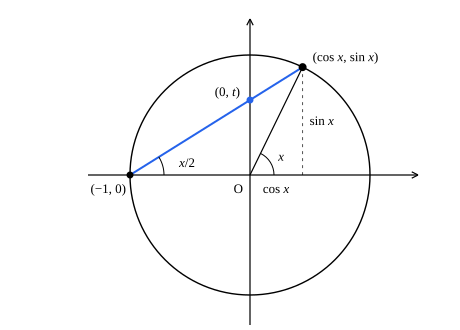

## 这一节要回答的问题

$\sin^2x$、$\sin^2x\cos^3x$、$\sin3x\cos2x$、$\frac1{1+\sin x+\cos x}$的:term[原函数]{id="math.calculus.antiderivative"}（antiderivative）怎样求？三角函数有一大堆恒等式，哪些能帮着积分？有没有一个办法，对所有由$\sin x$、$\cos x$做四则运算得到的函数都管用？

## 讲解

### 奇次幂：分出一个因子

求$\int\sin^mx\cos^nx\,\dd x$，$n$是奇数时，分出一个$\cos x$，和$\dd x$一起凑成$\dd u$，$u=\sin x$；剩下的$\cos^{n-1}x$是偶次幂，用$\cos^2x=1-\sin^2x$写成$u$的多项式。这是:term[第一类换元法]{id="math.calculus.substitution-first-kind"}（substitution of the first kind）。比如

$$
\begin{aligned}
\int\sin^2x\cos^3x\,\dd x&=\int\sin^2x\bigl(1-\sin^2x\bigr)\cos x\,\dd x\\
&=\int\bigl(u^2-u^4\bigr)\dd u=\frac{\sin^3x}3-\frac{\sin^5x}5+C.
\end{aligned}
$$

$m$是奇数时同样分出一个$\sin x$，令$u=\cos x$：$\int\sin^3x\,\dd x=\int\bigl(1-\cos^2x\bigr)\sin x\,\dd x=-\cos x+\frac{\cos^3x}3+C$。边界情况：$m$、$n$都是偶数时，分出一个因子以后剩下的是奇次幂，换不成$u$的多项式，要用下面的办法。

### 偶次幂：降幂

由二倍角公式$\cos2x=1-2\sin^2x=2\cos^2x-1$，得

$$
\sin^2x=\frac{1-\cos2x}2,\qquad\cos^2x=\frac{1+\cos2x}2.
$$

次数减半，代价是角度加倍，这叫降幂。$m$、$n$都是偶数时反复降幂，直到只剩$\cos2x$、$\cos4x$这样的一次项：$\int\sin^2x\,\dd x=\frac x2-\frac{\sin2x}4+C$；$\cos^4x=\Bigl(\frac{1+\cos2x}2\Bigr)^2=\frac38+\frac{\cos2x}2+\frac{\cos4x}8$，所以$\int\cos^4x\,\dd x=\frac{3x}8+\frac{\sin2x}4+\frac{\sin4x}{32}+C$。边界情况：$\sin x$在一个周期上积分是$0$，$\sin^2x$不是：它总不小于$0$，:term[平均值]{id="math.calculus.average-value"}（average value）是$\frac12$，$\int_0^{2\pi}\sin^2x\,\dd x=\pi$。

### 积化和差

两个角度不同的三角函数相乘，用积化和差写成和：

$$
\begin{aligned}
\sin\alpha\cos\beta&=\frac{\sin(\alpha+\beta)+\sin(\alpha-\beta)}2,\\
\sin\alpha\sin\beta&=\frac{\cos(\alpha-\beta)-\cos(\alpha+\beta)}2,\\
\cos\alpha\cos\beta&=\frac{\cos(\alpha-\beta)+\cos(\alpha+\beta)}2.
\end{aligned}
$$

比如$\int\sin3x\cos2x\,\dd x=\frac12\int(\sin5x+\sin x)\,\dd x=-\frac{\cos5x}{10}-\frac{\cos x}2+C$。$m$、$n$是不同的正整数时，$\sin mx\sin nx$在$[-\pi,\pi]$上积分为$0$（第 7 题），以后在数学分析里要用到，见[傅里叶级数](lesson:math.analysis.fourier-series)。

### 万能代换

::anchor{id="def-rational-trig"}
由$\sin x$、$\cos x$和常数经过有限次四则运算得到的函数，叫作三角函数有理式（rational function of sine and cosine），记作$R(\sin x,\cos x)$。

为什么单独起名：前面三种办法各管一类，三角函数有理式还有$\frac1{2+\cos x}$、$\frac{\sin x}{1+\sin x}$这样的，需要一个对整类都管用的办法。边界情况：$\sin x^2$、$x\sin x$不是三角函数有理式，前者是复合，后者乘了$x$本身。

::anchor{id="thm-universal-substitution"}
**定理（万能代换，universal substitution）**　在$(-\pi,\pi)$上令$t=\tan\frac x2$，则$\sin x=\frac{2t}{1+t^2}$，$\cos x=\frac{1-t^2}{1+t^2}$，$\dd x=\frac{2\,\dd t}{1+t^2}$，$\int R(\sin x,\cos x)\,\dd x$化成$t$的有理函数的积分。

道理：$\cos^2\frac x2=\frac1{1+\tan^2\frac x2}=\frac1{1+t^2}$，由二倍角公式，$\sin x=2\tan\frac x2\cos^2\frac x2=\frac{2t}{1+t^2}$，$\cos x=\bigl(1-\tan^2\frac x2\bigr)\cos^2\frac x2=\frac{1-t^2}{1+t^2}$。$x=2\arctan t$严格递增，由:term[反正切函数]{id="math.calculus.arctangent"}（arctangent）的:term[导数]{id="math.calculus.derivative"}（derivative），$\dd x=\frac{2\,\dd t}{1+t^2}$，这是:term[第二类换元法]{id="math.calculus.substitution-second-kind"}（substitution of the second kind）。$\sin x$、$\cos x$、$\dd x$都成了$t$的有理函数，拆成:term[部分分式]{id="math.calculus.partial-fraction"}（partial fractions）就能积出来。

为什么叫万能：三角函数有理式都能这样化，但化出来的有理函数常常很繁，能用前面的办法就先用前面的（常见误区）。边界情况：$t=\tan\frac x2$在$x=\pm\pi$（$\pi$的奇数倍）处没有定义，:term[积分区间]{id="math.calculus.interval-of-integration"}（interval of integration）跨过这些点时要拆开。$\int_0^{2\pi}\frac{\dd x}{2+\cos x}$的:term[被积函数]{id="math.calculus.integrand"}（integrand）处处为正，可$t$的上下限都是$\tan0=\tan\pi=0$，直接换限会得到$0$（第 6 题）。

## 几何图像

过点$(-1,0)$画一条直线，和纵轴交于$(0,t)$，和单位圆交于另一点$\bigl(\cos x,\sin x\bigr)$。圆心角是$x$，同一段弧所对的圆周角是它的一半，所以直线和横轴的夹角是$\frac x2$，斜率$t=\tan\frac x2$。反过来，给定斜率$t$，把直线方程代入圆的方程解出另一个交点，坐标是$\frac{1-t^2}{1+t^2}$和$\frac{2t}{1+t^2}$：万能代换就是用过$(-1,0)$的直线的斜率，给圆上的点编号。

## 例题

### 例 1　两个偶次幂相乘

求$\int\sin^2x\cos^2x\,\dd x$。

**为什么想到这么做**：两个都是偶次幂，分出一个因子行不通，要降幂。先用$\sin x\cos x=\frac12\sin2x$把乘积合成一项，只需降一次幂。

**推导**：$\sin^2x\cos^2x=\frac14\sin^22x=\frac{1-\cos4x}8$，所以

$$
\int\sin^2x\cos^2x\,\dd x=\int\frac{1-\cos4x}8\,\dd x=\frac x8-\frac{\sin4x}{32}+C.
$$

### 例 2　用万能代换

求$\int\frac{\dd x}{1+\sin x+\cos x}$（$-\frac\pi2<x<\pi$）。

**为什么想到这么做**：分母里$\sin x$、$\cos x$都是一次，分不出因子，也不是乘积，前三种办法都用不上；它是三角函数有理式，用万能代换。在所给的范围里$t=\tan\frac x2$有定义，分母也不为$0$。

**推导**：$1+\frac{2t}{1+t^2}+\frac{1-t^2}{1+t^2}=\frac{2+2t}{1+t^2}$，所以

$$
\int\frac{\dd x}{1+\sin x+\cos x}=\int\frac{1+t^2}{2(1+t)}\cdot\frac{2\,\dd t}{1+t^2}=\int\frac{\dd t}{1+t}=\ln\Bigl|1+\tan\frac x2\Bigr|+C.
$$

## 常见误区

- 「$\int\sin^2x\,\dd x=\frac{\sin^3x}3+C$。」求导验算：$\Bigl(\frac{\sin^3x}3\Bigr)'=\sin^2x\cos x$，多了因子$\cos x$。幂函数的积分公式只对:term[积分变量]{id="math.calculus.integration-variable"}（variable of integration）本身的幂成立。
- 「万能代换的上下限照搬就行。」$t=\tan\frac x2$在$x=\pi$处没有定义，:term[积分区间]{id="math.calculus.interval-of-integration"}跨过$\pi$时要拆开，否则可能得到$0$这样明显错误的结果。
- 「三角函数的积分用万能代换最省事。」$\int\sin x\cos^2x\,\dd x$令$u=\cos x$，一步得到$-\frac{\cos^3x}3+C$；用万能代换，要积一个分母是$(1+t^2)^4$的有理函数。
