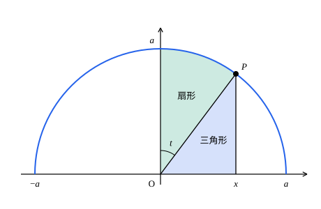

## 这一节要回答的问题

由几何，$\int_{-1}^1\sqrt{1-x^2}\,\dd x$是半个单位圆的面积$\frac\pi2$，可$\sqrt{1-x^2}$的:term[原函数]{id="math.calculus.antiderivative"}（antiderivative）是什么？$\frac1{\sqrt{x^2+1}}$、$\frac{\sqrt{x^2-4}}x$呢？根号里是$x$的二次式，:term[凑微分]{id="math.calculus.substitution-first-kind"}（substitution of the first kind）凑不出来，令根号为$t$也去不掉$x^2$。三角函数之间有$1-\sin^2t=\cos^2t$这样的平方关系，能不能借来开方？

## 讲解

### 三种代换

::anchor{id="def-trig-substitution"}
:term[被积函数]{id="math.calculus.integrand"}（integrand）含$\sqrt{a^2-x^2}$时令$x=a\sin t$，$-\frac\pi2\le t\le\frac\pi2$；含$\sqrt{a^2+x^2}$时令$x=a\tan t$，$-\frac\pi2<t<\frac\pi2$；含$\sqrt{x^2-a^2}$、$x\ge a$时令$x=\frac a{\cos t}$，$0\le t<\frac\pi2$（$a>0$）。这样的代换叫作:term[三角代换]{id="math.calculus.trig-substitution"}（trigonometric substitution）。

为什么这样选：三个根号分别变成$a\cos t$、$\frac a{\cos t}$、$a\tan t$，靠的是$1-\sin^2t=\cos^2t$、$1+\tan^2t=\frac1{\cos^2t}$、$\frac1{\cos^2t}-1=\tan^2t$。规定$t$的范围，一是让$x$是$t$的严格单调函数，好用:term[第二类换元法]{id="math.calculus.substitution-second-kind"}（substitution of the second kind）换回$x$；二是前两种的范围里$\cos t\ge0$，第三种的范围里$\tan t\ge0$，开方时不用加绝对值。边界情况：范围选错了，开方会差一个符号，比如$t$取在$\bigl[\frac\pi2,\frac{3\pi}2\bigr]$上，$\sqrt{a^2-a^2\sin^2t}=-a\cos t$。

### 圆的面积

求$\int\sqrt{a^2-x^2}\,\dd x$。令$x=a\sin t$，$\dd x=a\cos t\,\dd t$，$\sqrt{a^2-x^2}=a\cos t$，再用[三角函数的积分](lesson:math.calculus.trig-integrals)里的降幂：

$$
\int\sqrt{a^2-x^2}\,\dd x=a^2\int\cos^2t\,\dd t=\frac{a^2}2\bigl(t+\sin t\cos t\bigr)+C.
$$

换回$x$：$\sin t=\frac xa$，$t=\arcsin\frac xa$，$\cos t=\frac{\sqrt{a^2-x^2}}a$，所以$\int\sqrt{a^2-x^2}\,\dd x=\frac{a^2}2\arcsin\frac xa+\frac x2\sqrt{a^2-x^2}+C$。两项各有几何意义，见几何图像。代入$\pm a$，$\int_{-a}^a\sqrt{a^2-x^2}\,\dd x=\frac{a^2}2\Bigl(\frac\pi2+\frac\pi2\Bigr)=\frac{\pi a^2}2$，和半圆的面积一致。

### 另外两种根号

$\sqrt{x^2+a^2}$：令$x=a\tan t$，$\dd x=\frac{a\,\dd t}{\cos^2t}$，$\sqrt{x^2+a^2}=\frac a{\cos t}$，所以$\int\frac{\dd x}{\sqrt{x^2+a^2}}=\int\frac{\dd t}{\cos t}$。求导可以验证$\int\frac{\dd t}{\cos t}=\ln\frac{1+\sin t}{\cos t}+C$（$|t|<\frac\pi2$），而$\frac{1+\sin t}{\cos t}=\frac{\sqrt{x^2+a^2}+x}a$，常数$-\ln a$并进$C$，得

$$
\begin{aligned}
\int\frac{\dd x}{\sqrt{x^2+a^2}}&=\ln\Bigl(x+\sqrt{x^2+a^2}\Bigr)+C,\\
\int\frac{\dd x}{\sqrt{x^2-a^2}}&=\ln\Bigl(x+\sqrt{x^2-a^2}\Bigr)+C\quad(x>a).
\end{aligned}
$$

后一个令$x=\frac a{\cos t}$，同样化成$\int\frac{\dd t}{\cos t}$。为什么换回$x$总是做得到：$\sin t$、$\cos t$、$\tan t$里有一个是$\frac xa$或$\frac ax$，画一个直角三角形，让它的一个锐角是$t$，三条边分别是$x$、$a$和那个根号，其余的三角函数就从边长读出来。边界情况：$x<-a$时$\sqrt{x^2-a^2}$也有定义，这时$t$要另取在$\bigl(\frac\pi2,\pi\bigr]$上，结果写成$\ln\bigl|x+\sqrt{x^2-a^2}\bigr|+C$（第 7 题）。

## 几何图像

上半圆$y=\sqrt{a^2-x^2}$下面、从$0$到$x$的一块，被半径$OP$分成两块。扇形的圆心角是$t$，$\sin t=\frac xa$，面积是$\frac12a^2t=\frac{a^2}2\arcsin\frac xa$；直角三角形的两条直角边是$x$和$\sqrt{a^2-x^2}$，面积是$\frac x2\sqrt{a^2-x^2}$。两块加起来正是$\int_0^x\sqrt{a^2-s^2}\,\dd s$：:term[三角代换]{id="math.calculus.trig-substitution"}里的$t$就是这个圆心角。

## 例题

### 例 1　分母是二次式的平方

求$\int_0^1\frac{\dd x}{(x^2+1)^2}$。

**为什么想到这么做**：$\frac1{(x^2+1)^2}$是[有理函数的积分](lesson:math.calculus.partial-fractions)里第四种:term[部分分式]{id="math.calculus.partial-fraction"}（partial fractions），那里要用递推公式。分母里有$x^2+1$，令$x=\tan t$，$1+\tan^2t=\frac1{\cos^2t}$，分母变成三角函数，直接积。

**推导**：$\dd x=\frac{\dd t}{\cos^2t}$，$x$从$0$到$1$时$t$从$0$到$\frac\pi4$，所以

$$
\int_0^1\frac{\dd x}{(x^2+1)^2}=\int_0^{\pi/4}\cos^4t\cdot\frac{\dd t}{\cos^2t}=\int_0^{\pi/4}\cos^2t\,\dd t=\frac12\Bigl(t+\sin t\cos t\Bigr)\Big|_0^{\pi/4}=\frac\pi8+\frac14.
$$

### 例 2　第三种根号

求$\int_2^4\frac{\sqrt{x^2-4}}x\,\dd x$。

**为什么想到这么做**：含$\sqrt{x^2-4}$，$x\ge2$，令$x=\frac2{\cos t}$，$0\le t<\frac\pi2$，根号变成$2\tan t$。$x=2$时$t=0$，$x=4$时$\cos t=\frac12$，$t=\frac\pi3$。

**推导**：$\dd x=\frac{2\sin t}{\cos^2t}\,\dd t$，被积式化成$\frac{2\tan t}{2/\cos t}\cdot\frac{2\sin t}{\cos^2t}\,\dd t=2\tan^2t\,\dd t$，而$\tan^2t=\frac1{\cos^2t}-1$，所以

$$
\int_2^4\frac{\sqrt{x^2-4}}x\,\dd x=2\int_0^{\pi/3}\Bigl(\frac1{\cos^2t}-1\Bigr)\dd t=2\bigl(\tan t-t\bigr)\Big|_0^{\pi/3}=2\sqrt3-\frac{2\pi}3.
$$

## 常见误区

- 「$x=a\sin t$时$\sqrt{a^2-x^2}=a\cos t$，对哪个$t$都成立。」只有$\cos t\ge0$时才成立；$t$要限制在$\bigl[-\frac\pi2,\frac\pi2\bigr]$上，这也保证了$x$和$t$一一对应。
- 「:term[不定积分]{id="math.calculus.indefinite-integral"}（indefinite integral）做完:term[三角代换]{id="math.calculus.trig-substitution"}，结果用$t$表示就行。」要换回$x$：$\int\sqrt{1-x^2}\,\dd x$写成$\frac12(t+\sin t\cos t)+C$还没完，要写成$\frac12\arcsin x+\frac x2\sqrt{1-x^2}+C$。
- 「看到$\sqrt{1-x^2}$就用三角代换。」$\int x\sqrt{1-x^2}\,\dd x$里有因子$x$，令$u=1-x^2$，一步得到$-\frac13\bigl(1-x^2\bigr)^{3/2}+C$；三角代换反而绕远。
