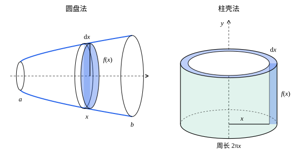

## 这一节要回答的问题

中学学过，锥体的体积是同底等高柱体的三分之一，球的体积是$\frac43\pi r^3$，这些公式是怎么来的？一个立体的每个截面都知道时，能不能把截面「叠」起来得到体积？一块平面图形绕一条直线转一圈，得到的立体体积又怎么求？

## 讲解

### 已知截面面积

::anchor{id="thm-volume-by-slices"}
**定理**　立体夹在平面$x=a$和$x=b$之间，用垂直于$x$轴的平面去截，在$x$处截得的截面（cross-section）面积是$A(x)$，$A$:term[连续]{id="math.calculus.continuous"}（continuous），则立体的体积是$V=\int_a^bA(x)\,\dd x$。

道理：用:term[微元法]{id="math.calculus.element-method"}（method of differential elements）。$[x,x+\dd x]$上的薄片近似是底面积$A(x)$、高$\dd x$的柱体，体积的:term[微元]{id="math.calculus.differential-element"}（differential element）是$\dd V=A(x)\,\dd x$，从$a$积到$b$就是$V$。薄片和柱体之差和$\dd x$相比趋于$0$，严格的证明要用多变量微积分的:term[二重积分]{id="math.vector-calculus.double-integral"}（double integral），这里不证。

为什么有用：只要截面面积相同，体积就相同，形状可以不同，这就是祖暅原理（Cavalieri's principle）。锥体高$h$、底面积$S$，离顶点$x$处的截面和底面相似，相似比是$\frac xh$，面积$A(x)=S\frac{x^2}{h^2}$，所以$V=\int_0^hS\frac{x^2}{h^2}\,\dd x=\frac13Sh$。边界情况：截面要垂直于:term[积分变量]{id="math.calculus.integration-variable"}（variable of integration）所在的轴；斜着截，薄片的厚度就不是$\dd x$。

### 旋转体：圆盘法

::anchor{id="def-solid-of-revolution"}
平面图形绕同一平面内的一条直线旋转一周，得到的立体叫作旋转体（solid of revolution），这条直线叫作旋转轴（axis of revolution）。

为什么单独讲：圆柱、圆锥、球、碗都是旋转体，垂直于旋转轴的截面都是圆或圆环，面积马上写得出。边界情况：图形和旋转轴之间有空隙时，截面是圆环，中间是空的。

::anchor{id="thm-disk-method"}
**定理（圆盘法，disk method）**　$f$在$[a,b]$上:term[连续]{id="math.calculus.continuous"}、$f\ge0$，曲线$y=f(x)$下面的图形绕$x$轴旋转，得到的旋转体体积是$V=\pi\int_a^bf(x)^2\,\dd x$；$f\ge g\ge0$时，两条曲线之间的图形绕$x$轴旋转，体积是$V=\pi\int_a^b\bigl[f(x)^2-g(x)^2\bigr]\dd x$。

道理：$x$处的截面是半径$f(x)$的圆，$A(x)=\pi f(x)^2$；有空隙时是外半径$f(x)$、内半径$g(x)$的圆环，$A(x)=\pi\bigl(f^2-g^2\bigr)$。比如半圆$y=\sqrt{r^2-x^2}$绕$x$轴转出半径为$r$的球，$V=\pi\int_{-r}^r\bigl(r^2-x^2\bigr)\dd x=\frac43\pi r^3$。

### 柱壳法

::anchor{id="thm-shell-method"}
**定理（柱壳法，shell method）**　$0\le a<b$，$f$在$[a,b]$上:term[连续]{id="math.calculus.continuous"}、$f\ge0$，曲线$y=f(x)$下面的图形绕$y$轴旋转，得到的旋转体体积是$V=2\pi\int_a^bxf(x)\,\dd x$。

道理：$[x,x+\dd x]$上的那一窄条绕$y$轴转一圈，成为一层薄薄的圆柱壳，半径$x$、高约$f(x)$、厚$\dd x$。它的体积约为$\pi\bigl[(x+\dd x)^2-x^2\bigr]f(x)=2\pi xf(x)\,\dd x+\pi f(x)(\dd x)^2$，后一项和$\dd x$相比趋于$0$，所以$\dd V=2\pi xf(x)\,\dd x$。把柱壳沿竖直方向剪开、摊平，就是长$2\pi x$、高$f(x)$、厚$\dd x$的薄板。

为什么有用：绕$y$轴旋转时用圆盘法，截面要按$y$来写，得先从$y=f(x)$解出$x$；柱壳法不用解。$y=x-x^2$（$0\le x\le1$）下面的图形绕$y$轴旋转，解出$x$有两支，柱壳法却只要$V=2\pi\int_0^1x\bigl(x-x^2\bigr)\dd x=\frac\pi6$。边界情况：半径是到旋转轴的距离，绕直线$x=c$旋转时，半径要换成$|x-c|$。

## 几何图像

左图：垂直于$x$轴切下一片，近似是半径$f(x)$、厚$\dd x$的圆盘，$\dd V=\pi f(x)^2\,\dd x$。右图：平行于旋转轴的一窄条转一圈，成为半径$x$、高$f(x)$、厚$\dd x$的柱壳，摊平以后长是周长$2\pi x$，$\dd V=2\pi xf(x)\,\dd x$。两种切法对应两种:term[微元]{id="math.calculus.differential-element"}，积出同一个体积。

## 例题

### 例 1　截面是正方形

一个立体的底面是圆盘$x^2+y^2\le r^2$，垂直于$x$轴的截面都是正方形，正方形的一边落在底面的弦上。求它的体积。

**为什么想到这么做**：截面面积知道：$x$处的弦长是$2\sqrt{r^2-x^2}$，正方形的面积是它的平方，直接积截面面积。

**推导**：$A(x)=4\bigl(r^2-x^2\bigr)$，所以

$$
V=\int_{-r}^r4\bigl(r^2-x^2\bigr)\dd x=4\Bigl(r^2x-\frac{x^3}3\Bigr)\Big|_{-r}^r=\frac{16}3r^3.
$$

### 例 2　圆环面围成的体积

圆盘$(x-R)^2+y^2\le\rho^2$（$0<\rho<R$）绕$y$轴旋转，转出一个像救生圈的立体。求它的体积。

**为什么想到这么做**：绕$y$轴旋转，用柱壳法。$x$处的竖条从$y=-\sqrt{\rho^2-(x-R)^2}$到$\sqrt{\rho^2-(x-R)^2}$，高$2\sqrt{\rho^2-(x-R)^2}$。把$x$写成$R+(x-R)$，一部分是圆盘的面积，另一部分关于$x=R$左右抵消。

**推导**：

$$
\begin{aligned}
V&=2\pi\int_{R-\rho}^{R+\rho}x\cdot2\sqrt{\rho^2-(x-R)^2}\,\dd x\\
&=2\pi R\int_{R-\rho}^{R+\rho}2\sqrt{\rho^2-(x-R)^2}\,\dd x\\
&\quad+2\pi\int_{R-\rho}^{R+\rho}(x-R)\cdot2\sqrt{\rho^2-(x-R)^2}\,\dd x.
\end{aligned}
$$

第一个积分是圆盘的面积$\pi\rho^2$；第二个积分的:term[被积函数]{id="math.calculus.integrand"}（integrand）在$x=R$两侧互为相反数，积分是$0$。所以$V=2\pi R\cdot\pi\rho^2=2\pi^2R\rho^2$：圆盘的面积乘上圆心走过的路程$2\pi R$。

## 常见误区

- 「两条曲线之间的图形绕$x$轴旋转，体积是$\pi\int_a^b(f-g)^2\,\dd x$。」截面是圆环，面积是$\pi\bigl(f^2-g^2\bigr)$，不是$\pi(f-g)^2$。$f=2$、$g=1$时，在$[0,1]$上转出的是外半径$2$、内半径$1$的厚圆筒，体积$3\pi$，后者只给出$\pi$。
- 「柱壳法里，半径是$f(x)$，高是$x$。」半径是这一窄条到旋转轴的距离$x$，高才是$f(x)$。
- 「绕$y$轴旋转只能用柱壳法。」也可以用圆盘法，截面垂直于$y$轴，:term[积分变量]{id="math.calculus.integration-variable"}换成$y$，半径是从$y=f(x)$解出的$x$；只是解$x$常常麻烦。
