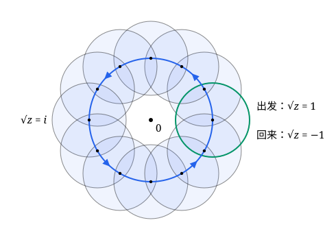

## 这一节要回答的问题

$\sum_{n=0}^\infty z^n$只在$|z|<1$里收敛，和是$\frac1{1-z}$；可$\frac1{1-z}$在$z\ne1$处都有定义，而且:term[全纯]{id="math.complex-analysis.holomorphic-function"}（holomorphic）。把它当作这个幂级数（power series）在单位圆盘外的「继续」，是唯一合理的做法吗？[全纯函数的幂级数展开](lesson:math.complex-analysis.power-series)一节的常见误区和第 8 题里，$\Log z$在$-1+i$处的泰勒级数（Taylor series）越过了:term[负实轴]{id="math.complex-analysis.real-axis"}（negative real axis），在负实轴下方的和比$\Log z$大$2\pi i$。一个函数沿不同的路往外「继续」，会得到不同的结果吗？

## 讲解

### 解析延拓

$f(z)=\sum_{n=0}^\infty z^n$在:term[开圆盘]{id="math.complex-analysis.open-disc"}（open disc）$|z|<1$上:term[全纯]{id="math.complex-analysis.holomorphic-function"}，在那里等于$\frac1{1-z}$；而$\frac1{1-z}$在更大的:term[区域]{id="math.complex-analysis.domain"}（domain）$\C\setminus\{1\}$上全纯。$|z|\ge1$时通项的:term[模]{id="math.complex-analysis.modulus"}（modulus）不小于$1$，级数发散，$\frac1{1-z}$却在那里接着给出值。

::anchor{id="def-continuation"}
设$D_1\subset D_2$都是区域，$f$在$D_1$上全纯。如果$F$在$D_2$上全纯，并且在$D_1$上处处$F=f$，就说$F$是$f$到$D_2$的:term[解析延拓]{id="math.complex-analysis.analytic-continuation"}（analytic continuation），也说把$f$解析延拓到$D_2$。

为什么这样定义：级数、积分常常只在一部分地方有意义，延拓把别处补上；要求$F$全纯，延拓就是唯一的（下面的定理），实函数只要求无穷次可导就不行（见第 7 题）。$\frac1{1-z}$就是$f$到$\C\setminus\{1\}$的解析延拓。边界情况：延拓不一定存在，$f$不能延拓到含$1$的区域，否则$F$在$1$处连续、在$1$附近有界，可$z$在单位圆盘里趋于$1$时$|F(z)|=\frac1{|1-z|}\to+\infty$。

::anchor{id="thm-continuation-unique"}
**定理**　设$D_1\subset D_2$都是区域，$F$、$G$都是$f$到$D_2$的解析延拓，则$F$、$G$在$D_2$上处处相等。

**证明**：$F$、$G$都在$D_2$上全纯，在:term[开集]{id="math.complex-analysis.open-set"}（open set）$D_1$上都等于$f$，所以在其中一点处，两者的函数值、各阶导数都分别相等。由:term[唯一性定理]{id="math.complex-analysis.identity-theorem"}（identity theorem），$F$、$G$在$D_2$上处处相等。

为什么有用：于是可以说「$f$到$D_2$的那个解析延拓」，用什么办法找到它都一样；[伽马函数的解析延拓](lesson:math.complex-analysis.gamma-continuation)一节就靠这一点。边界情况：$D_2$要连成一片，是两个:term[不相交]{id="math.logic-sets.disjoint"}（disjoint）的开圆盘时延拓就不唯一，例子见[唯一性定理](lesson:math.complex-analysis.identity-theorem#thm-identity)后面的边界情况。

### 越过收敛圆周

$f(z)=\sum_{n=0}^\infty z^n$的收敛圆周（circle of convergence）是$|z|=1$。取$b=-\frac12$，$f=\frac1{1-z}$在$b$处的$k$阶导数是$\frac{k!}{(1-b)^{k+1}}=k!\bigl(\frac23\bigr)^{k+1}$，所以它在$b$处的泰勒级数是$\sum_{k=0}^\infty\bigl(\frac23\bigr)^{k+1}\bigl(z+\frac12\bigr)^k$，收敛半径（radius of convergence）是$\frac32$。新的:term[收敛圆盘]{id="math.complex-analysis.disc-of-convergence"}（disc of convergence）$\bigl|z+\frac12\bigr|<\frac32$伸出了单位圆盘：$z=-1.2$处原来的级数发散，新级数是公比为$-\frac7{15}$的等比级数（geometric series），和是$\frac1{2.2}$，正是$\frac1{1-z}$的值。

::anchor{id="thm-recenter"}
**定理**　设幂级数$\sum_{n=0}^\infty a_n(z-a)^n$的收敛半径$R>0$，收敛圆盘是$\Delta$，和函数（sum function）是$f$，$b\in\Delta$。则$f$在$b$处的泰勒级数的收敛半径$R_b\ge R-|b-a|$；记这个泰勒级数的收敛圆盘为$\Delta_b$、和函数为$g$，则在$\Delta\cap\Delta_b$上$g=f$，于是$f$、$g$合起来是$f$到$\Delta\cup\Delta_b$的:term[解析延拓]{id="math.complex-analysis.analytic-continuation"}。

**证明**：由[逐项求导的定理](lesson:math.complex-analysis.complex-power-series#thm-termwise-complex)，$f$在$\Delta$上:term[全纯]{id="math.complex-analysis.holomorphic-function"}。由:term[三角不等式]{id="math.complex-analysis.triangle-inequality"}（triangle inequality），以$b$为圆心、半径为$R-|b-a|$的:term[开圆盘]{id="math.complex-analysis.open-disc"}含在$\Delta$里；由[泰勒展开的定理](lesson:math.complex-analysis.power-series#thm-taylor)，$f$在这个圆盘里等于它在$b$处的泰勒级数，所以$R_b\ge R-|b-a|$，并且在这个圆盘里$g=f$。

由三角不等式，开圆盘里两点连成的线段仍在圆盘里，所以$\Delta\cap\Delta_b$是:term[区域]{id="math.complex-analysis.domain"}。$f$、$g$在它上面全纯、在$b$附近相等，由:term[唯一性定理]{id="math.complex-analysis.identity-theorem"}在整个$\Delta\cap\Delta_b$上相等，所以在$\Delta$上取$f$、在$\Delta_b$上取$g$的函数有定义，每一点附近等于$f$或$g$，因而全纯；$\Delta\cup\Delta_b$里的点都能经过$b$用折线连起来，也是区域。

为什么有用：一次次换中心重新展开，能把$f$沿一串圆盘延拓出去。边界情况：$R_b$可能正好是$R-|b-a|$：$\sum z^n$在$b=\frac12$处重新展开，$z\to1$时$\bigl|\frac1{1-z}\bigr|\to+\infty$，由[收敛半径和最近的不全纯点](lesson:math.complex-analysis.power-series#thm-radius-nearest)的定理，收敛半径只有$\frac12$。

### 沿曲线延拓

定义域不是圆盘时，拼接会出问题。开头那个$\Log z$在$-1+i$处的泰勒级数，和函数$F$在圆盘$|z-(-1+i)|<\sqrt2$上:term[全纯]{id="math.complex-analysis.holomorphic-function"}。$\Log$的:term[支割线]{id="math.complex-analysis.branch-cut"}（branch cut）把圆盘切成不连成一片的上下两块，:term[唯一性定理]{id="math.complex-analysis.identity-theorem"}只管得到含$-1+i$的上面一块，那里$F=\Log z$；$F$连续地越过:term[负实轴]{id="math.complex-analysis.real-axis"}，下面一块里$\Im F$在$\pi$附近，$\Im\Log z$却在$-\pi$附近，两者都满足$e^w=z$，所以$F=\Log z+2\pi i$。延拓出来的是$\log z$的另一个:term[分支]{id="math.complex-analysis.branch"}（branch），不是$\Log z$。

::anchor{id="def-chain-continuation"}
设曲线$\gamma(t)$（$0\le t\le1$）从$z_0$走到$z_1$。取$0=t_0<t_1<\dots<t_k=1$和以$\gamma(t_j)$为圆心的:term[开圆盘]{id="math.complex-analysis.open-disc"}$\Delta_j$（$j=0,1,\dots,k$），使$\gamma$在$t_{j-1}\le t\le t_j$上的一段落在$\Delta_{j-1}$里。如果$f_j$在$\Delta_j$上全纯，并且在$\Delta_{j-1}\cap\Delta_j$上$f_j=f_{j-1}$（$j=1,\dots,k$），就说$f_k$是$f_0$沿$\gamma$的解析延拓（analytic continuation along a curve）。

为什么这样定义：一个圆盘装不下整条曲线，就用一串圆盘一段一段地接；两个圆盘的公共部分是:term[区域]{id="math.complex-analysis.domain"}，由唯一性定理，$f_{j-1}$定了，$f_j$就定了（只要存在），比如在$\gamma(t_j)$处把$f_{j-1}$重新展开。换一组满足条件的分点和圆盘，终点附近得到的函数也一样（这里不证）。每一步只在圆盘上拼，不会碰到上面的麻烦；可曲线回到出发点、取$\Delta_k=\Delta_0$时，$f_k$不一定等于$f_0$。

沿单位圆周把$\Log z$从$1$延拓一圈，回来时多了$2\pi i$（[复对数与幂函数](lesson:math.complex-analysis.complex-logarithm)一节第 7 题）；$\sqrt z$回来变成$-\sqrt z$（例 2）；:term[$n$次方根]{id="math.complex-analysis.nth-root"}（nth root）回来变成相邻的根（[复数的$n$次方根](lesson:math.complex-analysis.complex-roots)一节的几何图像和第 7 题）。这不违背:term[解析延拓]{id="math.complex-analysis.analytic-continuation"}的唯一性：唯一性管的是同一个区域上的函数，而这串圆盘拼起来围着原点，上面没有在每个$\Delta_j$上都等于$f_j$的函数，否则在$\Delta_0=\Delta_k$上它既是$f_0$又是$f_k$。

## 几何图像

图上是例 2 的延拓：:term[开圆盘]{id="math.complex-analysis.open-disc"}$\Delta_0,\dots,\Delta_{11}$的圆心依次排在单位圆周上，都不含原点，绿色的$\Delta_0$也是最后一个$\Delta_{12}$。每个圆盘里取一个:term[全纯]{id="math.complex-analysis.holomorphic-function"}的$\sqrt z$，每一步都只有一种接法；走半圈到$-1$时值是$i$，回到$1$时变成了$-1$。

:::anim{component="function-plot"}
range: { x: [-2.4, 0.9], y: [-1, 4] }
functions:
  - expr: "1/(1-x)"
    label: |
      $\frac1{1-x}$
  - expr: "sum(k, 0, N, x^k)"
    label: |
      $\sum_{k=0}^{N}x^k$
  - expr: "sum(k, 0, N, (2/3)^(k+1) * (x + 1/2)^k)"
    label: |
      $\sum_{k=0}^{N}\bigl(\frac23\bigr)^{k+1}\bigl(x+\frac12\bigr)^k$
sliders:
  - name: N
    min: 1
    max: 40
    step: 1
    default: 6
    label: |
      求和到$k=N$
:::

在:term[实轴]{id="math.complex-analysis.real-axis"}（real axis）上看重新展开（$z$图上写作$x$）：蓝线是$\frac1{1-x}$，橙线、绿线分别是原来的级数和在$-\frac12$处重新展开的级数的部分和（partial sum），滑块调求和到第几次。项数加多时，橙线只在$-1<x<1$里贴向蓝线，绿线在$-2<x<1$里都贴向蓝线，越过了$-1$。

## 例题

### 例 1　把$\sum\frac{z^n}n$延拓出去

设$|z|<1$时$f(z)=\sum_{n=1}^\infty\frac{z^n}n$。求$f$到:term[区域]{id="math.complex-analysis.domain"}$\C\setminus[1,+\infty)$的:term[解析延拓]{id="math.complex-analysis.analytic-continuation"}。

**为什么想到这么做**：逐项求导得到$\frac1{1-z}$；找一个在大区域上:term[全纯]{id="math.complex-analysis.holomorphic-function"}、导数也是它的函数，再用:term[唯一性定理]{id="math.complex-analysis.identity-theorem"}说明两者在单位圆盘里相等。

**推导**：由[逐项求导的定理](lesson:math.complex-analysis.complex-power-series#thm-termwise-complex)，$|z|<1$时$f'(z)=\sum_{n=1}^\infty z^{n-1}=\frac1{1-z}$，又$f(0)=0$。令$F(z)=-\Log(1-z)$：$1-z$落在$(-\infty,0]$里，当且仅当$z$是$[1,+\infty)$里的实数，所以由[对数的导数](lesson:math.complex-analysis.complex-logarithm#thm-log-derivative)和[求导法则](lesson:math.complex-analysis.complex-derivative#thm-derivative-rules)，$F$在$\C\setminus[1,+\infty)$上全纯，$F'(z)=\frac1{1-z}$，并且$F(0)=0$。在$|z|<1$上$f'=F'$，所以$f$、$F$在$0$处的函数值、各阶导数都相等，由唯一性定理，在$|z|<1$上$f=F$。$\C\setminus[1,+\infty)$是区域，$F$就是$f$到它的解析延拓，由延拓的唯一性，也只有这一个。

### 例 2　沿单位圆延拓$\sqrt z$

在$1$附近取$\sqrt z$的主值$e^{\frac12\Log z}$（$\sqrt1=1$）。沿单位圆周逆时针走一圈，把它:term[解析延拓]{id="math.complex-analysis.analytic-continuation"}回$1$附近，得到什么函数？

**为什么想到这么做**：不含原点的小圆盘里能取$\log z$的:term[分支]{id="math.complex-analysis.branch"}$F$，$e^{F/2}$就是一个:term[全纯]{id="math.complex-analysis.holomorphic-function"}的平方根；只要让相邻圆盘里的:term[辐角]{id="math.complex-analysis.argument"}（argument）接得上。

**推导**：取几何图像里的圆盘：$\theta_j=\frac{j\pi}6$，$\Delta_j$以$e^{i\theta_j}$为圆心、半径为$\frac35$（$j=0,1,\dots,12$）；圆周上从$e^{i\theta_{j-1}}$到$e^{i\theta_j}$的一段离$e^{i\theta_{j-1}}$不超过$2\sin\frac\pi{12}<\frac35$，落在$\Delta_{j-1}$里。$\Delta_j$里$\bigl|ze^{-i\theta_j}-1\bigr|<\frac35$，$ze^{-i\theta_j}$在右半平面里，所以

$$
F_j(z)=\Log\bigl(ze^{-i\theta_j}\bigr)+i\theta_j
$$

在$\Delta_j$上全纯，$e^{F_j(z)}=z$，:term[虚部]{id="math.complex-analysis.imaginary-part"}（imaginary part）是$z$的一个辐角，和$\theta_j$相差不到$\frac\pi2$。令$f_j=e^{F_j/2}$，$f_0$就是主值。

在$\Delta_{j-1}\cap\Delta_j$上，$F_j$、$F_{j-1}$的:term[实部]{id="math.complex-analysis.real-part"}（real part）都是$\ln|z|$，虚部都是$z$的辐角，相差$2\pi$的整数倍，又相差不到$\frac\pi2+\frac\pi6+\frac\pi2<2\pi$，所以相等，$f_j=f_{j-1}$；$f_{12}$就是$f_0$沿单位圆周的解析延拓。$\Delta_{12}=\Delta_0$上$F_{12}(z)=\Log z+2\pi i$，所以$f_{12}=e^{\frac12\Log z}e^{\pi i}=-f_0$：每一步都由:term[唯一性定理]{id="math.complex-analysis.identity-theorem"}定死了，回来时却是$-\sqrt z$。

## 常见误区

- 「沿哪条路延拓，结果都一样。」沿单位圆周把$\sqrt z$延拓一圈，回来是$-\sqrt z$，不是原地不动时的$\sqrt z$（例 2）。
- 「幂级数在收敛圆周上的某点发散，和函数就延拓不过这一点。」$\sum z^n$在$|z|=1$上处处发散，可在$-\frac12$处重新展开，新的:term[收敛圆盘]{id="math.complex-analysis.disc-of-convergence"}就盖住了$-1$；它的和函数只在$z=1$处延拓不过去。
