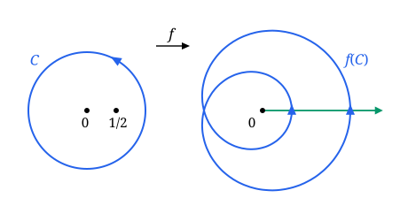

## 这一节要回答的问题

多项式$p$在一条闭曲线（closed curve）$C$里面有几个根？:term[留数定理]{id="math.complex-analysis.residue-theorem"}（residue theorem）把$\oint_C$化成$C$里面各点的:term[留数]{id="math.complex-analysis.residue"}（residue）之和；要是有一个函数恰好在$p$的每个根处有留数，并且留数就是根的重数，不用解方程，积分就把根数出来了。这样数出的个数，和$p(z)$沿$C$走一圈时绕原点转的圈数有什么关系？

## 讲解

### 对数导数

设$p(z)=c(z-z_1)\cdots(z-z_n)$，$c\ne0$，根可以有重复。由乘积的求导法则（product rule），在不是根的点上

$$
\frac{p'(z)}{p(z)}=\frac1{z-z_1}+\frac1{z-z_2}+\dots+\frac1{z-z_n}.
$$

设$C$是逆时针的分段光滑（piecewise smooth）简单闭曲线（simple closed curve），不经过这些根。由[变形积分路径](lesson:math.complex-analysis.cauchy-theorem#thm-deformation)后面的说明，$z_k$在$C$里面时$\oint_C\frac{\dd z}{z-z_k}=2\pi i$，在外面时是$0$，所以$\frac1{2\pi i}\oint_C\frac{p'}p\,\dd z$正是$C$里面的根数，重根按重数计。

::anchor{id="def-log-derivative"}
设$f$在:term[开集]{id="math.complex-analysis.open-set"}（open set）$D$上除去一些:term[孤立奇点]{id="math.complex-analysis.isolated-singularity"}（isolated singularity）外处处:term[全纯]{id="math.complex-analysis.holomorphic-function"}（holomorphic）。在$f$全纯、不为$0$的点$z$处，$\frac{f'(z)}{f(z)}$叫作$f$的:term[对数导数]{id="math.complex-analysis.logarithmic-derivative"}（logarithmic derivative）。

为什么这样定义：$f(z)$不在原点和:term[负实轴]{id="math.complex-analysis.real-axis"}（negative real axis）上时，由[对数的导数](lesson:math.complex-analysis.complex-logarithm#thm-log-derivative)和复合函数的[求导法则](lesson:math.complex-analysis.complex-derivative#thm-derivative-rules)，$\bigl(\Log f(z)\bigr)'=\frac{f'(z)}{f(z)}$，名字由此而来。边界情况：$e^{1/z}$的对数导数是$-\frac1{z^2}$，在:term[本性奇点]{id="math.complex-analysis.essential-singularity"}（essential singularity）$0$处有:term[二阶极点]{id="math.complex-analysis.pole"}（pole of order 2），:term[留数]{id="math.complex-analysis.residue"}是$0$。

::anchor{id="thm-log-residue"}
**定理**　设$a$是$f$的:term[$m$阶零点]{id="math.complex-analysis.order-of-zero"}（zero of order m）或$m$阶极点。则$a$是$\frac{f'}f$的一阶极点（simple pole），留数分别是$m$和$-m$。

**证明**：由[零点的阶](lesson:math.complex-analysis.identity-theorem#def-zero-order)和[极点的阶的定理](lesson:math.complex-analysis.singularities#thm-pole-order)，在$a$附近$f(z)=(z-a)^kg(z)$，零点时$k=m$，极点时$k=-m$；$g$在以$a$为圆心的某个:term[开圆盘]{id="math.complex-analysis.open-disc"}（open disc）上全纯、不为$0$（$g(a)\ne0$，由连续性把圆盘取小）。在去掉圆心的圆盘里，

$$
\frac{f'(z)}{f(z)}=\frac{k(z-a)^{k-1}g(z)+(z-a)^kg'(z)}{(z-a)^kg(z)}=\frac k{z-a}+\frac{g'(z)}{g(z)}.
$$

$g'$也全纯（[导数自动连续](lesson:math.complex-analysis.higher-derivatives#thm-derivative-continuous)），$\frac{g'}g$在整个圆盘上全纯、等于泰勒级数（Taylor series），由:term[洛朗级数]{id="math.complex-analysis.laurent-series"}（Laurent series）的唯一性，$\frac{f'}f$在$a$处的:term[主部]{id="math.complex-analysis.principal-part"}（principal part）是$\frac k{z-a}$（$k\ne0$）：$a$是一阶极点，留数是$k$。

### 辐角原理

::anchor{id="thm-argument-principle"}
**定理（:term[辐角原理]{id="math.complex-analysis.argument-principle"}，argument principle）**　设$C$是逆时针的分段光滑简单闭曲线；$f$在一个包含$C$和它围成的部分的:term[开集]{id="math.complex-analysis.open-set"}上，除$C$里面的有限个:term[极点]{id="math.complex-analysis.pole"}外处处:term[全纯]{id="math.complex-analysis.holomorphic-function"}，在$C$上没有零点。则$f$在$C$里面只有有限个零点，并且$\frac1{2\pi i}\oint_C\frac{f'(z)}{f(z)}\,\dd z=N-P$，其中$N$、$P$分别是$f$在$C$里面的零点个数和极点个数，都按阶计：:term[$m$阶零点]{id="math.complex-analysis.order-of-zero"}、$m$阶极点都算$m$个。

**证明**：零点有限：否则照[零点的孤立性与唯一性定理](lesson:math.complex-analysis.identity-theorem#thm-finite-zeros)一节第二个推论的证明，有一列互不相同的零点收敛到$C$上或$C$里面的一点$z^*$。$z^*$不是极点（[极点附近$|f|\to+\infty$](lesson:math.complex-analysis.singularities#thm-pole-modulus)），所以$f$在$z^*$附近全纯，由连续性$f(z^*)=0$；$f$在$C$上不为$0$，所以$z^*$在$C$里面，是不孤立的零点。$C$围成的部分去掉极点是:term[区域]{id="math.complex-analysis.domain"}（domain），由:term[零点的孤立性]{id="math.complex-analysis.isolated-zeros"}（principle of isolated zeros），$f$在上面恒为$0$，由连续性在$C$上也是$0$，矛盾。

$f$全纯、不为$0$的点组成开集，添上$C$里面的零点、极点仍是开集（它们各有一个:term[去心圆盘]{id="math.complex-analysis.punctured-disc"}（punctured disc），$f$在里面全纯、不为$0$），$\frac{f'}f$在上面除这些点外全纯。由上面的定理和:term[留数定理]{id="math.complex-analysis.residue-theorem"}，$\frac1{2\pi i}\oint_C\frac{f'}f\,\dd z$是它们的留数之和，即$N-P$。

### 连续辐角与绕数

$z=e^{it}$从$t=0$走到$2\pi$时，$z^2=e^{2it}$绕原点两圈，它的:term[辐角]{id="math.complex-analysis.argument"}（argument）可以连续地取成$2t$，增加$4\pi$；:term[辐角原理]{id="math.complex-analysis.argument-principle"}给出的$\frac1{2\pi i}\oint_{|z|=1}\frac{2z}{z^2}\,\dd z=2$正是$\frac{4\pi}{2\pi}$。用:term[辐角主值]{id="math.complex-analysis.principal-argument"}（principal argument）不行：$\Arg z^2$首尾都是$0$。

::anchor{id="def-continuous-arg"}
设实变量的:term[复值函数]{id="math.complex-analysis.complex-valued-function"}（complex-valued function）$w(t)$在$[\alpha,\beta]$上连续、处处不为$0$。如果连续实函数$\theta(t)$对每个$t$都是$w(t)$的一个辐角，即$w(t)=|w(t)|e^{i\theta(t)}$，就说$\theta$是$w$的一个:term[连续辐角]{id="math.complex-analysis.continuous-argument"}（continuous argument）。

为什么这样定义：辐角只确定到$2\pi$的整数倍，要说转了多少，得挑出随$t$连续变化的一个；[复对数与幂函数](lesson:math.complex-analysis.complex-logarithm)一节第 7 题沿单位圆连续地取的辐角就是$\theta(t)=t$。边界情况：$\theta+2\pi$也是连续辐角，下面的定理说明只能差这样的常数。

::anchor{id="thm-continuous-arg"}
**定理**　设$w(t)$在$[\alpha,\beta]$上连续、处处不为$0$，$[\alpha,\beta]$能分成有限段，在每一段上$w'$连续；令$L(t)=\int_\alpha^t\frac{w'(s)}{w(s)}\,\dd s$。（1）设$\theta_0$是$w(\alpha)$的一个辐角，则$w(t)=w(\alpha)e^{L(t)}$，$\theta_0+\Im L(t)$是$w$的一个连续辐角。（2）$w$的两个连续辐角只差一个常数，所以连续辐角的增量$\theta(\beta)-\theta(\alpha)$总是$\Im L(\beta)$。（3）$w(\beta)=w(\alpha)$时，$L(\beta)$是$2\pi i$的整数倍，这个增量是$2\pi$的整数倍。

**证明**：（1）令$h=we^{-L}$。在每一段上，对:term[实部]{id="math.complex-analysis.real-part"}、:term[虚部]{id="math.complex-analysis.imaginary-part"}分别用微积分基本定理（fundamental theorem of calculus），$L'=\frac{w'}w$，再由沿曲线的[求导法则](lesson:math.complex-analysis.complex-derivative#thm-derivative-rules)，$h'=w'e^{-L}-wL'e^{-L}=0$；由中值定理（mean value theorem）的[推论](lesson:math.calculus.mean-value-theorem#thm-zero-derivative)，$h$的实部、虚部在每一段上是常数，各段接起来，$h(t)=h(\alpha)=w(\alpha)$。写$w(\alpha)=|w(\alpha)|e^{i\theta_0}$，取:term[模]{id="math.complex-analysis.modulus"}（modulus）得$|w(t)|=|w(\alpha)|e^{\Re L(t)}$，所以$w(t)=|w(t)|e^{i(\theta_0+\Im L(t))}$，而$\theta_0+\Im L(t)$连续。

（2）两个连续辐角之差除以$2\pi$，是只取整数的连续函数，由介值定理（intermediate value theorem）是常数，所以增量都和（1）里的一样，是$\Im L(\beta)$。（3）$e^{L(\beta)}=\frac{w(\beta)}{w(\alpha)}=1$，由[指数法则](lesson:math.complex-analysis.complex-exponential#thm-exp-addition)，$L(\beta)$是$2\pi i$的整数倍。

::anchor{id="def-winding-number"}
设$C$是闭曲线$z(t)$（$\alpha\le t\le\beta$），$[\alpha,\beta]$能分成有限段，在每一段上$z'$连续；点$a$不在$C$上。由上面的定理，$z(t)-a$的连续辐角走完一圈的增量是$2\pi$的整数倍，这个整数叫作$C$绕$a$的:term[绕数]{id="math.complex-analysis.winding-number"}（winding number），记作$\operatorname{Ind}_C(a)$。

由定理的（2）（3），$\int_\alpha^\beta\frac{z'(t)}{z(t)-a}\,\dd t$的实部是$0$，虚部是$2\pi\operatorname{Ind}_C(a)$，所以$C$分段光滑时

$$
\operatorname{Ind}_C(a)=\frac1{2\pi i}\oint_C\frac{\dd z}{z-a}.
$$

为什么这样定义：它数的是$C$绕$a$转了几圈，逆时针为正，就是[保守场与路径无关](lesson:math.vector-calculus.conservative-fields)一节第 8 题的「极角总共增加了多少」除以$2\pi$。边界情况：$a$在$C$上时没有定义；$C$自己相交时可以是别的整数，如[留数定理](lesson:math.complex-analysis.residue-theorem)一节第 8 题的「8」字形曲线。

::anchor{id="thm-argument-winding"}
**定理**　设$C$、$f$满足辐角原理的条件，$C$是$z(t)$（$\alpha\le t\le\beta$）。则像曲线（image curve）$f(C)$：$w(t)=f(z(t))$不经过原点，并且$\operatorname{Ind}_{f(C)}(0)=N-P$，即沿$C$走一圈，$f(z)$的连续辐角增加$2\pi(N-P)$。

**证明**：$C$上$f$:term[全纯]{id="math.complex-analysis.holomorphic-function"}、不为$0$，由沿曲线的求导法则，在$C$的每一段上$w'(t)=f'(z(t))z'(t)$，它连续，所以

$$
\int_\alpha^\beta\frac{w'(t)}{w(t)}\,\dd t=\int_\alpha^\beta\frac{f'(z(t))}{f(z(t))}z'(t)\,\dd t=\oint_C\frac{f'(z)}{f(z)}\,\dd z=2\pi i(N-P),
$$

再由连续辐角的定理即得。

为什么有用：数零点、:term[极点]{id="math.complex-analysis.pole"}可以改成看像曲线绕原点几圈（例 1），「辐角原理」由此得名：$\frac{f'}f\,\dd z=\dd\ln|f|+i\,\dd\arg f$，走一圈$\ln|f|$回到原值，只剩辐角的增量。「按阶计」和[刘维尔定理与代数基本定理](lesson:math.complex-analysis.liouville)一节的「重根按重数计」一致。

## 几何图像

左边是$f(z)=z\bigl(z-\frac12\bigr)$的两个零点和逆时针的单位圆$C$，右边是像曲线$f(C)$：$w=e^{it}\bigl(e^{it}-\frac12\bigr)$。它绕原点两圈，对上$N=2$；从原点沿:term[正实轴]{id="math.complex-analysis.real-axis"}的绿色射线被它逆时针穿过两次，每穿过一次，:term[辐角]{id="math.complex-analysis.argument"}就多转了一圈。

:::anim{component="function-plot"}
range: { x: [0, 6.3], y: [-3.5, 13] }
functions:
  - expr: "atan2(sin(2x) - c*sin(x), cos(2x) - c*cos(x)) + 0*sqrt(3.08 - abs(atan2(sin(2x) - c*sin(x), cos(2x) - c*cos(x)))) + 0*sqrt(2*pi - x)"
    label: |
      $\Arg w(t)$
  - expr: "1.5x + atan2((1 + c)*sin(x/2), (1 - c)*cos(x/2)) + 0*sqrt(2*pi - x)"
    label: |
      $\theta(t)$
sliders:
  - name: c
    min: 0.1
    max: 1.9
    step: 0.2
    default: 0.5
    label: |
      第二个零点$c$
:::

横轴是$t$（图上写作 x），$w(t)=e^{it}(e^{it}-c)$是$f(z)=z(z-c)$在单位圆周上的值。蓝线是:term[辐角主值]{id="math.complex-analysis.principal-argument"}$\Arg w(t)$，$w$每穿过一次负实轴，它就跳$2\pi$；橙线是:term[连续辐角]{id="math.complex-analysis.continuous-argument"}$\theta(t)$。$c<1$时两个零点都在单位圆里，橙线升高$4\pi$；拖动$c$越过$1$，零点$c$跑到圆外，橙线只升高$2\pi$。

## 例题

### 例 1　右半平面里的根

$p(z)=z^3+3z+1$有几个根落在右半平面（right half-plane）$\Re z>0$里？

**为什么想到这么做**：根不好解，就沿右半圆盘$|z|<\rho$、$\Re z>0$的边界跟踪$p(z)$的:term[辐角]{id="math.complex-analysis.argument"}：:term[虚轴]{id="math.complex-analysis.imaginary-axis"}（imaginary axis）上$p(iy)$的:term[实部]{id="math.complex-analysis.real-part"}恒为$1$，$\rho$很大时半圆周上$p(z)$和$z^3$差不多，都好估计。

**推导**：$C$由半圆周$z=\rho e^{it}$（$t$从$-\frac\pi2$到$\frac\pi2$）和虚轴上从$i\rho$到$-i\rho$的线段组成，逆时针；$\rho$足够大时，右半平面里的根都在$C$里面。虚轴上$p(iy)=1+i(3y-y^3)$，实部恒为$1$，没有根，$\Arg p(iy)$就是:term[连续辐角]{id="math.complex-analysis.continuous-argument"}：$y$从$\rho$变到$-\rho$时，它从$\arctan(3\rho-\rho^3)$变到$\arctan(\rho^3-3\rho)$，增量$\rho\to+\infty$时趋于$\pi$。

半圆周上$p(z)=z^3g(z)$，$g(z)=1+\frac3{z^2}+\frac1{z^3}$，由:term[三角不等式]{id="math.complex-analysis.triangle-inequality"}（triangle inequality），$|g(z)-1|\le\frac3{\rho^2}+\frac1{\rho^3}$。$z^3$的连续辐角$3t$增加$3\pi$，$g$的值靠近$1$，$\Arg g$的增量趋于$0$，两者相加是$p$在这一段的增量。所以$p(z)$沿$C$走一圈，连续辐角的增量趋于$4\pi$；它又总是$2\pi$的整数倍，$\rho$足够大时只能是$4\pi$，由:term[辐角原理]{id="math.complex-analysis.argument-principle"}，右半平面里有$2$个根。

## 常见误区

- 「$\frac1{2\pi i}\oint_C\frac{f'}f\,\dd z$数的是$C$里面有几个不同的零点。」零点要按阶计：$f(z)=z^2$沿单位圆周，这个积分是$2$，零点却只有$0$一个。
- 「:term[辐角]{id="math.complex-analysis.argument"}增加了多少，用$\Arg$首尾相减就行。」沿闭曲线走一圈，$\Arg$首尾相同，相减总是$0$；$\Arg$在:term[负实轴]{id="math.complex-analysis.real-axis"}上跳$2\pi$，要用:term[连续辐角]{id="math.complex-analysis.continuous-argument"}，见几何图像里的蓝线和橙线。
- 「$\frac1{2\pi i}\oint_C\frac{f'}f\,\dd z=0$，$C$里面就没有零点。」积分给出的是零点个数减:term[极点]{id="math.complex-analysis.pole"}个数，不是零点个数。
