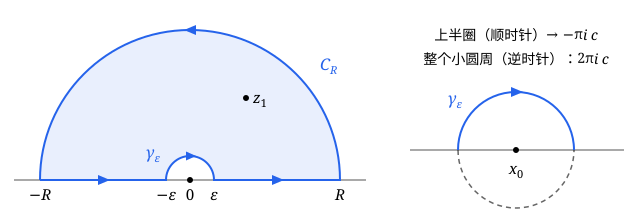

## 这一节要回答的问题

[原函数与不定积分](lesson:math.calculus.antiderivatives)一节第 8 题说过，$\frac{\sin x}x$的原函数写不成初等函数（elementary function），可$\int_0^{+\infty}\frac{\sin x}x\,\dd x$照样算得出来。照[若尔当引理与傅里叶型积分](lesson:math.complex-analysis.jordan-lemma)一节的办法，$\sin x$是$e^{ix}$的:term[虚部]{id="math.complex-analysis.imaginary-part"}（imaginary part），要积分的是$\frac{e^{iz}}z$。可它的:term[一阶极点]{id="math.complex-analysis.pole"}（simple pole）$0$正好在:term[实轴]{id="math.complex-analysis.real-axis"}（real axis）上，:term[围道]{id="math.complex-analysis.contour"}（contour）不能从极点上穿过去。

实积分里也碰到过这样的点：$\frac1x$在$0$两侧一正一负，「左右抵消」像是得$0$，可[无界函数的反常积分](lesson:math.calculus.improper-unbounded)一节说$\int_{-1}^1\frac{\dd x}x$发散。被积函数（integrand）在某一点附近像$\frac1{x-x_0}$那样无界时，「左右抵消」能不能算数？围道又该怎样绕开这一点？

## 讲解

### 柯西主值

[无界函数的反常积分](lesson:math.calculus.improper-unbounded)一节第 8 题算过：$\int_{-1}^{-\varepsilon}\frac{\dd x}x+\int_\varepsilon^1\frac{\dd x}x$对每个$\varepsilon$都是$0$，右侧改挖$k\varepsilon$，极限就成了$-\ln k$。挖法不同结果就不同，所以按[那一节的定义](lesson:math.calculus.improper-unbounded#def-interior-singular)，$\int_{-1}^1\frac{\dd x}x$发散。可两侧挖得一样长是最自然的挖法，:term[围道]{id="math.complex-analysis.contour"}在:term[实轴]{id="math.complex-analysis.real-axis"}上留下的也正是这样挖剩的几段（几何图像）。

::anchor{id="def-cauchy-pv"}
设$f$在$[a,b]$上除一点$x_0\in(a,b)$外都连续。如果$\varepsilon\to0^+$时$\int_a^{x_0-\varepsilon}f(x)\,\dd x+\int_{x_0+\varepsilon}^bf(x)\,\dd x$有极限，这个极限叫作$\int_a^bf(x)\,\dd x$的:term[柯西主值]{id="math.complex-analysis.cauchy-principal-value"}（Cauchy principal value），记作$\operatorname{P.V.}\int_a^bf(x)\,\dd x$；有几个这样的点时，每一点两侧都挖去$\varepsilon$。$f$在$(-\infty,+\infty)$上连续时，$R\to+\infty$时$\int_{-R}^Rf(x)\,\dd x$的极限也叫柯西主值，记作$\operatorname{P.V.}\int_{-\infty}^{+\infty}f(x)\,\dd x$。两样都有时，在$[-R,R]$上照前面挖去各点两侧，取$\varepsilon\to0^+$、$R\to+\infty$时的极限。

为什么这样定义：被积函数在$x_0$附近像$\frac c{x-x_0}$的那一部分，两侧挖得一样长时正好抵消。反常积分（improper integral）收敛时两侧各自有极限，柯西主值就等于它；反过来不成立，$\operatorname{P.V.}\int_{-1}^1\frac{\dd x}x$、$\operatorname{P.V.}\int_{-\infty}^{+\infty}\frac{x\,\dd x}{1+x^2}$都是$0$，反常积分却都发散（后者见[无穷区间上的反常积分](lesson:math.calculus.improper-integrals)一节的常见误区）。

边界情况：$\frac1{x^2}$在$0$两侧都是正的，$\int_{-1}^{-\varepsilon}\frac{\dd x}{x^2}+\int_\varepsilon^1\frac{\dd x}{x^2}=\frac2\varepsilon-2\to+\infty$，柯西主值不存在。$f$在$x_0$处有极限时（如$\frac{\sin x}x$在$0$处），补上这个值就连续，柯西主值就是普通的积分（[无界函数的反常积分](lesson:math.calculus.improper-unbounded#def-improper-unbounded)一节的边界情况）。

「主值」和:term[辐角主值]{id="math.complex-analysis.principal-argument"}（principal argument）、:term[对数主值]{id="math.complex-analysis.principal-logarithm"}（principal logarithm）、$z^a$的主值（[复对数与幂函数](lesson:math.complex-analysis.complex-logarithm#def-power)一节）不是一回事：那几个是从许多个值里取定一个，这里是从许多种挖法里取定对称的那一种。

### 小半圆引理

回到$\frac{e^{iz}}z$：:term[围道]{id="math.complex-analysis.contour"}沿:term[实轴]{id="math.complex-analysis.real-axis"}走到$-\varepsilon$时，改沿以$0$为圆心、半径为$\varepsilon$的上半圆周绕到$\varepsilon$（几何图像）。这一小段上的积分不会随$\varepsilon\to0^+$消失：$0$附近$\frac{e^{iz}}z\approx\frac1z$，而$\frac1z$沿这段半圆周的积分是$-\pi i$，和半径无关。

::anchor{id="thm-small-arc"}
**定理（小半圆引理，small semicircle lemma）**　设$x_0$是实数，$f$在:term[去心圆盘]{id="math.complex-analysis.punctured-disc"}（punctured disc）$0<|z-x_0|<r_0$上:term[全纯]{id="math.complex-analysis.holomorphic-function"}（holomorphic），$(z-x_0)f(z)$在$x_0$处补上一个值以后全纯（$x_0$是$f$的:term[一阶极点]{id="math.complex-analysis.pole"}时就是这样，见[极点的阶的定理](lesson:math.complex-analysis.singularities#thm-pole-order)），$f$在$x_0$处的:term[留数]{id="math.complex-analysis.residue"}（residue）是$c=\Res_{z=x_0}f(z)$。设$\gamma_\varepsilon$是上半小半圆$z=x_0+\varepsilon e^{it}$，$t$从$\pi$减小到$0$，即从$x_0-\varepsilon$沿顺时针走到$x_0+\varepsilon$（$0<\varepsilon<r_0$）。则$\varepsilon\to0^+$时$\int_{\gamma_\varepsilon}f(z)\,\dd z\to-\pi ic$。

**证明**：把补上值以后的$(z-x_0)f(z)$记作$g(z)$，由[极点处留数的定理](lesson:math.complex-analysis.residue-theorem#thm-residue-poles)（$m=1$），$g(x_0)=c$。$\gamma_\varepsilon$是$z=x_0+\varepsilon e^{it}$（$0\le t\le\pi$）反过来走，由[反向走积分变号](lesson:math.complex-analysis.contour-integrals#thm-contour-properties)，

$$
\int_{\gamma_\varepsilon}\frac{\dd z}{z-x_0}=-\int_0^\pi\frac{i\varepsilon e^{it}}{\varepsilon e^{it}}\,\dd t=-\pi i,
$$

所以$\int_{\gamma_\varepsilon}f(z)\,\dd z+\pi ic=\int_{\gamma_\varepsilon}\frac{g(z)-g(x_0)}{z-x_0}\,\dd z$。

任给$\delta>0$，$g$在$x_0$处连续，$\varepsilon$足够小时$\gamma_\varepsilon$上处处$|g(z)-g(x_0)|<\delta$，上式右边被积函数的:term[模]{id="math.complex-analysis.modulus"}（modulus）小于$\frac\delta\varepsilon$。$\gamma_\varepsilon$长$\pi\varepsilon$，由 :term[ML 不等式]{id="math.complex-analysis.ml-inequality"}（ML inequality），右边的模不超过$\pi\delta$。$\delta$可以任意小，所以$\int_{\gamma_\varepsilon}f(z)\,\dd z\to-\pi ic$。这和[复积分](lesson:math.complex-analysis.contour-integrals)一节第 6 题的证明一样，只是整个圆周换成了半个。

边界情况：引理管不了二阶极点。$\frac1{z^2}$的留数是$0$，可它沿上半圆周从$\varepsilon$逆时针走到$-\varepsilon$的积分是$\frac2\varepsilon$（[一个最重要的例子](lesson:math.complex-analysis.contour-integrals#thm-power-integral)后面的边界情况），沿$\gamma_\varepsilon$是$-\frac2\varepsilon$，$\varepsilon\to0^+$时趋于无穷：整圈上正负抵消成$0$，半圈抵消不掉。

### 实轴上有一阶极点的积分

把小半圆引理放进:term[围道]{id="math.complex-analysis.contour"}：分母在:term[实轴]{id="math.complex-analysis.real-axis"}上的每个根都用上半小半圆绕开，大半圆照旧（几何图像）。

::anchor{id="thm-pv-real"}
**定理**　设$P$、$Q$是实系数多项式，$Q$的实根$x_1,\dots,x_m$都是:term[单零点]{id="math.complex-analysis.order-of-zero"}（simple zero），$z_1,\dots,z_n$是$Q$在上半平面（upper half-plane）里互不相同的全部根；$\lambda\ge0$，$\lambda>0$时$Q$的次数至少比$P$的次数高$1$，$\lambda=0$时至少高$2$。记$f(z)=\frac{P(z)}{Q(z)}e^{i\lambda z}$，则$\operatorname{P.V.}\int_{-\infty}^{+\infty}f(x)\,\dd x$存在，并且等于$2\pi i\sum_{k=1}^n\Res_{z=z_k}f(z)+\pi i\sum_{j=1}^m\Res_{z=x_j}f(z)$。这里$f$在实轴上取的值一般不是实数，它的:term[柯西主值]{id="math.complex-analysis.cauchy-principal-value"}按:term[实部]{id="math.complex-analysis.real-part"}（real part）、:term[虚部]{id="math.complex-analysis.imaginary-part"}分别取。

**证明**：照[有理函数那条定理](lesson:math.complex-analysis.real-integrals#thm-rational-real)证明里的估计，有正数$\rho_0$、$K$，使$|z|\ge\rho_0$时$\bigl|\frac{P(z)}{Q(z)}\bigr|\le\frac K{|z|}$（$\lambda=0$时可以取成$\frac K{|z|^2}$），并且$Q$的根都满足$|z|<\rho_0$。取$R>\rho_0$，再取正数$\varepsilon$，小于各实根之间距离的一半，也小于$R-\rho_0$和各$z_k$的虚部。

从$-R$沿实轴走到$R$，在每个$x_j$处改走上半小半圆$\gamma_j$：$z=x_j+\varepsilon e^{it}$，$t$从$\pi$减小到$0$；再沿上半圆周$C_R$：$z=Re^{it}$（$0\le t\le\pi$）回到$-R$。这个围道围着$z_1,\dots,z_n$，$Q$的实根和下半平面（lower half-plane）的根都在外面，平面去掉这些根是包含围道和它围成的部分的:term[开集]{id="math.complex-analysis.open-set"}（open set）。记$I(\varepsilon,R)$是$[-R,R]$挖去各个$(x_j-\varepsilon,x_j+\varepsilon)$后剩下各段上$\int f(x)\,\dd x$之和，由:term[留数定理]{id="math.complex-analysis.residue-theorem"}（residue theorem），

$$
I(\varepsilon,R)+\sum_{j=1}^m\int_{\gamma_j}f(z)\,\dd z+\int_{C_R}f(z)\,\dd z=2\pi i\sum_{k=1}^n\Res_{z=z_k}f(z).
$$

$x_j$是$Q$的单零点，$Q(z)=(z-x_j)Q_j(z)$，$Q_j$是多项式，$Q_j(x_j)=Q'(x_j)\ne0$，所以$(z-x_j)f(z)=\frac{P(z)e^{i\lambda z}}{Q_j(z)}$在$x_j$附近:term[全纯]{id="math.complex-analysis.holomorphic-function"}；由小半圆引理，$\int_{\gamma_j}f(z)\,\dd z\to-\pi i\Res_{z=x_j}f(z)$。$C_R$上$|e^{i\lambda z}|\le1$：$\lambda>0$时$\bigl|\frac{P(z)}{Q(z)}\bigr|\le\frac KR\to0$，由:term[若尔当引理]{id="math.complex-analysis.jordan-lemma"}（Jordan's lemma），$\int_{C_R}f(z)\,\dd z\to0$；$\lambda=0$时由 :term[ML 不等式]{id="math.complex-analysis.ml-inequality"}，它的:term[模]{id="math.complex-analysis.modulus"}不超过$\frac K{R^2}\cdot\pi R\to0$。把上式移项，右边每一项只含$\varepsilon$、$R$中的一个，所以$\varepsilon\to0^+$、$R\to+\infty$时$I(\varepsilon,R)$趋于定理里的那个数。

为什么有用：实轴上的:term[一阶极点]{id="math.complex-analysis.pole"}只算「半个」，系数是$\pi i$，不是$2\pi i$，正好对应小半圆只绕了半圈。$Q$没有实根时，公式和[有理函数那条定理](lesson:math.complex-analysis.real-integrals#thm-rational-real)、[若尔当引理与傅里叶型积分](lesson:math.complex-analysis.jordan-lemma#thm-fourier-type)一节的定理一样；那两条还证明了积分本身收敛，柯西主值就等于它。

边界情况：实轴上有二阶极点就不行，$\frac1{x^2}$的柯西主值不存在，小半圆引理也不成立。

## 几何图像

左图是讲解里定理用的:term[围道]{id="math.complex-analysis.contour"}，:term[实轴]{id="math.complex-analysis.real-axis"}上的:term[极点]{id="math.complex-analysis.pole"}画在原点：小半圆$\gamma_\varepsilon$把它留在外面，上半平面的极点$z_1$在里面；实轴上留下的两段正是对称地挖去以后的积分。右图把$x_0$附近放大：逆时针的整个小圆周上积分是$2\pi i$乘:term[留数]{id="math.complex-analysis.residue"}$c$，$\gamma_\varepsilon$只走上半圈、方向又相反，所以趋于$-\pi ic$。

:::anim{component="function-plot"}
range: { x: [0, 40], y: [0, 2] }
functions:
  - expr: "sum(k, 1, 400, sin((k - 0.5)*x/400)/(k - 0.5))"
    label: |
      $\int_0^x\frac{\sin u}u\,\dd u$
  - expr: "pi/2"
    label: |
      $y=\frac\pi2$
:::

蓝线是$\int_0^x\frac{\sin u}u\,\dd u$（用$400$段的中点和算），橙线是$y=\frac\pi2$。蓝线在$x=\pi$处最高，约为$1.85$，以后在橙线上下摆动，摆幅像$\frac1x$那样慢慢变小：积分收敛到$\frac\pi2$（例 1），但收敛得很慢，靠的是$\sin u$正负交替带来的抵消（[无穷区间上的反常积分](lesson:math.calculus.improper-integrals)一节第 6 题：$\int_1^{+\infty}\frac{|\sin u|}u\,\dd u$发散）。

## 例题

### 例 1　$\frac{\sin x}x$在正半轴上的积分

求$\int_0^{+\infty}\frac{\sin x}x\,\dd x$。

**为什么想到这么做**：$\frac{\sin x}x$的原函数写不出来，换成:term[复积分]{id="math.complex-analysis.contour-integral"}（contour integral）。$\sin x$是$e^{ix}$的:term[虚部]{id="math.complex-analysis.imaginary-part"}，$\frac{e^{iz}}z$在:term[实轴]{id="math.complex-analysis.real-axis"}上的$0$处有:term[一阶极点]{id="math.complex-analysis.pole"}，就用讲解里的:term[围道]{id="math.complex-analysis.contour"}绕开它；大半圆上$\bigl|\frac1z\bigr|=\frac1R$，:term[ML 不等式]{id="math.complex-analysis.ml-inequality"}只给出上界$\pi$，要用:term[若尔当引理]{id="math.complex-analysis.jordan-lemma"}。围道给出的是对称挖去以后的极限；$\frac{\sin x}x$是偶函数（even function），这个极限存在就说明积分收敛（也可以直接由[无穷区间上的反常积分](lesson:math.calculus.improper-integrals)一节第 6 题看出）。

**推导**：$\frac{e^{iz}}z$在去掉$0$的平面上:term[全纯]{id="math.complex-analysis.holomorphic-function"}，$0$在围道外面，由:term[柯西积分定理]{id="math.complex-analysis.cauchy-theorem"}（Cauchy's integral theorem），

$$
\int_{-R}^{-\varepsilon}\frac{e^{ix}}x\,\dd x+\int_{\gamma_\varepsilon}\frac{e^{iz}}z\,\dd z+\int_\varepsilon^R\frac{e^{ix}}x\,\dd x+\int_{C_R}\frac{e^{iz}}z\,\dd z=0.
$$

第一个积分里令$x=-u$，它等于$-\int_\varepsilon^R\frac{e^{-iu}}u\,\dd u$，和第三个合起来是$\int_\varepsilon^R\frac{e^{ix}-e^{-ix}}x\,\dd x=2i\int_\varepsilon^R\frac{\sin x}x\,\dd x$。$0$处的:term[留数]{id="math.complex-analysis.residue"}是$\lim_{z\to0}z\cdot\frac{e^{iz}}z=1$，由小半圆引理，第二个积分趋于$-\pi i$；$C_R$上$\bigl|\frac1z\bigr|=\frac1R\to0$，由若尔当引理，第四个积分趋于$0$。令$\varepsilon\to0^+$、$R\to+\infty$，得$2i\int_0^{+\infty}\frac{\sin x}x\,\dd x=\pi i$，所以

$$
\int_0^{+\infty}\frac{\sin x}x\,\dd x=\frac\pi2.
$$

对称地挖，偶的虚部给出积分本身，奇的:term[实部]{id="math.complex-analysis.real-part"}只剩:term[柯西主值]{id="math.complex-analysis.cauchy-principal-value"}（常见误区第 1 条）。合起来正是讲解里定理的情形（$P=1$，$Q=x$，$\lambda=1$）：$\operatorname{P.V.}\int_{-\infty}^{+\infty}\frac{e^{ix}}x\,\dd x=\pi i\cdot1$。

### 例 2　实轴上和上半平面都有极点

求$\operatorname{P.V.}\int_{-\infty}^{+\infty}\frac{\dd x}{(x-1)(x^2+1)}$。

**为什么想到这么做**：分母在:term[实轴]{id="math.complex-analysis.real-axis"}上有单根$1$，在上半平面有根$i$，分母比分子高$3$次，正好用讲解里的定理（$\lambda=0$）。$1$附近被积函数像$\frac1{2(x-1)}$，两侧的积分各自发散，只能求:term[柯西主值]{id="math.complex-analysis.cauchy-principal-value"}。

**推导**：$1$是:term[一阶极点]{id="math.complex-analysis.pole"}，:term[留数]{id="math.complex-analysis.residue"}是$\lim_{z\to1}\frac1{z^2+1}=\frac12$；$i$处的留数是$\frac1{(i-1)\cdot2i}=-\frac1{2+2i}=-\frac{1-i}4$。由定理，

$$
\operatorname{P.V.}\int_{-\infty}^{+\infty}\frac{\dd x}{(x-1)(x^2+1)}=2\pi i\cdot\Bigl(-\frac{1-i}4\Bigr)+\pi i\cdot\frac12=-\frac{\pi+\pi i}2+\frac{\pi i}2=-\frac\pi2.
$$

用部分分式（partial fractions）核对：写成$\frac A{x-1}+\frac{Bx+C}{x^2+1}$，通分以后比较分子，得$A=\frac12$，$B=C=-\frac12$。$R>1$时，$\int_{-R}^{1-\varepsilon}\frac{\dd x}{x-1}+\int_{1+\varepsilon}^R\frac{\dd x}{x-1}=\ln\frac{R-1}{R+1}\to0$，$\int_{-R}^R\frac{x\,\dd x}{x^2+1}=0$，$\int_{-R}^R\frac{\dd x}{x^2+1}=2\arctan R\to\pi$，所以柯西主值是$\frac12\cdot0-\frac12(0+\pi)=-\frac\pi2$，一致。

## 常见误区

- 「:term[柯西主值]{id="math.complex-analysis.cauchy-principal-value"}存在，反常积分就收敛。」主值只看对称的挖法，两侧各自发散时，也可能互相抵消。$\frac{\cos x}x$是奇函数（odd function），$\operatorname{P.V.}\int_{-\infty}^{+\infty}\frac{\cos x}x\,\dd x=0$，可在$(0,1]$上$\frac{\cos x}x\ge\frac{\cos1}x$，$\int_0^1\frac{\cos x}x\,\dd x$发散，所以这个反常积分发散。
- 「:term[实轴]{id="math.complex-analysis.real-axis"}上的:term[一阶极点]{id="math.complex-analysis.pole"}不在:term[围道]{id="math.complex-analysis.contour"}里面，算柯西主值时不用管它。」它确实在围道外面，可绕开它的小半圆上的积分趋于$-\pi i$乘:term[留数]{id="math.complex-analysis.residue"}，一阶极点的留数不是$0$，这一项也就不是$0$。漏掉它，例 1 会得出$\int_0^{+\infty}\frac{\sin x}x\,\dd x=0$。
