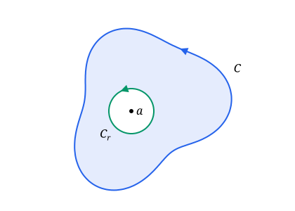

## 这一节要回答的问题

:term[复积分]{id="math.complex-analysis.contour-integral"}（contour integral）一般和路径有关，$\bar z$从$0$积到$1+i$，换一条路结果就变了；$z^2$换路却不变。什么样的函数沿闭曲线的积分为$0$？$\oint_{|z|=1}\frac{\dd z}z=2\pi i$不为$0$，又该怎样理解？

## 讲解

### 柯西积分定理

::anchor{id="thm-cauchy"}
**定理（:term[柯西积分定理]{id="math.complex-analysis.cauchy-theorem"}，Cauchy's integral theorem）**　设$C$是分段光滑（piecewise smooth）的简单闭曲线（simple closed curve），$\bar D$是$C$连同它围成的部分，$f$在一个包含$\bar D$的:term[开集]{id="math.complex-analysis.open-set"}（open set）上:term[全纯]{id="math.complex-analysis.holomorphic-function"}（holomorphic），并且$f'$连续。则$\oint_Cf(z)\,\dd z=0$。

**证明**：取$C$的正向（positive orientation），即沿$C$走时它围成的部分在左手边；反方向只差一个符号。记$f=u+iv$。由:term[柯西-黎曼方程]{id="math.complex-analysis.cauchy-riemann-equations"}（Cauchy-Riemann equations），$u_x=\Re f'$，$v_x=\Im f'$，$u_y=-v_x$，$v_y=u_x$，所以四个偏导数（partial derivative）都连续，可以用[格林公式](lesson:math.vector-calculus.greens-theorem)（Green's theorem）：

$$
\begin{aligned}
\oint_C(u\,\dd x-v\,\dd y)&=\iint_D(-v_x-u_y)\,\dd x\,\dd y=0,\\
\oint_C(v\,\dd x+u\,\dd y)&=\iint_D(u_x-v_y)\,\dd x\,\dd y=0,
\end{aligned}
$$

两个被积函数（integrand）都由柯西-黎曼方程变成了$0$。而$\oint_Cf\,\dd z$正是第一个积分加上$i$乘第二个积分，所以为$0$。

为什么有用：定理里要求$f'$连续，只是为了能用格林公式；[古尔萨定理](lesson:math.complex-analysis.goursat)、[柯西积分公式](lesson:math.complex-analysis.cauchy-integral-formula)和[高阶导数与莫雷拉定理](lesson:math.complex-analysis.higher-derivatives)三节会证明全纯函数的导数自动连续，那时这个条件就去掉了。它说明了[复积分](lesson:math.complex-analysis.contour-integrals)一节例 1 里的现象：$z^2$是:term[整函数]{id="math.complex-analysis.entire-function"}（entire function），沿两条路积分之差是沿一条闭曲线的积分，为$0$；$\bar z$不满足柯西-黎曼方程，定理管不到它。边界情况：$f$在$C$上全纯还不够，$C$围成的部分里也要处处全纯：$\frac1z$在单位圆周上全纯，可原点在圆内，$\oint_{|z|=1}\frac{\dd z}z=2\pi i$。

### 变形积分路径

::anchor{id="thm-deformation"}
**定理**　设$C_1$、$C_2$是分段光滑的简单闭曲线，都取逆时针方向，$C_2$在$C_1$围成的部分里面；$f$在一个:term[开集]{id="math.complex-analysis.open-set"}上:term[全纯]{id="math.complex-analysis.holomorphic-function"}、$f'$连续，这个开集包含两条曲线和它们之间的部分。则$\oint_{C_1}f\,\dd z=\oint_{C_2}f\,\dd z$。

**证明**：记$R$是两条曲线之间的部分。格林公式对$R$也成立，这时边界的正向是外圈$C_1$逆时针、内圈$C_2$顺时针（[格林公式](lesson:math.vector-calculus.greens-theorem)第 6 题的:term[圆环]{id="math.complex-analysis.annulus"}（annulus）论证）。照上面的证明，沿$R$的整个边界的积分为$0$，即$\oint_{C_1}f\,\dd z-\oint_{C_2}f\,\dd z=0$。

为什么有用：积分路径可以在全纯的范围里随意变形，只要不越过$f$不全纯的点。特别地，设$C$是分段光滑的简单闭曲线，逆时针方向，点$a$在$C$围成的部分里面，取一个小圆$C_r$：$|z-a|=r$落在$C$里面，由这个定理和[一个最重要的例子](lesson:math.complex-analysis.contour-integrals#thm-power-integral)，$\oint_C\frac{\dd z}{z-a}=\oint_{C_r}\frac{\dd z}{z-a}=2\pi i$；$a$在$C$外面时，由:term[柯西积分定理]{id="math.complex-analysis.cauchy-theorem"}，这个积分是$0$。闭曲线不必简单时，$\oint_C\frac{\dd z}z$的:term[实部]{id="math.complex-analysis.real-part"}（real part）是$\oint_C\frac{x\,\dd x+y\,\dd y}{x^2+y^2}$，它是$\ln\sqrt{x^2+y^2}$的全微分（total differential）沿闭曲线的积分，为$0$；:term[虚部]{id="math.complex-analysis.imaginary-part"}（imaginary part）是$\oint_C\frac{-y\,\dd x+x\,\dd y}{x^2+y^2}$，由[保守场与路径无关](lesson:math.vector-calculus.conservative-fields)第 8 题，等于$2\pi$乘$C$绕原点的圈数，所以$\oint_C\frac{\dd z}z$等于$2\pi i$乘:term[绕数]{id="math.complex-analysis.winding-number"}（winding number）。

### 原函数

::anchor{id="def-antiderivative"}
设$f$在:term[开集]{id="math.complex-analysis.open-set"}$D$上连续。如果$D$上有:term[全纯函数]{id="math.complex-analysis.holomorphic-function"}（holomorphic function）$F$，使$F'=f$，就说$F$是$f$在$D$上的:term[原函数]{id="math.complex-analysis.antiderivative"}（antiderivative）。

为什么这样定义：和实函数一样，$f$的原函数就是求导以后得到$f$的函数；要求$F$在开集上全纯，是因为在一点求导要用到它周围一整圈的值，下面的定理还要沿$D$里的曲线对$F(z(t))$求导。边界情况：原函数加上任何常数仍是原函数；$D$不连成一片时，还可以在每一块上加不同的常数，例如$D$是两个不相交的圆盘、$f=0$时，在一个圆盘上取$F=0$、另一个圆盘上取$F=1$，这个$F$也是原函数。

::anchor{id="thm-antiderivative-integral"}
**定理**　设$F$是$f$在开集$D$上的原函数，$C$是$D$里从$A$到$B$的分段光滑曲线，则$\int_Cf(z)\,\dd z=F(B)-F(A)$；特别地，沿$D$里任何闭曲线的积分为$0$。

**证明**：设$C$是$z(t)$，$a\le t\le b$。由沿曲线的[求导法则](lesson:math.complex-analysis.complex-derivative#thm-derivative-rules)，$\frac{\dd}{\dd t}F(z(t))=F'(z(t))z'(t)=f(z(t))z'(t)$。对:term[复值函数]{id="math.complex-analysis.complex-valued-function"}（complex-valued function）用牛顿-莱布尼茨公式（Newton-Leibniz formula），$\int_Cf\,\dd z=\int_a^b\frac{\dd}{\dd t}F(z(t))\,\dd t=F(z(b))-F(z(a))$。分段光滑时各段相加，中间的端点抵消。

为什么有用：有了原函数，:term[复积分]{id="math.complex-analysis.contour-integral"}就像定积分（definite integral）一样算，而且只看起点和终点，这里不要求$C$围成的部分都在$D$里。$\frac1{z^2}$在去掉原点的平面上有原函数$-\frac1z$，所以沿任何不过原点的闭曲线，$\oint\frac{\dd z}{z^2}=0$。边界情况：$\oint_{|z|=1}\frac{\dd z}z=2\pi i\ne0$，所以$\frac1z$在去掉原点的平面上没有原函数，那里找不到一个处处全纯、导数是$\frac1z$的「对数」，以后讲:term[复对数]{id="math.complex-analysis.complex-logarithm"}（complex logarithm）时还会碰到这件事。

## 几何图像

蓝色的是简单闭曲线$C$，绿色的是绕着$a$的小圆周$C_r$，两者都取逆时针方向。$f$在浅蓝色的部分里和两条曲线上:term[全纯]{id="math.complex-analysis.holomorphic-function"}时，$\oint_Cf\,\dd z=\oint_{C_r}f\,\dd z$：可以把$C$一点点收缩成$C_r$，只要不越过$f$不全纯的点。$a$处$f$可以不全纯，比如$f(z)=\frac1{z-a}$，积分仍然从$C$搬到了$C_r$上，算出来是$2\pi i$。

## 例题

### 例 1　拆开再变形

设$C$是圆周$|z-i|=1$，逆时针方向。求$\oint_C\frac{\dd z}{z^2+1}$。

**为什么想到这么做**：$\frac1{z^2+1}$在$\pm i$处不:term[全纯]{id="math.complex-analysis.holomorphic-function"}，$i$在$C$里面，$-i$在外面。拆成两项之差，每一项要么用$\oint\frac{\dd z}{z-a}=2\pi i$，要么用:term[柯西积分定理]{id="math.complex-analysis.cauchy-theorem"}。

**推导**：$\frac1{z^2+1}=\frac1{2i}\Bigl(\frac1{z-i}-\frac1{z+i}\Bigr)$。$i$在$C$里面，$\oint_C\frac{\dd z}{z-i}=2\pi i$；$-i$到$i$的距离是$2$，在$C$外面，$\frac1{z+i}$在$C$和它围成的部分上全纯，积分为$0$。所以

$$
\oint_C\frac{\dd z}{z^2+1}=\frac1{2i}(2\pi i-0)=\pi.
$$

### 例 2　用原函数算积分

求$\int_Cze^{z^2}\,\dd z$，$C$是从$0$到$1+i$的任意分段光滑曲线。

**为什么想到这么做**：$\frac12e^{z^2}$的导数是$ze^{z^2}$，它是:term[整函数]{id="math.complex-analysis.entire-function"}，是$ze^{z^2}$在整个平面上的:term[原函数]{id="math.complex-analysis.antiderivative"}，积分只看两端。

**推导**：$(1+i)^2=2i$，所以

$$
\int_Cze^{z^2}\,\dd z=\frac12\bigl(e^{2i}-1\bigr)=\frac{\cos2-1}2+\frac{\sin2}2i\approx-0.708+0.455i.
$$

## 常见误区

- 「沿闭曲线的:term[复积分]{id="math.complex-analysis.contour-integral"}总是$0$。」:term[柯西积分定理]{id="math.complex-analysis.cauchy-theorem"}要$f$在曲线围成的部分里也处处:term[全纯]{id="math.complex-analysis.holomorphic-function"}；不满足时积分可能不是$0$，比如$\oint_{|z|=1}\frac{\dd z}z=2\pi i$，也可能仍是$0$，比如$\oint_{|z|=1}\frac{\dd z}{z^2}=0$。
- 「$f$在曲线$C$上全纯，$\oint_Cf\,\dd z$就是$0$。」$C$围成的部分里有$f$不全纯的点时一般不是$0$，$\frac1z$沿单位圆周就是例子。
- 「$\oint_C\frac{\dd z}{z-a}=2\pi i$只对圆周成立。」任何逆时针的分段光滑简单闭曲线，只要把$a$围在里面，积分都是$2\pi i$；$a$在外面时是$0$。
